# Appendix

## Appendix 1: Google Form

This appendix shows the Google Form used for the EasyEarn User Requirement Survey. Information on users&#39; requirements and extra feedback was gathered using the questionnaire, which also asked for respondents&#39; background data, their job searches, and their experiences of being hired or not.

Questionnaire:

https://forms.gle/28utP2sdZZ9MFvBbA

Response:

https://docs.google.com/spreadsheets/d/1whp2KaGWr0da-I7iLeo3lDQ6lxSiMdyb/edit?usp=sharing&amp;ouid=102370839147916344868&amp;rtpof=true&amp;sd=true

## Appendix 2: EasyEarn Job Matching Portal

This appendix provides a link to the deployed EasyEarn Job Matching Portal for direct access to the implemented system.

https://peiying040830.github.io/easyearn/

## Appendix 3: System Testing

This appendix provides the detailed System Testing test cases and supporting evidence that are not presented in Section 4.3.1. System Testing was conducted across seven categories: E2E Workflow, Integration, Performance, Recovery, Business Logic, Reporting and Compliance. A total of 34 System Testing test cases (ST-001 to ST-034) were executed, and all 34 achieved a Pass result in the final testing round. A representative case from each of these categories is included in Section 4.3.1, and the other test cases and evidence are grouped by category in Appendix 3.1 to Appendix 3.7. The complete System Testing evidence is available at:

https://docs.google.com/spreadsheets/d/1t0kEYQJqHQSiiJkLfzPzEq97Lbfq-3IL/edit?usp=drive_link&amp;ouid=102370839147916344868&amp;rtpof=true&amp;sd=true

###  Appendix 3.1 E2E Workflow

This appendix provides the remaining E2E Workflow System Testing test cases that are not presented in Section 4.3.1.1. These test cases provide supporting evidence for complete EasyEarn workflows involving the Job Seeker, Employer and Admin roles. The representative test case, ST-003: Hire-to-Completion Flow, is presented in Section 4.3.1.1, while the additional E2E Workflow test cases are provided below.

Test ID: ST-001 Job Seeker Registration to Application

A new Job Seeker account was successfully registered and logged in during the test. Location, skills and availability were entered and saved successfully. The Profile page was reopened, and the saved information was still present. The Job Seeker then applied for the SugarShine job, and the application appeared under My Applications with a Pending status. The Pending status was correctly displayed even after the page was refreshed. The workflow to register an application is now complete as illustrated in Figure A3.1.

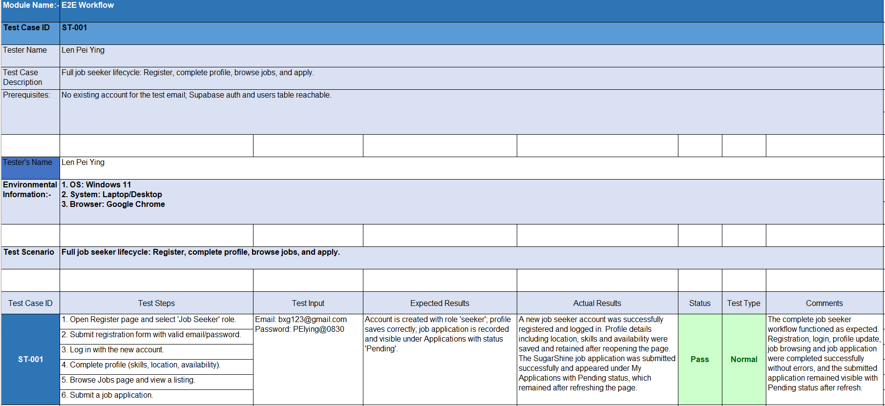

Figure A3.1: Job Seeker Registration to Application

 

Test ID: ST-002 Employer Registration to Applicant Review

A new Employer job listing was successfully created during the test and initially appeared with a Pending Review status. After the Admin approved the listing, it became visible to Job Seekers. A Job Seeker then submitted an application for the approved job, and a new-application notification was generated for the Employer. The Employer reviewed the application, and its status changed to Reviewed. The updated Reviewed status was also correctly reflected on the Job Seeker&#39;s My Applications page. Completed Employer registration-to-applicant-review workflow shown in Figure A3.2.

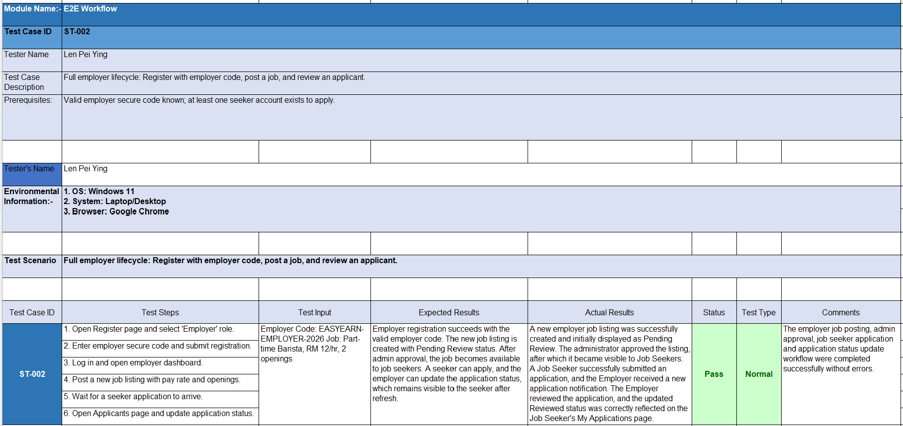

Figure A3.2: Employer Registration to Applicant Review

Test ID: ST-004 Admin Moderation Lifecycle

A suspicious job report was successfully submitted by a Job Seeker and appeared on the Admin Reports page. The Admin reviewed the report, removed the related job listing and resolved the submitted report. The status of the report was changed to Resolved, and the deleted job no longer appeared in the active list of jobs available to Job Seekers. The Admin moderation lifecycle is shown in Figure A3.3.

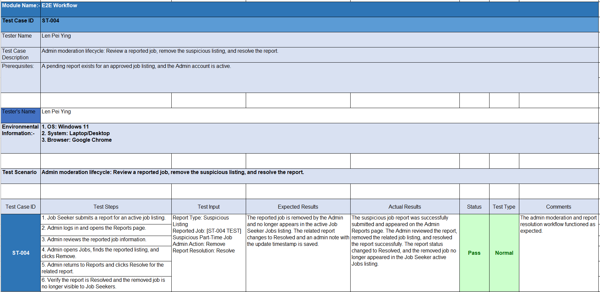

Figure A3.3: Admin Moderation Lifecycle

Test ID: ST-005 Payment Lifecycle

The Employer successfully confirmed work completion and payment for the accepted application during the test. The application status then changed to Completion Pending. After the Job Seeker confirmed receipt of the payment, the application status was updated to Completed. The completed job was also recorded in the Job Seeker&#39;s Work History together with the corresponding earnings. The final payment lifecycle is in Figure A3.4.

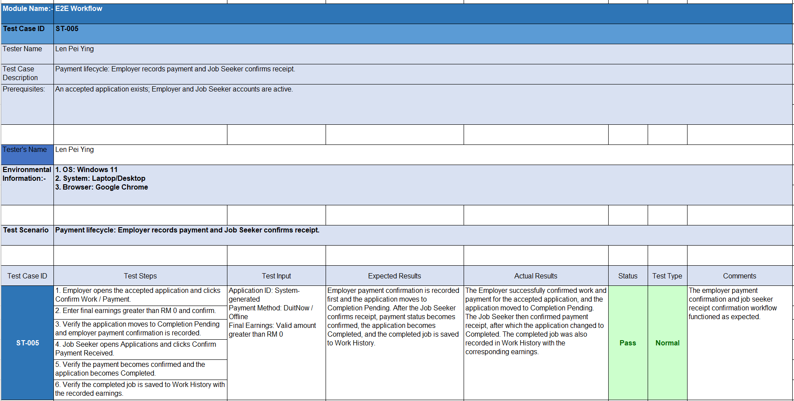

Figure A3.4: Payment Lifecycle

Test ID: ST-006 Payment Dispute and Resolution

The Job Seeker successfully submitted a payment dispute during the test. The dispute appeared on the Admin Reports page with the correct application and payment information. The Admin reviewed and resolved the dispute, and its status was updated to Resolved. The payment and application details were correctly linked to the dispute process. Figure A3.5 shows the payment-dispute and resolution workflow.

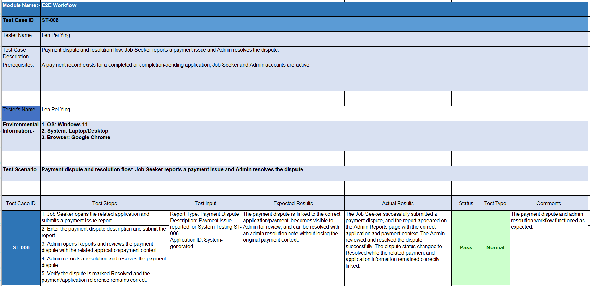

Figure A3.5: Payment Dispute and Resolution

### Appendix 3.2 Integration

This appendix provides the remaining Integration System Testing test cases that are not presented in Section 4.3.1.2. These test cases provide supporting evidence for interactions among the EasyEarn frontend, Supabase database, database triggers, notifications, Employer verification workflow, asynchronous messaging, chatbot knowledge base and saved-job functions. The representative test case, ST-007: Application CRUD and openings_count Trigger, is presented in Section 4.3.1.2, while the additional Integration test cases are provided below.

Test ID: ST-008 New-Application Notification Trigger

After the Job Seeker submitted a new application, a notification was successfully generated for the correct Employer. The notification initially appeared as unread in the Employer&#39;s notification panel. The status of the notification was updated to read after it was viewed or checked, which is the correct status. Figure A3.6 shows the new-application notification generated during the test.

Figure A3.6: New-application Notification Trigger

Test ID: ST-009 Employer Verification Workflow

The employer verified a package that included business details and documents. The verification request appeared on the Admin Verifications page and was successfully approved by the Admin. The Employer&#39;s verification status changed to Approved, and the verification badge appeared on the respective Employer and job views once it was approved. Figure A3.7 shows the completed Employer verification workflow.

Figure A3.7: Employer Verification Workflow

Test ID: ST-010 Messaging Integration

The Employer successfully sent a message to the Job Seeker, and the message appeared in the correct conversation thread. When the Job Seeker opened the conversation, the unread-message indicator appeared. The Job Seeker then replied to the Employer, and the response was correctly displayed in the Employer&#39;s conversation view. The history of the conversation was also accessible following the exchange of messages. The result of the messaging integration is displayed in Figure A3.8.

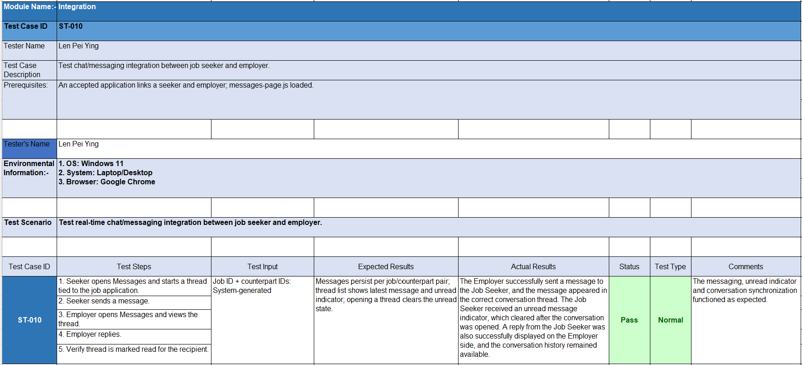

Figure A3.8: Messaging Integration

Test ID: ST-011 Chatbot Knowledge Base Integration

The rule-based chatbot successfully returned the expected knowledge-base response for the recognised question, “How do I apply for a job?”. An unrelated question, “What is the weather on Mars today?”, was then entered to evaluate the fallback behaviour. The chatbot didn&#39;t produce any error and returned the expected support message instead. Recognised-query and fallback-query were thus utilised as planned. The result of integrating the Knowledge Base in the Chatbot is shown in Figure A3.9.

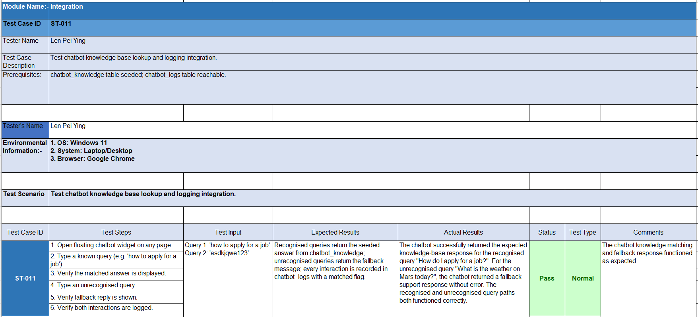

Figure A3.9: Chatbot Knowledge Base Integration

Test ID: ST-012 Saved Jobs Integration

The Job Seeker successfully saved a job during the test, and the Saved Jobs count increased accordingly. The selected job appeared in the Saved Jobs list. After the Job Seeker removed the saved job, it disappeared from the list and the Saved Jobs count decreased accordingly. Figure A3.10 shows the save and remove behaviour of the Saved Jobs function.

Figure A3.10: Saved Jobs Integration

### Appendix 3.3 Performance

This appendix provides the remaining Performance System Testing test cases that are not presented in Section 4.3.1.3. The tests evaluated selected time-sensitive and data-processing operations, including Jobs page loading and filtering, PDF resume generation and Admin Analytics rendering. The representative test case, ST-014: Concurrent Application Race Condition, is presented in Section 4.3.1.3, while the additional Performance test cases are provided below.

Test ID: ST-013 Jobs Page Load and Filter Performance

The Job Seeker Jobs page had no interface freezing observed. Chrome DevTools recorded 79 requests, 3.0 MB transferred, 3.8 MB of resources and a total finish time of 1.11 seconds. The results were shown without delay or interface freezing after applying a job filter. The test therefore achieved a Pass result. Figure A3.11 shows the Jobs page load and filter performance result.

Figure A3.11: Jobs Page Load and Filter Performance

Test ID: ST-015 PDF Resume Generation Performance

The PDF resume generation function was tested using the Job Seeker Resume page. The PDF was successfully created in about 2.56 seconds, which is within the 3-second target. After the generated PDF was opened, the profile information, skills, education and work history were displayed correctly without clipped text, missing content or layout problems. The test therefore achieved a Pass result. Figure A3.12 shows the PDF resume generation performance result.

Figure A3.12: PDF Resume Generation Performance

Test ID: ST-016 Admin Analytics Dashboard Render Time

The Admin Analytics Dashboard loaded successfully during the performance test. Chrome DevTools recorded a total finish time of 1.86 seconds, with 75 requests, 5.0 MB transferred and 6.1 MB of resources. No observable interface freezing or display problems occurred while the summary cards and Chart.js visualisations were rendered. The test therefore achieved a Pass result. Figure A3.13 shows the Admin Analytics Dashboard performance result.

Figure A3.13: Admin Analytics Dashboard Render Time

### Appendix 3.4 Recovery

This appendix provides the remaining Recovery System Testing test cases that are not presented in Section 4.3.1.4. The tests verified the stability and consistency of data state in case of loss of connectivity, interruption of a session and repeated payment operations. The representative test case, ST-019: Failed Application Submission Rollback, is presented in Section 4.3.1.4, while the additional Recovery test cases are provided below.

ST-017: Supabase Connectivity Loss Handling

Network connectivity was disabled while a Job Seeker attempted to submit a job application. The application was not submitted, and the message “Unable to submit application. Please try again” was displayed. The page stayed up and did not crash or become blank, but the submit control did not go away after the failed attempt and stayed in the “Submitting...” state. Network connection was restored and the Job Seeker tried the application again successfully. Figure A3.14 shows the behaviour observed during the connectivity-loss test.

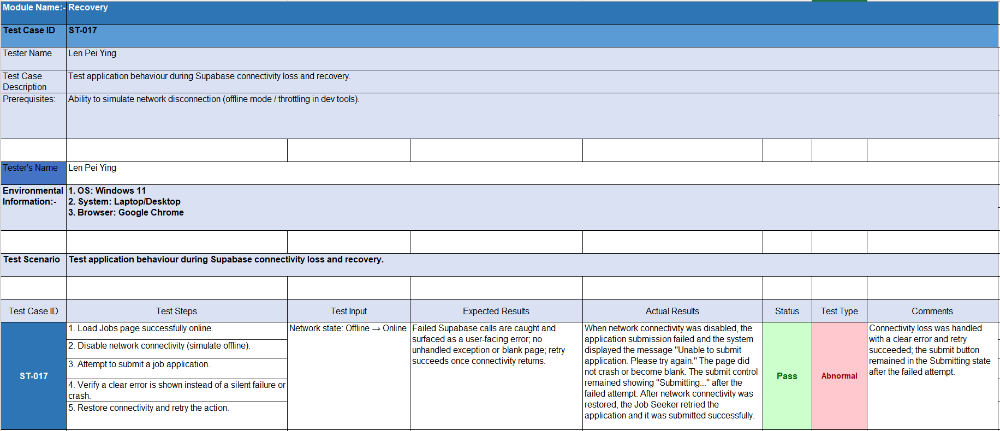

Figure A3.14: Supabase Connectivity Loss Handling

Test ID: ST-018 Session Expiry and Re-authentication

The authentication session in the store was flushed during testing. After the session was removed, the protected Job Seeker page was no longer accessible, and the user was redirected to the Login page. No protected application data was shown without an authenticated session. Once the user logged in again with valid credentials, access to the Dashboard and Applications page was restored. Figure A3.15 shows the session-expiry and re-authentication behaviour.

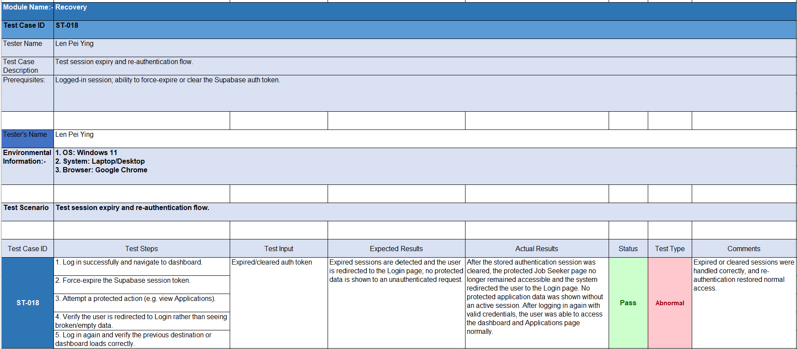

Figure A3.15: Session Expiry and Re-authentication

Test ID: ST-020 Duplicate Payment Prevention on Retry

The Employer successfully confirmed payment for the tested application. After the confirmation was completed, the payment control was locked and could not be submitted again. One of the payment records was found in the database with RM200. No duplicate payment record was made. The payment record and duplicate-payment prevention behaviour observed during the test are displayed in Figure A3.16.

Figure A3.16: Duplicate Payment Prevention on Retry

### Appendix 3.5 Business Logic

This appendix provides the remaining Business Logic System Testing test cases that are not presented in Section 4.3.1.5. The tests were designed to assess important EasyEarn business rules such as Job Match calculations, location-distance bonuses, rating eligibility, moderation classification and the action of the Employer Verification Badge. The below Business Logic test cases are presented in Section 4.3.1.5 as an additional test case to ST-023: Application Status Transition Constraints.

Test ID: ST-021 Match Score Calculation Accuracy

Five skills were listed for the Cashier job, and four matched the skills recorded in the tested Job Seeker profile. The system correctly showed an 80% Match score. The skills were divided so that Cash Handling, POS Systems, Customer Service and Friendly Communication were matched skills and Attention to Detail was a skill to build. After all Job Seeker skills were removed and the Jobs page was refreshed, the match badge changed to “New” instead of displaying 0%. Figure A3.17 shows the calculated match score and “New” badge behaviour.

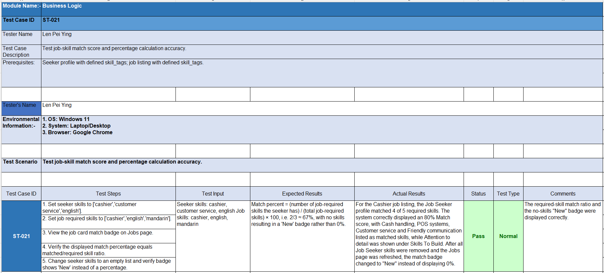

Figure A3.17: Match Score Calculation Accuracy

 

Test ID: ST-022 Location-Distance Bonus and Match Cap

The tested job initially displayed an 85% Match score without a location-distance bonus. The Near Me setting was turned on, and the job was displayed as about 2.9 km away, and the bonus for being close to the location was applied. The Match score rose to 99%, but not beyond the set match-score limit. Figure A3.18 shows the Match score before and after the location-distance bonus was applied.

Figure A3.18: Location-distance Bonus and Match Cap

Test ID: ST-024 Bidirectional Rating Eligibility

The rating action was not available for an application that had not reached Completed status. A completed application had a valid rating already submitted in the completed workflow. The application was then presented as Rated and there was no further rating action possible on the tested interface. The test confirmed that rating was only available after the job was completed, and that a second rating action was not offered after the job was rated. Figure A3.19 shows the tested rating-eligibility behaviour.

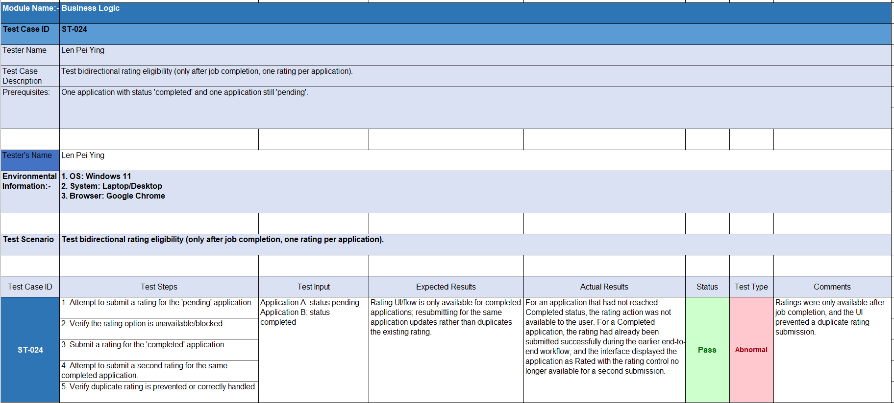

Figure A3.19: Bidirectional Rating Eligibility

Test ID: ST-025 Admin Moderation Queue Classification

The Pending Review, Flagged and Removed filters on the Admin Jobs page displayed job listings under their corresponding moderation statuses. The visible moderation queue was updated properly when the filter was changed. Summary counts were the same as the listings shown under the tested status categories. Figure A3.20 shows the status-filter behaviour and Admin moderation queue.

Figure A3.20: Admin Moderation Queue Classification

Test ID: ST-026 Employer Verification Badge Visibility

Verified Employers consistently showed the verification badge on the Employer Dashboard and relevant job postings. When an unverified Employer was viewed, the verification badge was not displayed. Hence, the visibility of the badge is consistent with the status of the Employer in the different views tested. Figure A3.21 shows the verification-badge behaviour for verified and unverified Employers.

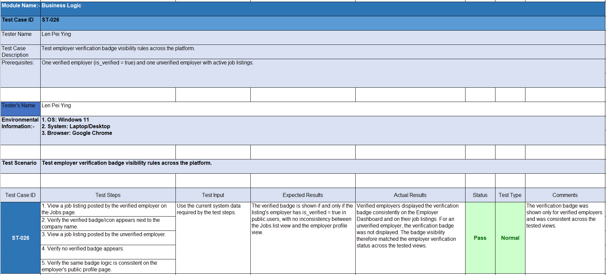

Figure A3.21: Employer Verification Badge Visibility

### Appendix 3.6 Reporting

This appendix provides the remaining Reporting System Testing test cases that are not presented in Section 4.3.1.6. The tests evaluated whether information displayed in EasyEarn reports, dashboards and calculated summaries was consistent with the underlying stored data. The additional tests covered job-listing reports, Job Seeker work history and earnings, and Employer job-posting performance. The representative test case is shown in Section 4.3.1.6: Admin Analytics Dashboard Accuracy.

Test ID: ST-028 Job Listing Reporting Feature

The Job Seeker successfully submitted a suspicious-job report during the test. The report appeared on the Admin Reports page with the correct Job Seeker as the reporter, the correct reported job and Employer reference, the submitted description and an initial Pending status. The Admin was then able to review and resolve the report successfully. Figure A3.22 shows the submitted report and corresponding Admin record.

Figure A3.22: Job Listing Report Feature

Test ID: ST-029 Work History and Earnings Report

The Work History page displayed one Completed job with Total Earnings of RM120. The Part-Time Barista &amp; Caf&#233; Crew application has been verified as Completed in the database with a confirmed payment of RM120. The Cashier application was not completed and was not included in the Work History completed. A query to the database with the same completion and payment constraints yielded one completed job with RM120 earned, which corresponds to the values on the page. Figure A3.23 shows the verified Work History and earnings information.

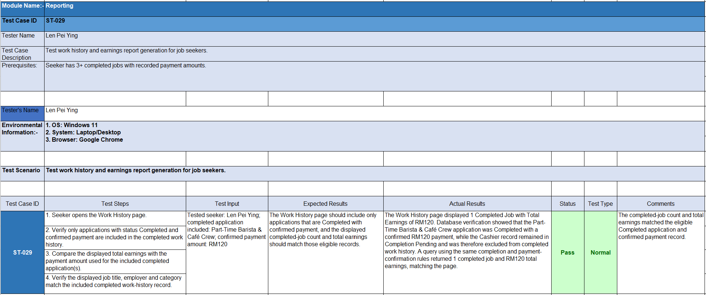

Figure A3.23: Work History and Earnings Report

Test ID: ST-030 Employer Job Posting Performance View

The Employer Manage Jobs page showed applicant and opening numbers consistent with the database records. The listing for “[ST-002 TEST] Part-time Barista” showed two people for the position and no vacancy, which is the same information in the database. The Event Crew (F&amp;B Booth - SugarShine) listing showed one applicant and two vacancies, which was consistent with the database records.  After the ST-002 test listing was closed, its status changed to Closed, the summary reflected one closed listing and the available action changed to Reopen. Figure A3.24 shows the verified Employer job-posting performance information.

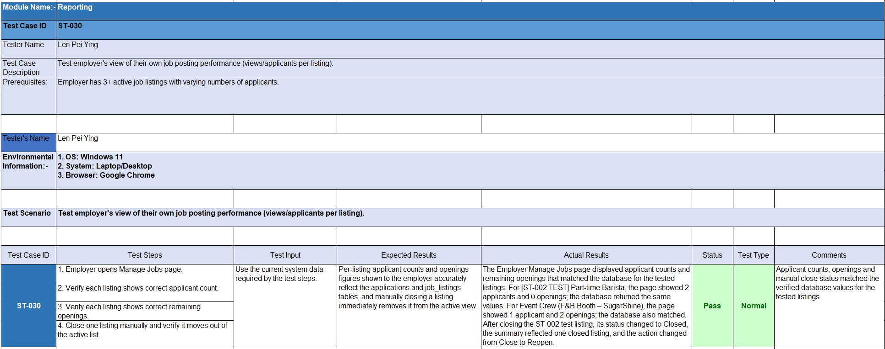

Figure A3.24: Employer Job Posting Performance View

### Appendix 3.7 Compliance

This appendix provides the remaining Compliance-related System Testing test cases that are not presented in Section 4.3.1.7. The tests included selected EasyEarn controls pertaining to privacy, transparency and user protection, such as access to the Privacy Policy and Terms of Service, administrative audit records, and reminders of compliance with the policy and awareness of the user. These tests were used to assess selected implemented controls and were not intended to be legal or regulatory certification. The representative test case, ST-032: PDPA-Aligned Document Handling, is presented in Section 4.3.1.7, while the remaining test cases are provided below.

Test ID: ST-031 Privacy Policy and Terms of Service Accessibility

A consent and privacy notice was displayed on the Registration page before account creation. The notice explained the collection and use of account and profile information for EasyEarn services and stated that the data would be stored using Supabase. Working links to the Privacy Policy and Terms of Service were provided in the notice. Policy pages were loaded, and the same links were present in the shared website footer. Figure A3.25 shows the privacy notice and policy-accessibility result.

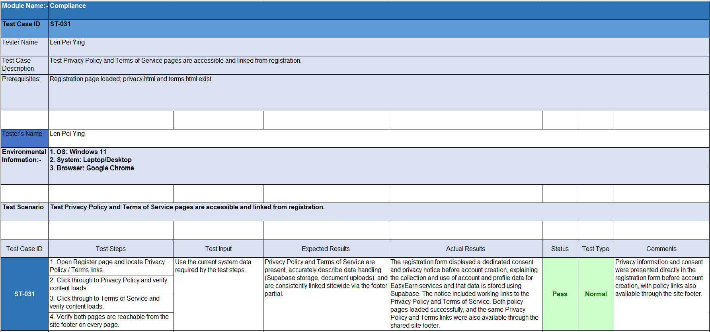

Figure A3.25: Privacy Policy and Terms of Service Accessibility

Test ID: ST-033 Admin Audit Trail for Account Decisions

The Admin locked the ABCD Job Seeker account during the test, and the account status changed to Locked. After the user logged out, a subsequent login attempt was blocked with the message “Your account has been locked by the administrator. Please contact support.” The Admin then unlocked the account; the status became Active, and the login was restored. The Admin also rejected the CarePlus Employer verification request. The Employer view showed Rejected, and the database had verification_status = rejected, and the verification note was &quot; Admin rejected this verification package.” The account-status and verification-decision records created during the test are illustrated in Figure A3.26.

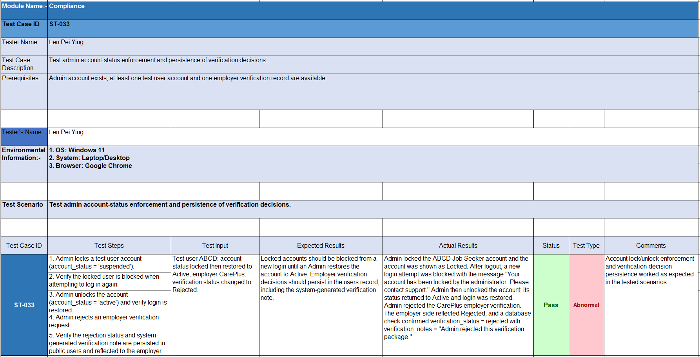

Figure A3.26: Admin Audit Trail for Account Decisions

Test ID: ST-034 Gig Workers Act 2025 Compliance Reminders

The Admin Analytics page displayed a “Gig Workers Act 2025 Compliance Awareness” panel during the test. The panel reminded the Admin to review job postings for information such as work scope, schedule, location and pay; monitor reports and payment disputes; and refer to verification and moderation records when reviewing Employer accountability. The implemented guidance was displayed correctly during the test. This test was conducted to assess compliance-awareness guidance and was not a legal compliance certification. Figure A3.27 shows the Compliance Awareness panel displayed to the Admin.

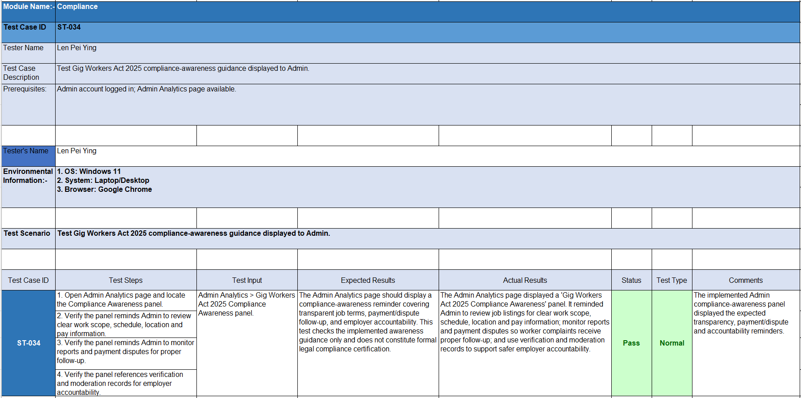

Figure A3.27: Gig Workers Act 2025 Compliance Reminders

Overall, all 34 System Testing test cases across the seven categories achieved a Pass result. The detailed evidence in Appendix 3 supports the System Testing results summarised in Section 4.3.1 and documents the additional test cases omitted from the main chapter for conciseness.

## Appendix 4: User Acceptance Testing (UAT)

Section 4.3.2 presents the overall UAT results and representative examples for the Job Seeker, Employer and Admin roles. This appendix provides access to the complete UAT forms collected from all five testers. Testers performed Sections A, B, and C (the 15 functional tasks for each of the three user roles) and then Section D (User Satisfaction and Overall Acceptance). The complete signed UAT forms are provided through the Google Drive links below.

Tester 1: Windows 11 Laptop

Completed the UAT using a Pavilion Plus 14 running Windows 11. All 15 functional tasks across the Job Seeker, Employer and Admin roles were completed, followed by the usability evaluation and Overall Acceptance.

Link:

https://drive.google.com/file/d/1KcJ3EFmnTZ2PZWbknDAacSTIJ2Jz9aEK/view?usp=drive_link

Tester 2: Windows 11 Laptop

Completed the UAT using an MSI Raider GE78 HX 14V running Windows 11. All 15 functional tasks across the three user roles were completed, followed by the usability evaluation and Overall Acceptance.

Link:

https://drive.google.com/file/d/1TdtuODBYe7-XbQyDV5cvmLpGgxY_Pc39/view?usp=drive_link

Tester 3: iPhone / Safari

Completed the UAT using an iPhone 15 Pro Max with Safari. All 15 functional tasks across the three user roles were completed, followed by the usability evaluation and Overall Acceptance.

Link:

https://drive.google.com/file/d/1ypJAt8R_Oy0jOejH3755P6dNUyzXqEpJ/view?usp=drive_link

 

Tester 4: Android Tablet / Chrome

Completed the UAT using HONOR Pad 9 with Android and Chrome. All 15 functional tasks across the three user roles were completed, followed by the usability evaluation and Overall Acceptance.

Link:

https://drive.google.com/file/d/18JCX8OTYEZM_QhbUZ2xk4Fy62O5jFFtl/view?usp=drive_link

Tester 5: Android Smartphone / Chrome

Completed the UAT using HONOR X9b with Android and Chrome. All 15 functional tasks across the three user roles were completed, followed by the usability evaluation and Overall Acceptance.

Link:

https://drive.google.com/file/d/1xeB8hhVvYaZgcg6_-wzyVeNjdXxVm-HA/view?usp=drive_link

Overall, the five UAT forms provide supporting evidence that the core Job Seeker, Employer and Admin tasks were completed across the tested devices and platforms. The corresponding usability evaluations and Overall Acceptance responses are included in the complete forms provided above.

 

## Appendix 5: Security Testing

This appendix provides the detailed Security Testing test cases and supporting evidence that are not presented in Section 4.3.4. Security Testing was conducted across nine categories: RLS Data Isolation, Auth &amp; Access Control, Upload Security, Input Sanitisation, Rating &amp; Business Rules, Report Security, Analytics &amp; Chatbot, PDPA &amp; Compliance, and Employer Verification &amp; Visibility. A total of 30 Security Testing test cases (SEC-001 to SEC-030) were executed, and all 30 achieved a Pass result in the final testing round. Section 4.3.4 provides one representative test case from each category, while the rest of the test cases and supporting evidence are provided in Appendix 5.1 to Appendix 5.9. There were a number of limitations that were identified during the early testing phases, which were resolved and successfully retested prior to the final results being recorded. The complete Security Testing evidence is available at:

https://docs.google.com/spreadsheets/d/1J8tsBmmfZewbUvCZdGcKjbObT-Y0A0vb/edit?usp=drive_link&amp;ouid=102370839147916344868&amp;rtpof=true&amp;sd=true

### Appendix 5.1: RLS Data Isolation

This appendix provides the remaining RLS Data Isolation Security Testing test cases that are not presented in Section 4.3.4.1. These tests provide supporting evidence for the RLS controls applied to user-specific records, including applications, notifications, job listings, verification information, payments, saved jobs, user profiles and work history. The representative test case, SEC-001: Seeker Cannot Read Another Job Seeker&#39;s Applications, is presented in Section 4.3.4.1, while the additional RLS Data Isolation test cases are provided below.

Test ID: SEC-002 Seeker Cannot Update Another Seeker&#39;s Application Status

The RLS policy applied to application updates restricted a Job Seeker to application records permitted by the authenticated user&#39;s scope. When Seeker B attempted to update an application belonging to Seeker A, no application record was modified. The cross-user update attempt therefore resulted in zero rows being affected. Figure A5.1 shows the blocked application-update attempt.

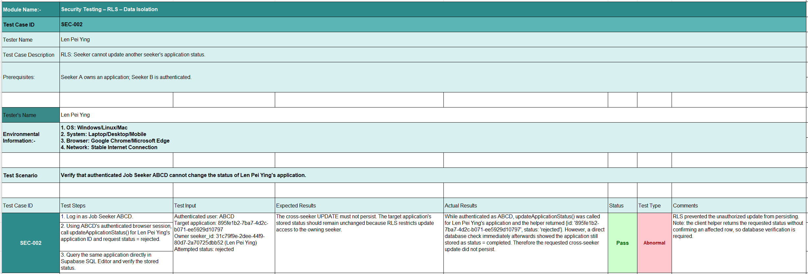

Figure A5.1: RLS Data Isolation (Seeker Application Update Isolation)

Test ID: SEC-003 Seeker Cannot Read Another User&#39;s Notifications

The notifications_select_own RLS policy restricted notification records according to the authenticated user&#39;s ID. A Job Seeker queried the notification table and only got the notifications that belonged to the authenticated user, not the other users. Figure A5.2 shows the notification read-isolation result.

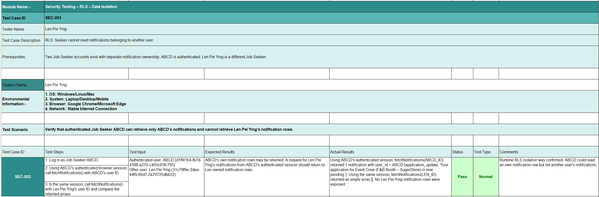

Figure A5.2: RLS Data Isolation (Notification Read Isolation) 

 

Test ID: SEC-004 Employer cannot update another employer&#39;s job listing

The job_listings_update_owner policy restricted job-listing updates to the authenticated Employer who owned the listing. When one Employer attempted to update a job listing owned by another Employer, the update was rejected and no record was modified. A cross-Employer update attempt was rejected as indicated in Figure A5.3.

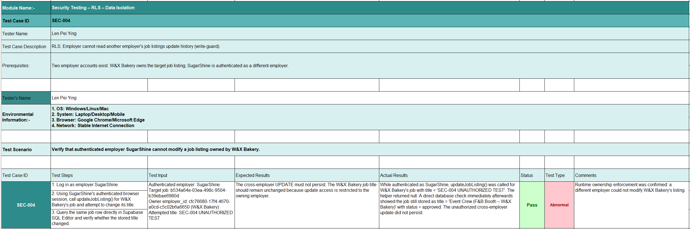

Figure A5.3: RLS Data Isolation (Job Listing Update Isolation) 

Test ID: SEC-005 Employer Cannot Modify Another Employer&#39;s Verification Documents

The users_update_own policy limited updates to the updated user&#39;s own record. Employer E2 tried to change the verification-related data of Employer E1, but the change was refused, and the protected data was not modified. The blocked Cross-owner update attempt is illustrated in Figure A5.4.

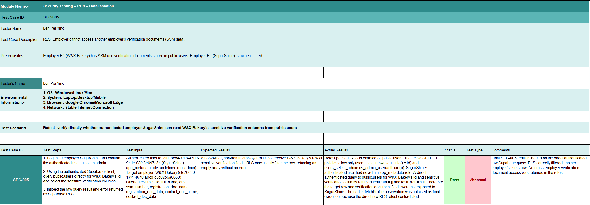

Figure A5.4: RLS Data Isolation (Verification Document Access)

Test ID: SEC-006 Seeker Cannot Insert a Payment Record on the Employer&#39;s Behalf

The tested payment-insertion controls restricted the actions available to a Job Seeker according to the authenticated user&#39;s role and relationship to the application. During testing, the Job Seeker was prevented from creating an Employer payment record through the tested workflow. Figure A5.5 shows the payment-insert restriction.

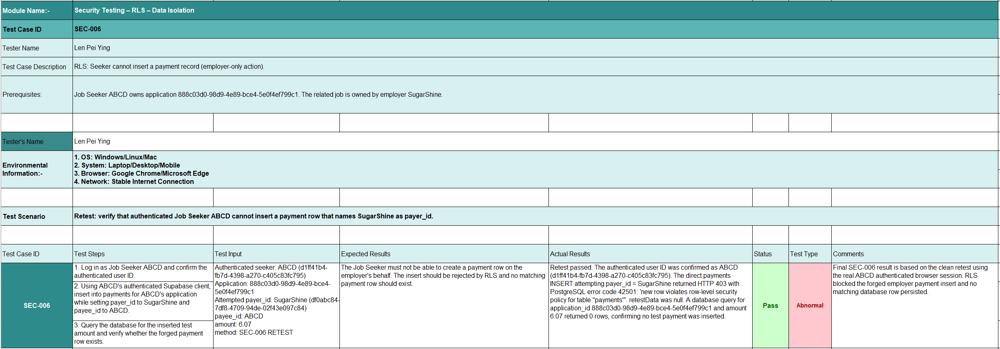

Figure A5.5: RLS Data Isolation (Payment Insert Restriction)

Test ID: SEC-007 Seeker Cannot Update Another Seeker&#39;s Payment Confirmation

The tested payment-update policy restricted modification of payment information to authorised related users. The request to change Seeker 1&#39;s payment confirmation was rejected, and Seeker 2&#39;s payment record remained unchanged. The isolation result for payment confirmation is displayed as shown in Figure A5.6.

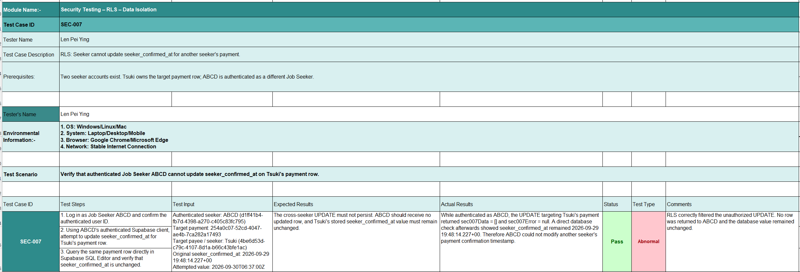

Figure A5.6: RLS Data Isolation (Payment Confirmation Isolation) 

Test ID: SEC-012 Seeker Cannot Delete Another Seeker&#39;s Saved Job

The saved_jobs_delete_own policy only allowed DELETE when the user ID was equal to auth.uid(), so even though Seeker 2 knew the UUID of Seeker 1&#39;s saved job, it was not deleted. In Figure A5.7, Seeker 1&#39;s saved job has not been altered by the blocked delete request of Seeker 2.

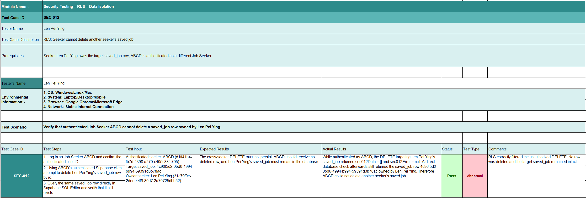

Figure A5.7: RLS Data Isolation (Saved Job Delete Isolation)

Test ID: SEC-019 Non-Admin Cannot Update Another User&#39;s Profile Row

The users_update_own and users_admin_update policies restricted profile updates to the record owner or an authorised Admin. A Job Seeker tried to change another user&#39;s profile record, but it was not allowed to be changed, and no protected profile information was changed. The rejected cross-user profile update is displayed in Figure A5.8.

Figure A5.8: RLS Data Isolation (User Profile Update Isolation)

Test ID: SEC-020 Seeker Cannot Change an Application&#39;s Status Field Directly

The initial test identified that a Job Seeker could directly change the status of an owned application from Pending to Completed. Then, a security rule was added at the database level, and the same direct change was made again. The request was rejected due to HTTP status code 403 and database error code 42501, and another database check showed that the application still had Pending status. The retest was therefore successful, and the status of the application could not be changed by the unauthorised direct request that was tested. Figure A5.9 shows the application-status field restriction.

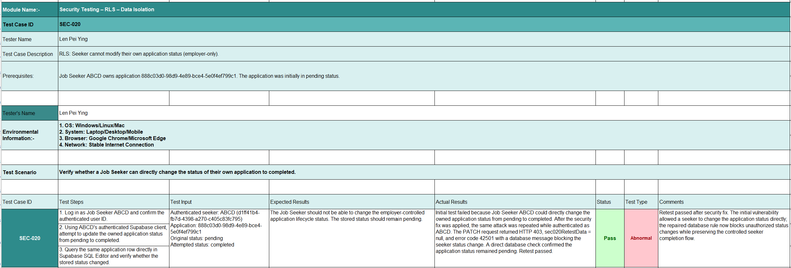

Figure A5.9: RLS Data Isolation (Application Status Field Restriction) 

Test ID: SEC-021 Employer Cannot Read Another Seeker&#39;s Work History

The Work History data were limited by the Work_history_select_own policy that defined the scope of the authorised user. When a user who did not own the tested Work History record attempted to retrieve it, the query returned no rows and the other user&#39;s Work History information was not exposed. Figure A5.10 shows the Work History read-isolation result.

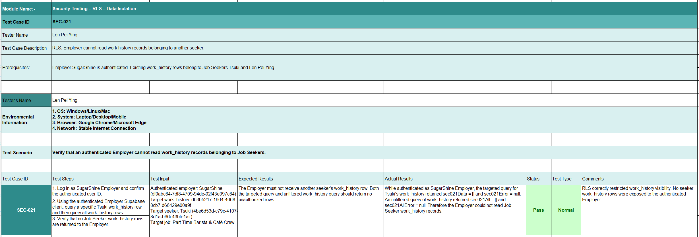

Figure A5.10: RLS Data Isolation - Work History Read Isolation

### Appendix 5.2: Auth &amp; Access Control

This appendix provides the remaining Auth &amp; Access Control Security Testing test cases that are not presented in Section 4.3.4.2. These tests cover authentication, session handling and role-based access restrictions, such as cross-role access, registration role-gating, password handling and session expiry. The representative test case, SEC-024: Admin Page Access Blocked for Non-Admin Authenticated Users, is presented in Section 4.3.4.2, while the additional test cases are provided below.

Test ID: SEC-013 RLS Prevents Cross-Role Data Access

The tested RLS and role-based controls restricted access to records and functions according to the authenticated user&#39;s role and record ownership. Non-admin users were also denied access to Admin-only pages and were redirected from Admin-only functions. The cross-role access-control result is displayed in Figure A5.11.

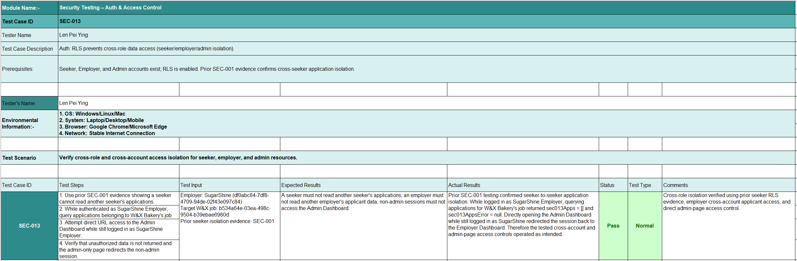

Figure A5.11: Auth &amp; Access Control - Cross-role Data Access 

Test ID: SEC-014 Registration Role-Gating via Invite Codes

The registration process checked the necessary Admin or Employer invite code before account creation. When an invalid invite code was entered, the registration attempt was blocked, and an error message was displayed before a Supabase account could be created. Figure A5.12 shows the registration role-gating result.

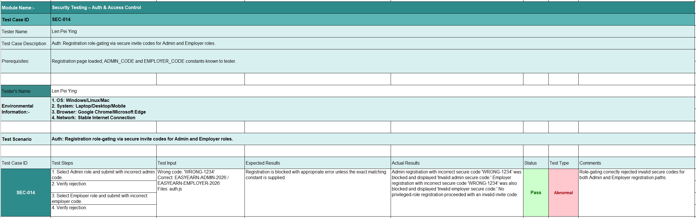

Figure A5.12: Auth &amp; Access Control - Registration Role-gating

Test ID: SEC-015 Password Policy Enforcement and Credential Handling

The account creation process verified the set password-length and character limits before creating an account. For login testing, invalid credential responses were translated to a generic “Invalid email or password” message, instead of revealing the presence or absence of an email account. The tested password and credential-handling behaviour is illustrated in Figure A5.13.

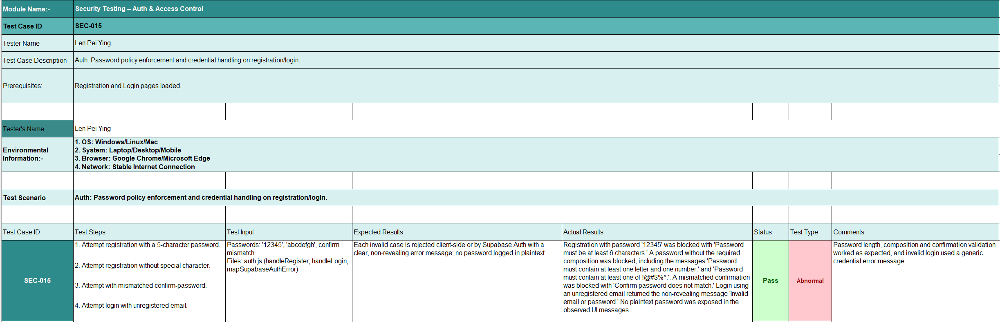

Figure A5.13: Auth &amp; Access Control - Password Policy Enforcement

Test ID: SEC-023 Session Expiry and requireUser() Redirect Behaviour

When the authenticated session was no longer valid, the protected page could not be accessed, and the user was redirected to the Login page. The authentication check failed to return a valid user session, and the UI responded to exiting the session by denying access to protected content. The result for handling the session expiry is displayed in Figure A5.14.

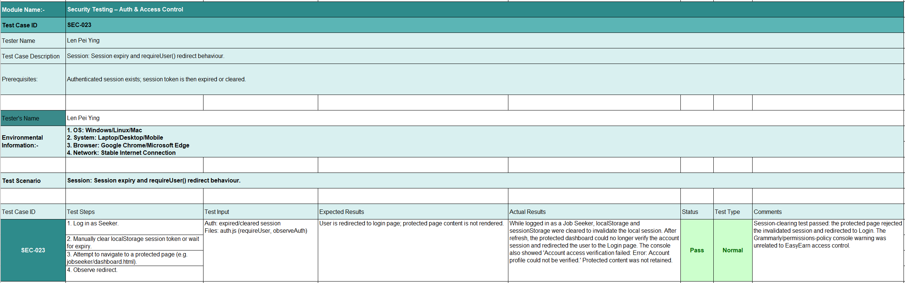

Figure A5.14: Auth &amp; Access Control - Session Expiry Handling

 

### Appendix 5.3: Upload Security

This appendix supports the Upload Security Testing presented in Section 4.3.4.3. SEC-016 evaluated the file-size and file-type restrictions applied to Job Seeker profile images and Employer verification documents. Since this category contains only one test case and the complete representative result is presented in Section 4.3.4.3, the test case is not repeated in this appendix.

### Appendix 5.4: Input Sanitisation

This appendix provides the remaining Input Sanitisation Security Testing test case that is not presented in Section 4.3.4.4. The tests evaluated how potentially malicious input was handled, including XSS and SQL injection-related input. The representative test case, SEC-017: Input Sanitisation Against XSS, is presented in Section 4.3.4.4, while the additional test case is provided below.

Test ID: SEC-018 SQL Injection Resistance

SQL queries were not directly built from user input; instead, they were made using the Supabase JavaScript client and through PostgREST requests. The payload submitted for the test was not executed as an SQL statement but rather was treated as an input value. Figure A5.15 shows the tested SQL injection-related input behaviour.

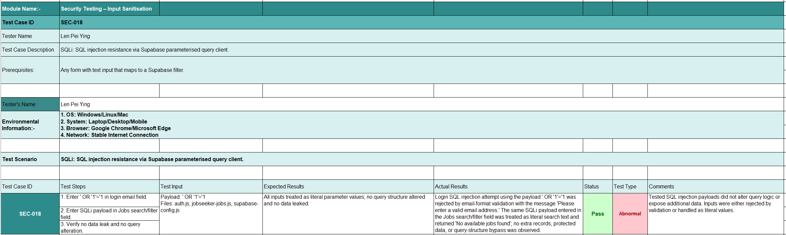

Figure A5.15: Input Sanitisation - SQL Injection Resistance

### Appendix 5.5: Rating &amp; Business Rules

This appendix provides the remaining Rating &amp; Business Rules Security Testing test case that is not presented in Section 4.3.4.5. The tests focused on limitations on rating eligibility and reviewer-reviewee relationships as they relate to security issues. The representative test case, SEC-008: Seeker Cannot Submit a Rating for a Pending Application, is presented in Section 4.3.4.5, while the additional test case is provided below.

Test ID: SEC-009 Reviewer and Reviewee Cannot Be the Same User

A forced self-rating attempt was performed using a Completed application with the same user specified as both reviewer and reviewee. The request was denied with HTTP status 403, and a further check in the database revealed that no self-rating record was made. The retest thus resulted in a Pass outcome, which showed that the database-level rating validation prevented the attempted self-rating at the database level. Figure A5.16 shows the self-rating prevention result.

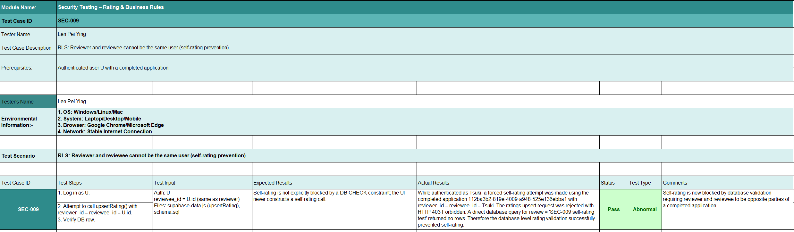

Figure A5.16: Rating &amp; Business Rules - Self-rating Prevention

### Appendix 5.6: Report Security

This appendix provides the remaining Report Security test case that is not presented in Section 4.3.4.6. The tests evaluated whether report submission and report records were restricted to authenticated and authorised users. The representative test case, SEC-011: Seeker Cannot Read Another User&#39;s Submitted Reports, is presented in Section 4.3.4.6, while the additional test case is provided below.

Test ID: SEC-010 Unauthenticated User Cannot Submit a Report

The reports_insert_own policy did not permit an unauthenticated user to create a report record. The frontend also checked for an authenticated session before making the report form available. During the test, an unauthenticated user could not access and submit the report form. Figure A5.17 shows the unauthenticated report-submission restriction.

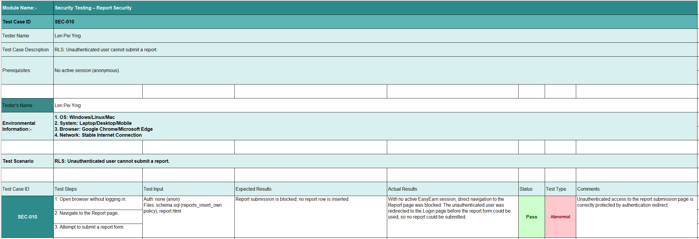

Figure A5.17: Report Security - Unauthenticated Submission Block 

### Appendix 5.7: Analytics &amp; Chatbot

This appendix provides the remaining Analytics &amp; Chatbot Security Testing test case that is not presented in Section 4.3.4.7. The tests determined if administrative analytics and chatbot-related records were limited by user role. The representative test case, SEC-025: Admin Analytics Data Is Not Accessible to Non-Admin Users, is presented in Section 4.3.4.7, while the additional test case is provided below.

Test ID: SEC-022 Admin-Only Access to Chatbot Logs

The chatbot_logs_select_admin policy restricted SELECT access to users with the Admin role. When a non-admin user queried the chatbot logs table, no chatbot-log records were returned. Figure A5.18 shows the chatbot-log access restriction.

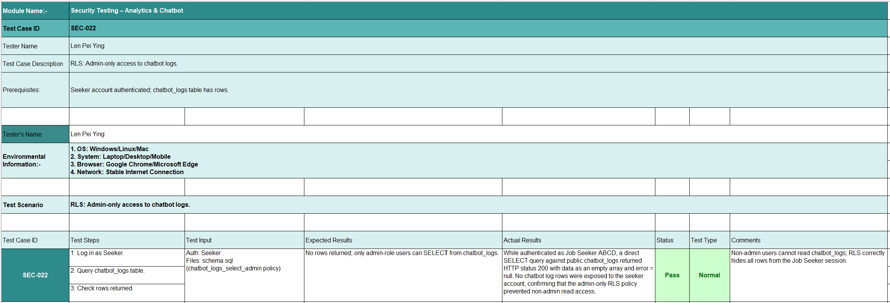

Figure A5.18: Analytics &amp; Chatbot - Chatbot Log Access Restriction

### Appendix 5.8: PDPA &amp; Compliance

This appendix provides the remaining PDPA &amp; Compliance Security Testing test cases that are not presented in Section 4.3.4.8. The tests examined certain privacy and access-control aspects of personal data, Employer verification information, modification of verification status and visibility of public job listings. These tests evaluated the technical controls that had been implemented and were not a comprehensive legal compliance audit. The representative test case, SEC-026: Personal Data Fields Are Not Exposed in Public Job Listing Queries, is presented in Section 4.3.4.8, while the additional test cases are provided below.

Test ID: SEC-027 Employer Verification Documents Are Not Exposed to Authenticated Non-Owner Users

The tested users-table SELECT policies restricted direct access to a user&#39;s record according to ownership and authorised Admin access. A valid non-owner user was not allowed to view other employers&#39; record information that was protected by the verification document. Figure A5.19 shows the verification-document access restriction.

Figure A5.19: PDPA &amp; Compliance - Verification Document Access Restriction

Test ID: SEC-028  Seeker Cannot Update an Employer&#39;s Verification Status

The tested update policies restricted modification of the Employer verification status to authorised users. When a Job Seeker attempted to change another Employer&#39;s verification status, the protected verification-status field remained unchanged. Figure A5.20 shows the verification-status update restriction.

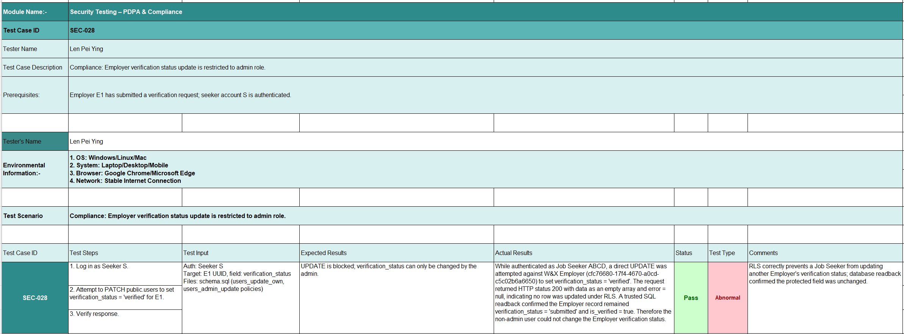

Figure A5.20: PDPA &amp; Compliance - Verification Status Update Restriction 

 

Test ID: SEC-029 Closed Job Listings Are Removed from Public Job Search

The public job-listing query excluded listings whose status was no longer Open. After the tested listing was changed to Closed, it was no longer returned in the public job-search results. The result of the closed-listing removal appears in Figure A5.21.

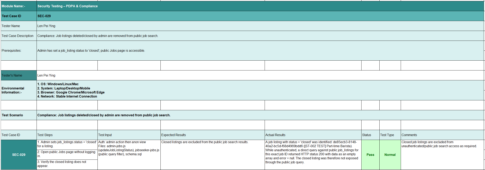

Figure A5.21: PDPA &amp; Compliance - Closed Listing Removal

### Appendix 5.9: Employer Verification &amp; Visibility

This appendix corresponds to the Employer Verification &amp; Visibility Security Testing category. This category contains one test case, SEC-030: Employer Verification &amp; Job Visibility.  The complete test case and supporting evidence are presented in Section 4.3.4.9; therefore, SEC-030 is not repeated in this appendix.

Overall, all 30 Security Testing test cases across the nine testing categories achieved a Pass result in the final testing round. Several vulnerabilities detected in the initial test were patched, and retests were conducted successfully. The detailed evidence in Appendix 5 supports the Security Testing results summarised in Section 4.3.4 and documents the additional test cases omitted from the main chapter for conciseness. The restrictions mentioned in Section 5.3.1 apply to the scope of security assurance and are not directly related to known failures in the final Security Testing results.

## Appendix 6: Compatibility Testing

This appendix provides the detailed Compatibility Testing test cases and supporting evidence that are not presented in Section 4.3.5. Compatibility Testing was conducted across six categories: Browser Compatibility, Responsive Design, Feature Compatibility, Session &amp; Auth, UI &amp; Display, and Form &amp; Input. A total of 23 Compatibility Testing test cases (CT-001 to CT-023) were executed, and all 23 achieved a Pass result in the final testing round within the environments directly tested. One representative test case from each category is contained in Section 4.3.5, and all the other test cases and supporting evidence are grouped in Appendix 6.1 to Appendix 6.6. The complete Compatibility Testing evidence is available at:

https://docs.google.com/spreadsheets/d/1XXPW7gAKUQUbruu0E_LBs4451-zoo1Fi/edit?usp=drive_link&amp;ouid=102370839147916344868&amp;rtpof=true&amp;sd=true

### Appendix 6.1: Browser Compatibility

This appendix provides the remaining Browser Compatibility test cases that are not presented in Section 4.3.5.1. These tests evaluated selected browser-dependent functions and interface elements in Google Chrome, Mozilla Firefox and Microsoft Edge, such as feature support for JavaScript, creating PDF resumes and rendering analytics with Chart.js. The following Browser Compatibility test cases are provided; for the representative test case, a description is given in Section 4.3.5.1.

Test ID: CT-002 JavaScript Feature Support

The JavaScript functions used to retrieve job-listing data from Supabase were tested in Google Chrome, Mozilla Firefox and Microsoft Edge. The tested fetch() operations and ES module imports executed without related console errors in the browsers tested. Figure A6.1 shows the JavaScript feature-support result.

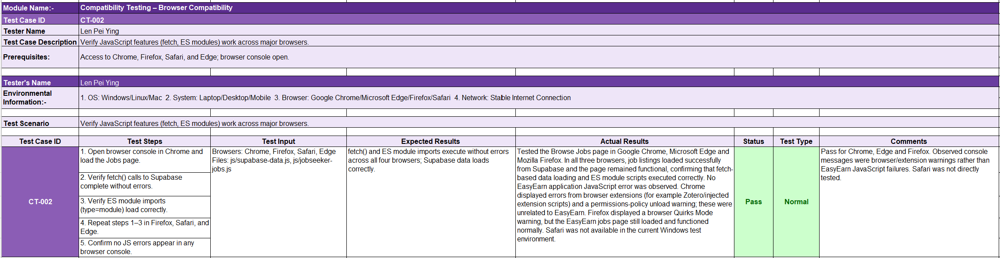

Figure A6.1: Browser Compatibility - JavaScript Feature Support

Test ID: CT-003 PDF Resume Generation

The PDF resume function was tested in Google Chrome, Mozilla Firefox and Microsoft Edge using jsPDF and html2canvas. The resume PDF was generated successfully in the tested browsers, and the profile information, layout and Work History content were displayed correctly in the resulting document. Figure A6.2 shows the PDF resume generation result.

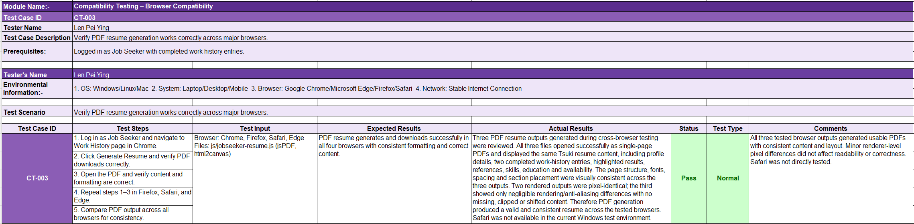

Figure A6.2: Browser Compatibility - PDF Resume Generation 

Test ID: CT-004 Chart.js Analytics Rendering

The Admin Analytics charts were tested in Google Chrome, Mozilla Firefox and Microsoft Edge. The line and doughnut charts were tested; they displayed with Chart.js and the analytics values were consistent. Both the line and doughnut charts were represented correctly. Figure A6.3 shows the analytics-rendering result.

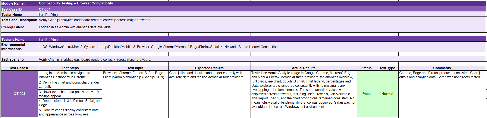

Figure A6.3: Browser Compatibility - Chart.js Analytics Rendering

### Appendix 6.2: Responsive Design

This appendix provides the remaining Responsive Design Compatibility Testing test cases that are not presented in Section 4.3.5.2. These tests assessed how EasyEarn reacts to the following viewport sizes and interactions: mobile touch interaction, mobile content display, form-validation presentation and mobile filtering. The representative test case, CT-005: Layout Breakpoints, is presented in Section 4.3.5.2, while the additional test cases are provided below.

Test ID: CT-006 Mobile Touch Interactions

Hamburger menu, job card navigation and filter controls were tested with touch interaction in the mobile layout. The tested controls were accessible and reacted to tap input in the mobile interface. Figure A6.4 shows the mobile touch-interaction result.

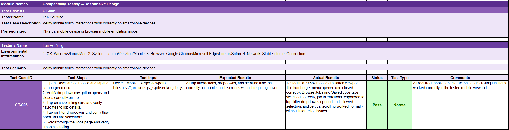

Figure A6.4: Responsive Design - Mobile Touch Interactions 

Test ID: CT-007 Mobile Content Display

The Saved Jobs and Work History pages were tested using a 375 px mobile viewport. Card-based layouts were correctly stacked, and content on the relevant pages was visible and readable without breaking the layout. Figure A6.5 shows the mobile content-display result.

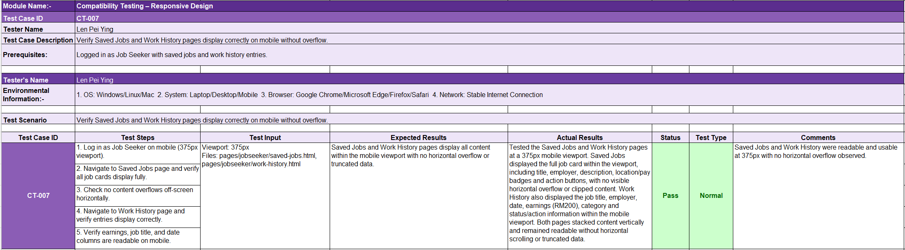

Figure A6.5: Responsive Design - Mobile Content Display 

Test ID: CT-008 Form Validation Consistency

Tests in invalid fields and passwords were conducted in the supported browser environments. The custom JavaScript validation always showed the expected error messages in the tests performed. Figure A6.6 shows the form-validation result.

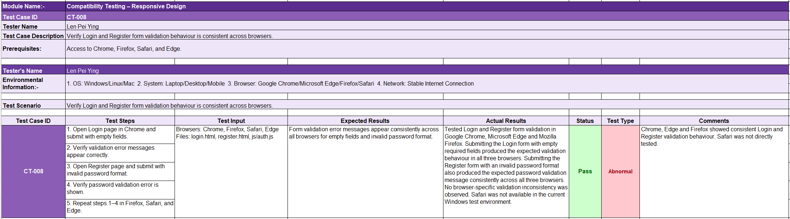

Figure A6.6: Responsive Design - Form Validation Consistency

 

Test ID: CT-009 Mobile Filter Functionality

The Category and Location filters on the Jobs page were tested within the mobile layout. The filter controls were responsive to touch input, and the job list shown was updated based on the current filter criteria. Figure A6.7 shows the mobile filtering result.

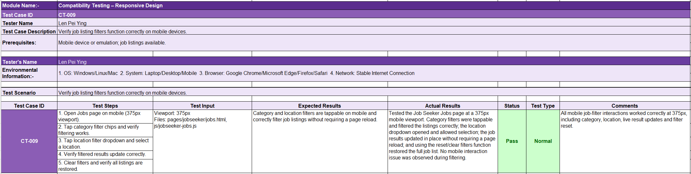

Figure A6.7: Responsive Design - Mobile Filter Functionality

### Appendix 6.3: Feature Compatibility

This appendix provides the remaining Feature Compatibility test cases that are not presented in Section 4.3.5.3. These tests evaluated selected EasyEarn features within the tested browser and screen environments, including dark mode, the floating chatbot, Employer verification file uploads, notification updates and Admin Analytics. The representative test case, CT-010: Google Translate Integration, is presented in Section 4.3.5.3, while the additional test cases are provided below.

Test ID: CT-011 Dark Mode Across Role Dashboards

Dark mode was tested across the Job Seeker, Employer and Admin dashboards. The preferred theme was saved and stayed in place after refreshing the page, and the dashboards for the different roles were still readable in the tested dark mode. Dark Mode is visible throughout the role dashboards in Figure A6.8.

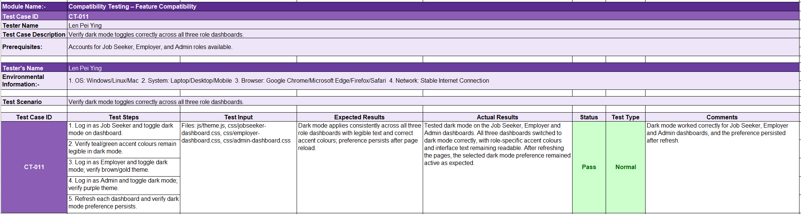

Figure A6.8: Feature Compatibility - Dark Mode Across Role Dashboards 

Test ID: CT-012 Floating Chatbot Widget

The floating chatbot widget was tested on desktop and mobile layouts. The widget was available in both layouts and did not block the primary navigation on views in the tested layouts. The chatbot interaction based on the rules also remained functional via the tested interface. The chatbot widget is displayed on the desktop and mobile layouts as shown in Figure A6.9.

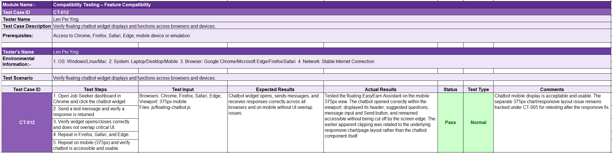

Figure A6.9: Feature Compatibility - Floating Chatbot Widget 

Test ID: CT-013 File Upload for Verification

The Employer verification file-upload function was tested in the supported browsers. The file picker opened, and the set-up client-side file-type and file-size validation was performed before the selected verification document was processed. Figure A6.10 shows the verification file-upload result.

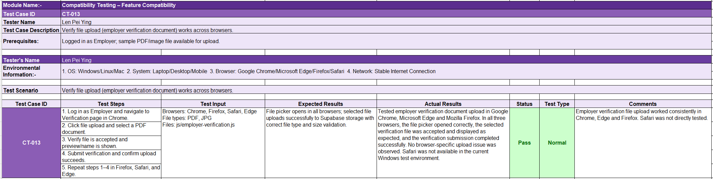

Figure A6.10: Feature Compatibility - File Upload for Verification 

Test ID: CT-014 Notification Bell Updates

The notification bell was tested after a new notification was generated. The number of notifications was updated during the following polling period, and the updated unread-notification indicator was correctly shown. The notification-bell update result is shown in Figure A6.11.

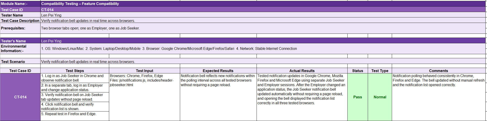

Figure A6.11: Feature Compatibility - Notification Bell Updates 

Test ID: CT-015 Admin Analytics Data Consistency

The Admin Analytics Dashboard was tested across the supported browsers using the same underlying Supabase records. The summary values and Chart.js visualisations remained consistent across the browsers tested. Figure A6.12 shows the Admin Analytics data-consistency result.

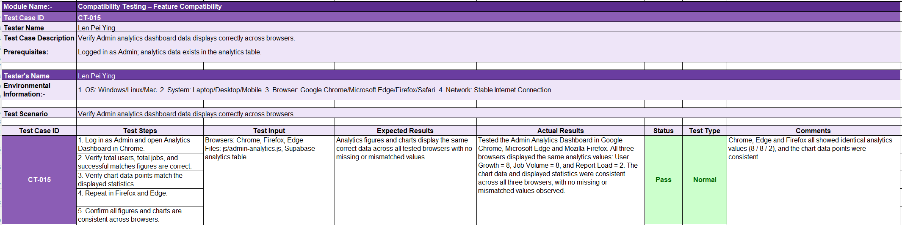

Figure A6.12: Feature Compatibility - Admin Analytics Data Consistency

### Appendix 6.4: Session &amp; Auth

This appendix provides the remaining Session &amp; Auth Compatibility Testing test case that is not presented in Section 4.3.5.4. The tests covered the authentication-session behaviour for various tabs in the same browser session, such as cross-tab session persistence and synchronised logout. The representative test case, CT-017: Cross-Tab Logout, is presented in Section 4.3.5.4, while the additional test case is provided below.

Test ID: CT-016 Cross-Tab Session Persistence

The authenticated EasyEarn session was tried with multiple tabs in the same browser session. Once logged in, opening the protected dashboard in a second tab kept the user logged in without requiring the user to log in again. Figure A6.13 shows the cross-tab session-persistence result.

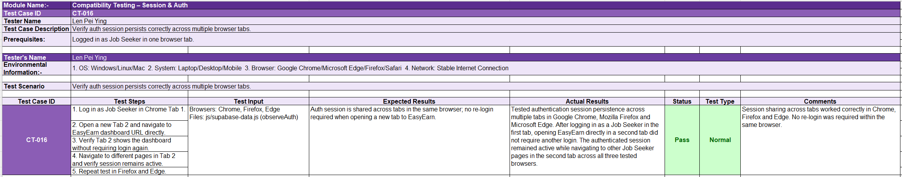

Figure A6.13: Session &amp; Auth - Cross-tab Session Persistence 

### Appendix 6.5: UI &amp; Display

This appendix provides the remaining UI &amp; Display Compatibility Testing test cases that are not presented in Section 4.3.5.5. The following tests were performed for the selected EasyEarn interface elements to assess their readability and presentation in the environments being tested, such as font rendering and previews of images being uploaded. The representative test case, CT-019: Long Text Overflow Handling, is presented in Section 4.3.5.5, while the additional test cases are provided below.

Test ID: CT-018 Cross-Operating-System Font Rendering

The rendering of fonts was tested in the operating-system environments directly available for the tests, and the Compatibility Testing environment was based mainly on Windows. The tested EasyEarn text was still readable; no font layout problems were observed in the directly tested environment. This test was not conducted with macOS or Linux, so it should not be considered as compatibility with those operating systems. The tested font rendering is shown in Figure A6.14.

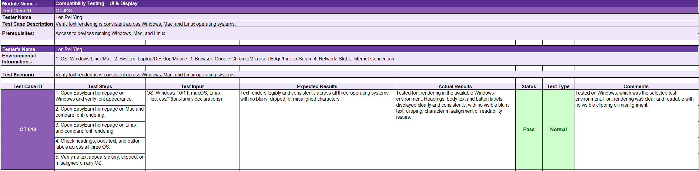

Figure A6.14: UI &amp; Display - Cross-OS Font Rendering 

Test ID: CT-020 Image Upload Preview

The image-upload preview function was tested in Google Chrome, Mozilla Firefox and Microsoft Edge. After an image was selected, the preview was displayed correctly before upload and remained correctly displayed after the upload process in the tested browsers. Figure A6.15 shows the image-upload preview result.

Figure A6.15: UI &amp; Display - Image Upload Preview 

### Appendix 6.6: Form &amp; Input

This appendix provides the remaining Form &amp; Input Compatibility Testing test cases that are not presented in Section 4.3.5.6. The tests checked typical form and input controls for the browsers that were tested, such as password masking for fields, file-size and file-type checking. The representative test case, CT-021: Interview Date/Time Picker, is presented in Section 4.3.5.6, while the additional test cases are provided below.

Test ID: CT-022 File Size and Type Validation

The configured file-size and file-type validation was tested using invalid upload files in the supported browsers. Files not conforming to the configured file requirements were rejected, and the anticipated validation message was always shown in the browsers tested. The rejected oversized-file scenario and validation message are illustrated in Figure A6.16.

Figure A6.16: Form &amp; Input - File Size and Type Validation

Test ID: CT-023 Password Field Masking

The password input field was tested in the supported browsers. The characters entered into the password field on the login page were hidden instead of showing them in plain text in the password field. Figure A6.17 shows the password-field masking behaviour.

Figure A6.17: Form &amp; Input - Password Field Masking

Overall, all 23 Compatibility Testing test cases across the six testing categories achieved a Pass result in the final testing round within the environments directly tested. The Compatibility Testing results summarised in Section 4.3.5 are detailed in Appendix 6, which also provides information about test cases excluded from the main chapter for brevity. The results are only applicable to browsers, devices, operating systems and viewport configurations evaluated directly, and are not a guarantee of all possible environments.

## Appendix 7: GitHub Repository and Deployment

EasyEarn was developed using Git for version control and GitHub as the project repository. The repository maintains the development history of the system through commits made throughout the implementation, testing, correction and deployment stages. The commit history then supports evidence of the iterative development process undertaken during FYP2.

The EasyEarn web application is deployed by the main deployment workflow of the EasyEarn repository to GitHub Pages. This deployment strategy is similar to the static-frontend and BaaS architecture discussed in Section 4.2, with the frontend served using GitHub Pages and the authentication and database services offered by Supabase.

The deployment history also shows repeated deployments while developing the system, which is also written to the deployment history on GitHub Pages. Successful and unsuccessful deployment attempts provided evidence of the iterative deployment process, where deployment-related issues were identified, corrected and followed by subsequent deployments.

The development record export is available as a supplementary spreadsheet, which can be downloaded from the link below. The record will allow you to see the commit history and development evidence without having to replicate this history in this report.

GitHub Repository:

https://github.com/PeiYing040830/easyearn

Deployed EasyEarn Website:

https://peiying040830.github.io/easyearn/

Supplementary Development Record:

https://docs.google.com/spreadsheets/d/1kI1XszY_p9zjSSiSyxYvcOC7JIXOphPacPTJAdbirEA/edit?usp=drive_link
