# Chapter 4: Implementation

## 4.1 Introduction

This chapter presents the implementation and testing of EasyEarn, a web-based job-matching platform developed to support short-term, part-time and freelance employment. It explains the main technologies and implementation decisions used for the frontend, backend services, database and supporting third-party packages. The chapter also evaluates the implemented system through five testing approaches such as System Testing, UAT, Usability Testing, Security Testing and Compatibility Testing.

EasyEarn is implemented using HTML, CSS and JavaScript for the frontend interface and client-side interactions. Supabase is used as the BaaS platform to support authentication, application logic and backend services, while PostgreSQL is used for structured data storage and queries [18]. RLS is applied to restrict data access according to user roles and ownership [18]. There are also a number of supporting technologies that are built in to enhance the system functionality, such as Chart.js for analytics visualisation, jsPDF for PDF resume generation and the Google Translate integration for multilingual accessibility.

Five complementary testing approaches are used to evaluate the implemented system. System Testing is used to verify the core functionality and overall system behaviour, while UAT evaluates whether the implemented functions meet the intended user requirements. Usability Testing assesses the ease of use and user experience of the system. Security Testing looks at access control, data protection, security-related functions, and Compatibility Testing looks at whether the system works equally on all supported browsers, devices and interface conditions. Figure 4.1 summarises the main implementation technologies used in EasyEarn and the five testing approaches applied to evaluate the system.

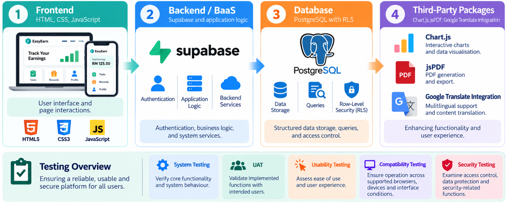

Figure 4.1: Implementation and Testing Overview of EasyEarn

4.2 Implementation

This section explains how EasyEarn is technically implemented in four aspects: Frontend, Backend, Database and Third-party Packages. EasyEarn uses a static frontend with a BaaS architecture. The frontend comprises HTML, CSS and JavaScript files served through GitHub Pages, while Supabase provides authentication, data persistence, access control and selected database-level business logic. This architecture minimises the need to have a dedicated application server and enables access-control rules to be implemented using Supabase RLS policies and database rules [18]. Section 4.2.1 explains the structure of the frontend and the page inventory; Section 4.2.2 describes the backend services and the security model; Section 4.2.3 describes the database schema and access-control policies; and Section 4.2.4 summarises the third-party packages used in the system.

### 4.2.1 Frontend

EasyEarn is a multi-page application organised into a set of public pages in the root directory (index.html, login.html, jobs.html) and three role-scoped directories (pages/jobseeker/, pages/employer/, pages/admin/). The page distribution is summarised in Table 4.1 below.

Table 4.1: Page Distribution by role/section

<table>
<tr>
<td>

Section

</td>
<td>

Page Count

</td>
<td>

Representative Page

</td>
<td>

Paired CSS

</td>
</tr>
<tr>
<td>

Public / Auth

</td>
<td>

16

</td>
<td>

index, login, register, forgot-password, reset-password, jobs, about, help, report, security

</td>
<td>

css/landing.css, css/style.css

</td>
</tr>
<tr>
<td>

Job Seeker

</td>
<td>

11

</td>
<td>

dashboard, jobs, applications, saved-jobs, interviews, resume, work-history, messages, profile, logout

</td>
<td>

jobseeker-pages.css / jobseeker-dashboard.css

</td>
</tr>
<tr>
<td>

Employer

</td>
<td>

8

</td>
<td>

dashboard, post-job, manage-jobs, applicants, ratings, verification, messages, profile

</td>
<td>

employer-pages.css

</td>
</tr>
<tr>
<td>

Admin

</td>
<td>

9

</td>
<td>

dashboard, jobs, users, verifications, reports, chatbot-knowledge, analytics, messages, profile

</td>
<td>

admin-pages.css

</td>
</tr>
</table>

The page count includes redirect and compatibility routes retained in the project structure, such as post-job.html and saved-jobs.html, although their main functionality has been consolidated into manage-jobs.html and the Saved Jobs tab of jobs.html, respectively.

The three colour themes (green for Job Seekers, amber for Employers and purple for Admins) are stored centrally in a single CSS file per role folder.  All pages are written using semantic HTML5 and assembled dynamically using a lightweight client-side includes system (js/includes.js), where a common header and footer are dynamically included in each page, without any server-side template engine; a pattern that is appropriate to a static host like GitHub Pages [52].

 

To implement interactivity, EasyEarn uses multiple vanilla JavaScript with the code organised into ECMAScript (ES) modules [50], including page-specific modules such as jobseeker-resume.js, employer-manage-jobs.js and admin-analytics.js, together with shared modules for authentication, data access, notifications, themes, translation and chatbot functionality.

The Job Seeker Resume Builder uses four supporting libraries to extend page functionality over native browser APIs: Lucide [93] is used to provide lightweight Scalable Vector Graphics (SVG) icons on all the role dashboards; Chart.js [53] is used to render charts in selected dashboard and analytics views, including the Job Seeker Applications page, Employer Dashboard and Admin Analytics Dashboard and html2canvas [94] and jsPDF [51] to take a snapshot of the on-screen Document Object Model (DOM) of the on-screen resume and export it as an A4 PDF without a server round trip.

### 4.2.2 Backend

EasyEarn&#39;s backend is powered by Supabase, with no need to build a custom application server. Three back-end issues are addressed this way: authentication, data access, and server-enforced business logic.

Authentication:

Supabase Auth provides email/password sign-up and login, and issues JWTs [95]which are stored in the browser and automatically refreshed as needed without user intervention. Each protected page subscribes to the Supabase onAuthStateChange event using observeAuth() (js/supabase-data.js), and redirects unauthenticated visitors to the login page before any protected UI is rendered.

 

Data access:

Instead of sending raw Structured Query Language (SQL) from the client, database operations are performed through the Supabase JavaScript client. The client sends Hypertext Transfer Protocol (HTTP) requests through PostgREST to the underlying PostgreSQL database, where applicable RLS policies are evaluated before data is returned or modified [96]. This reduces the need to construct raw SQL queries directly in client-side code and helps reduce SQL injection risks associated with manually constructed queries [79].

Table 4.2: Layered Access Control in EasyEarn

<table>
<tr>
<td>

Layer

</td>
<td>

Mechanism

</td>
<td>

Purpose

</td>
</tr>
<tr>
<td>

Client-side

</td>
<td>

Use role guards in page JavaScript (e.g. requireUser(), role checks in admin-*.js)

</td>
<td>

Protects UI from unauthorised users.

</td>
</tr>
<tr>
<td>

Network

</td>
<td>

PostgREST over HTTPS, Supabase anon key

</td>
<td>

Client requests are sent to Supabase/PostgREST over HTTPS, while database operations remain subject to the configured RLS policies.

</td>
</tr>
<tr>
<td>

Database

</td>
<td>

RLS policies per table

</td>
<td>

Applies access rules when there are duplicate or modified client requests.

</td>
</tr>
</table>

Server-enforced business logic:

Important business rules that should not rely only on client-side JavaScript are implemented using PostgreSQL trigger functions at the database level. This reduces reliance on client-side checks because the rules are applied at the database level when the relevant operations are performed. The two key examples are sync_job_openings_from_application(), which is activated on INSERT/UPDATE/DELETE to the applications table to ensure that the job_listings.openings_count field is up to date, no overbooking occurs, and notify_new_application(), which adds a row to the notifications table for the appropriate employer when an application is added to the applications table.

### 4.2.3 Database

The EasyEarn schema consists of 12 tables, summarised in Table 4.3: Key tables support soft-delete via a deleted_at timestamp column, preserving referential integrity while allowing logical removal of records (e.g. a withdrawn job listing).

Table 4.3: EasyEarn Database Tables and Purpose

<table>
<tr>
<td>

Table

</td>
<td>

Purpose

</td>
</tr>
<tr>
<td>

users

</td>
<td>

Stores information about the user&#39;s profile and role (seeker/employer/admin) for each account.

</td>
</tr>
<tr>
<td>

job_listings

</td>
<td>

Job offers made by employers.

</td>
</tr>
<tr>
<td>

applications

</td>
<td>

Connects a person looking for a job to a job posting and tracks the status of the job.

</td>
</tr>
<tr>
<td>

notifications

</td>
<td>

Built-in notifications based on system events.

</td>
</tr>
<tr>
<td>

payments

</td>
<td>

Completed application payment history.

</td>
</tr>
<tr>
<td>

ratings

</td>
<td>

Bidirectional post-completion ratings and reviews between Employers and Job Seekers.

</td>
</tr>
<tr>
<td>

reports

</td>
<td>

Safety reports (fraud, dispute, abuse) are checked by Admins.

</td>
</tr>
<tr>
<td>

saved_jobs

</td>
<td>

Job seeker bookmarks.

</td>
</tr>
<tr>
<td>

work_history

</td>
<td>

Completed job records created when the application is completed.

</td>
</tr>
<tr>
<td>

chatbot_knowledge

</td>
<td>

Keyword-response pairs used by the rule-based chatbot.

</td>
</tr>
<tr>
<td>

chatbot_logs

</td>
<td>

Logged chatbot interactions.

</td>
</tr>
<tr>
<td>

analytics

</td>
<td>

All platform statistics for the Admin dashboard.

</td>
</tr>
</table>

Each table has RLS configured, and policies are set based on the type and sensitivity of the data. Access rules are based on the authenticated user&#39;s UUID (auth.uid()), on record ownership fields like employer_id or seeker_id, on Administrator role checks and where not sensitive to public read access. This way, UI access control is complemented with access control at the PostgreSQL database level.

The chatbot_knowledge table is accessible for reading by public and authenticated users, enabling chatbot support before logging in, but INSERT, UPDATE and DELETE are only allowed for authorised Administrators. These interactions with the chatbot can be saved in the chatbot_logs table, and only Administrators have access to see the chatbot&#39;s logs for monitoring.

Unique constraints are used to prevent duplicate records. The applications (job_id, seeker_id) constraint makes sure that any Job Seeker does not apply for the same job more than once, and the ratings (application_id, reviewer_id) ensures that no reviewer rates the same application more than once.

### 4.2.4 Imported Packages

EasyEarn is an integration of the following library packages with the goal of facilitating development. The following are the libraries integrated in EasyEarn for easy development and summarised in Table 4.4. All client-side libraries are loaded from CDN links, without the need for a local build pipeline, as it is used during publishing to GitHub Pages.

Table 4.4:  Imported Packages and Third-party Libraries Used in EasyEarn

<table>
<tr>
<td>

Package / Library

</td>
<td>

Version / Source

</td>
<td>

Purpose

</td>
</tr>
<tr>
<td>

Supabase JavaScript Client

</td>
<td>

@supabase/supabase-js(CDN)

</td>
<td>

BaaS client for authentication and database access through Supabase and PostgREST; database access remains subject to configured RLS policies.

</td>
</tr>
<tr>
<td>

Chart.js

</td>
<td>

V4.x(CDN)

</td>
<td>

Renders line and doughnut charts in selected Job Seeker, Employer and Admin dashboard and analytics views.

</td>
</tr>
<tr>
<td>

jsPDF

</td>
<td>

v2.x(CDN)

</td>
<td>

Job Seeker: Export (programmatic) to PDF.

</td>
</tr>
<tr>
<td>

html2canvas

</td>
<td>

v1.x(CDN)

</td>
<td>

The frame source used for the exported resume (jsPDF) is a DOM-to-canvas snapshot.

</td>
</tr>
<tr>
<td>

Lucide Icons

</td>
<td>

CDN

</td>
<td>

Helpful, user-friendly, lightweight SVG icon library that is implemented in all role dashboards and in public pages.

</td>
</tr>
<tr>
<td>

Google Translate Integration

</td>
<td>

Google Translate Web Service

</td>
<td>

Redirects the existing EasyEarn page to the Google Translate website translation service, making it accessible in multiple languages.

</td>
</tr>
<tr>
<td>

Google Fonts (Manrope, DM Sans)

</td>
<td>

CDN

</td>
<td>

When using secondary UI typefaces: Manrope on public &amp; landing pages; DM Sans on all role dashboards.

</td>
</tr>
</table>

Other services listed in Table 4.4 include the Supabase JavaScript Client. [18]which is used to access Supabase from the client-side JavaScript, the Google Translate website translation service for multilingual access and Google Fonts for providing the Manrope and DM Sans typefaces employed across the site.

### 4.2.5 System Deployment

EasyEarn is published using the automatic build-and-deploy pipeline offered by GitHub Pages, which automatically rebuilds and republishes EasyEarn when changes are made to the main branch without needing a custom build/publish pipeline or manual release step. EasyEarn is built with a static-frontend, BaaS architecture, meaning that the HTML, CSS and JavaScript frontend is served from GitHub Pages, while Supabase serves managed backend services like authentication, database access, RLS and business logic at the database level. This design makes it possible to deploy the system without a specific application server.

There were some problems that were encountered in the deployment process that were not apparent when developing locally and only became apparent during deployment; these were related to paths. Shared partials are used in the site, including a common header and footer that are included from a shared file, js/includes.js (Section 4.2.1). The paths to these partials, logos and backgrounds are different for the depth of each page within the folder hierarchy, however. For instance, pages/jobseeker/dashboard.html has to have a different relative path from the top-level pages.

Each page sets the EASYEARN_BASE_PATH global variable before the include file includes.js is loaded (such as &#39;../../&#39; for role-specific pages), so that they don&#39;t have to duplicate the logic for including the script. Then the script uses this base path to determine at runtime where the header, footer, logo and footer-link will be found. This partial-loading approach allows the same common components to load properly across all system pages, even with varying folder depths.

The EasyEarn deployment history on GitHub shows successful and unsuccessful deployments across the development of EasyEarn. Potential deployment problems were resolved by future commits and successful deployments. This history shows that there were issues with deployment, which were monitored and acted upon throughout the iterative development process. The deployment history can be found in Appendix 7, Figure A7.1.

## 4.3 Testing

Five complementary testing methods were used: System Testing, UAT, Usability Testing, Security Testing, and Compatibility Testing. The methods are used to assess various quality characteristics of EasyEarn, such as functional correctness, user acceptance, usability, security and cross-environment behaviour. System Testing is the testing that checks the E2E functionality of EasyEarn.

### 4.3.1 System Testing

System Testing was conducted to evaluate the completed EasyEarn system across seven categories: E2E Workflow, Integration, Performance, Recovery, Business Logic, Reporting and Compliance. 34 System Testing test cases (ST-001-ST-034) were run, and all of the test cases passed. The tests focused on the core workflows, front-end-to-Supabase integration, performance, failure handling and business rules, reporting accuracy, and selected compliance system controls. Security Testing and Compatibility Testing were evaluated separately in Sections 4.3.4 and 4.3.5. Figure 4.2 summarises the seven System Testing categories. The following is a representative test case for each category; the other test cases and supporting evidence are given in Appendix 3 [97].

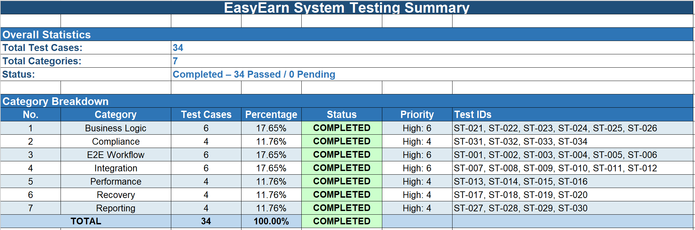

Figure 4.2: EasyEarn System Testing Summary

#### 4.3.1.1 End-to-End Workflow

E2E Workflow Testing tests the ability of a complete user workflow to complete successfully across interconnected sets of system functions [97]. In EasyEarn, the testing covered registration, job applications, applicant management, job completion, payment confirmation and moderation, with additional test cases and evidence provided in Appendix 3.1.

Test ID: ST-003 Hire-to-Completion Flow

The hire-to-completion workflow was tested using an existing job application. During the test, the application successfully progressed from Reviewed to Interview, Accepted, Completion Pending and finally Completed. The Job Seeker confirmed interview attendance and payment receipt, submitted a five-star rating and review for the Employer, and the completed job was recorded in the Job Seeker&#39;s Work History. Figure 4.3 shows the successful completion of the tested workflow.

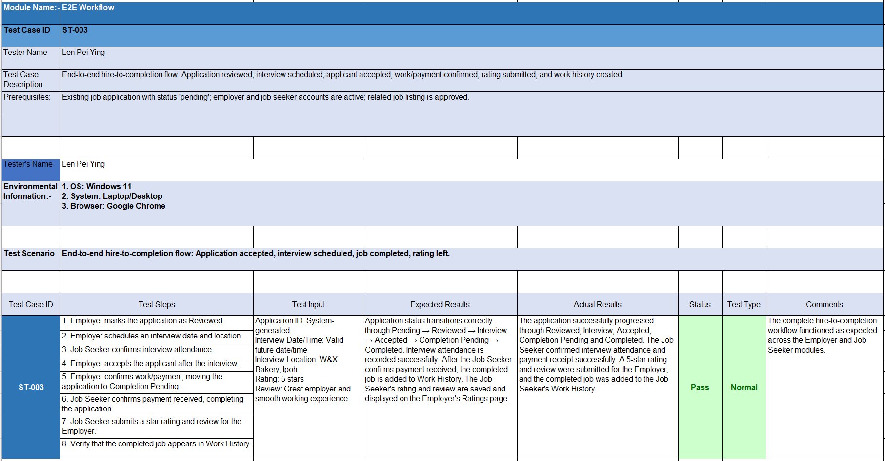

Figure 4.3: Hire-to-completion flow

#### 4.3.1.2 Integration

Integration Testing determines if the system components that are connected communicate and work properly together [97]. EasyEarn testing covered interactions among the JavaScript frontend, Supabase database, triggers, notifications, Employer Verification, asynchronous messaging, chatbot knowledge and saved jobs, with additional evidence provided in Appendix 3.2.

Test ID: ST-007 Application CRUD and openings_count trigger

This test examined the integration between job applications and the job listing&#39;s available openings count. The tested job had one available position at first. After a Job Seeker submitted an application, the available openings decreased from 1 to 0. The opening count bounced back from 0 to 1 when the application was cancelled. The openings count remained consistent throughout the test and did not become negative. Figure 4.4 shows the application and openings_count behaviour during the test.

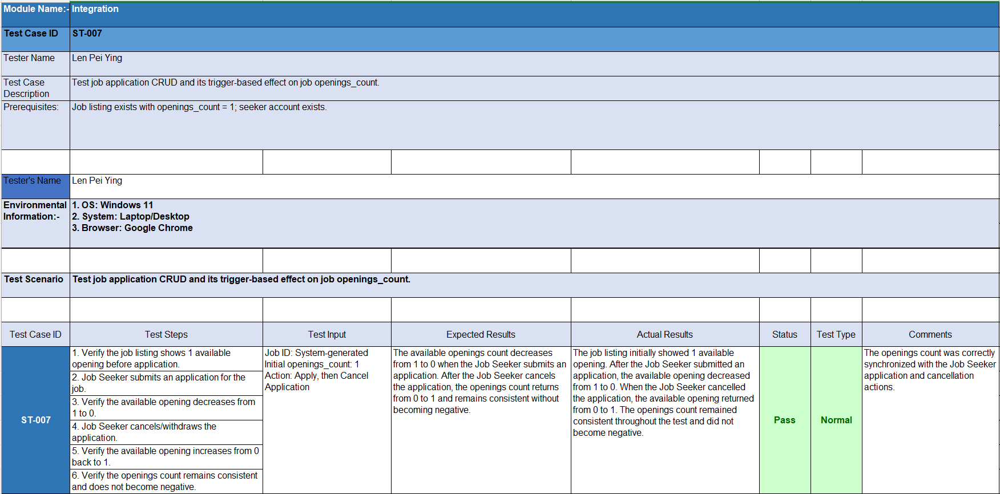

Figure 4.4: Application CRUD and openings_count trigger

#### 4.3.1.3 Performance

Performance Testing evaluates system response and behaviour during selected time-sensitive or data-processing operations [97]. EasyEarn testing covered job-page loading and filtering, concurrent applications, PDF resume generation and Admin Analytics rendering, with additional evidence provided in Appendix 3.3.

Test ID: ST-014 Concurrent Application Race Condition

This test evaluated how EasyEarn handled near-simultaneous applications for a job with only one remaining opening. During the test, one Job Seeker successfully submitted the application. After the final opening was taken, the second Job Seeker&#39;s Apply button changed to “Full”, preventing another application from being submitted. There was no overbooking, and the test passed. Figure 4.5 shows the concurrent application scenario.

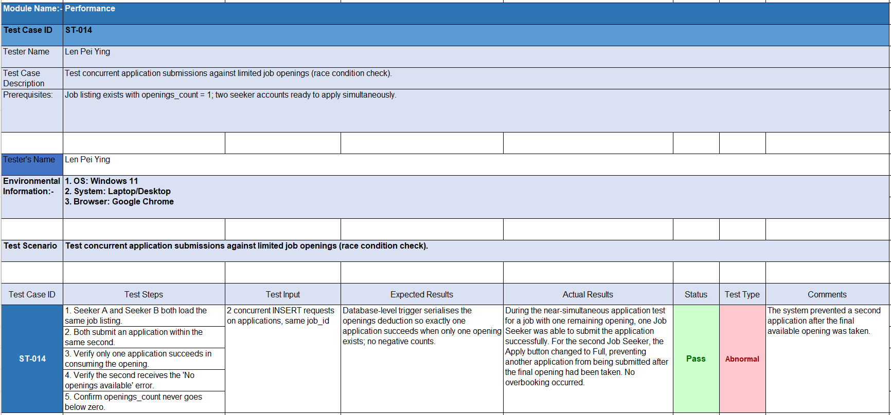

Figure 4.5: Concurrent Application Race Condition

#### 4.3.1.4 Recovery

Recovery Testing checks the response of the system to failure and disruption without compromising stability and consistency of the data state [97]. The connectivity loss, session-related interruptions and failed transactions were covered in EasyEarn testing, and further test cases and evidence were supplied in Appendix 3.4.

 

Test ID: ST-019 Failed Application Submission Rollback

This test was used to determine if the application submission fails to leave the database with incomplete or inconsistent data. A direct application insert was attempted for a job that was not available. The operation failed because there was no partial application record. The job data remained unchanged after the failed transaction. As illustrated in Figure 4.6, the submitted data was successfully backed out without any data corruption.

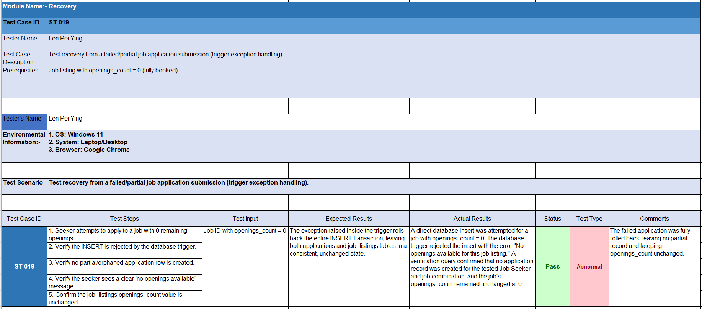

Figure 4.6: Failed Application Submission Rollback

#### 4.3.1.5 Business Logic

Business Logic Testing was conducted to check whether EasyEarn’s implemented business rules operated as expected. This subsection is an Evaluation of Application-status Transition Constraints in the Employer interface, namely ST-023. Additional business logic testing evidence is provided in Appendix 3.5.

 

Test ID: ST-023 Application Status Transition Constraints

This test checked if the forward application-status workflow is applied as intended in the Employer interface. A Reviewed application could not be moved backwards to an earlier status. Once an application was completed, there were no controls on the Employer interface to toggle the application back to the previous status, so it could not be done through the normal interface. Figure 4.7 shows the status-transition controls used in the test.

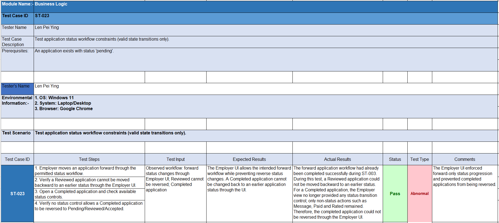

Figure 4.7: Application Status Transition Constraints

#### 4.3.1.6 Reporting

Reporting Testing determines if system-generated values and summaries match the data stored in the system [97]. EasyEarn testing covered Admin Analytics, job-listing reports, Job Seeker work history and earnings, and Employer job-performance information, with additional evidence provided in Appendix 3.6.

Test ID: ST-027 Admin Analytics Dashboard Accuracy

This test compared the values displayed on the Admin Analytics Dashboard with the corresponding records stored in Supabase. The dashboard showed User Growth = 8, Job Volume = 5, Report Load = 2 and database verification showed: eight active users, five active job listings, two report records, and one approved Employer verification. The chart displayed 50% User Growth, 31% Job Volume, 13% Report Load and 6% Verification Load, which matched the rounded proportions of the underlying values. Figure 4.8 shows the verified Admin Analytics Dashboard results.

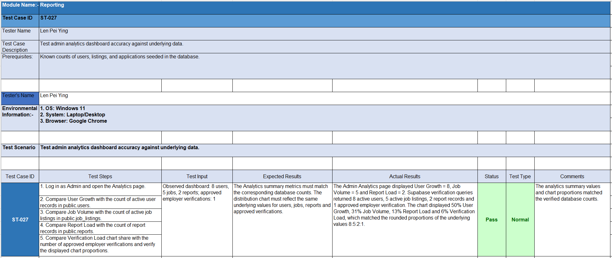

Figure 4.8: Admin Analytics Dashboard Accuracy

#### 4.3.1.7 Compliance

Compliance-related System Testing consisted of the evaluation of selected EasyEarn controls related to privacy, transparency and user-protection aspects, such as privacy information access, handling of Employer verification documents, audit records, and compliance reminders [17], [19], [97]. These tests were for selected controls already implemented and were not legal or regulatory certification. Additional test cases and evidence are provided in Appendix 3.7.

 

Test ID: ST-032 PDPA-Aligned Document Handling

This test evaluated the access controls applied to Employer verification documents. Each Employer&#39;s registration and contact details were recorded in the Employer record in the Supabase database during testing. An Admin account was able to log in to the Verifications area and view the documents submitted by the Employer, whereas a Job Seeker attempting to log in to the Employer verification area was directed to the Job Seeker section and was not able to see protected verification documents. The test confirmed that the verification-document access is in accordance with the tested user roles and record ownership. Figure 4.9 shows the document-access control evidence.

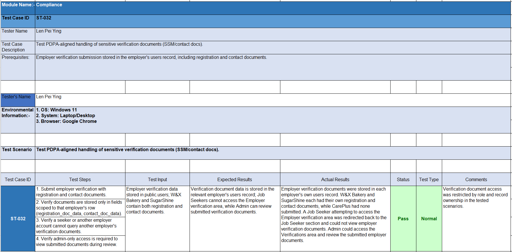

Figure 4.9: PDPA-aligned Document Handling

Overall, all 34 System Testing test cases across the seven categories of E2E Workflow, Integration, Performance, Recovery, Business Logic, Reporting and Compliance achieved a Pass result. The tested EasyEarn workflows, system integrations, operations related to performance, recovery behaviour, business rules, reporting functions and selected compliance-related controls functioned as designed in the scenarios evaluated. The remaining System Testing test cases and supporting evidence are provided in Appendix 3.

### 4.3.2 User Acceptance Testing (UAT)

UAT was conducted to determine whether EasyEarn could support the main functional needs of its three primary user groups: Job Seeker, Employer and Admin. The testing was performed with the designated user accounts and test data stored in Supabase to simulate real-life system usage. Five testers participated in the UAT, and each tester completed 15 core functional tasks, consisting of five Job Seeker tasks, five Employer tasks and five Admin tasks. In the scenarios tested, all functional tasks were executed to Pass. Figure 4.10 summarises the UAT results, showing 75 successful functional task executions across the five testers with an overall pass rate of 100%. The detailed UAT forms and supporting evidence are provided in Appendix 4.

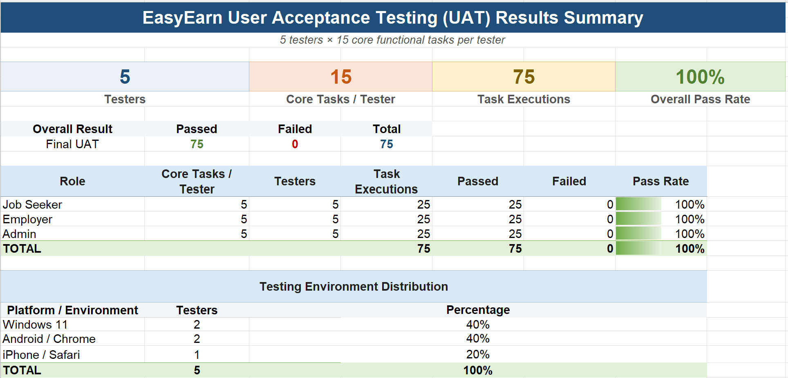

Figure 4.10: Summary of User Acceptance Testing Results

#### 4.3.2.1 Job Seeker UAT

The Job Seeker UAT consisted of five core functional tasks covering registration and login, job search and browsing, job application, work history and Employer rating, and resume management. All five testers completed the five Job Seeker tasks, resulting in 25 successful Job Seeker task executions. One completed Job Seeker UAT form is presented as a representative example in this section, as shown in Figure 4.11. The complete UAT forms for all testers are provided in Appendix 4.

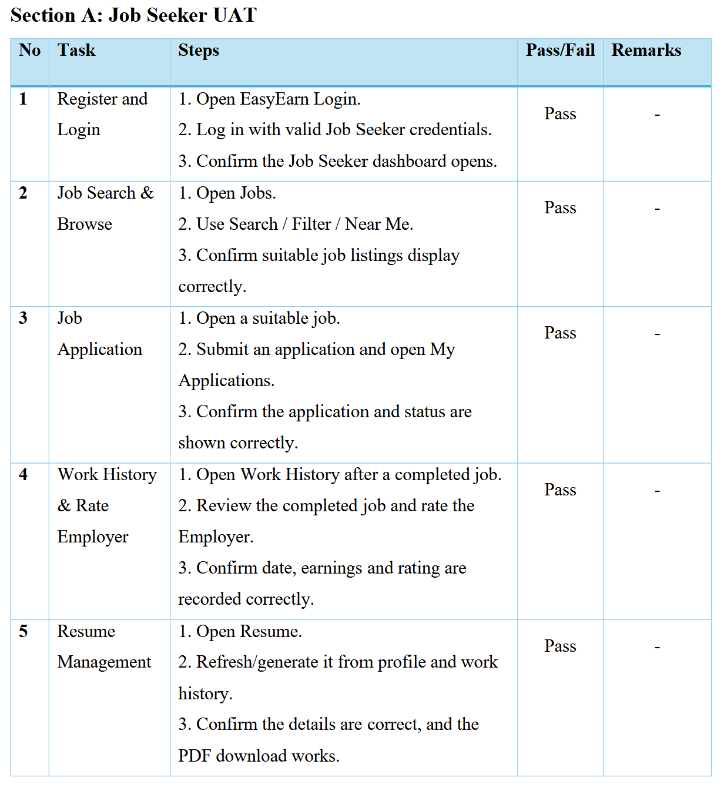

Figure 4.11: Representative Job Seeker UAT Results

#### 4.3.2.2 Employer UAT

The Employer UAT consisted of five core functional tasks covering job posting, applicant viewing, applicant acceptance or rejection, Employer verification, and job completion and Job Seeker rating. All five testers completed the five Employer tasks, resulting in 25 successful Employer task executions. One completed Employer UAT form is presented as a representative example in this section, as shown in Figure 4.12. The complete UAT forms for all testers are provided in Appendix 4.

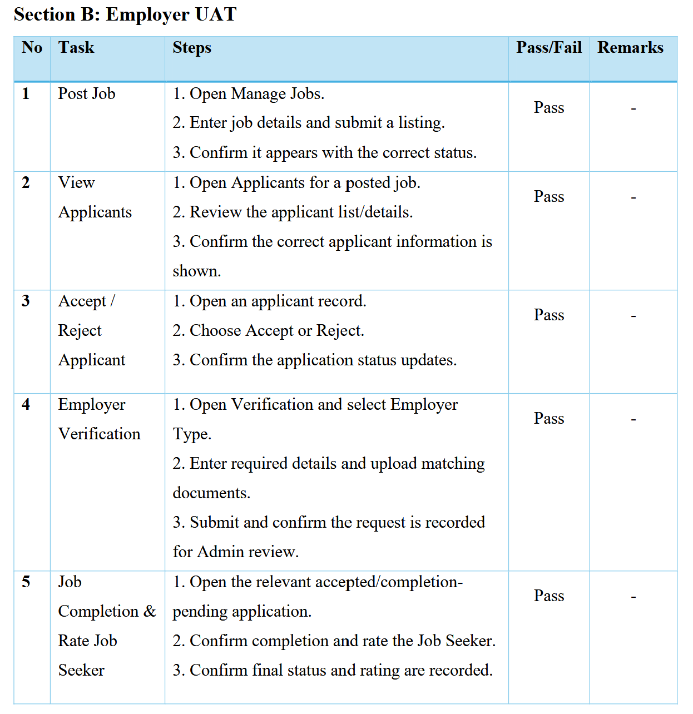

Figure 4.12: Representative Employer UAT Results 

#### 4.3.2.3 Admin UAT

The Admin UAT processes were organised into five core functional tasks: Employer account lock and unlock, Job Approval, Job Flagging or Removal, Employer verification review, and handling of reports. All five testers completed the five Admin tasks, resulting in 25 successful Admin task executions. One completed Admin UAT form is presented as a representative example in this section, as shown in Figure 4.13. The complete UAT forms for all testers are provided in Appendix 4.

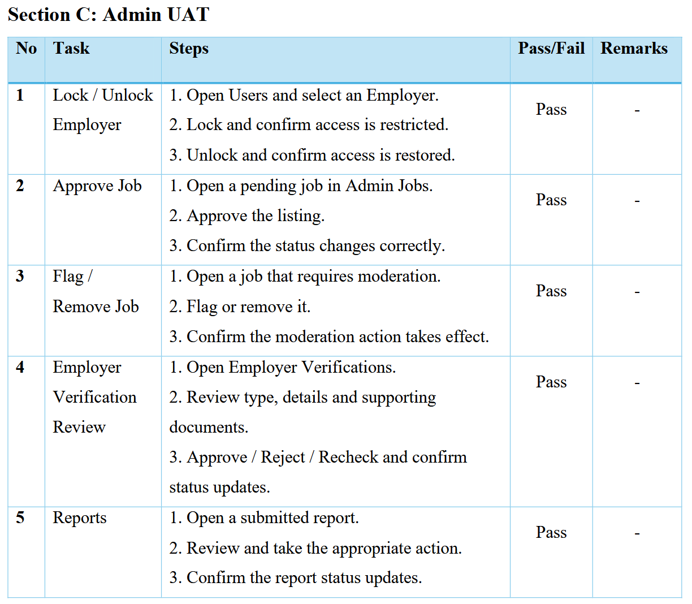

Figure 4.13: Representative Admin UAT Results

All 75 functional UAT task executions were completed successfully across the three user roles: Job Seeker, Employer and Admin. Each of the five testers completed 15 core functional tasks, consisting of five tasks for each user role. The results showed that the main EasyEarn workflows could be completed successfully using the tested user accounts and Supabase data. The complete UAT forms and supporting evidence are provided in Appendix 4.

### 4.3.3 Usability Testing

Usability Testing was conducted using two complementary approaches: an end-user usability questionnaire and a heuristic evaluation based on Nielsen&#39;s 10 Usability Heuristics [57]. The end-user usability questionnaire was included in Section D of the UAT form, which was composed of 10 statements rated on a five-point Likert scale ranging from Strongly Disagree (1) to Strongly Agree (5). Five testers completed the questionnaire after performing the Job Seeker, Employer and Admin UAT tasks.

Across the five testers, a total of 50 usability ratings were collected. Of these, 42 ratings were Strongly Agree (5) and eight ratings were Agree (4), giving a mean usability rating of 4.84 out of 5.00. No Neutral, Disagree, or Strongly Disagree responses were recorded. All five testers also selected “Accept” for Overall Acceptance. These results indicate that the tested users generally perceived EasyEarn as clear, usable and easy to navigate within the evaluated scenarios.

The end-user usability results were complemented by a heuristic evaluation conducted by the author using Nielsen&#39;s 10 Usability Heuristics [57]. The heuristic evaluation was applied to identify interface-level usability problems that may not have been reported directly by the end users. Each heuristic was assessed across the Job Seeker, Employer and Admin interfaces, and identified issues were rated using Nielsen&#39;s 0-4 severity scale, where 0 represents no usability problem, and four represents a usability catastrophe [57]. The end-user usability questionnaire results are presented in Table 4.5, while the heuristic evaluation results are presented in Tables 4.6 to 4.8.

 

Table 4.5: End-user Usability Questionnaire Results

<table>
<tr>
<td>

No.

</td>
<td>

Evaluation Item

</td>
<td>

Agree (4)

</td>
<td>

Strongly Agree (5)

</td>
<td>

Mean Score

</td>
</tr>
<tr>
<td>

1

</td>
<td>

Navigation menu makes functions easy to find.

</td>
<td>

0

</td>
<td>

5

</td>
<td>

5.00

</td>
</tr>
<tr>
<td>

2

</td>
<td>

Job information, buttons and instructions are clear.

</td>
<td>

0

</td>
<td>

5

</td>
<td>

5.00

</td>
</tr>
<tr>
<td>

3

</td>
<td>

Job search, filters and Near Me are easy to use.

</td>
<td>

0

</td>
<td>

5

</td>
<td>

5.00

</td>
</tr>
<tr>
<td>

4

</td>
<td>

Application status and next actions are clearly displayed.

</td>
<td>

0

</td>
<td>

5

</td>
<td>

5.00

</td>
</tr>
<tr>
<td>

5

</td>
<td>

Forms and system messages support task completion and error correction.

</td>
<td>

2

</td>
<td>

3

</td>
<td>

4.60

</td>
</tr>
<tr>
<td>

6

</td>
<td>

Layout, buttons and design are consistent throughout EasyEarn.

</td>
<td>

0

</td>
<td>

5

</td>
<td>

5.00

</td>
</tr>
<tr>
<td>

7

</td>
<td>

Employer verification requirements are clear and understandable.

</td>
<td>

3

</td>
<td>

2

</td>
<td>

4.40

</td>
</tr>
<tr>
<td>

8

</td>
<td>

Chatbot and available guidance are helpful.

</td>
<td>

3

</td>
<td>

2

</td>
<td>

4.40

</td>
</tr>
<tr>
<td>

9

</td>
<td>

Translation feature is easy to access and use.

</td>
<td>

0

</td>
<td>

5

</td>
<td>

5.00

</td>
</tr>
<tr>
<td>

10

</td>
<td>

Main EasyEarn tasks can be completed easily and efficiently.

</td>
<td>

0

</td>
<td>

5

</td>
<td>

5.00

</td>
</tr>
<tr>
<td>

Overall

</td>
<td>

50 usability rating

</td>
<td>

8

</td>
<td>

42

</td>
<td>

4.84

</td>
</tr>
</table>

As shown in Table 4.5, the five testers provided a total of 50 usability ratings. Of these, 42 (84%) were considered “Strongly Agree”, and eight (16%) were considered “Agree”, giving an overall mean usability score of 4.84 out of 5.00. No Neutral, Disagree, or Strongly Disagree responses were recorded. The highest mean score of 5.00 was achieved by seven of the ten evaluation items. Employer verification clarity and chatbot guidance had the lowest mean scores of 4.40, but were still considered positive between “Agree” and “Strongly Agree.” All five testers also selected Accept for Overall Acceptance.

In addition to the end-user questionnaire, a heuristic evaluation based on Nielsen&#39;s 10 Usability Heuristics [57] was conducted by the author to identify interface-level usability issues that might not be directly reported by end users. The evaluation identified issues involving Visibility of System Status, Consistency and Standards, and Help and Documentation. The identified issues, severity levels and proposed solutions are presented in Tables 4.6 to 4.8.

Table 4.6: Heuristic Evaluation Issues and Proposed Solutions

<table>
<tr>
<td>

No.

</td>
<td>

Issue

</td>
<td>

Heuristic Violated

</td>
<td>

Location

</td>
<td>

Severity

</td>
<td>

Proposed Solution

</td>
</tr>
<tr>
<td>

1

</td>
<td>

The chatbot can only handle a set of pre-defined FAQ keywords, and free-form natural language questions are not supported.

</td>
<td>

H10 - Help and Documentation

</td>
<td>

Floating chatbot widget (all dashboard pages)

</td>
<td>

2 - Minor

</td>
<td>

Implement a lightweight intent-matching service or Large Language Model (LLM)-as-a-service tool to be used alongside the existing FAQ knowledge base for handling free-form questions.

</td>
</tr>
<tr>
<td>

2

</td>
<td>

The navbar background colour is inconsistent with the page background on some role dashboards.

</td>
<td>

H4 - Consistency and Standards

</td>
<td>

Job Seeker and Admin dashboard navbars

</td>
<td>

1 - Cosmetic

</td>
<td>

Match the colour of the navbar background to the page-level colour token or CSS variable.

</td>
</tr>
<tr>
<td>

3

</td>
<td>

Below 700px, the Applications page stat-card grid does not appear as desired due to a CSS specificity issue.

</td>
<td>

H4 - Consistency and Standards

</td>
<td>

Job Seeker Applications page

</td>
<td>

1 - Cosmetic

</td>
<td>

Make the 700px media query more specific, or order the media queries to make the narrower one the most specific.

</td>
</tr>
<tr>
<td>

4

</td>
<td>

The notification bell is polling for 30 seconds instead of push-based notification updates, which may cause the status change to be delayed.

</td>
<td>

H1 - Visibility of System Status

</td>
<td>

Notification bell across all roles

</td>
<td>

2 - Minor

</td>
<td>

Use Supabase Realtime subscriptions instead of periodic polling to ensure that notifications are sent to the client more quickly.

</td>
</tr>
</table>

The heuristic findings were evaluated in conjunction with the lower end-user ratings of Employer verification clarity and chatbot guidance. The result of the chatbot was similar to that of H10, and there was no distinct heuristic violation found for Employer verification clarity.

Among the four usability issues identified in Table 4.6, two were rated as minor and were considered to have a greater effect on UX than the two cosmetic issues. These were limited help and documentation support (H10) and delayed notification updates (H1). Table 4.7 compares the current implementation of these two issues with their proposed improvements.

Table 4.7: Comparison for the Two Higher-Impact Issues

<table>
<tr>
<td>

Issue

</td>
<td>

Current Implementation

</td>
<td>

Proposed Improvement

</td>
</tr>
<tr>
<td>

Help and Documentation (H10)

</td>
<td>

The chatbot answers primarily based on set FAQ keywords. If a question is not similar to the stored keywords, it may not get the desired answer.

</td>
<td>

Integrate light intent matching/LLM response handling for free-form inputs and preserve the FAQ knowledge base.

</td>
</tr>
<tr>
<td>

Visibility of System Status (H1)

</td>
<td>

The notification bell refreshes every 30 seconds, which can make it take a bit longer for it to display the latest status changes.

</td>
<td>

Use Supabase Realtime subscriptions to push notification updates to the client more promptly.

</td>
</tr>
</table>

Table 4.7 presents the comparison between two higher-impact usability issues found in the heuristic evaluation: limited chatbot support under Help and Documentation (H10) and delayed notification updates under Visibility of System Status (H1). Both issues were rated as minor because they could affect the UX but did not prevent users from completing the main system tasks. All other usability problems were cosmetic and mainly were related to consistency and responsiveness of layout.

To provide an overall summary of the heuristic evaluation, Table 4.8 maps all ten Nielsen usability heuristics to the issues identified in EasyEarn. The table shows which heuristics were associated with usability issues and which were found to have no specific issue during the evaluation. This provides a consolidated view of the usability strengths and areas for improvement across the Job Seeker, Employer and Admin interfaces.

Table 4.8: Heuristics and Issues Found

<table>
<tr>
<td>

Heuristic

</td>
<td>

Issue(s) Found

</td>
<td>

Notes

</td>
</tr>
<tr>
<td>

H1 - Visibility of System Status

</td>
<td>

Issue 4

</td>
<td>

Notification updates can take up to 30 seconds since the notification bell operates on periodic polling instead of push updates.

</td>
</tr>
<tr>
<td>

H2 - Match Between System and the Real World

</td>
<td>

None identified

</td>
<td>

Job categories, RM currency formatting, role names and application status terms match the setting of the gig work in Malaysia.

</td>
</tr>
<tr>
<td>

H3 - User Control and Freedom

</td>
<td>

None identified

</td>
<td>

Actions supported can be edited and deleted or reversed, as applicable to the user&#39;s role and the state of the workflow.

</td>
</tr>
<tr>
<td>

H4 - Consistency and Standards

</td>
<td>

Issues 2 and 3

</td>
<td>

There were two cosmetic consistency problems: navbar background inconsistencies and a responsive stat-card layout problem below the 700px breakpoint.

</td>
</tr>
<tr>
<td>

H5 - Error Prevention

</td>
<td>

None identified

</td>
<td>

Validation and duplicate-submission prevention for required field data was verified to be working for the scenarios tested.

</td>
</tr>
<tr>
<td>

H6 - Recognition Rather Than Recall

</td>
<td>

None identified

</td>
<td>

Persistent navigation, role-specific menus and dashboard summaries minimise navigation path and system state memory.

</td>
</tr>
<tr>
<td>

H7 - Flexibility and Efficiency of Use

</td>
<td>

None identified

</td>
<td>

Filters, dark mode and saved jobs offer shortcuts and repeated-use support, but don&#39;t stop novice users from enjoying the same capabilities.

</td>
</tr>
<tr>
<td>

H8 - Aesthetic and Minimalist Design

</td>
<td>

None identified

</td>
<td>

Common card layouts and specific content for roles keep the interface system coherent and form task-oriented groups.

</td>
</tr>
<tr>
<td>

H9 - Help Users Recognise, Diagnose, and Recover from Errors

</td>
<td>

None identified

</td>
<td>

Clear and actionable error messages were displayed for the tested invalid inputs and failed actions.

</td>
</tr>
<tr>
<td>

H10 - Help and Documentation

</td>
<td>

Issue 1

</td>
<td>

The chatbot offers answers based on FAQs but can only match keywords and cannot handle free-form natural language questions.

</td>
</tr>
</table>

Overall, four usability issues were identified across three heuristics: Visibility of System Status (H1), Consistency and Standards (H4), and Help and Documentation (H10). Two issues were rated as minor and two as cosmetic. In all the identified scenarios, the identified issues did not prevent completion of the main EasyEarn tasks.  

#### 4.3.3.1 Justification for Non-Violations

For the seven heuristics where no specific usability issue was identified, the “Met” assessment was based on direct review of the deployed EasyEarn interfaces and the tested system behaviour. Match Between System and the Real World (H2) was judged as met because job categories, the format of RM currency, user-role terminology and application-status labels were presented consistently in the context of gig work in Malaysia. User Control and Freedom (H3) was found to be met as users were able to edit, delete, logout and remove saved jobs where permitted, based on their role and workflow state.

Required field Validation and Duplicate submission controls were tested and found to be functioning as expected, and Error Prevention H5 was therefore judged met. Recognition Rather Than Recall (H6) was supported by sustained navigation and role-specific menus and dashboard summaries, decreasing the need for users to remember paths or states in the system. Flexibility and Efficiency of Use (H7) was supported by functions such as filters, dark mode and saved jobs, which provided convenient access without preventing new users from completing the same tasks. Aesthetic and Minimalist Design (H8) was classified as met, as the common card designs and the content relevant to the task remained clearly visible and the function was kept in focus. Help Users Recognise, Diagnose, and Recover from Errors (H9) was also rated as met, as clear error messages in the form of actionable instructions were displayed for the tested incorrect inputs or failed actions.

Overall, four usability issues were identified across three heuristics: Visibility of System Status (H1), Consistency and Standards (H4), and Help and Documentation (H10). Two issues were rated as minor and two as cosmetic, with none preventing completion of the main EasyEarn tasks. The results were generally similar to the end-user usability questionnaire that gave a mean score of 4.84 out of 5.00 on 50 usability rating.

 

A limitation of the heuristic evaluation is that it was conducted by a single evaluator who was also the system developer. Therefore, the identified issues may not represent all possible usability problems. The heuristic findings should be considered in conjunction with the UAT results that included 50 usability ratings and 75 functional task executions by five testers in the Job Seeker, Employer and Admin roles.

### 4.3.4 Security Testing

Security Testing was conducted to evaluate the security controls implemented in EasyEarn for protecting user data, restricting unauthorised access and reducing common application-level security risks [79], [97]. The testing was organised into nine categories: RLS Data Isolation, Auth &amp; Access Control, Upload Security, Input Sanitisation, Rating &amp; Business Rules, Report Security, Analytics &amp; Chatbot, PDPA &amp; Compliance, and Employer Verification &amp; Visibility. A total of 30 Security Testing test cases (SEC-001 to SEC-030) were executed, and all 30 test cases achieved a Pass result in the final testing round. The testing centred on Supabase RLS, authentication and RBAC, file-upload restrictions, handling of input, rating and reporting restrictions, access to administrative data, privacy-related restrictions, and Employer verification-based job visibility. Figure 4.14 summarises the nine Security Testing categories. In this section, one representative test case from each category is presented, with the other test cases and supporting evidence given in Appendix 5.

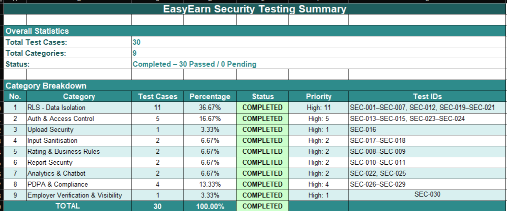

Figure 4.14: EasyEarn Security Testing Summary

#### 4.3.4.1 RLS Data Isolation

RLS Data Isolation Testing evaluated whether Supabase RLS controls restrict users to records they are authorised to access. EasyEarn testing covered applications, notifications, job listings, user profiles, work history and other user-related records, with additional test cases and evidence provided in Appendix 5.1.

Test ID: SEC-001 Seeker Cannot Read Another Seeker&#39;s Applications

This test was designed to determine if an authenticated Job Seeker could gain access to application records of another Job Seeker. The system was logged in by Job Seeker ABCD and returned ABCD&#39;s own application record. When requesting another Job Seeker&#39;s applications, using the same authenticated session returned no results, and neither user&#39;s application data was exposed. The test passed as a result, and the tested RLS policy prevented application data from being shared between Job Seekers. Figure 4.15 shows the application data-isolation test result.

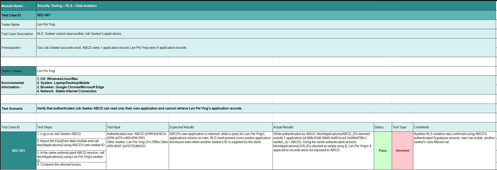

Figure 4.15: RLS Data Isolation (Seeker Application Read Isolation) 

#### 4.3.4.2 Auth &amp; Access Control

Auth &amp; Access Control Testing evaluated whether authentication, session and role-based restrictions prevent users from accessing functions or data outside their authorised role. The testing included registration controls, cross-role access, session handling, Admin-only functions, as well as some additional evidence in Appendix 5.2.

Test ID: SEC-024 Admin Page Access Blocked for Non-Admin Users

This test confirmed whether a non-admin authenticated user can directly access an admin-only page. While logged in as Job Seeker ABCD, direct navigation to the Admin Users page was blocked and the session was redirected back to the Job Seeker Dashboard. No Admin content was displayed. The test passed, thus verifying that direct access to the page was blocked by the Admin access guard. The access-control result is shown in Figure 4.16.

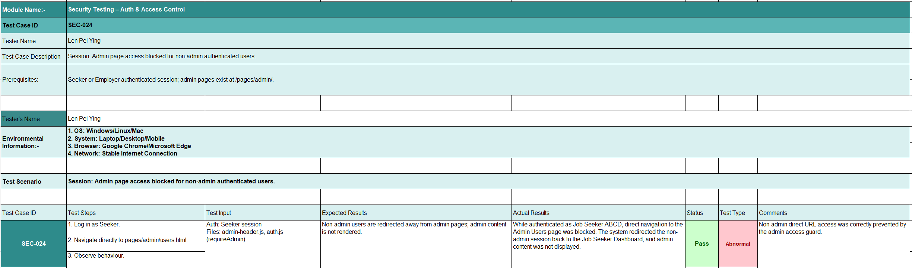

Figure 4.16: Auth &amp; Access Control - Admin Page Access Restriction 

#### 4.3.4.3 Upload Security

Upload Security Testing was used to assess the file-type and file-size limits for profile images and Employer verification documents. This category contains one test case, SEC-016, which is presented below.

Test ID: SEC-016 Profile Photo and Verification Document Upload Restrictions

This test measured the size and type of restrictions on profile images and Employer verification documents. An 11.46 MB PNG profile image was rejected because it exceeded the 2 MB limit. An oversized Employer verification document was also rejected and was not saved, and a plain-text file with a .jpg extension was similarly rejected. The test passed, showing that the tested upload controls blocked oversized files and a non-image file with an image extension. Figure 4.17 shows the upload-security test result.

Figure 4.17: Upload Security - File Type and Size Restrictions

 

#### 4.3.4.4 Input Sanitisation

Input Sanitisation Testing evaluated how EasyEarn handles potentially malicious user input, including Cross-Site Scripting (XSS) and SQL injection-related input. One representative test case is presented below, while the additional test case and evidence are provided in Appendix 5.4.

Test ID: SEC-017 Input Sanitisation Against XSS

This test evaluated whether HTML and JavaScript payloads could execute when user-generated content was displayed by EasyEarn. XSS payloads were tested in job descriptions, rating reviews and chat messages. In the re-test, the job-description payload was presented as escaped text, and the rating-review and chat-message payloads did not trigger any JavaScript alert. Display of the payloads provided access to normal system functions. The retest subsequently passed and verified that the XSS payloads submitted could not be executed because of the display paths tested. Figure 4.18 shows the XSS test result.

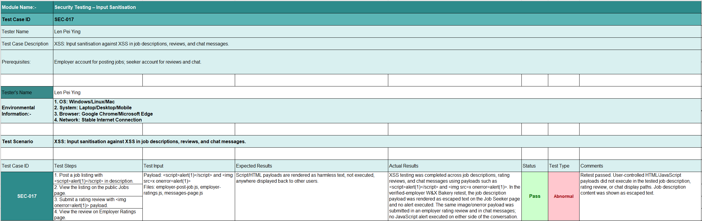

Figure 4.18: Input Sanitisation - XSS Prevention

#### 4.3.4.5 Rating &amp; Business Rules

Rating &amp; Business Rules Security Testing evaluated whether rating-related restrictions prevent invalid or unauthorised rating activities. The testing covered rating eligibility and self-rating prevention, with additional evidence provided in Appendix 5.5.

Test ID: SEC-008 Seeker Cannot Submit a Rating for a Pending Application

The first test showed that a Job Seeker was able to prompt a rating for an application that was still Pending, and the rating was now displayed on the Employer Ratings page. With database-level rating validation enabled, the same request was made, and it was denied with a 403 HTTP error code. A new rating record was never added, and an invalid pending-application rating was no longer shown. It was also confirmed that valid ratings attached to Completed applications remained valid through regression testing. The retest passed in turn, and it was confirmed that the creation of ratings is now limited based on the eligibility of the application. Figure 4.19 shows the rating-security test result.

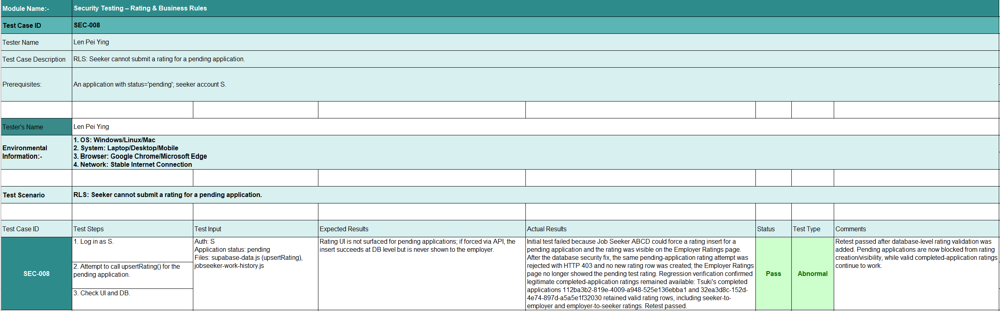

Figure 4.19: Rating &amp; Business Rules - Rating Eligibility Guard

#### 4.3.4.6 Report Security

Report Security Testing determined that report submission and report records are controlled only to authenticated and authorised users. Testing included unauthenticated report submission and cross-user report access; further evidence is included in Appendix 5.6.

Test ID: SEC-011 Seeker Cannot Read Another User&#39;s Submitted Reports

This test was to ensure an authenticated Job Seeker could not access reports submitted by other users. While logged in as Job Seeker ABCD, a direct query to the reports table returned an empty result, and known reports belonging to other Job Seekers were not returned. The test passed because it limited reports&#39; visibility and prevented disclosure of cross-user reports. Figure 4.20 shows the report data-isolation result.

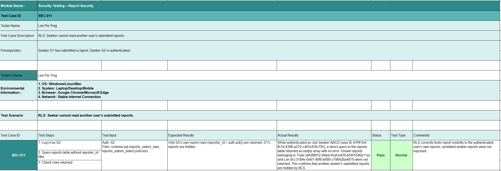

Figure 4.20: Report Security - Report Read Isolation

#### 4.3.4.7 Analytics &amp; Chatbot

Analytics &amp; Chatbot Security Testing examined whether analytics and chatbot data is limited by user role. The tests were focused on restricting non-admin users from accessing administrative analytics and chatbot log information, and further evidence is included in Appendix 5.7.

Test ID: SEC-025 Admin Analytics Data is Not Accessible to Non-Admin Users

This test confirmed whether the data on platform analytics can be retrieved directly by a non-admin user. A direct query to the analytics table was made with the same username as Job Seeker ABCD and returned no analytics records, an empty result, and the HTTP status code 200. The test was successful, and it was concluded that analytics data is restricted to authorised Admin users by the tested RLS policy. Figure 4.21 shows the analytics access-control result.

Figure 4.21: Analytics &amp; Chatbot - Analytics Access Restriction 

#### 4.3.4.8 PDPA &amp; Compliance

PDPA &amp; Compliance Security Testing evaluated selected EasyEarn privacy and access-control measures related to personal data, Employer verification information and job-listing visibility. These tests were for selected technical controls and were not part of a legal compliance audit. Additional test cases and evidence are provided in Appendix 5.8.

Test ID: SEC-026 Personal Data Fields are Not Exposed in Public Job Listing Queries

This test was designed to determine if public job-listing queries revealed Employer personal information or verification information. While unauthenticated, a direct query returned the available public job listings and their job-specific fields, such as title, category, location, pay information and status. The returned job-listing records did not contain employee personal information like email addresses, phone numbers, biographies, registration details or verification-document details. The tested public query was therefore successful, establishing that these personal-data fields of the Employer were not disclosed. The result of the public job-listing query is shown in Figure 4.22.

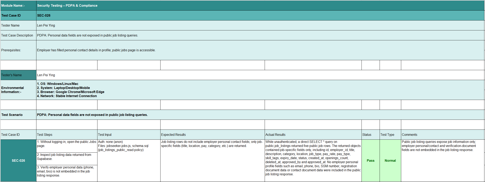

Figure 4.22: PDPA &amp; Compliance - Job Listing Data Minimisation

#### 4.3.4.9 Employer Verification &amp; Visibility

Employer Verification &amp; Visibility Testing determined if public job visibility is appropriately limited based on the Employer&#39;s verification status. This category contains only one test case, SEC-030, which is presented in full below. Since there are no additional test cases in this category, SEC-030 is not repeated in Appendix 5.9.

 

Test ID: SEC-030 Employer Verification &amp; Job Visibility

The initial test identified that an approved job posted by the unverified CarePlus Employer was visible to Job Seekers even though the Employer had not completed verification. A security update was then added to ensure the public can see jobs only when an employer has an approved job list and a verified, active Employer. During the retest, the CarePlus job remained available in the Employer Dashboard for management but was no longer visible on the Public or Job Seeker Browse Jobs page. The retest passed, and it was shown that approved jobs from unverified Employers are not visible in the public job view. Figure 4.23 shows the Employer verification and job-visibility result.

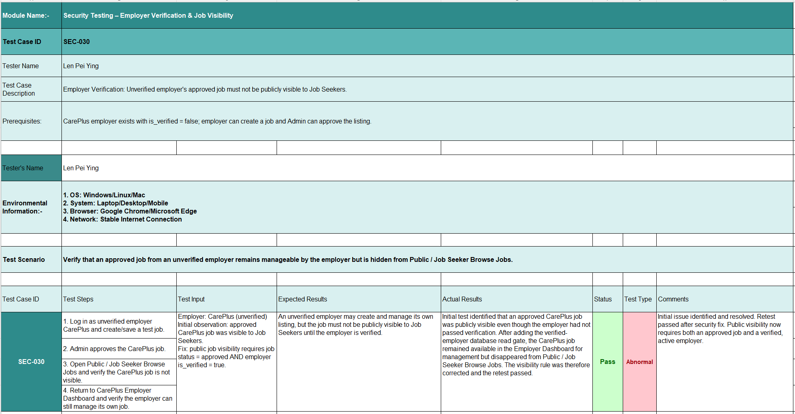

Figure 4.23: Employer Verification and Job Visibility Restriction

Overall, all 23 Compatibility Testing test cases across the six testing categories achieved a Pass result in the final testing round. In the directly tested environments, the platform features, authentication-session behaviour, the interface components and form controls performed as expected for the selected functions. The findings are limited to the browsers, devices, operating systems and viewport conditions that were directly tested. Other Security Testing test cases and supporting evidence are included in Appendix 5.

### 4.3.5 Compatibility Testing

Compatibility Testing was performed to determine if EasyEarn was consistent with the browsers, screen sizes, devices and interaction environments within the scope of the test. The testing categories were: Browser Compatibility, Responsive Design, Feature Compatibility, Session &amp; Auth, UI &amp; Display, Form &amp; Input. A total of 23 Compatibility Testing test cases (CT-001 to CT-023) were executed, and all 23 achieved a Pass result in the final testing round. The tests included browser-dependent functionality, responsive layout, platform-dependent features, authentication-session functionality, presentation of the interface and form controls. Figure 4.24 summarises the six Compatibility Testing categories. One representative test case from each category is presented in this section, while the remaining test cases and supporting evidence are provided in Appendix 6.

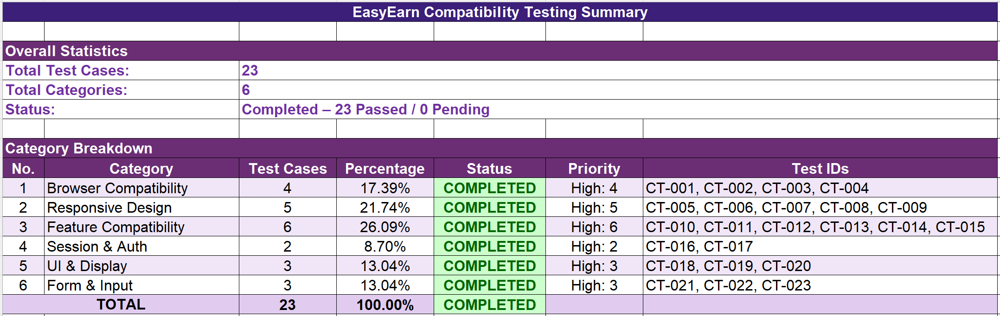

Figure 4.24: EasyEarn Compatibility Testing Summary

#### 4.3.5.1 Browser Compatibility

Browser Compatibility Testing evaluated the consistency of selected browser-dependent EasyEarn functions and interface elements as they were tested in the directly tested desktop browsers. The testing covered CSS layout rendering, JavaScript functionality, PDF resume generation and Chart.js analytics rendering in Google Chrome, Mozilla Firefox and Microsoft Edge. Additional test cases and evidence are provided in Appendix 6.1.

Test ID: CT-001 CSS Layout Rendering

This test evaluated whether the main EasyEarn interface rendered correctly in Google Chrome, Mozilla Firefox and Microsoft Edge. CSS Grid and Flexbox layouts, Lucide icons and role-specific interface elements were displayed without broken layouts in the tested browsers. The test passed: the layout rendered in all the desktop browsers it was tested in. Figure 4.25 shows the browser compatibility result.

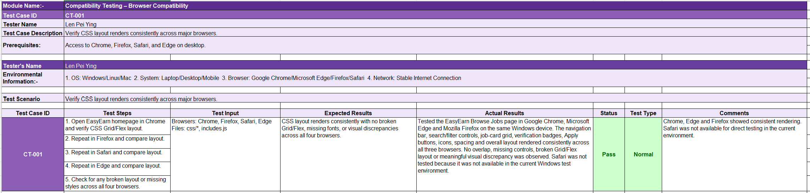

Figure 4.25: Browser Compatibility - CSS Layout Rendering 

#### 4.3.5.2 Responsive Design

Responsive Design Testing determined if EasyEarn&#39;s layout, navigation and interactive components were responsive to desktop, tablet and mobile screen sizes. The testing included layout breakpoints, touch interactions, mobile content display, validation presentation and mobile filtering, and video evidence is attached in Appendix 6.2.

Test ID: CT-005 Layout Breakpoints

This test evaluated the Jobs page across desktop, tablet and mobile viewport sizes. At the end of the retest, the job layout adjusted correctly to the tested breakpoints, the mobile navigation collapsed as intended, and the page did not cause unwanted horizontal scrolling. The test was successful in its final test round. The responsive layout at the breakpoints tested is shown in Figure 4.26

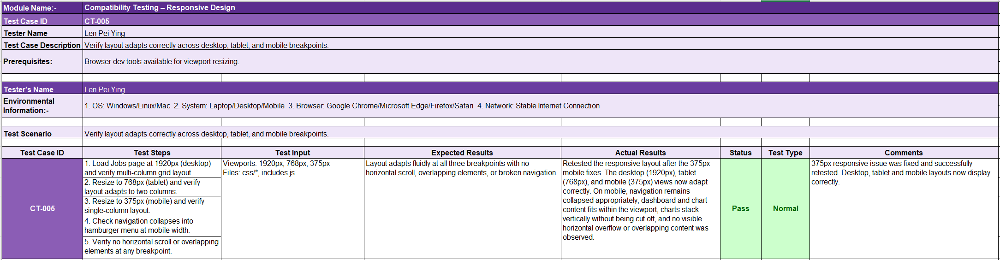

Figure 4.26: Responsive Design - Layout Breakpoints 

#### 4.3.5.3 Feature Compatibility

Feature Compatibility Testing checked if the selected EasyEarn features functioned correctly across the browsers and screen resolutions tested. The tests covered Google Translate Integration, dark mode, the floating chatbot, Employer verification uploads, notification updates and Admin analytics, with additional evidence provided in Appendix 6.3.

Test ID: CT-010 Google Translate Integration

This test evaluated whether Google Translate Integration could be activated while keeping the main EasyEarn content, navigation and interface accessible. The translation function was activated during the test, and the page was usable after translation. The test achieved a Pass result. Figure 4.27 shows the test record and result for Google Translate integration.

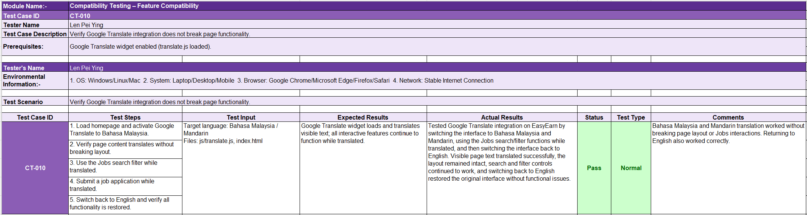

Figure 4.27: Feature Compatibility - Google Translate Integration

#### 4.3.5.4 Session &amp; Auth

Session &amp; Auth Compatibility Testing checked if authentication-session behaviour was consistent across multiple tabs in the same browser session. Tests included cross-tab session persistence and synchronised logout, and there was additional evidence provided in Appendix 6.4.

Test ID: CT-017 Cross-Tab Logout

This test checked if the authenticated state of one browser tab was invalidated by the logout of another tab of the same browser session. When logout was done on the first tab, the second tab noticed the logout and brought the user back to the Login page. The test passed, confirming the tested cross-tab logout behaviour. Figure 4.28 shows the logout result.

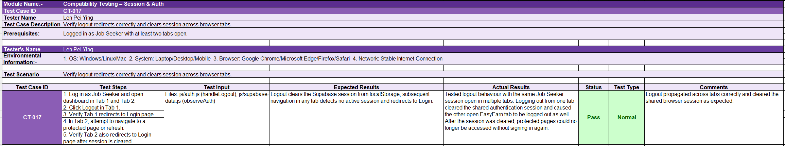

Figure 4.28: Session &amp; Auth - Cross-tab Logout 

#### 4.3.5.5 UI &amp; Display

UI &amp; Display Compatibility Testing was used to determine the readability and proper display of the EasyEarn interface content in the test environments. Testing was conducted on font rendering, long text handling and image-upload preview, and some specifics are included in Appendix 6.5.

 

Test ID: CT-019 Long Text Overflow Handling

This test assessed if long text content would be shown without breaking the EasyEarn page layout. When tested, the content in the long job description did not overrun or break the surrounding UI. The test was successfully passed. Figure 4.29 shows the long-text display result.

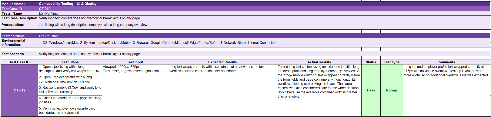

Figure 4.29: UI &amp; Display - Long Text Overflow Handling

#### 4.3.5.6 Form &amp; Input

Form &amp; Input Compatibility Testing was used to determine if common EasyEarn form controls and functions responded consistently in the tested browsers. The tests included interview date and time selection, file-size and file-type validation, and password-field masking; additional evidence is included in Appendix 6.6.

Test ID: CT-021 Interview date/time picker

This test evaluated whether the interview date and time picker operated correctly in Google Chrome, Mozilla Firefox and Microsoft Edge. The form accepted the selected date and correct time, and the information was passed to the interview scheduling process and stored in the application record. A pass result was obtained from the test. Figure 4.30 shows the tested date and time picker.

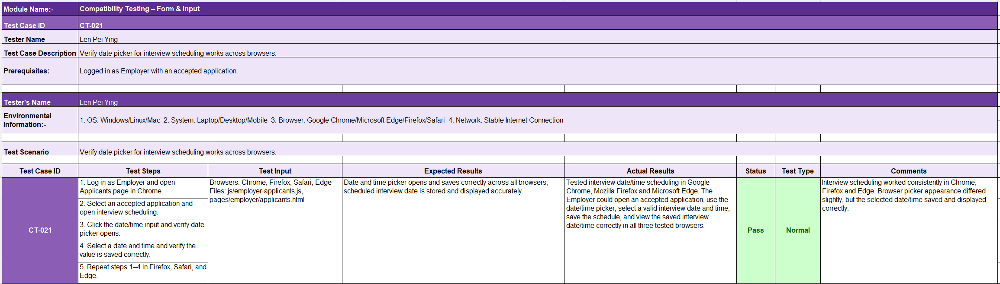

Figure 4.30: Form &amp; Input - Interview Date/Time Picker

Overall, all 23 Compatibility Testing test cases across the six testing categories achieved a Pass result in the final testing round. For the EasyEarn browser, the results indicated that the tested environments operated in a consistent manner for the tested functions and the features of the platform selected, the authentication-session behaviour, the interface components and form controls. The findings are limited to the browsers, devices, operating systems and viewport conditions that were directly tested. The remaining Compatibility Testing test cases and supporting evidence are provided in Appendix 6.

### 4.3.6 Requirements Traceability and Verification Summary

To show the connection between the system requirements established in Chapter 3 and the evidence of evaluating the system in this chapter, the FRs and NFRs of EasyEarn were mapped to the evidence of the implementation and the verification of the system. Requirements traceability provides a systematic relationship between software requirements, implementation and evaluation activities [22], [97]. Tables 4.9 and 4.10 accordingly show the evidence used to assess each requirement and whether it is verified, partially verified, evaluated or supported in terms of implementation evidence in the scope of this FYP.

 

The 18 FRs defined in Table 3.8 are mapped to the corresponding System Testing, UAT, Security Testing and Compatibility Testing evidence in Table 4.9. As the final UAT was structured as 15 core functional tasks for the Job Seeker, Employer and Admin roles, rather than as numbered test cases, the relevant UAT task descriptions are provided directly as evidence for verification in the table.

Table 4.9: Functional Requirements Verification Summary

<table>
<tr>
<td>

Requirement

</td>
<td>

Test Case IDs

</td>
<td>

Status

</td>
</tr>
<tr>
<td>

FR01 - User Registration &amp; Login

</td>
<td>

UAT - Job Seeker Registration &amp; Login; ST-001; SEC-014; SEC-015

</td>
<td>

Verified

</td>
</tr>
<tr>
<td>

FR02 - RBAC

</td>
<td>

SEC-013; SEC-024; ST-018

</td>
<td>

Verified

</td>
</tr>
<tr>
<td>

FR03 - Profile Setup

</td>
<td>

ST-001

</td>
<td>

Verified

</td>
</tr>
<tr>
<td>

FR04 - Browse &amp; Filter Job Listings

</td>
<td>
<table>
<tr>
<td>

</td>
</tr>
</table>

<table>
<tr>
<td>

UAT - Job Seeker Job Search &amp; Browsing; ST-013; CT-009

</td>
</tr>
</table>

</td>
<td>

Verified

</td>
</tr>
<tr>
<td>

FR05 - Apply for Jobs

</td>
<td>

UAT - Job Seeker Job Application; ST-001; ST-007

</td>
<td>

Verified

</td>
</tr>
<tr>
<td>

FR06 - Application Status Tracking

</td>
<td>

ST-003; ST-023

</td>
<td>

Verified

</td>
</tr>
<tr>
<td>

FR07 - Save Jobs / Wishlist

</td>
<td>

ST-012

</td>
<td>

Verified

</td>
</tr>
<tr>
<td>

FR08 - Work History Dashboard

</td>
<td>

UAT - Job Seeker Work History &amp; Employer Rating; ST-029

</td>
<td>

Verified

</td>
</tr>
<tr>
<td>

FR09 - Auto-Generate Resume

</td>
<td>

UAT - Job Seeker Resume Management; ST-015; CT-003

</td>
<td>

Verified

</td>
</tr>
<tr>
<td>

FR10 - Post &amp; Manage Job Listings

</td>
<td>

UAT - Employer Job Posting; ST-002; ST-030

</td>
<td>

Verified

</td>
</tr>
<tr>
<td>

FR11 - Review &amp; Manage Applicants

</td>
<td>

UAT - Employer Applicant Viewing and Acceptance/Rejection; ST-003

</td>
<td>

Verified

</td>
</tr>
<tr>
<td>

FR12 - Employer Verification Badge

</td>
<td>

UAT - Employer Verification; ST-009; ST-026; SEC-030

</td>
<td>

Verified

</td>
</tr>
<tr>
<td>

FR13 - Bidirectional Rating &amp; Review

</td>
<td>

UAT - Job Seeker Work History &amp; Employer Rating; UAT - Employer Job Completion &amp; Job Seeker Rating; ST-024; SEC-008; SEC-009

</td>
<td>

Verified

</td>
</tr>
<tr>
<td>

FR14 - Report / Flag System

</td>
<td>

UAT - Admin Job Flagging/Removal; UAT - Admin Handling of Reports; ST-004; ST-028; SEC-010; SEC-011

</td>
<td>

Verified

</td>
</tr>
<tr>
<td>

FR15 - User Management

</td>
<td>

UAT - Admin Employer Account Lock/Unlock; ST-033

</td>
<td>

Verified

</td>
</tr>
<tr>
<td>

FR16 - Job Listing Moderation

</td>
<td>

UAT - Admin Job Approval; UAT - Admin Job Flagging/Removal; ST-004; ST-025

</td>
<td>

Verified

</td>
</tr>
<tr>
<td>

FR17 - Google Translate Integration

</td>
<td>

CT-010

</td>
<td>

Verified

</td>
</tr>
<tr>
<td>

FR18 - Rule-Based Chatbot

</td>
<td>

ST-011; CT-012

</td>
<td>

Verified

</td>
</tr>
</table>

Direct evidence of evaluation of all 18 FRs was provided within the scope of testing defined. The verification evidence included 34 System Testing test cases, 75 UAT functional task executions completed by five testers, 30 Security Testing test cases and 23 Compatibility Testing test cases. The results demonstrate that the FRs implemented worked as expected in the scenarios and environments tested [97].

Table 4.10 shows how the NFRs stipulated in Table 3.9 are mapped to the corresponding verification evidence. NFRs are the quality attributes and operational constraints that impact the performance of the system, such as performance, security, usability, compatibility and maintainability [21].

 

Table 4.10: Non-Functional Requirements Verification Summary

<table>
<tr>
<td>

Requirement

</td>
<td>

Test Case IDs

</td>
<td>

Status

</td>
</tr>
<tr>
<td>

NFR01 - Page Load Time

</td>
<td>

ST-013; ST-016

</td>
<td>

Verified (Selected Pages)

</td>
</tr>
<tr>
<td>

NFR02 - HTTPS Encryption

</td>
<td>

Section 4.2.5 System Deployment; HTTPS implementation evidence

</td>
<td>

Implementation Verified

</td>
</tr>
<tr>
<td>

NFR03 - RLS

</td>
<td>

SEC-001-SEC-007; SEC-012; SEC-019-SEC-021

</td>
<td>

Verified

</td>
</tr>
<tr>
<td>

NFR04 - Session Management

</td>
<td>
<table>
<tr>
<td>

</td>
</tr>
</table>

ST-018; SEC-023; CT-016; CT-017

</td>
<td>

Verified

</td>
</tr>
<tr>
<td>

NFR05 - Responsive Design

</td>
<td>

CT-005-CT-009; UAT device evidence

</td>
<td>

Verified within Tested Devices

</td>
</tr>
<tr>
<td>

NFR06 - Accessibility

</td>
<td>

UAT Usability Questionnaire; Heuristic Evaluation

</td>
<td>

Evaluated

</td>
</tr>
<tr>
<td>

NFR07 - System Availability

</td>
<td>

Section 4.2.5 System Deployment

</td>
<td>

Not Formally Verified

</td>
</tr>
<tr>
<td>

NFR08 - Concurrent Users

</td>
<td>

ST-014

</td>
<td>

Partially Verified

</td>
</tr>
<tr>
<td>

NFR09 - Code Modularity

</td>
<td>

Section 4.2.1 Frontend

</td>
<td>

Implementation Verified

</td>
</tr>
<tr>
<td>

NFR10 - PDPA 2010

</td>
<td>

SEC-026-SEC-029; ST-031-ST-033

</td>
<td>

Verified (Selected Controls)

</td>
</tr>
<tr>
<td>

NFR11 - Browser Compatibility

</td>
<td>

CT-001-CT-004; UAT - iPhone/Safari

</td>
<td>

Partially Verified

</td>
</tr>
<tr>
<td>

NFR12 - Deployment Independence

</td>
<td>

Section 4.2.5 System Deployment; Appendix 7

</td>
<td>

Implementation Verified

</td>
</tr>
</table>

The detailed evaluation results discussed in Sections 4.3.1-4.3.5 are complemented by the verification evidence presented in Tables 4.9 and 4.10. The 12 NFRs were verified, with three of them within the specified scope limits. Three were implementation verified, one was evaluated, two were partially verified, and one was not formally verified.

The scope limits apply to NFR01 (Page Load Time), NFR05 (Responsive Design) and NFR10 (PDPA 2010), which were verified for selected pages, tested devices and selected controls, respectively. We evaluated NFR06 (Accessibility) through the usability questionnaire and heuristic evaluation. NFR07 (System Availability) was not formally verified because it was not monitored for long. The concurrent application test in ST-014 partially validated NFR08 (Concurrent Users) without stress or load testing with 100 concurrent users. NFR11 (Browser Compatibility) was partially verified as the formal Compatibility Testing suite included Google Chrome, Mozilla Firefox and Microsoft Edge, while Safari evidence was collected via iPhone UAT.

The three remaining NFRs, NFR02 (HTTPS Encryption), NFR09 (Code Modularity), and NFR12 (Deployment Independence), were considered implementation-verified NFRs, which are verified through implementation and deployment evidence without dedicated execution-based test cases. The classifications reflect the evidence type and extent that exists and do not give undue credence to the results of the verification [21], [22], [97].

## 4.4 Output Analysis

This section shows two sample outputs that EasyEarn can produce: the Admin Analytics Dashboard and the Job Seeker Auto-Generated Resume. The outputs provide examples of how the data stored and processed in EasyEarn can be converted to information that can be useful to various system users. The Admin Analytics Dashboard provides a summary of platform information and visualisations for easy administration monitoring, and the Auto-Generated Resume makes a Job Seeker&#39;s profile information and completed work history available as a downloadable PDF. The following subsections describe the purpose, data sources and resulting output of each feature.

 

### 4.4.1 Admin Analytics Dashboard Output

The Admin Analytics Dashboard provides Admins with a consolidated overview of platform activity through summary statistics, visualisations and detailed records. The dashboard presents information related to users, job listings, reports and Employer verification. Selected statistics are presented visually through charts for interpretation and monitoring of activities on the platform [53].

The dashboard fetches actual data from Supabase and makes the necessary calculations on the client side before returning and rendering the summaries and visualisations. The analytics information that was selected may also be saved as a dated snapshot in the analytics table, so that previous platform statistics may be referenced. It is implemented following EasyEarn&#39;s static-frontend and BaaS architecture, where the data is stored in Supabase, while the front-end processes and displays the retrieved information.

Admins also have access to a Data Explorer on the dashboard to view even more detailed information, depending on the filters available. In addition, a Compliance Awareness panel provides reminders related to job information, reports, payment disputes and Employer verification records. These elements combine to make the platform information comprehensible as a structured management overview. Figure 4.31 shows the Supabase analytics table used to store analytics records and historical snapshots.

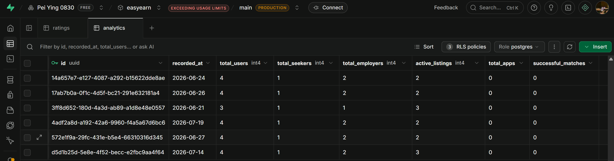

Figure 4.31: Supabase Analytics Table

### 4.4.2 Auto-Generated Resume Output

The Auto-Generated Resume function produces a PDF resume using information stored in the Job Seeker&#39;s EasyEarn profile and completed work history. The information for the resumes generated includes profile information, skills, education, availability, and completed work experience, so that the Job Seeker can use this information without having to re-enter it into EasyEarn.

The resume content is first rendered within the browser using the Job Seeker&#39;s stored information. The html2canvas library captures the rendered resume content and converts it to PDF document format with a size of A4, using jsPDF [51], [94]. The document will then show the profile and completed work information provided when the Resume was made.

Completed work records can provide supporting employment information such as the job role, completion details and available platform rating information. The Auto-Generated Resume transforms the Job Seeker data stored in EasyEarn into a portable employment document. Figure 4.32 shows an example of the PDF resume generated by EasyEarn.

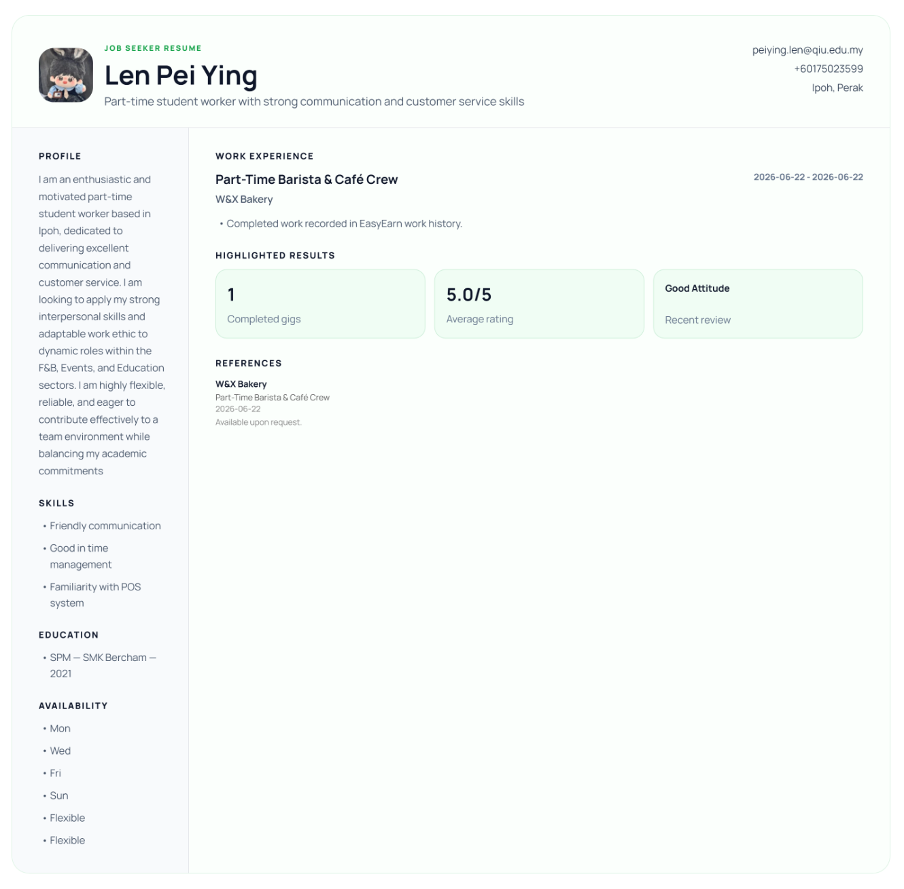

Figure 4.32: Auto-Generated Resume Output (PDF)

## 4.5 Chapter Summary

This chapter presented the implementation, testing and representative outputs of the EasyEarn Job Matching Portal. Section 4.2 described the frontend, backend, database, imported packages and system deployment. EasyEarn is built as a multi-page web application with HTML, CSS, and JavaScript, with Supabase handling the authentication, database services, RLS, and some of the database logic. It was deployed using a static frontend and a BaaS approach via GitHub Pages.

Five complementary evaluation methods were conducted in Section 4.3: System Testing, UAT, Usability Testing, Security Testing and Compatibility Testing. All 34 System Testing test cases across seven categories achieved a Pass result. Five UAT testers completed 75 functional task executions across the Job Seeker, Employer and Admin roles, with all tested tasks completed successfully. The mean value for the End-user usability questionnaire was 4.84/5.00, which was the result of 50 ratings from five testers. In addition, the heuristic evaluation identified four usability issues across three of Nielsen&#39;s usability heuristics, consisting of two minor issues and two cosmetic issues.

Security Testing had 30 test cases in nine categories, with all 30 passing the final testing round. Several deficiencies that were noted during the first testing were rectified and retested satisfactorily before the final results were obtained. Compatibility Testing included 23 test cases across six categories, all of which passed in the directly tested environments. The Compatibility Testing findings were therefore limited to the browsers, devices, operating systems and viewport conditions that were directly evaluated.

The FRs and NFRs were mapped to the respective testing and implementation evidence in Section 4.3.6 to show requirement traceability. All 18 FRs were found to be supported by direct evaluation evidence, and selected NFRs were identified as verified, partially verified, evaluated, implementation verified or not formally verified based on the available evidence and project scope.

In Section 4.4, two typical outputs of the system were introduced: the Admin Analytics Dashboard and the Auto-Generated Resume. The dashboard provides an overview of platform information for admin monitoring, and the resume feature transforms a Job Seeker&#39;s profile and completed work history into a PDF document for download. In summary, the operation of the main EasyEarn functions and workflows in the scope of evaluation is supported. Chapter 5 discusses these findings in relation to the project objectives, limitations, contributions and future enhancements.
