# Chapter 5: Discussion and Conclusion

## 5.1 Introduction

This final chapter discusses the findings of the EasyEarn project in relation to the four RQs presented in Section 3.2.1 and the four research objectives outlined in Section 1.3. The findings are interpreted using the implementation, testing and output evidence presented in Chapter 4. Section 5.2 discusses how each RQ was addressed and how the corresponding research objective was achieved. Limitations related to implementation, security assurance and testing are discussed in Section 5.3. The contributions of EasyEarn are presented in Section 5.4, while Section 5.5 summarises its research contribution and significance. Future enhancements are discussed in Section 5.6. The chapter and overall project are completed in Section 5.7.  Figure 5.1 outlines the discussion of the research findings, objective achievement, project limitations, contributions, future enhancements and overall project conclusion.

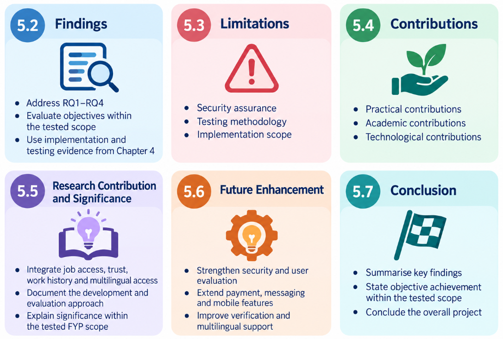

Figure 5.1: Overview of Chapter 5 Discussion and Conclusion

## 5.2 Findings

The key findings of the EasyEarn project are discussed in relation to the four RQs and their corresponding research objectives. Each subsection explains how the relevant RQ was addressed through the user requirement findings, system implementation and testing evidence presented in the previous chapters, and evaluates whether the corresponding research objective was achieved.

### 5.2.1 RQ1 and Objective 1: A Multi-User Job-Matching Platform

RQ1 aimed to identify the key requirements for a web-based job-matching platform that supports short-term, part-time and freelance employment between Job Seekers and Employers in Malaysia. Based on the user requirement findings and the identified system requirements, the main requirements included role-based access, job posting and application management, location and category-based job search and filtering, application status tracking, and user-support functions. These requirements formed the basis for the development of the main EasyEarn platform functions.

Objective 1 was achieved through the development of a multi-user web-based job-matching platform with separate role-based interfaces for Job Seekers, Employers and Admins. Job Seekers can browse and filter job listings, apply for jobs, track application status, save jobs and access the rule-based chatbot. Employers can create and manage job listings, review applicants and manage application progress. Admins are provided with platform management, user management, job moderation, reporting and analytics functions.

System Testing and UAT were used to evaluate the implementation. All 34 System Testing test cases were conducted across the E2E Workflow, Integration, Performance, Recovery, Business Logic, Reporting and Compliance categories. In addition, five UAT testers completed 75 functional task executions across the Job Seeker, Employer and Admin roles using designated accounts and test data stored in Supabase. All 75 task executions were completed successfully, indicating that the main role-based workflows could be completed within the tested scenarios

The findings therefore indicate that EasyEarn provides the essential functions required for structured short-term job matching between Job Seekers and Employers. This directly addresses Problem 1, Lack of a Specialised Short-Term Labour Platform in Smaller Towns; Problem 4, Inefficient Recruitment Process for Employers; and Problem 5, Limited Structured Access to Flexible Work Opportunities, as identified in Section 1.2.

Figure 5.2 summarises the key findings for RQ1 and Objective 1, including the main role-based functions of EasyEarn, the supporting System Testing and UAT evidence, and the three related problems addressed by the platform.

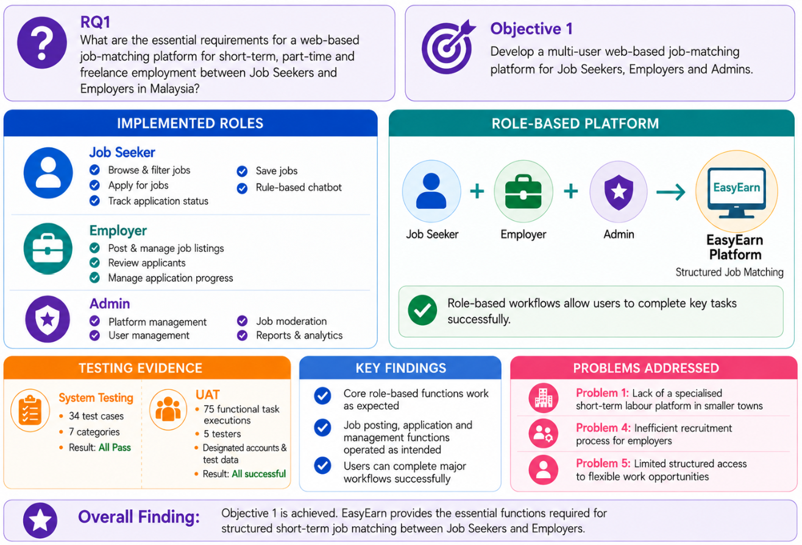

Figure 5.2: Summary of Findings for RQ1 and Objective 1

### 5.2.2 RQ2 and Objective 2: A Safety and Trust Verification System

RQ2 focused on the safety and trust aspects that can be included in EasyEarn to minimise the risk of fraudulent job postings and build trust between the Job Seeker and Employer. Employer verification and reporting/flagging, bidirectional ratings and reviews, and RBAC and security controls are important features to support transparency and accountability for the platform.

The Employer Verification Badge, Report and Flag System, and Bidirectional Rating and Review System were used to accomplish Objective 2. These functions give users options to review completed work engagements, report any suspicious activity and find out which Employers have been verified by the platform.

Security Testing was conducted to evaluate the implemented safety- and security-related controls. All 30 Security Testing test cases were performed on nine categories, and all 30 of them passed the final test rounds. Several weaknesses identified during the initial testing were corrected and successfully retested, including rating eligibility, unauthorised application-status modification and the public visibility of jobs posted by unverified Employers. The final results showed that all the tested controls in authentication, access control, reporting, privacy and Employer verification were working as designed in the tested scenarios.

Overall, EasyEarn provides more structured accountability mechanisms than informal job-seeking channels. This answers Problem 2: Prevalence of Social Media Job Scams identified in Section 1.2.

Figure 5.3 summarises the key findings for RQ2 and Objective 2, including EasyEarn&#39;s main safety and trust features, the supporting Security Testing evidence, and how these functions address Problem 2 related to social media job scams.

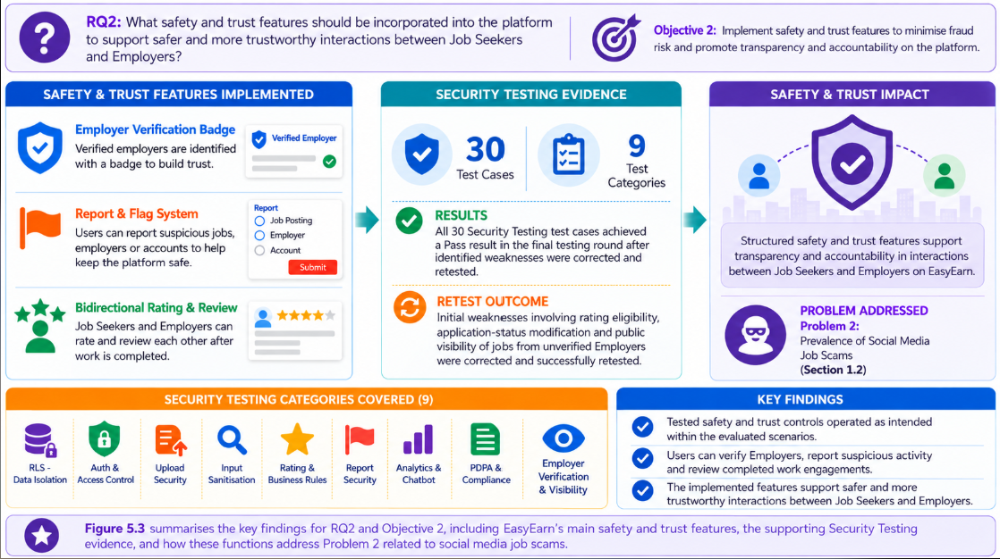

Figure 5.3: Summary of Findings for RQ2 and Objective 2

### 5.2.3 RQ3 and Objective 3: A Verifiable Digital Work History

RQ3 focused on the use of a digital work history and the Auto-Generated Resume to document and present the completed work experience of gig workers. The results suggest that data gathered from completed jobs, skills and platform ratings can be utilised to build a structured work history and used to produce a downloadable PDF resume. This allows Job Seekers to have a more portable and structured resume of their experience on platforms.

Objective 3 was accomplished by implementing the Work History Dashboard and Auto-Generated Resume identified in Section 4.4.2. The Resume Builder extracts the content from the Job Seeker&#39;s profile, skill tags, work history and platform ratings from Supabase and outputs them into a formatted resume and downloadable PDF. The resume created, therefore, is based on information already recorded in the EasyEarn platform, and does not require that the Job Seeker re-enter the information.

The Work History Dashboard also offers a detailed history of the jobs Job Seekers have finished and some work details. When combined, the Work History Dashboard and Auto-Generated Resume offer a viable means of recording and presenting gig workers&#39; work history more systematically.

This directly responds to Problem 3 in Section 1.2: Lack of Verifiable Work History for Gig Workers. The key findings for RQ3 and Objective 3 are summarised in Figure 5.4, which includes the Work History Dashboard, Auto-Generated Resume, output evidence to show the work, and inputs to address the lack of verifiable work history for gig workers.

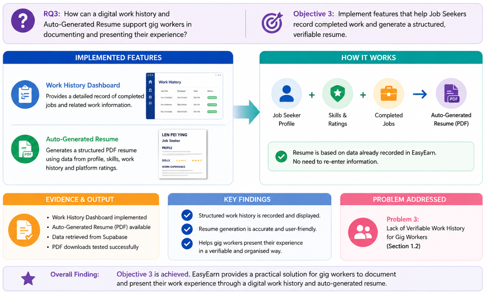

Figure 5.4: Summary of findings for RQ3 and Objective 3

### 5.2.4 RQ4 and Objective 4: Multilingual Accessibility

RQ4 explored the possibility of EasyEarn being more accessible to users with different language preferences by using multilingual access. The results show that multilingual accessibility can be achieved by providing a translated version of EasyEarn on the Google Translate website translation service. This way, users who are using different languages can see the content on the pages displayed in their own language, rather than having to download different versions of each EasyEarn page that have been translated into the users&#39; language.

The Google Translate Integration implemented in EasyEarn achieved Objective 4. The translation function enables the website to be read in various languages such as Bahasa Melayu, Mandarin and Tamil, depending on the languages supported by the Google Translate service.

The multilingual feature was evaluated through CT-010: Google Translate Integration as part of Compatibility Testing. The translation function was successfully activated during testing, and the content of the tested page, navigation and main interface elements were accessible. The broader Compatibility Testing suite achieved 23 Pass results across six categories within the directly tested environments.

The implementation thus offers a useful multilingual-access option for different language preferences of users. It directly addresses Problem 6, Language Barrier on Existing Platforms, in Section 1.2.

Figure 5.5 summarises the key findings for RQ4 and Objective 4, including the multilingual feature implemented in EasyEarn, the supporting Compatibility Testing evidence, and how the feature addresses Problem 6 related to language barriers on existing platforms.

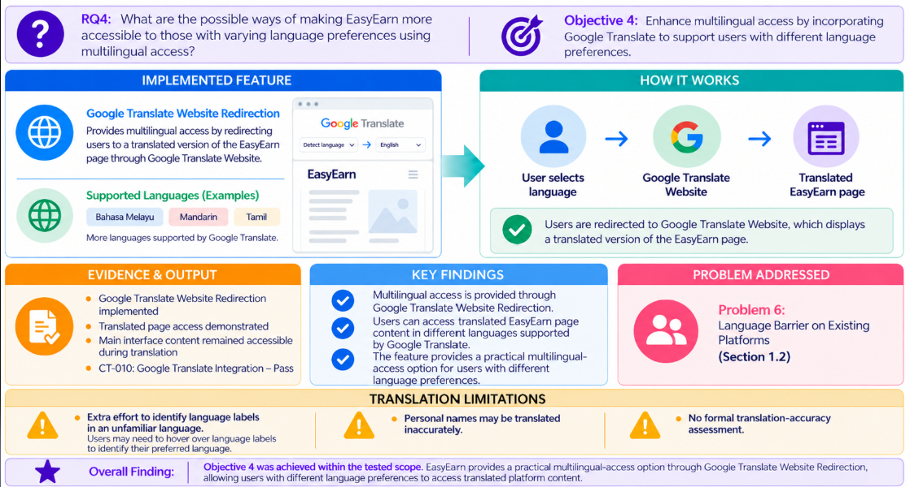

Figure 5.5: Summary of findings for RQ4 and Objective 4

### 5.2.5 Overall Objective Achievement Summary

The findings presented in Sections 5.2.1 to 5.2.4 demonstrate the extent to which each research objective was achieved. The evidence of implementation, evaluation outcomes and overall achievement of each project objective are summarised in Table 5.1.

Table 5.1: Overall Project Objective Achievement Summary

<table>
<tr>
<td>

Objective

</td>
<td>

Evidence Collected

</td>
<td>

Result

</td>
<td>

Status

</td>
</tr>
<tr>
<td>

Objective 1: Develop a multi-user web-based job-matching platform with role-based dashboards, CRUD job management and a rule-based chatbot.

</td>
<td>

34 System Testing test cases; 75 UAT functional task executions; role-based implementation

</td>
<td>

Core workflows for Job Seeker, Employer and Admin were successfully completed within the evaluated scenarios.

</td>
<td>

Achieved

</td>
</tr>
<tr>
<td>

Objective 2: Implement trust and safety features to improve platform reliability.

</td>
<td>

30 Security Testing test cases; Employer Verification Badge; Report &amp; Flag System; Bidirectional Rating &amp; Review

</td>
<td>

The tested safety, trust and security-related controls operated as intended in the final testing round after identified weaknesses were corrected and retested.

</td>
<td>

Achieved

</td>
</tr>
<tr>
<td>

Objective 3: Develop a digital work history profile with automatic PDF resume generation.

</td>
<td>

Work History Dashboard, Auto-Generate Resume, System Testing

</td>
<td>

The completed work history was successfully converted into a downloadable PDF resume.

</td>
<td>

Achieved

</td>
</tr>
<tr>
<td>

Objective 4: Improve multilingual accessibility through Google Translate integration.

</td>
<td>

CT-010; Google Translate Integration; Compatibility Testing

</td>
<td>

Multilingual access was enabled via Google Translate integration, with the job information displayed in the correct language in the examples shown. However, personal names may be translated inaccurately. The accuracy of translation for all supported languages was not formally evaluated.

</td>
<td>

Achieved

</td>
</tr>
</table>

In summary, the evaluation outcomes are in support of the project goals of all four objectives being met within the scope of the tested FYP. Implementation evidence and relevant evaluation results for each objective were presented in Chapter 4. The results show that these features performed as expected in the assessed scenarios. Longer-term effects on user trust and fraud reduction, and translation accuracy across all supported languages, were not formally assessed. The remaining limitations are discussed in Section 5.3.

## 5.3 Limitations

The four project objectives were met based on the findings presented in Section 5.2, but there were a number of limitations during the implementation and testing of EasyEarn. The limitations should be taken into account before the system is deployed more widely in a production environment.

### 5.3.1 Security Assurance Limitations

All 30 Security Testing test cases passed in the final testing round after the issues found during the earlier testing were fixed and tested again. However, passing these test cases does not mean that EasyEarn is completely free from security risks. In this FYP, only selected areas have been tested, including authentication, access control, RLS, file upload, input handling, ratings, reporting, privacy and Employer verification.

The security evaluation was mainly carried out using manually prepared test cases and by checking the security controls implemented in the system. It was not an independent penetration test or a comprehensive security audit. Therefore, there may still be security risks that were not covered by the selected test cases, especially if the system code, database policies or third-party services are changed in the future.

Before EasyEarn is deployed more widely, further security testing should be carried out. This can involve independent security testing, periodic audits of Supabase RLS and database security features, scans for vulnerabilities and dependencies, and regression testing after security changes. The main constraint is thus not in the final Security Testing result, but in the scope of the security evaluation.

 

Figure 5.6 highlights the primary security testing and assurance weaknesses of EasyEarn, namely the narrow focus of the Security Testing scenarios, the lack of independent Security Testing and a formal security audit, and the requirement for ongoing testing and regression testing prior to the wider production deployment of EasyEarn.

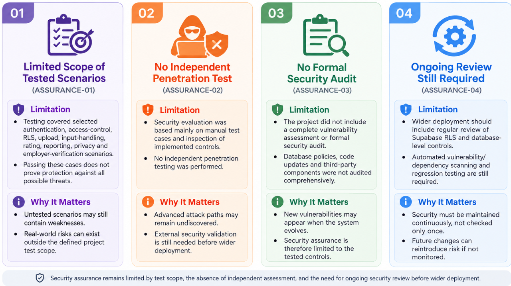

Figure 5.6: Limitation - Security Assurance Limitations

### 5.3.2 Testing Methodology Limitations

The project author performed Security Testing by manual analysis of the source code, RLS policies and some of the security test scenarios. Some combinations of vulnerabilities or attack patterns may not have been discovered in the 30 Security Testing test cases; the testing was not conducted by any independent penetration-testing team or a full security audit.

 

The heuristic evaluation based on Nielsen&#39;s 10 Usability Heuristics [57] identified four minor or cosmetic issues across three heuristics. This evaluation was done by one evaluator, who was also the author of the project, which is one of the limitations of this evaluation. Multiple evaluators are recommended by Nielsen [57] as it is possible that different evaluators will find different usability problems. Thus, the results are not meant to be definitive.

The UAT (Section 4.3.2) involved five testers who completed 75 functional task executions across the Job Seeker, Employer and Admin roles using designated accounts and test data stored in Supabase. The UAT was able to test the major workflows of a role, but the number of testers was low in relation to the total target user base within the selected underserved towns in Malaysia. In addition, the testers were not chosen through an official sampling process. A larger-scale field test including users of different geographical regions would thus offer more reliable evidence of the usability and acceptance of the platform in real-world contexts.

Figure 5.7 summarises the main limitations of the testing methodology, including the absence of an independent security assessment, the use of a single evaluator for heuristic evaluation, and the limited number of UAT testers compared with the intended user population.

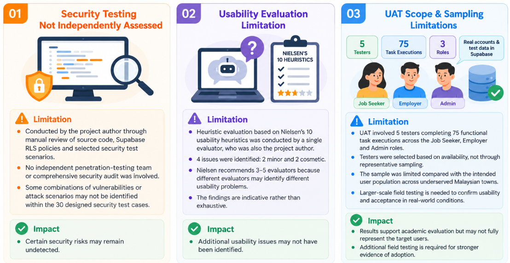

Figure 5.7: Limitation - Testing Methodology Limitations

### 5.3.3 Scope Limitations

The scope limitations of EasyEarn are mainly related to the academic project environment, implementation boundaries and functions that were not fully extended within the current FYP scope. They are not a failure of the system implemented, but are boundaries of the current version and areas for further development, wider evaluation or other technical assistance in further work.

Academic Time Frame

EasyEarn was developed within a 26-week academic period across two FYP courses. The specific time restriction for the project decreased the time available for continued development, evaluation, and large-scale refinement. The project therefore concentrated on implementing and piloting the core functions that have been identified and have been incorporated into the available academic programme.

Single-Developer Environment

EasyEarn was developed by one developer without an independent peer review team or cross-functional development team. Requirements analysis, system design, implementation, testing and QA activities were therefore conducted within a single-developer environment. This could have limited the independent testing and validation available in the development and testing phases.

Architecture Constraints

EasyEarn is built with a static frontend and a BaaS architecture. The frontend is deployed via GitHub Pages, and Supabase offers authentication, database services, RLS policies and some business logic. Some controls are also implemented on the client-side using JavaScript. It is desirable to limit the need for a dedicated application server, but, as described in Section 5.3.1, there are potential security and privacy issues that will need to be resolved before widespread production deployment.

Excluded Features

Some functions were excluded from the implemented system due to the current project scope. This consists of an inbuilt settlement gateway and a native mobile application. Payments are therefore not part of the application, but mobile users access EasyEarn via the responsive web interface and not through a dedicated mobile app.

Communication Scope

The current EasyEarn messaging function is not real-time, but asynchronous. Thus, the testing that was conducted was centered on the rule-based chatbot and the implemented asynchronous messaging functionality. Real-time messaging, live chat and the related communication patterns were not considered in the scope of the ongoing project.

Limited Employer-Side Match Score Filtering

EasyEarn provides a rule-based job match score for Job Seekers based on factors such as skills and location. However, the current Employer applicant management interface does not provide advanced filtering, sorting or ranking of applicants based on the calculated match score. Employers should therefore consider each applicant separately, and not simply give priority to those who have a higher match score. Future developments might extend the existing matching mechanism to the Employer side by enabling filtering/sorting applicants based on match score, skills and location match.

Translation Limitations

The accessibility and usability of EasyEarn pages translated using the Google Translate website translation service were assessed as part of Compatibility Testing, but no formal assessment of translation accuracy or native localisation was conducted. When the interface language is changed, the language names in the selector may also be translated into the selected language, which may make it more difficult for users unfamiliar with that language to identify English or another preferred language. Personal names may also not always be translated accurately by the automatic translation service. Users may therefore need to compare translated names with the original names.

Figure 5.8 summarises six scope limitations of EasyEarn: the academic time frame, single-developer environment, architecture constraints, excluded features, communication scope and translation limitations.

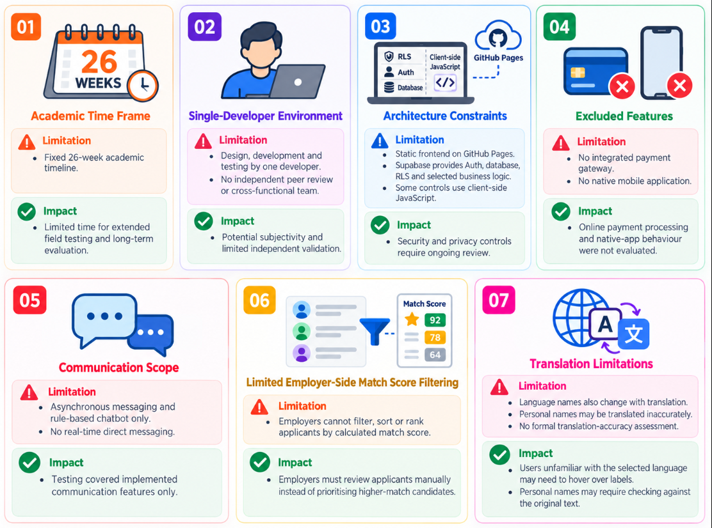

Figure 5.8: Limitation - Scope Limitations

## 5.4 Contribution of the Project

This section looks at the other contributions of EasyEarn, in addition to the four project objectives outlined in Section 5.2. The contributions are evaluated from the viewpoints of practical usefulness for Job Seekers and Employers, academic/methodological usefulness as a FYP, and technological usefulness in terms of architecture and technologies used in the system.

Contribution to Job Seekers and Employers

The following section summarises the practical benefits of the implementation and evaluation results presented in Chapter 4. The evaluation included 34 System Testing test cases, 75 UAT functional task executions, 30 Security Testing test cases and 23 Compatibility Testing test cases, together with the end-user usability questionnaire and heuristic evaluation. The results showed that the main EasyEarn functions worked as expected in the scenarios considered. EasyEarn is thus offering a structured platform that helps to connect Job Seekers and Employers and assists with job searching, application management, hiring, verification, reporting, rating and work-history functions. However, the constraints mentioned in Section 5.3 should be taken into account prior to wider production deployment.

For the Job Seekers, the Work History Dashboard and Auto-Generated Resume also offer a practical benefit, as completed work history, skills and available platform ratings stored in EasyEarn can be used again in a downloadable PDF resume. This will allow Job Seekers to provide a more structured and portable record of their work history.

Academic and Methodological Contribution

EasyEarn documents a case study that applies a Hybrid Agile-Waterfall approach to a FYP developed by a single developer. The project was a blend of formal planning and documentation and iterative development during the FYP. For the evaluation approach, the project used System Testing, UAT, an end-user usability questionnaire, and a heuristic evaluation based on Nielsen&#39;s 10 Usability Heuristics [57], Security Testing and Compatibility Testing. Along with the restrictions listed in Sections 5.3.1 and 5.3.2, this is an example of how several testing methods can be implemented in the context of an academic information systems project, with limitations.

The findings can also be understood in the context of the TAM presented in Section 2.2.2, when interpreting the usability and acceptance of EasyEarn. The UAT and Usability Testing, however, were not formal assessments of constructs of the TAM (such as PEOU or PU). Thus, the outcomes should not be considered a formal TAM assessment.

Technological Contribution

EasyEarn is an example of a multi-role web application implemented using a BaaS architecture with Supabase, GitHub Pages, Chart.js and jsPDF. Supabase provides authentication and database services, with RLS policies controlling data access and database functions and triggers enforcing selected business rules. The frontend is deployed as a static website with no dedicated application server by using GitHub Pages.

The various contributions of EasyEarn are summarised in Figure 5.9, which outlines the practical value of EasyEarn to Job Seekers and Employers, the academic and methodological contribution of the Hybrid Agile-Waterfall approach and multiple testing methods, and the technological contribution of the implementation of a multi-role web application with a BaaS architecture.

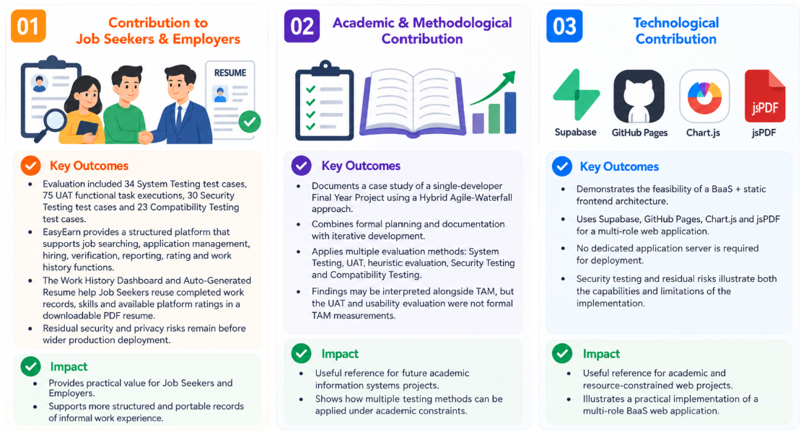

Figure 5.9: Contribution of the Project

## 5.5 Research Contribution and Significance

EasyEarn offers practical, methodological and technological contributions to the tested Final Year Project scope.

Practical Contribution

EasyEarn offers a structured platform that combines job search, hiring, trust controls, digital work history and multilingual access. Its Job Seeker, Employer and Admin roles support the management of short-term, part-time and freelance job opportunities. It is aimed at allowing for flexible access to jobs that people can use, including those in the underserved towns of Malaysia like Ipoh, Kangar, Alor Setar, Kota Bharu and Kuala Terengganu. However, its wider adoption and impact in these towns require further field evaluation.

 

Academic and Methodological Contribution

The project demonstrates the application of a Hybrid Agile-Waterfall methodology in a single-developer FYP. Initial planning, requirements analysis and system design were followed by iterative development and testing. Five main evaluation methods were used: System Testing, UAT, Usability Testing, Security Testing and Compatibility Testing. These methods gave some indication of functional correctness, user experience, security behaviour and compatibility in the scope tested.

Technology Contribution

EasyEarn is a multi-role web application built in HTML, CSS and JavaScript, leveraging Supabase for authentication and database and GitHub Pages for deployment. The platform features a built-in data visualisation tool, Chart.js, for visualising data, a PDF resume generation tool, jsPDF, and Google Translate for multilingual access. These technologies were integrated into a web platform for job management, trust features and digital work records.

Significance

EasyEarn&#39;s value is being able to have structured jobs, control access to them, digital work history and multilingual accessibility in one place. The completed implementation and evaluation demonstrate the feasibility of this approach within the FYP scope. Larger-scale evaluation is needed to establish its long-term adoption and employment outcomes in the target communities.

Figure 5.10 summarises the practical, academic, methodological, and technological contributions of EasyEarn, highlighting their significance within the tested FYP scope. It also notes a need for broader evaluation of the long-term effects and need for wider adoption.

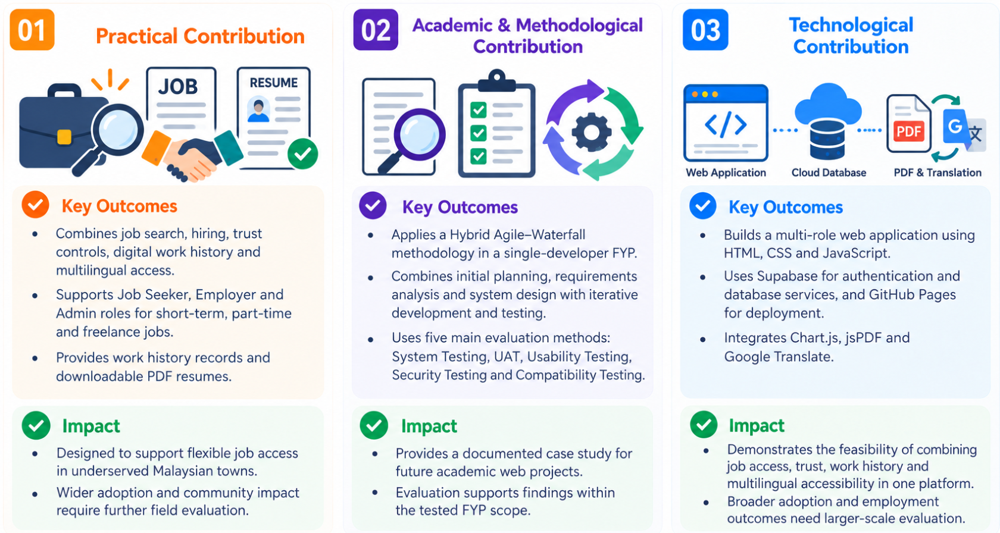

Figure 5.10: Research Contribution and Significance

## 5.6 Future Enhancement

Future security enhancements should focus on strengthening security assurance beyond the test scenarios completed in this project. This could involve independent penetration testing, automated vulnerability and dependency checks, regular audits of Supabase RLS and database-level security measures, improved monitoring of security-sensitive activities, and regression testing following system changes that may affect security.

The platform could also be expanded with additional functional features. Manual payment confirmation could be reduced by integrating an online payment service, such as DuitNow. Real-time messaging could be added to the existing asynchronous messaging with Supabase Realtime or another appropriate real-time communications service.

Future versions of EasyEarn could also integrate Google Maps into the Employer job-posting process. Employers may choose or pin the specific job location on a map they use to create a job posting, not just select from a list of cities or locations. The selected location could then be displayed to Job Seekers to improve job-location clarity and support more convenient location-based job searching. Further enhancement could include distance estimation between the Job Seeker and the job location.

In addition to the responsive web design, a native iOS or Android application could also be created to provide the application with special mobile features, like push notifications, more mobile interaction and selected offline features.

More end users from the target underserved towns should be involved in future evaluation. More extensive field testing would provide stronger evidence of the usability and acceptance of EasyEarn in real-world settings, since the current UAT involved only five testers. To obtain broader coverage of potential usability issues, heuristic evaluation could also be conducted by three to five evaluators, as suggested by Nielsen [57].

Furthermore, the existing Google Translate website translation service could be replaced or extended using the Google Cloud Translation API to provide a more integrated multilingual user experience. The language selector might show fixed and recognisable labels, such as English, Bahasa Melayu and Chinese, irrespective of the selected interface language. This would allow the user to choose his/her preferred language, without having to hover over translated labels. There should also be an obvious choice to return to the original language. Personal names may not be translated automatically, to keep the name intact. A formal identity verification service could also be introduced into the Employer verification process to strengthen employer identity checks. The improvements may help provide more uniform multilingual access and to improve employer verification.

 

The proposed EasyEarn Future Enhancement Roadmap is summarised in Figure 5.11. It includes continued security assurance with independent security assessment, automated vulnerability scanning, periodic review of access control, regression testing, and broader evaluation and trust and accessibility improvements with multi-evaluator heuristic testing, formal identity verification, and multilingual improvements.

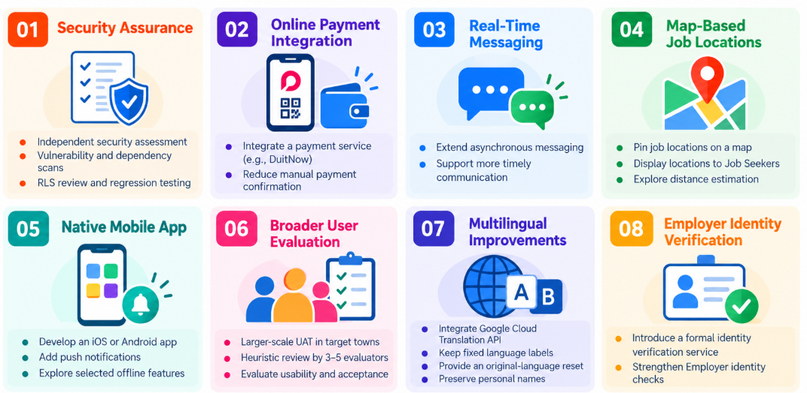

Figure 5.11: Future Enhancement

## 5.7 Conclusion

The EasyEarn project aimed to develop a web-based job-matching platform for Job Seekers and Employers, with particular consideration for underserved Malaysian towns such as Ipoh, Kangar, Alor Setar, Kuala Terengganu and Kota Bharu. The evaluation results support the achievement of the four project objectives outlined in Section 1.3 within the tested FYP scope. Supporting evidence included 34 System Testing test cases, 75 UAT functional task executions completed by five testers across three roles, 30 Security Testing test cases and 23 Compatibility Testing test cases. 50 ratings were received for the usability questionnaire, which gave a mean rating of 4.84 out of 5.00 points and four minor or cosmetic issues were found during the heuristic evaluation.

The project has limitations concerning security assurance, testing methodology and implementation scope, as discussed in Section 5.3. These include the small tester sample, the absence of an independent security assessment and the lack of a formal translation-accuracy evaluation. The limited scope of academic research and the one-developer environment also limited the scope of development and independent testing. Within these boundaries, EasyEarn provides practical, academic and technological contributions. The future enhancements presented in Section 5.6 outline opportunities for further development and evaluation.

In conclusion, EasyEarn shows that it is possible to build a multi-role job-matching web application with a static frontend and BaaS architecture with just one developer and in an academic project. The implemented features support structured job access, trust and safety mechanisms, digital work history and multilingual access in the evaluated scenarios. These findings are not conclusive evidence of lasting improvements in user trust, or of decreasing employment fraud. Additional security guarantees, wider evaluations and production-oriented enhancements are required to pave the way for wider deployment.

 
