 

FACULTY OF COMPUTING AND ENGINEERING

Bachelor of Information Technology (Hons)

BIT 3118 FINAL YEAR PROJECT 2

PROJECT FINAL REPORT

PREPARED BY:

LEN PEI YING (QIU-202404-007159)

SUBMISSION DATE:

16 10 2026

PROJECT TITLE: EASYEARN JOB MATCHING PORTAL

by

Len Pei Ying

A Project

Submitted to the School of Computing

As a Requirement for the Bachelor of Information Technology

OCTOBER 2026

 

# ACKNOWLEDGEMENT

First and foremost, I would like to express my deepest gratitude to my project supervisor, Mr On Siang Aik, for the invaluable guidance, constructive feedback, and continuous encouragement throughout the entire duration of this Final Year Project (FYP). His expertise and patience have been instrumental in shaping both the direction and quality of this work.

I would also like to extend my sincere appreciation to my project moderator, Mr Jivindra A/L Kalaichelven, for the thoughtful evaluation, valuable comments, and constructive critique that have greatly contributed to the improvement and refinement of this project.

My sincere thanks also go to the Faculty of Computing and Engineering at Quest International University for providing the academic resources, infrastructure, and support necessary to carry out this research.

My heartfelt thanks go to my family, especially my parents, for their unwavering support, understanding, and encouragement during the many long hours of development and writing. Their belief in me has been a constant source of motivation.

I am also grateful to my friends and classmates for their moral support, thoughtful discussions, and shared experiences throughout this journey.

Finally, I acknowledge the open-source communities and documentation behind HyperText Markup Language (HTML), Cascading Style Sheets (CSS), JavaScript, and Supabase, as well as the many academic authors whose published works have informed and enriched the theoretical foundation of this project.

# ABSTRACT

In Malaysia, the gig economy has been growing alongside the demand for flexible and short-term job opportunities. However, smaller towns like Ipoh, Kangar, Alor Setar, Kota Bharu and Kuala Terengganu may lack formal job platforms. Other challenges include employment trust, language barriers and limited documentation of work experience.

EasyEarn is a web-based job-matching portal developed using HyperText Markup Language (HTML), Cascading Style Sheets (CSS), JavaScript and Supabase. It supports Job Seekers, Employers and Administrators through role-based dashboards, job posting and application management, location and category filtering, and rule-based chatbot support. Trust and safety features include employer verification, reporting and flagging, and bidirectional ratings and reviews. There are also features for digital work history, Portable Document Format (PDF) resume generation with jsPDF and multilingual support via Google Translate integration.

The development process took 26 weeks and used a Hybrid Agile-Waterfall approach, with the structured planning phase in FYP1 and six iterative development sprints in FYP2. The Technology Acceptance Model (TAM) guided the system design, and a literature review and competitor comparison, along with a survey of 30 respondents, guided the process of requirement identification.

Final evaluation recorded 34/34 system, 30/30 security and 23/23 compatibility test cases passed. There were five testers with 75 task executions (all three roles), and 50 usability ratings with a mean of 4.84/5.00. These findings support achievement of the four objectives within the tested FYP scope. Limitations include the small tester sample and the absence of independent security and formal translation-accuracy assessments.

# TABLE OF CONTENTS

ACKNOWLEDGEMENT i

ABSTRACT ii

PRELIMINARY PAGES

TABLE OF CONTENTS iii

LIST OF TABLES xiv

LIST OF FIGURES xvi

LIST OF ABBREVIATIONS xxiii

Chapter 1: Project Introduction 1

1.1 Introduction 1

1.2 Problem Statement 3

1.3 Research Questions and Research Objectives 7

1.3.1 Research Questions 7

1.3.2 Research Objectives 8

1.4 Scope of Project 10

1.4.1 Project Coverage 10

1.4.2 Complete Features List 12

1.4.3 Excluded Features 14

1.4.4 Information Security and Policies 16

1.4.4.1 Regulatory Framework 17

1.4.4.2 Technical Security Measures 19

1.5 Significance of the Study 20

1.5.1 Benefits 20

1.5.2 Significance 22

1.6 Milestones and Deliverables 25

1.6.1 Work Breakdown Structure (WBS) 26

1.6.2 Project Schedule 27

1.6.3 Gantt Chart 28

1.6.4 Project Milestones 31

1.6.5 Sprint Breakdown and Deliverables 32

1.6.6 Final Deliverables 33

1.7 Thesis Overview 34

1.8 Constraints and Limitations 36

1.8.1 Project Constraints 36

1.8.2 System Limitations 40

1.9 Chapter Summary 44

Chapter 2: Literature Review 45

2.1 Introduction 45

2.2 Theoretical Framework 46

2.2.1 The Technology Acceptance Model (TAM) 47

2.2.2 Application of TAM to EasyEarn 49

2.2.3 Limitations of TAM and Supplementary Considerations 52

2.3 Empirical Review 53

2.3.1 The Gig Economy in Malaysia 54

2.3.2 Employment Fraud and the Risks of Informal Job-Seeking Channels 56

2.3.3 The Absence of Verifiable Work Histories for Gig Workers 58

2.3.4 Language Barriers and Digital Exclusion in Malaysian Gig Platforms 60

2.3.5 Flexible Work and Underserved Demographics 62

2.3.6 Inefficient SME Recruitment and Short-Term Hiring Challenges 64

2.3.7 Synthesis of Empirical Evidence 66

2.4 Review of Relevant Technologies 69

2.4.1 Web-Based Application Development 69

2.4.2 Client-Side PDF Generation via jsPDF 70

2.4.3 Data Visualisation via Chart.js 72

2.4.4 Multilingual Accessibility: Google Translate Integration 73

2.5 Review of Selected Tools and Platforms 74

2.5.1 Supabase: Open-Source BaaS 75

2.5.2 GitHub Pages: Static Site Hosting 76

2.5.3 Canva: User Interface (UI)/ User Experience (UX) Wireframing and Prototyping 77

2.6 Review of Similar Systems 77

2.6.1 Full-Time Employment Portals: JobStreet and RiceBowl 78

2.6.2 Task-Based Gig Platforms: GoGet and Troopers 79

2.6.3 International Gig Platforms: Fiverr, TaskRabbit, and Upwork 81

2.6.4 Comparison Feature Gap Analysis 82

2.6.5 Research Gap 84

2.7 Conceptual Framework 85

2.8 Chapter Summary 88

Chapter 3: Research Methodology 89

3.1 Introduction 89

3.2 Research Methodology 90

3.2.1 Alignment of Research Questions with Methodology 91

3.2.2 Research Approach 93

3.2.3 Research Design 95

3.2.4 Population and Sampling 96

3.2.5 Data Collection Method 98

3.2.6 Research Instrument: Questionnaire Design 99

3.2.7 Data Analysis 101

3.2.8 Validity, Reliability and Research Ethics 103

3.2.9 Summary of User Requirement Survey Findings 106

3.3 System Development Methodology 110

3.3.1 Hybrid Development Approach 110

3.3.2 Rationale for Adopting a Hybrid Development Approach 111

3.3.3 Waterfall Phase (FYP1, Weeks 1-8) 112

3.3.4 Agile Phase (FYP2, Weeks 9-20) 113

3.3.5 Hybrid Model Workflow 114

3.3.6 Sprint Structure 115

3.3.7 Sprint Management Practices 116

3.3.8 Risk Mitigation Through the Hybrid Approach 117

3.3.9 System Evaluation Methodology 118

3.4 Project Phases and Sprint Breakdown 119

3.5 Tools and Technologies 122

3.6 Planning 124

3.6.1 Risk Management 125

3.7 Hardware Requirements 128

3.8 Software Requirements 129

3.8.1 Functional Requirements 129

3.8.2 Non-Functional Requirements 131

3.8.3 Ethical and Legal Considerations 133

3.9 System Design 135

3.9.1 Framework 135

3.9.2 System Architecture 136

3.9.3 System Modules and Functionality 139

3.9.4 Database Design 142

3.9.5 Data Dictionary 144

3.9.5.1 users 144

3.9.5.2 job_listings 146

3.9.5.3 applications 148

3.9.5.4 payments 149

3.9.5.5 ratings 151

3.9.5.6 reports 152

3.9.5.7 saved_jobs 153

3.9.5.8 work_history 153

3.9.5.9 notifications 154

3.9.5.10 chatbot_knowledge 155

3.9.5.11 chatbot_logs 156

3.9.5.12 analytics 157

3.9.6 Use Case Diagram 158

3.9.7 System Flow 160

3.10 Wireframe 164

3.10.1 Landing Page (Index) 164

3.10.2 Registration Page 166

3.10.3 Login Page 167

3.10.4 Job Listing Page 168

3.10.5 Job Seeker Dashboard 169

3.10.6 Job Seeker Resume Builder 170

3.10.7 Employer Dashboard 172

3.10.8 Employer Manage Jobs 174

3.10.9 Employer Applicants 175

3.10.10 Admin Dashboard 177

3.10.11 Admin Job Listing Moderation 178

3.11 User Interface (UI) 179

3.11.1 Landing Page (Index) 180

3.11.2 About Us Page 183

3.11.3 Help Center Page 186

3.11.4 Browse Job Page 187

3.11.5 Report Page 188

3.11.6 Security Page 189

3.11.7 Chatbot Page 191

3.11.8 Google Translate Integration 191

3.11.9 Registration Page 192

3.11.10 Login Page 193

3.11.11 Forgot Password Page 194

3.11.12 Password Reset Email 195

3.11.13 Logout Page 196

3.11.14 Job Seeker 197

3.11.14.1 Job Seeker Dashboard 197

3.11.14.2 Jobs Page 199

3.11.14.3 My Application Page 202

3.11.14.3.1 Report Employer 204

3.11.14.4 Job Seeker Messages Page 205

3.11.14.5 Interviews Page 206

3.11.14.6 Work History Page 207

3.11.14.7 Resume Page 209

3.11.14.8 Job Seeker Profile Page 210

3.11.15 Employer 212

3.11.15.1 Employer Dashboard 213

3.11.15.2 Manage Jobs Page 214

3.11.15.3 Applicants Page 216

3.11.15.4 Employer Messages Page 217

3.11.15.5 Verification Page 218

3.11.15.6 Rating Page 219

3.11.15.7 Employer Profile Page 220

3.11.16 Admin 221

3.11.16.1 Admin Dashboard 222

3.11.16.2 Admin Users Page 223

3.11.16.3 Admin Jobs Page 224

3.11.16.4 Admin Reports Page 226

3.11.16.5 Admin Messages Page 227

3.11.16.6 Admin Verifications Review Page 228

3.11.16.7 Admin Chatbot Knowledge Management Page 229

3.11.16.8 Admin Analytics Page 230

3.11.16.9 Admin Profile Page 232

3.12 Chapter Summary 233

Chapter 4: Implementation 235

4.1 Introduction 235

4.2.1 Frontend 236

4.2.2 Backend 238

4.2.3 Database 240

4.2.4 Imported Packages 241

4.2.5 System Deployment 242

4.3 Testing 243

4.3.1 System Testing 244

4.3.1.1 End-to-End Workflow 244

4.3.1.2 Integration 245

4.3.1.3 Performance 246

4.3.1.4 Recovery 247

4.3.1.5 Business Logic 248

4.3.1.6 Reporting 249

4.3.1.7 Compliance 250

4.3.2 User Acceptance Testing (UAT) 252

4.3.2.1 Job Seeker UAT 252

4.3.2.2 Employer UAT 253

4.3.2.3 Admin UAT 254

4.3.3 Usability Testing 256

4.3.3.1 Justification for Non-Violations 262

4.3.4 Security Testing 263

4.3.4.1 RLS Data Isolation 264

4.3.4.2 Auth &amp; Access Control 264

4.3.4.3 Upload Security 265

4.3.4.4 Input Sanitisation 266

4.3.4.5 Rating &amp; Business Rules 267

4.3.4.6 Report Security 268

4.3.4.7 Analytics &amp; Chatbot 269

4.3.4.8 PDPA &amp; Compliance 269

4.3.4.9 Employer Verification &amp; Visibility 270

4.3.5 Compatibility Testing 272

4.3.5.1 Browser Compatibility 272

4.3.5.2 Responsive Design 273

4.3.5.3 Feature Compatibility 274

4.3.5.4 Session &amp; Auth 275

4.3.5.5 UI &amp; Display 275

4.3.5.6 Form &amp; Input 276

4.3.6 Requirements Traceability and Verification Summary 277

4.4 Output Analysis 281

4.4.1 Admin Analytics Dashboard Output 282

4.4.2 Auto-Generated Resume Output 283

4.5 Chapter Summary 284

Chapter 5: Discussion and Conclusion 286

5.1 Introduction 286

5.2 Findings 287

5.2.1 RQ1 and Objective 1: A Multi-User Job-Matching Platform 287

5.2.2 RQ2 and Objective 2: A Safety and Trust Verification System 289

5.2.3 RQ3 and Objective 3: A Verifiable Digital Work History 290

5.2.4 RQ4 and Objective 4: Multilingual Accessibility 292

5.2.5 Overall Objective Achievement Summary 293

5.3 Limitations 295

5.3.1 Security Assurance Limitations 295

5.3.2 Testing Methodology Limitations 296

5.3.3 Scope Limitations 298

5.4 Contribution of the Project 301

5.5 Research Contribution and Significance 303

5.6 Future Enhancement 305

5.7 Conclusion 307

References 309

Appendix 317

Appendix 1: Google Form 317

Appendix 2: EasyEarn Job Matching Portal 317

Appendix 3: System Testing 317

Appendix 3.1 E2E Workflow 318

Appendix 3.2 Integration 321

Appendix 3.3 Performance 325

Appendix 3.4 Recovery 327

Appendix 3.5 Business Logic 330

Appendix 3.6 Reporting 333

Appendix 3.7 Compliance 336

Appendix 4: User Acceptance Testing (UAT) 338

Appendix 5: Security Testing 341

Appendix 5.1: RLS Data Isolation 341

Appendix 5.2: Auth &amp; Access Control 347

Appendix 5.3: Upload Security 350

Appendix 5.4: Input Sanitisation 350

Appendix 5.5: Rating &amp; Business Rules 351

Appendix 5.6: Report Security 351

Appendix 5.7: Analytics &amp; Chatbot 352

Appendix 5.8: PDPA &amp; Compliance 353

Appendix 5.9: Employer Verification &amp; Visibility 355

Appendix 6: Compatibility Testing 356

Appendix 6.1: Browser Compatibility 356

Appendix 6.2: Responsive Design 358

Appendix 6.3: Feature Compatibility 360

Appendix 6.4: Session &amp; Auth 363

Appendix 6.5: UI &amp; Display 364

Appendix 6.6: Form &amp; Input 365

Appendix 7: GitHub Repository and Deployment 366

# LIST OF TABLES

<table>
<tr>
<td>

Table 1.1: Core Features

</td>
<td>

12

</td>
</tr>
<tr>
<td>

Table 1.2: Optional Features

</td>
<td>

13

</td>
</tr>
<tr>
<td>

Table 1.3: Project Schedule Summary

</td>
<td>

27

</td>
</tr>
<tr>
<td>

Table 1.4: Project Milestones

</td>
<td>

31

</td>
</tr>
<tr>
<td>

Table 1.5: Sprint Breakdown and Deliverables

</td>
<td>

32

</td>
</tr>
<tr>
<td>

Table 1.6: Final Deliverables

</td>
<td>

33

</td>
</tr>
<tr>
<td>

Table 1.7: Summary of Constraints

</td>
<td>

38

</td>
</tr>
<tr>
<td>

Table 1.8: Summary of Limitations

</td>
<td>

42

</td>
</tr>
<tr>
<td>

Table 2.1: TAM Application to EasyEarn Features by User Group

</td>
<td>

50

</td>
</tr>
<tr>
<td>

Table 2.2: Synthesis of Empirical Evidence

</td>
<td>

67

</td>
</tr>
<tr>
<td>

Table 2.3: Feature Comparison of Job Platforms and EasyEarn

</td>
<td>

83

</td>
</tr>
<tr>
<td>

Table 2.4: EasyEarn Conceptual Framework

</td>
<td>

86

</td>
</tr>
<tr>
<td>

Table 3.1: Structure of the User Requirement Questionnaire

</td>
<td>

100

</td>
</tr>
<tr>
<td>

Table 3.2: Hybrid Model Workflow of EasyEarn

</td>
<td>

114

</td>
</tr>
<tr>
<td>

Table 3.3: Sprint Structure of EasyEarn

</td>
<td>

115

</td>
</tr>
<tr>
<td>

Table 3.4: Project Phases and Sprint Breakdown of EasyEarn

</td>
<td>

120

</td>
</tr>
<tr>
<td>

Table 3.5: Tools and Technologies of EasyEarn

</td>
<td>

123

</td>
</tr>
<tr>
<td>

Table 3.6: Risk Management

</td>
<td>

125

</td>
</tr>
<tr>
<td>

Table 3.7: Hardware Requirements

</td>
<td>

128

</td>
</tr>
<tr>
<td>

Table 3.8: Functional Requirements

</td>
<td>

129

</td>
</tr>
<tr>
<td>

Table 3.9: Non-Functional Requirements

</td>
<td>

131

</td>
</tr>
<tr>
<td>

Table 3.10: Data Dictionary - users

</td>
<td>

144

</td>
</tr>
<tr>
<td>

Table 3.11: Data Dictionary - job_listings

</td>
<td>

147

</td>
</tr>
<tr>
<td>

Table 3.12: Data Dictionary - applications

</td>
<td>

148

</td>
</tr>
<tr>
<td>

Table 3.13: Data Dictionary - payments

</td>
<td>

149

</td>
</tr>
<tr>
<td>

Table 3.14: Data Dictionary - ratings

</td>
<td>

151

</td>
</tr>
<tr>
<td>

Table 3.15: Data Dictionary - reports

</td>
<td>

152

</td>
</tr>
<tr>
<td>

Table 3.16: Data Dictionary - saved_jobs

</td>
<td>

153

</td>
</tr>
<tr>
<td>

Table 3.17: Data Dictionary - work_history

</td>
<td>

154

</td>
</tr>
<tr>
<td>

Table 3.18: Data Dictionary - notifications

</td>
<td>

155

</td>
</tr>
<tr>
<td>

Table 3.19: Data Dictionary - chatbot_knowledge

</td>
<td>

156

</td>
</tr>
<tr>
<td>

Table 3.20: Data Dictionary - chatbot_logs

</td>
<td>

157

</td>
</tr>
<tr>
<td>

Table 3.21: Data Dictionary - analytics

</td>
<td>

158

</td>
</tr>
<tr>
<td>

Table 4.1: Page Distribution by role/section

</td>
<td>

237

</td>
</tr>
<tr>
<td>

Table 4.2: Layered Access Control in EasyEarn

</td>
<td>

239

</td>
</tr>
<tr>
<td>

Table 4.3: EasyEarn Database Tables and Purpose

</td>
<td>

240

</td>
</tr>
<tr>
<td>

Table 4.4: Imported Packages and Third-party Libraries Used in EasyEarn

</td>
<td>

241

</td>
</tr>
<tr>
<td>

Table 4.5: End-user Usability Questionnaire Results

</td>
<td>

257

</td>
</tr>
<tr>
<td>

Table 4.6: Heuristic Evaluation Issues and Proposed Solutions

</td>
<td>

258

</td>
</tr>
<tr>
<td>

Table 4.7: Comparison for the Two Higher-Impact Issues

</td>
<td>

259

</td>
</tr>
<tr>
<td>

Table 4.8: Heuristics and Issues Found

</td>
<td>

260

</td>
</tr>
<tr>
<td>

Table 4.9: Functional Requirements Verification Summary

</td>
<td>

278

</td>
</tr>
<tr>
<td>

Table 4.10: Non-Functional Requirements Verification Summary

</td>
<td>

280

</td>
</tr>
<tr>
<td>

Table 5.1: Overall Project Objective Achievement Summary

</td>
<td>

293

</td>
</tr>
</table>

 

# LIST OF FIGURES

<table>
<tr>
<td>

Figure 1.1: Overview of the Gig Economy and EasyEarn in Malaysia

</td>
<td>

2

</td>
</tr>
<tr>
<td>

Figure 1.2: Problem Statement of EasyEarn

</td>
<td>

6

</td>
</tr>
<tr>
<td>

Figure 1.3: Research Questions of EasyEarn

</td>
<td>

8

</td>
</tr>
<tr>
<td>

Figure 1.4: Objectives of EasyEarn

</td>
<td>

10

</td>
</tr>
<tr>
<td>

Figure 1.5: Project Coverage of EasyEarn

</td>
<td>

11

</td>
</tr>
<tr>
<td>

Figure 1.6: Features of EasyEarn

</td>
<td>

14

</td>
</tr>
<tr>
<td>

Figure 1.7: Excluded Features of EasyEarn

</td>
<td>

16

</td>
</tr>
<tr>
<td>

Figure 1.8: Regulatory Framework of EasyEarn

</td>
<td>

18

</td>
</tr>
<tr>
<td>

Figure 1.9: Technical Security Measures of EasyEarn

</td>
<td>

20

</td>
</tr>
<tr>
<td>

Figure 1.10: Benefits of EasyEarn

</td>
<td>

22

</td>
</tr>
<tr>
<td>

Figure 1.11: Significance of EasyEarn

</td>
<td>

25

</td>
</tr>
<tr>
<td>

Figure 1.12: Work Breakdown Structure (WBS)

</td>
<td>

26

</td>
</tr>
<tr>
<td>

Figure 1.13: Gantt Chart (1)

</td>
<td>

29

</td>
</tr>
<tr>
<td>

Figure 1.14: Gantt Chart (2)

</td>
<td>

29

</td>
</tr>
<tr>
<td>

Figure 1.15: Gantt Chart (3)

</td>
<td>

30

</td>
</tr>
<tr>
<td>

Figure 1.16: Gantt Chart (4)

</td>
<td>

30

</td>
</tr>
<tr>
<td>

Figure 1.17: Gantt Chart (5)

</td>
<td>

30

</td>
</tr>
<tr>
<td>

Figure 1.18: Thesis Overview of EasyEarn

</td>
<td>

36

</td>
</tr>
<tr>
<td>

Figure 1.19: Project Constraints of EasyEarn

</td>
<td>

39

</td>
</tr>
<tr>
<td>

Figure 1.20: System Limitations of EasyEarn

</td>
<td>

43

</td>
</tr>
<tr>
<td>

Figure 2.1: Literature Review Overview of EasyEarn

</td>
<td>

46

</td>
</tr>
<tr>
<td>

Figure 2.2: The Original Technology Acceptance Model (TAM)

</td>
<td>

48

</td>
</tr>
<tr>
<td>

Figure 2.3: Application of TAM

</td>
<td>

52

</td>
</tr>
<tr>
<td>

Figure 2.4: Limitations of TAM and Supplementary Considerations

</td>
<td>

53

</td>
</tr>
<tr>
<td>

Figure 2.5: Malaysia’s Gig Economy Landscape

</td>
<td>

56

</td>
</tr>
<tr>
<td>

Figure 2.6: Risks of Informal Gig Channels and Solutions

</td>
<td>

58

</td>
</tr>
<tr>
<td>

Figure 2.7: The Absence of Verifiable Work Histories of Gig Workers

</td>
<td>

60

</td>
</tr>
<tr>
<td>

Figure 2.8: Language Accessibility

</td>
<td>

62

</td>
</tr>
<tr>
<td>

Figure 2.9: Flexible Work and Underserved Demographics

</td>
<td>

64

</td>
</tr>
<tr>
<td>

Figure 2.10: Inefficient SME Recruitment and Short-Term Hiring Challenges

</td>
<td>

66

</td>
</tr>
<tr>
<td>

Figure 2.11: Web-Based Application Development

</td>
<td>

70

</td>
</tr>
<tr>
<td>

Figure 2.12: Client-Side PDF Generation

</td>
<td>

71

</td>
</tr>
<tr>
<td>

Figure 2.13: Data Visualisation

</td>
<td>

72

</td>
</tr>
<tr>
<td>

Figure 2.14: Multilingual Accessibility

</td>
<td>

74

</td>
</tr>
<tr>
<td>

Figure 2.15: Review of Selected Tools and Platforms

</td>
<td>

75

</td>
</tr>
<tr>
<td>

Figure 2.16: Full-Time Employment Portals

</td>
<td>

79

</td>
</tr>
<tr>
<td>

Figure 2.17: Task-Based Gig Platform

</td>
<td>

80

</td>
</tr>
<tr>
<td>

Figure 2.18: International Gig Platform

</td>
<td>

82

</td>
</tr>
<tr>
<td>

Figure 2.19: EasyEarn Conceptual Framework

</td>
<td>

87

</td>
</tr>
<tr>
<td>

Figure 3.1: Research and System Development Methodology for EasyEarn

</td>
<td>

90

</td>
</tr>
<tr>
<td>

Figure 3.2: Alignment of Research Questions, Problems and Objectives

</td>
<td>

92

</td>
</tr>
<tr>
<td>

Figure 3.3: Research Approach Flow of the Study

</td>
<td>

94

</td>
</tr>
<tr>
<td>

Figure 3.4: Research Design of the Study

</td>
<td>

96

</td>
</tr>
<tr>
<td>

Figure 3.5: Population and Sampling Process of the Study

</td>
<td>

98

</td>
</tr>
<tr>
<td>

Figure 3.6: Data Analysis Process of the Study

</td>
<td>

103

</td>
</tr>
<tr>
<td>

Figure 3.7: Validity, Reliability and Research Ethics of the Study

</td>
<td>

105

</td>
</tr>
<tr>
<td>

Figure 3.8: Distribution of Respondents by Intended Platform Role

</td>
<td>

106

</td>
</tr>
<tr>
<td>

Figure 3.9: Difficulty in Finding Suitable Short-Term Jobs or Workers

</td>
<td>

107

</td>
</tr>
<tr>
<td>

Figure 3.10: Problems in Short-Term Job Search and Hiring

</td>
<td>

107

</td>
</tr>
<tr>
<td>

Figure 3.11: Importance Ratings of Proposed EasyEarn Features

</td>
<td>

108

</td>
</tr>
<tr>
<td>

Figure 3.12: Most Important Factor When Using a Short-Term Job Platform

</td>
<td>

109

</td>
</tr>
<tr>
<td>

Figure 3.13: Hybrid Agile-Waterfall Methodology Diagram

</td>
<td>

111

</td>
</tr>
<tr>
<td>

Figure 3.14: Visual Overview of Technology Stack

</td>
<td>

123

</td>
</tr>
<tr>
<td>

Figure 3.15: Project Risk Matrix and Mitigation Strategies

</td>
<td>

127

</td>
</tr>
<tr>
<td>

Figure 3.16: Ethical and Legal Considerations

</td>
<td>

135

</td>
</tr>
<tr>
<td>

Figure 3.17: System Architecture Diagram

</td>
<td>

138

</td>
</tr>
<tr>
<td>

Figure 3.18: System Module Diagram

</td>
<td>

139

</td>
</tr>
<tr>
<td>

Figure 3.19: Entity-Relationship Diagram (ERD)

</td>
<td>

143

</td>
</tr>
<tr>
<td>

Figure 3.20: Use Case Diagram

</td>
<td>

159

</td>
</tr>
<tr>
<td>

Figure 3.21: Full System Workflow

</td>
<td>

160

</td>
</tr>
<tr>
<td>

Figure 3.22: Job Seeker System Workflow

</td>
<td>

161

</td>
</tr>
<tr>
<td>

Figure 3.23: Employer System Workflow

</td>
<td>

162

</td>
</tr>
<tr>
<td>

Figure 3.24: Admin System Workflow

</td>
<td>

163

</td>
</tr>
<tr>
<td>

Figure 3.25: Wireframe for Landing Page (Index)

</td>
<td>

165

</td>
</tr>
<tr>
<td>

Figure 3.26: Wireframe for Registration Page

</td>
<td>

166

</td>
</tr>
<tr>
<td>

Figure 3.27: Wireframe for Login Page

</td>
<td>

167

</td>
</tr>
<tr>
<td>

Figure 3.28: Wireframe for Job Listing Page

</td>
<td>

169

</td>
</tr>
<tr>
<td>

Figure 3.29: Wireframe for Job Seeker Dashboard

</td>
<td>

170

</td>
</tr>
<tr>
<td>

Figure 3.30: Wireframe for Job Seeker Resume Builder (Auto-Generated)

</td>
<td>

172

</td>
</tr>
<tr>
<td>

Figure 3.31: Wireframe for Employer Dashboard

</td>
<td>

173

</td>
</tr>
<tr>
<td>

Figure 3.32: Wireframe for Employer Manage Jobs

</td>
<td>

175

</td>
</tr>
<tr>
<td>

Figure 3.33: Wireframe for Employer Applicants

</td>
<td>

176

</td>
</tr>
<tr>
<td>

Figure 3.34: Wireframe for Admin Dashboard

</td>
<td>

178

</td>
</tr>
<tr>
<td>

Figure 3.35: Wireframe for Admin Job Listing Moderation

</td>
<td>

179

</td>
</tr>
<tr>
<td>

Figure 3.36: Landing Page (Index)

</td>
<td>

183

</td>
</tr>
<tr>
<td>

Figure 3.37: About Us Page

</td>
<td>

185

</td>
</tr>
<tr>
<td>

Figure 3.38: Help Center Page

</td>
<td>

186

</td>
</tr>
<tr>
<td>

Figure 3.39: Browse Job Page

</td>
<td>

187

</td>
</tr>
<tr>
<td>

Figure 3.40: Report Page

</td>
<td>

189

</td>
</tr>
<tr>
<td>

Figure 3.41: Security Page

</td>
<td>

190

</td>
</tr>
<tr>
<td>

Figure 3.42: Chatbot Page

</td>
<td>

191

</td>
</tr>
<tr>
<td>

Figure 3.43: Google Translate Integration

</td>
<td>

192

</td>
</tr>
<tr>
<td>

Figure 3.44: Registration Page

</td>
<td>

193

</td>
</tr>
<tr>
<td>

Figure 3.45: Login Page

</td>
<td>

194

</td>
</tr>
<tr>
<td>

Figure 3.46: Forgot Password Page

</td>
<td>

195

</td>
</tr>
<tr>
<td>

Figure 3.47: Password Reset Email

</td>
<td>

196

</td>
</tr>
<tr>
<td>

Figure 3.48: Logout Page

</td>
<td>

197

</td>
</tr>
<tr>
<td>

Figure 3.49: Job Seeker Dashboard

</td>
<td>

198

</td>
</tr>
<tr>
<td>

Figure 3.50: Jobs Page (Browse Jobs Tab)

</td>
<td>

200

</td>
</tr>
<tr>
<td>

Figure 3.51: Jobs Page (Saved Jobs Tab)

</td>
<td>

201

</td>
</tr>
<tr>
<td>

Figure 3.52: My Applications Page

</td>
<td>

203

</td>
</tr>
<tr>
<td>

Figure 3.53: Report Employer

</td>
<td>

204

</td>
</tr>
<tr>
<td>

Figure 3.54: Job Seeker Messages Page

</td>
<td>

205

</td>
</tr>
<tr>
<td>

Figure 3.55: Interviews Page

</td>
<td>

207

</td>
</tr>
<tr>
<td>

Figure 3.56: Work History Page

</td>
<td>

209

</td>
</tr>
<tr>
<td>

Figure 3.57: Resume Page

</td>
<td>

210

</td>
</tr>
<tr>
<td>

Figure 3.58: Job Seeker Profile Page

</td>
<td>

212

</td>
</tr>
<tr>
<td>

Figure 3.59: Employer Dashboard

</td>
<td>

214

</td>
</tr>
<tr>
<td>

Figure 3.60: Manage Jobs Page

</td>
<td>

215

</td>
</tr>
<tr>
<td>

Figure 3.61: Applicants Page

</td>
<td>

217

</td>
</tr>
<tr>
<td>

Figure 3.62: Employer Messages Page

</td>
<td>

218

</td>
</tr>
<tr>
<td>

Figure 3.63: Verification Page

</td>
<td>

219

</td>
</tr>
<tr>
<td>

Figure 3.64: Rating Page

</td>
<td>

220

</td>
</tr>
<tr>
<td>

Figure 3.65: Employer Profile Page

</td>
<td>

221

</td>
</tr>
<tr>
<td>

Figure 3.66: Admin Dashboard

</td>
<td>

222

</td>
</tr>
<tr>
<td>

Figure 3.67: Admin User Page

</td>
<td>

224

</td>
</tr>
<tr>
<td>

Figure 3.68: Admin Jobs Page

</td>
<td>

225

</td>
</tr>
<tr>
<td>

Figure 3.69: Admin Reports Page

</td>
<td>

226

</td>
</tr>
<tr>
<td>

Figure 3.70: Admin Messages Page

</td>
<td>

227

</td>
</tr>
<tr>
<td>

Figure 3.71: Admin Verifications Review Page

</td>
<td>

229

</td>
</tr>
<tr>
<td>

Figure 3.72: Admin Chatbot Knowledge Management Page

</td>
<td>

230

</td>
</tr>
<tr>
<td>

Figure 3.73: Admin Analytics Page

</td>
<td>

232

</td>
</tr>
<tr>
<td>

Figure 3.74: Admin Profile Page

</td>
<td>

233

</td>
</tr>
<tr>
<td>

Figure 4.1: Implementation and Testing Overview of EasyEarn

</td>
<td>

236

</td>
</tr>
<tr>
<td>

Figure 4.2: EasyEarn System Testing Summary

</td>
<td>

244

</td>
</tr>
<tr>
<td>

Figure 4.3: Hire-to-completion flow

</td>
<td>

245

</td>
</tr>
<tr>
<td>

Figure 4.4: Application CRUD and openings_count trigger

</td>
<td>

246

</td>
</tr>
<tr>
<td>

Figure 4.5: Concurrent Application Race Condition

</td>
<td>

247

</td>
</tr>
<tr>
<td>

Figure 4.6: Failed Application Submission Rollback

</td>
<td>

248

</td>
</tr>
<tr>
<td>

Figure 4.7: Application Status Transition Constraints

</td>
<td>

249

</td>
</tr>
<tr>
<td>

Figure 4.8: Admin Analytics Dashboard Accuracy

</td>
<td>

250

</td>
</tr>
<tr>
<td>

Figure 4.9: PDPA-aligned Document Handling

</td>
<td>

251

</td>
</tr>
<tr>
<td>

Figure 4.10: Summary of User Acceptance Testing Results

</td>
<td>

252

</td>
</tr>
<tr>
<td>

Figure 4.11: Representative Job Seeker UAT Results

</td>
<td>

253

</td>
</tr>
<tr>
<td>

Figure 4.12: Representative Employer UAT Results

</td>
<td>

254

</td>
</tr>
<tr>
<td>

Figure 4.13: Representative Admin UAT Results

</td>
<td>

255

</td>
</tr>
<tr>
<td>

Figure 4.14: EasyEarn Security Testing Summary

</td>
<td>

263

</td>
</tr>
<tr>
<td>

Figure 4.15: RLS - Data Isolation (Seeker Application Read Isolation)

</td>
<td>

264

</td>
</tr>
<tr>
<td>

Figure 4.16: Auth &amp; Access Control - Admin Page Access Restriction

</td>
<td>

265

</td>
</tr>
<tr>
<td>

Figure 4.17: Upload Security - File Type and Size Restrictions

</td>
<td>

266

</td>
</tr>
<tr>
<td>

Figure 4.18: Input Sanitisation - XSS Prevention

</td>
<td>

267

</td>
</tr>
<tr>
<td>

Figure 4.19: Rating &amp; Business Rules - Rating Eligibility Guard

</td>
<td>

268

</td>
</tr>
<tr>
<td>

Figure 4.20: Report Security - Report Read Isolation

</td>
<td>

268

</td>
</tr>
<tr>
<td>

Figure 4.21: Analytics &amp; Chatbot - Analytics Access Restriction

</td>
<td>

269

</td>
</tr>
<tr>
<td>

Figure 4.22: PDPA &amp; Compliance - Job Listing Data Minimisation

</td>
<td>

270

</td>
</tr>
<tr>
<td>

Figure 4.23: Employer Verification and Job Visibility Restriction

</td>
<td>

271

</td>
</tr>
<tr>
<td>

Figure 4.24: EasyEarn Compatibility Testing Summary

</td>
<td>

272

</td>
</tr>
<tr>
<td>

Figure 4.25: Browser Compatibility - CSS Layout Rendering

</td>
<td>

273

</td>
</tr>
<tr>
<td>

Figure 4.26: Responsive Design - Layout Breakpoints

</td>
<td>

274

</td>
</tr>
<tr>
<td>

Figure 4.27: Feature Compatibility - Google Translate Integration

</td>
<td>

274

</td>
</tr>
<tr>
<td>

Figure 4.28: Session &amp; Auth - Cross-tab Logout

</td>
<td>

275

</td>
</tr>
<tr>
<td>

Figure 4.29: UI &amp; Display - Long Text Overflow Handling

</td>
<td>

276

</td>
</tr>
<tr>
<td>

Figure 4.30: Form &amp; Input - Interview Date/Time Picker

</td>
<td>

277

</td>
</tr>
<tr>
<td>

Figure 4.31: Supabase Analytics Table

</td>
<td>

282

</td>
</tr>
<tr>
<td>

Figure 4.32: Auto-Generated Resume Output (PDF)

</td>
<td>

284

</td>
</tr>
<tr>
<td>

Figure 5.1: Overview of Chapter 5 Discussion and Conclusion

</td>
<td>

286

</td>
</tr>
<tr>
<td>

Figure 5.2: Summary of Findings for RQ1 and Objective 1

</td>
<td>

288

</td>
</tr>
<tr>
<td>

Figure 5.3: Summary of Findings for RQ2 and Objective 2

</td>
<td>

290

</td>
</tr>
<tr>
<td>

Figure 5.4: Summary of findings for RQ3 and Objective 3

</td>
<td>

291

</td>
</tr>
<tr>
<td>

Figure 5.5: Summary of findings for RQ4 and Objective 4

</td>
<td>

293

</td>
</tr>
<tr>
<td>

Figure 5.6: Limitation - Security Assurance Limitations

</td>
<td>

296

</td>
</tr>
<tr>
<td>

Figure 5.7: Limitation - Testing Methodology Limitations

</td>
<td>

297

</td>
</tr>
<tr>
<td>

Figure 5.8: Limitation - Scope Limitations

</td>
<td>

300

</td>
</tr>
<tr>
<td>

Figure 5.9: Contribution of the Project

</td>
<td>

303

</td>
</tr>
<tr>
<td>

Figure 5.10: Research Contribution and Significance

</td>
<td>

305

</td>
</tr>
<tr>
<td>

Figure 5.11: Future Enhancement

</td>
<td>

307

</td>
</tr>
<tr>
<td>

Figure A3.1: Job Seeker Registration to Application

</td>
<td>

318

</td>
</tr>
<tr>
<td>

Figure A3.2: Employer Registration to Applicant Review

</td>
<td>

319

</td>
</tr>
<tr>
<td>

Figure A3.3: Admin Moderation Lifecycle

</td>
<td>

320

</td>
</tr>
<tr>
<td>

Figure A3.4: Payment Lifecycle

</td>
<td>

320

</td>
</tr>
<tr>
<td>

Figure A3.5: Payment Dispute and Resolution

</td>
<td>

321

</td>
</tr>
<tr>
<td>

Figure A3.6: New-application Notification Trigger

</td>
<td>

322

</td>
</tr>
<tr>
<td>

Figure A3.7: Employer Verification Workflow

</td>
<td>

323

</td>
</tr>
<tr>
<td>

Figure A3.8: Messaging Integration

</td>
<td>

323

</td>
</tr>
<tr>
<td>

Figure A3.9: Chatbot Knowledge Base Integration

</td>
<td>

324

</td>
</tr>
<tr>
<td>

Figure A3.10: Saved Jobs Integration

</td>
<td>

325

</td>
</tr>
<tr>
<td>

Figure A3.11: Jobs Page Load and Filter Performance

</td>
<td>

326

</td>
</tr>
<tr>
<td>

Figure A3.12: PDF Resume Generation Performance

</td>
<td>

326

</td>
</tr>
<tr>
<td>

Figure A3.13: Admin Analytics Dashboard Render Time

</td>
<td>

327

</td>
</tr>
<tr>
<td>

Figure A3.14: Supabase Connectivity Loss Handling

</td>
<td>

328

</td>
</tr>
<tr>
<td>

Figure A3.15: Session Expiry and Re-authentication

</td>
<td>

329

</td>
</tr>
<tr>
<td>

Figure A3.16: Duplicate Payment Prevention on Retry

</td>
<td>

329

</td>
</tr>
<tr>
<td>

Figure A3.17: Match Score Calculation Accuracy

</td>
<td>

330

</td>
</tr>
<tr>
<td>

Figure A3.18: Location-distance Bonus and Match Cap

</td>
<td>

331

</td>
</tr>
<tr>
<td>

Figure A3.19: Bidirectional Rating Eligibility

</td>
<td>

332

</td>
</tr>
<tr>
<td>

Figure A3.20: Admin Moderation Queue Classification

</td>
<td>

332

</td>
</tr>
<tr>
<td>

Figure A3.21: Employer Verification Badge Visibility

</td>
<td>

333

</td>
</tr>
<tr>
<td>

Figure A3.22: Job Listing Report Feature

</td>
<td>

334

</td>
</tr>
<tr>
<td>

Figure A3.23: Work History and Earnings Report

</td>
<td>

335

</td>
</tr>
<tr>
<td>

Figure A3.24: Employer Job Posting Performance View

</td>
<td>

335

</td>
</tr>
<tr>
<td>

Figure A3.25: Privacy Policy and Terms of Service Accessibility

</td>
<td>

336

</td>
</tr>
<tr>
<td>

Figure A3.26: Admin Audit Trail for Account Decisions

</td>
<td>

337

</td>
</tr>
<tr>
<td>

Figure A3.27: Gig Workers Act 2025 Compliance Reminders

</td>
<td>

338

</td>
</tr>
<tr>
<td>

Figure A5.1: RLS - Data Isolation (Seeker Application Update Isolation)

</td>
<td>

342

</td>
</tr>
<tr>
<td>

Figure A5.2: RLS - Data Isolation (Notification Read Isolation)

</td>
<td>

342

</td>
</tr>
<tr>
<td>

Figure A5.3: RLS - Data Isolation (Job Listing Update Isolation)

</td>
<td>

343

</td>
</tr>
<tr>
<td>

Figure A5.4: RLS - Data Isolation (Verification Document Access)

</td>
<td>

343

</td>
</tr>
<tr>
<td>

Figure A5.5: RLS - Data Isolation (Payment Insert Restriction)

</td>
<td>

344

</td>
</tr>
<tr>
<td>

Figure A5.6: RLS - Data Isolation (Payment Confirmation Isolation)

</td>
<td>

344

</td>
</tr>
<tr>
<td>

Figure A5.7: RLS - Data Isolation (Saved Job Delete Isolation)

</td>
<td>

345

</td>
</tr>
<tr>
<td>

Figure A5.8: RLS - Data Isolation (User Profile Update Isolation)

</td>
<td>

345

</td>
</tr>
<tr>
<td>

Figure A5.9: RLS - Data Isolation (Application Status Field Restriction)

</td>
<td>

346

</td>
</tr>
<tr>
<td>

Figure A5.10: RLS - Data Isolation - Work History Read Isolation

</td>
<td>

347

</td>
</tr>
<tr>
<td>

Figure A5.11: Auth &amp; Access Control - Cross-role Data Access

</td>
<td>

348

</td>
</tr>
<tr>
<td>

Figure A5.12: Auth &amp; Access Control - Registration Role-gating

</td>
<td>

348

</td>
</tr>
<tr>
<td>

Figure A5.13: Auth &amp; Access Control - Password Policy Enforcement

</td>
<td>

349

</td>
</tr>
<tr>
<td>

Figure A5.14: Auth &amp; Access Control - Session Expiry Handling

</td>
<td>

349

</td>
</tr>
<tr>
<td>

Figure A5.15: Input Sanitisation - SQL Injection Resistance

</td>
<td>

350

</td>
</tr>
<tr>
<td>

Figure A5.16: Rating &amp; Business Rules - Self-rating Prevention

</td>
<td>

351

</td>
</tr>
<tr>
<td>

Figure A5.17: Report Security - Unauthenticated Submission Block

</td>
<td>

352

</td>
</tr>
<tr>
<td>

Figure A5.18: Analytics &amp; Chatbot - Chatbot Log Access Restriction

</td>
<td>

353

</td>
</tr>
<tr>
<td>

Figure A5.19: PDPA &amp; Compliance - Verification Document Access Restriction

</td>
<td>

354

</td>
</tr>
<tr>
<td>

Figure A5.20: PDPA &amp; Compliance - Verification Status Update Restriction

</td>
<td>

354

</td>
</tr>
<tr>
<td>

Figure A5.21: PDPA &amp; Compliance - Closed Listing Removal

</td>
<td>

355

</td>
</tr>
<tr>
<td>

Figure A6.1: Browser Compatibility - JavaScript Feature Support

</td>
<td>

357

</td>
</tr>
<tr>
<td>

Figure A6.2: Browser Compatibility - PDF Resume Generation

</td>
<td>

357

</td>
</tr>
<tr>
<td>

Figure A6.3: Browser Compatibility - Chart.js Analytics Rendering

</td>
<td>

358

</td>
</tr>
<tr>
<td>

Figure A6.4: Responsive Design - Mobile Touch Interactions

</td>
<td>

358

</td>
</tr>
<tr>
<td>

Figure A6.5: Responsive Design - Mobile Content Display

</td>
<td>

359

</td>
</tr>
<tr>
<td>

Figure A6.6: Responsive Design - Form Validation Consistency

</td>
<td>

359

</td>
</tr>
<tr>
<td>

Figure A6.7: Responsive Design - Mobile Filter Functionality

</td>
<td>

360

</td>
</tr>
<tr>
<td>

Figure A6.8: Feature Compatibility - Dark Mode Across Role Dashboards

</td>
<td>

361

</td>
</tr>
<tr>
<td>

Figure A6.9: Feature Compatibility - Floating Chatbot Widget

</td>
<td>

361

</td>
</tr>
<tr>
<td>

Figure A6.10: Feature Compatibility - File Upload for Verification

</td>
<td>

362

</td>
</tr>
<tr>
<td>

Figure A6.11: Feature Compatibility - Notification Bell Updates

</td>
<td>

362

</td>
</tr>
<tr>
<td>

Figure A6.12: Feature Compatibility - Admin Analytics Data Consistency

</td>
<td>

363

</td>
</tr>
<tr>
<td>

Figure A6.13: Session &amp; Auth - Cross-tab Session Persistence

</td>
<td>

363

</td>
</tr>
<tr>
<td>

Figure A6.14: UI &amp; Display - Cross-OS Font Rendering

</td>
<td>

364

</td>
</tr>
<tr>
<td>

Figure A6.15: UI &amp; Display - Image Upload Preview

</td>
<td>

365

</td>
</tr>
<tr>
<td>

Figure A6.16: Form &amp; Input - File Size and Type Validation

</td>
<td>

365

</td>
</tr>
<tr>
<td>

Figure A6.17: Form &amp; Input - Password Field Masking

</td>
<td>

366

</td>
</tr>
</table>

# LIST OF ABBREVIATIONS

<table>
<tr>
<td>

AI

</td>
<td>

Artificial Intelligence

</td>
</tr>
<tr>
<td>

API

</td>
<td>

Application Programming Interface

</td>
</tr>
<tr>
<td>

BaaS

</td>
<td>

Backend-as-a-Service

</td>
</tr>
<tr>
<td>

BIU

</td>
<td>

Behavioural Intention to Use

</td>
</tr>
<tr>
<td>

CDN

</td>
<td>

Content Delivery Network

</td>
</tr>
<tr>
<td>

CEO

</td>
<td>

Chief Executive Officer

</td>
</tr>
<tr>
<td>

COVID-19

</td>
<td>

Coronavirus Disease 2019

</td>
</tr>
<tr>
<td>

CRUD

</td>
<td>

Create, Read, Update, Delete

</td>
</tr>
<tr>
<td>

CSS

</td>
<td>

Cascading Style Sheets

</td>
</tr>
<tr>
<td>

CT

</td>
<td>

Compatibility Testing

</td>
</tr>
<tr>
<td>

DOM

</td>
<td>

Document Object Model

</td>
</tr>
<tr>
<td>

DT

</td>
<td>

Digital Transformation

</td>
</tr>
<tr>
<td>

E2E

</td>
<td>

End-to-End

</td>
</tr>
<tr>
<td>

EMP

</td>
<td>

Employer

</td>
</tr>
<tr>
<td>

EPF

</td>
<td>

Employees Provident Fund

</td>
</tr>
<tr>
<td>

ERD

</td>
<td>

Entity-Relationship Diagram

</td>
</tr>
<tr>
<td>

ES

</td>
<td>

ECMAScript

</td>
</tr>
<tr>
<td>

FAQ

</td>
<td>

Frequently Asked Questions

</td>
</tr>
<tr>
<td>

FK

</td>
<td>

Foreign Key

</td>
</tr>
<tr>
<td>

FR

</td>
<td>

Functional Requirement

</td>
</tr>
<tr>
<td>

FYP

</td>
<td>

Final Year Project

</td>
</tr>
<tr>
<td>

FYP1

</td>
<td>

Final Year Project 1

</td>
</tr>
<tr>
<td>

FYP2

</td>
<td>

Final Year Project 2

</td>
</tr>
<tr>
<td>

F&amp;B

</td>
<td>

Food and Beverage

</td>
</tr>
<tr>
<td>

GDP

</td>
<td>

Gross Domestic Product

</td>
</tr>
<tr>
<td>

HTML

</td>
<td>

HyperText Markup Language

</td>
</tr>
<tr>
<td>

HTTP

</td>
<td>

Hypertext Transfer Protocol

</td>
</tr>
<tr>
<td>

HTTPS

</td>
<td>

Hypertext Transfer Protocol Secure

</td>
</tr>
<tr>
<td>

HR

</td>
<td>

Human Resources

</td>
</tr>
<tr>
<td>

ID

</td>
<td>

Identifier

</td>
</tr>
<tr>
<td>

ILO

</td>
<td>

International Labour Organisation

</td>
</tr>
<tr>
<td>

JSON

</td>
<td>

JavaScript Object Notation

</td>
</tr>
<tr>
<td>

JWT

</td>
<td>

JSON Web Token

</td>
</tr>
<tr>
<td>

KYB

</td>
<td>

Know Your Business

</td>
</tr>
<tr>
<td>

LLM

</td>
<td>

Large Language Model

</td>
</tr>
<tr>
<td>

MDEC

</td>
<td>

Malaysia Digital Economy Corporation

</td>
</tr>
<tr>
<td>

MDN

</td>
<td>

Mozilla Developer Network

</td>
</tr>
<tr>
<td>

MSME

</td>
<td>

Micro, Small and Medium Enterprise

</td>
</tr>
<tr>
<td>

MYR

</td>
<td>

Malaysian Ringgit

</td>
</tr>
<tr>
<td>

NFR

</td>
<td>

Non-Functional Requirement

</td>
</tr>
<tr>
<td>

OS

</td>
<td>

Operating System

</td>
</tr>
<tr>
<td>

PDF

</td>
<td>

Portable Document Format

</td>
</tr>
<tr>
<td>

PDPA

</td>
<td>

Personal Data Protection Act

</td>
</tr>
<tr>
<td>

PEOU

</td>
<td>

Perceived Ease of Use

</td>
</tr>
<tr>
<td>

PERKESO

</td>
<td>

Pertubuhan Keselamatan Sosial (Social Security Organisation)

</td>
</tr>
<tr>
<td>

PK

</td>
<td>

Primary Key

</td>
</tr>
<tr>
<td>

PU

</td>
<td>

Perceived Usefulness

</td>
</tr>
<tr>
<td>

QA

</td>
<td>

Quality Assurance

</td>
</tr>
<tr>
<td>

QR

</td>
<td>

Quick Response

</td>
</tr>
<tr>
<td>

RAM

</td>
<td>

Random Access Memory

</td>
</tr>
<tr>
<td>

RBAC

</td>
<td>

Role-Based Access Control

</td>
</tr>
<tr>
<td>

RLS

</td>
<td>

Row-Level Security

</td>
</tr>
<tr>
<td>

RQ

</td>
<td>

Research Question

</td>
</tr>
<tr>
<td>

SEC

</td>
<td>

Security Testing

</td>
</tr>
<tr>
<td>

SESS

</td>
<td>

Self-Employment Social Security Scheme

</td>
</tr>
<tr>
<td>

SME

</td>
<td>

Small and Medium Enterprise

</td>
</tr>
<tr>
<td>

SOCSO

</td>
<td>

Social Security Organisation

</td>
</tr>
<tr>
<td>

SQL

</td>
<td>

Structured Query Language

</td>
</tr>
<tr>
<td>

SSD

</td>
<td>

Solid State Drive

</td>
</tr>
<tr>
<td>

SSM

</td>
<td>

Suruhanjaya Syarikat Malaysia (Companies Commission of Malaysia)

</td>
</tr>
<tr>
<td>

ST

</td>
<td>

System Testing

</td>
</tr>
<tr>
<td>

SVG

</td>
<td>

Scalable Vector Graphics

</td>
</tr>
<tr>
<td>

TAM

</td>
<td>

Technology Acceptance Model

</td>
</tr>
<tr>
<td>

TBTAM

</td>
<td>

Trust-Based Technology Acceptance Model

</td>
</tr>
<tr>
<td>

TRA

</td>
<td>

Theory of Reasoned Action

</td>
</tr>
<tr>
<td>

UAT

</td>
<td>

User Acceptance Testing

</td>
</tr>
<tr>
<td>

UI

</td>
<td>

User Interface

</td>
</tr>
<tr>
<td>

UML

</td>
<td>

Unified Modelling Language

</td>
</tr>
<tr>
<td>

UNCDF

</td>
<td>

United Nations Capital Development Fund

</td>
</tr>
<tr>
<td>

URL

</td>
<td>

Uniform Resource Locator

</td>
</tr>
<tr>
<td>

UTAUT

</td>
<td>

Unified Theory of Acceptance and Use of Technology

</td>
</tr>
<tr>
<td>

UUID

</td>
<td>

Universally Unique Identifier

</td>
</tr>
<tr>
<td>

UX

</td>
<td>

User Experience

</td>
</tr>
<tr>
<td>

WBS

</td>
<td>

Work Breakdown Structure

</td>
</tr>
<tr>
<td>

XSS

</td>
<td>

Cross-Site Scripting

</td>
</tr>
</table>

# Chapter 1: Project Introduction

## Introduction

The gig economy has changed the way that people work in the 21st century. According to Datta et al. [1], there are more than 545 gig platforms and between 154 million and 435 million workers worldwide engaged in online gig work. This transformation has impacted traditional work by unleashing flexible and multiple earning opportunities, and has gained momentum since the smartphone and internet became commonplace [2]. Informal and temporary work has become an increased source of income, particularly for higher education students, housewives and those who have several sources of income in addition to their main income in Southeast Asia  [1].

During the coronavirus disease 2019 (COVID-19) pandemic, this new gig economy has risen to a significant force in Malaysia as workers have sought alternative ways to earn a living, as jobs were cut or shifted to work-from-home arrangements, as labour markets have been affected, and as wages have declined [3]. Students, housewives, and jobless people are attracted to gig work because of its flexible working hours, the possibility of additional income and minimal participation requirements [3], [4]. According to Malay Mail [5], citing internal analysis by the Malaysia Digital Economy Corporation (MDEC), the gig economy market size in Malaysia was approximately RM1.33 billion in Q3 2023, while more than 100,000 new individuals participated in and earned income through gig-economy platforms during the same period.

Although structured gig platforms are available in Malaysia, the availability of workers and jobs varies by location. GoGet states that its part-timers are mainly available in Klang Valley, Penang, Negeri Sembilan and Johor Bahru [6], suggesting that access to structured gig opportunities may vary outside its main service areas. Job seekers may also use informal channels such as social media and messaging applications, where employment scams remain a concern [7], [8]. EasyEarn therefore focuses on providing a structured short-term job-matching option with location-based access for users in Malaysia, including the secondary towns covered in this study.

EasyEarn is suggested to address this gap with a web-based job-matching site utilising HyperText Markup Language (HTML), Cascading Style Sheets (CSS), JavaScript, and Supabase. It also has safety and trust features, a multi-language user interface (UI) with Google Translate, and a work history profile with automatic resume generation. EasyEarn aims to support digital inclusion by providing structured job-matching access for users in smaller towns, where digital connectivity and access to economic opportunities may remain more limited [9].

Figure 1.1 summarises the Malaysian gig economy context, the inadequacies in structured access to short-term jobs, and how EasyEarn bridges these gaps with a web-based job-matching platform that is safe, trustworthy, multilingual, and integrated with work history.

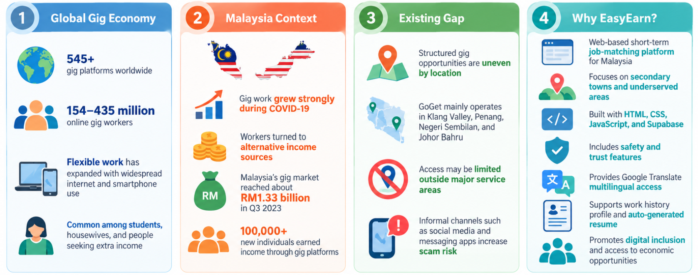

Figure 1.1: Overview of the Gig Economy and EasyEarn in Malaysia

## Problem Statement

Despite the growth of Malaysia&#39;s gig economy, challenges remain in accessing structured short-term work and in managing trust when jobs are sought through informal online channels. EasyEarn is designed around the following six problems:

Problem 1: Lack of a Specialised Short-Term Labour Platform in Smaller Towns

There are only a handful of geographical hotspots in Malaysia that offer organised gig-work opportunities. One of the established gig-work platforms in Malaysia, GoGet, has more than 400,000 verified part-timers to connect businesses with them, but has said that the majority of the part-timers are in the Klang Valley, Penang, Negeri Sembilan and Johor Bahru [6]. This means that while structured gig platforms have now reached significant scale, they still have a highly skewed distribution of their key workforce availability across Malaysia. However, smaller towns targeted by EasyEarn, like Ipoh, Kangar, Alor Setar, Kuala Terengganu and Kota Bharu, are not in GoGet&#39;s main availability areas. Access to platform work is geographically limited, especially away from the main employment hubs, which can be seen as a barrier in digital labour markets [1].

Problem 2: Prevalence of Social Media Job Scams

There is still a risk of employment scams for persons who are looking for part-time and flexible jobs in Malaysia. The number of part-time job scam cases reported in 2025 rose to 8,911 (up 144% from 2024), generating financial losses of around RM222 million, according to the Royal Malaysia Police [8]. The fake job offers are usually sent via WhatsApp and Telegram and can include the promise of earning lots of money for doing easy online jobs that ask for upfront payments or private details. The magnitude of these cases shows the importance of having stricter verification and accountability systems for job-seeking online. Moreover, it has been found that reputation information has an impact on trust in digital labour platforms [10]. To offer more organised trust mechanisms for Job Seekers and Employers, EasyEarn includes an Employer Verification Badge, a Report and Flag System, and a Bidirectional Rating and Review System.

Problem 3: Lack of Verifiable Work History for Gig Workers

Gig workers might have trouble proving their employment history and earnings, since the work is often done in an engagement that lasts only a short time on the platform. The inability to prove work history and income was one of the constraints identified in accessing formal finance for gig workers from a United Nations Capital Development Fund (UNCDF) study which randomly surveyed 16,166 respondents across five gig platform markets in Malaysia and China [11]. It also stated that one out of four users of Grab&#39;s microloans might not have been available at traditional financial institutions due to the lack of accurate earnings information. This is a good example of the importance of keeping an organised record of work done and income generated. Platform workers can also experience problems in establishing a portable professional identity based on their platform-based work [12]. To present and organise completed work experience more systematically, EasyEarn therefore offers a Work History Dashboard and an Auto-Generated Resume.

Problem 4: Inefficient Recruitment Process for Employers

Small and Medium Enterprises (SMEs), or individual employers, looking for short-term workers may need to coordinate and mobilise extra resources for recruitment. This is especially crucial in Malaysia, as Micro, Small and Medium Enterprises (MSMEs) employed about 8.09 million people or 48.7% of the population in employment, in 2025, with a contribution of RM689.8 billion or 39.7% of Malaysia&#39;s gross domestic product (GDP) [13]. Gusenbauer et al. [14] also arrived at the conclusion that digital work platforms could facilitate access to outside labour for SMEs, enhance the flexibility of their workforces, and lessen the obstacles to outsourcing. Hence, a structured digital recruitment system can assist SMEs to better manage their short-term hiring and applicant coordination.

 

Problem 5: Limited Structured Access to Flexible Work Opportunities

Flexible working opportunities are significant for those who need flexible working arrangements to facilitate study, personal commitments and/or other duties. In Malaysia, recent data from a study of 385 youth gig workers in Kuala Lumpur indicates that 60.5% were aged 19-24, 33.2% were aged 25-30, and 33.5% engaged in gig work on a part-time basis [4]. Another important motivator for youth participation in the gig economy identified by the study was flexibility. This is an indicator of the need for flexible working by younger employees. But opportunities for structured short-term work are not ubiquitous, especially in areas away from gig services&#39; central service hubs. For those who are looking for flexibility in their work, EasyEarn offers short-term job categories, filters for location and category, as well as application management functions.

Problem 6: Language Barrier on Existing Platforms

Language accessibility can have an impact on the capacity of the user to be able to engage freely within digital gig platforms. As part of GoGet&#39;s involvement in the UNCDF B40 Challenge, there were over 10,000 registered users on the platform who reported that many low/middle income users preferred to use the platform in their native language, Bahasa Melayu, and that the training materials were available in English [15]. This means that accessibility can be a problem for language differences even in a well-established Gig Platform in Malaysia. A similar study of 4,217 respondents in six countries carried out by Saulītis [16] revealed a great preference for web content in users&#39; native language. For this reason, multilingual access is an essential feature to enhance digital accessibility, and EasyEarn offers translated versions of its pages with Google Translate site redirection.

 

All six problems have pointed out a systemic gap in the gig economy infrastructure in Malaysia. Many Malaysians are economically marginalised, defrauded and unable to switch to better career development due to a lack of a dedicated, accessible and secure job-matching platform, particularly those in less-serviced areas. EasyEarn is suggested to be an integrated solution, structured and web-based through a job-seeker / job-provider matching portal all over Malaysia. The relevance of EasyEarn is further supported by the Gig Workers Act 2025 (Act 872), which came into force on 31 March 2026 and provides a formal framework for gig worker protection in Malaysia [17].

EasyEarn addresses six core issues presented in Figure 1.2, ranging from geographical exclusion to the absence of verifiable gig workers&#39; work histories.

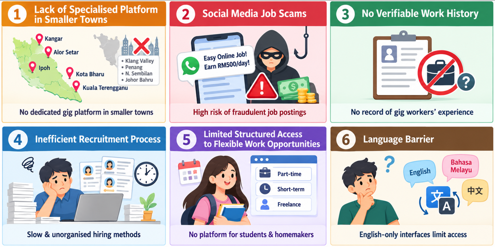

Figure 1.2: Problem Statement of EasyEarn

 

## Research Questions and Research Objectives

EasyEarn is a web-based job-matching platform developed to connect Job Seekers and Employers to short-term, part-time and freelance job opportunities in Malaysia, especially in the underserved towns of Malaysia, namely Ipoh, Kangar, Alor Setar, Kuala Terengganu and Kota Bharu. In view of the problem statements explained in Section 1.2, this section elaborates the research questions (RQs) and research objectives to be used in developing and evaluating the EasyEarn Job Matching Portal.

### 1.3.1 Research Questions

Four RQs are generated based on the problem statements discussed in the above Section 1.2. These RQs are in line with the project goals and serve as a basis for developing and assessing the EasyEarn Job Matching Portal.

RQ1: What are the essential requirements for a web-based job-matching platform that supports short-term, part-time and freelance employment between Job Seekers and Employers in Malaysia?

RQ2: What safety and trust features should be incorporated into the platform to support safer and more trustworthy interactions between Job Seekers and Employers?

RQ3: How can a digital work history and auto-generated resume support gig workers in documenting and presenting their completed work experience?

RQ4: What are the possible ways of making EasyEarn more accessible to those with varying language preferences using multilingual access?

 

Figure 1.3 outlines the four questions that have been identified for the development and assessment of the EasyEarn Job Matching Portal. The questions address the platform&#39;s essential functions, security and trust elements, digital work history, and automated resume building capabilities, as well as multilingual support.

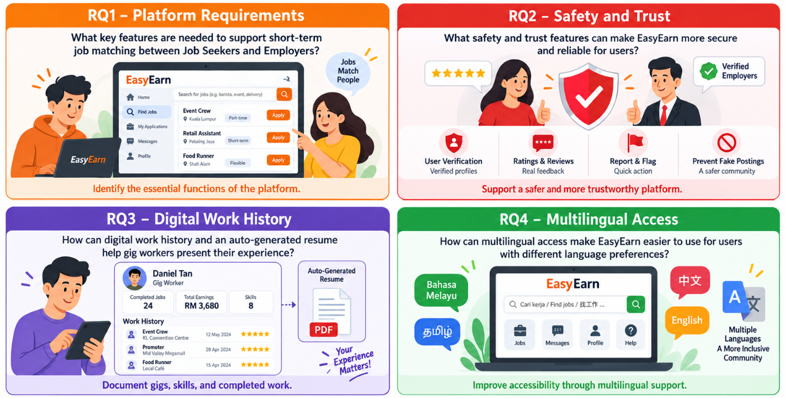

Figure 1.3: Research Questions of EasyEarn

### 1.3.2 Research Objectives

This project aims to develop and design EasyEarn. Accessed online, the job-matching platform will facilitate job seekers and employers in finding short-term, part-time and freelance jobs in Malaysia and in specific areas that are little-recognised, such as Ipoh, Kangar, Alor Setar, Kuala Terengganu and Kota Bharu. The objectives of EasyEarn are as follows:

 

Objective 1: Multi-user platform

To develop a full-fledged multi-user-based web job matching platform, where users seeking employment can receive job offers from employers and apply for the jobs using the job matching services offered, such as job-specific dashboards, job posting and management with full Create, Read, Update, and Delete (CRUD) facilities, location-wise job search and filtering, and 24/7 job seeker support by a rule-based chatbot.

Objective 2: Safety and Trust Verification System

To establish a strong platform safety and trust verification system by implementing a bidirectional rating and review system, a Report and Flag function, and an Employer Verification Badge to reduce the risk of fraudulent job postings and support a fair, transparent and accountable job search and hiring environment for Job Seekers and Employers.

Objective 3: Verifiable Digital Work History

To develop a verifiable digital work history profile for gig workers, enabling them to document their completed gigs, earnings and skills acquired, such as an Auto-Generate Resume feature that will generate a downloadable Portable Document Format (PDF) resume based on data captured from gig workers&#39; work history profiles, which is not currently standardised to record employment history in the informal sector in Malaysia.

Objective 4: Multilingual Access

To further enhance multilingual access on the platform by incorporating Google Translate to facilitate access in various languages such as Bahasa Melayu, Mandarin and Tamil, and to allow smaller communities around Malaysia to access the platform.

The four research objectives of EasyEarn are outlined in Figure 1.4, which include development of the platform, safety and trust, verifiable work history and multilingual accessibility.

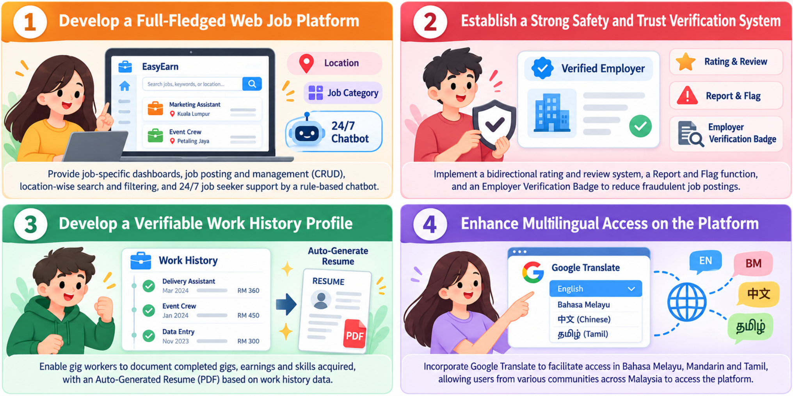

Figure 1.4: Objectives of EasyEarn

## Scope of Project

EasyEarn is an online job matching service which links job seekers and employers in an easy-to-use, secure and efficient platform. The system caters to three main user types: Job Seeker, Employer, and Administrator, with each having its own set of features and access levels to suit their needs. The project involves the full development of EasyEarn, including user management, job posting and management of applications, safety and trust verification, work history monitoring, and multi-language support for accessibility.

### 1.4.1 Project Coverage

EasyEarn is designed as a multi-user Web-based portal that allows various categories of users with various permissions and functions.

 

Job seekers (university students, housewives and unemployed) can register and upload their profiles with skill tags, browse and filter job postings by category and location, apply for jobs, follow up on job applications, save jobs to a wishlist, view their history dashboard, auto-generate a PDF resume from their job history, and use the chatbot for platform support.

Employers (SMEs and individual hirers) can register, submit verification details and supporting documents based on their employer type for Admin review, receive a Verification Badge upon approval, post and manage job listings with expiry dates, review applicant submissions, approve or reject applicants, and rate Job Seekers after completed jobs.

Administrators have full control of the platform, including user account management, job listing moderation, report and flag resolution, and monitoring platform analytics.

Figure 1.5 shows that there are three primary groups of users of EasyEarn: Job Seekers, Employers, and Administrators and the features and access each group has to EasyEarn.

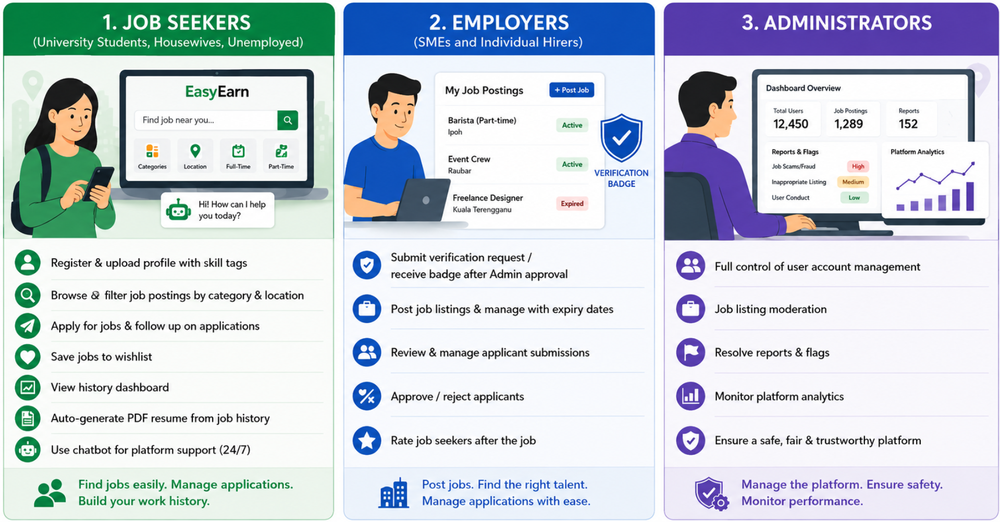

Figure 1.5: Project Coverage of EasyEarn

### 1.4.2 Complete Features List

EasyEarn has functionalities classified into two categories: core and optional features. These two categories are explained as follows:

Core Features:

These are the key features of the EasyEarn platform that must be fulfilled in the system&#39;s development. Table 1.1 displays the minimal functionalities that the EasyEarn platform should have to satisfy its main activities.

Table 1.1: Core Features

<table>
<tr>
<td>

No

</td>
<td>

Features

</td>
<td>

Description

</td>
</tr>
<tr>
<td>

1

</td>
<td>

User Registration &amp; Login

</td>
<td>

Role-based Job Seeker, Employer and Admin Registration/Login.

</td>
</tr>
<tr>
<td>

2

</td>
<td>

Job Posting &amp; Application

</td>
<td>

Employers advertise jobs and job seekers apply for jobs, with application management within the platform.

</td>
</tr>
<tr>
<td>

3

</td>
<td>

Job Category &amp; Filter

</td>
<td>

Search for jobs based on categories, such as Food and Beverage (F&amp;B), Event, Delivery, and Tutor.

</td>
</tr>
<tr>
<td>

4

</td>
<td>

Location Filter

</td>
<td>

Search for jobs in Malaysia by city/region.

</td>
</tr>
<tr>
<td>

5

</td>
<td>

Application Status Timeline

</td>
<td>

Visual tracker with Pending, Reviewed, Interview, Accepted, Completion Pending, Completed, and Rejected stages.

</td>
</tr>
<tr>
<td>

6

</td>
<td>

Employer Verification Badge

</td>
<td>

Employers with verified accounts have a trust badge in their profile.

</td>
</tr>
<tr>
<td>

7

</td>
<td>

Report and Flag System

</td>
<td>

Users are asked to inform the Admin about suspicious or non-paying employers or fraudulently posted listings.

</td>
</tr>
<tr>
<td>

8

</td>
<td>

Rating &amp; Review System

</td>
<td>

A two-way rating system of 1 to 5 stars and written feedback between employers and job seekers.

</td>
</tr>
<tr>
<td>

9

</td>
<td>

Work History Dashboard

</td>
<td>

Records finished work, income generated and the distribution of jobs by type.

</td>
</tr>
<tr>
<td>

10

</td>
<td>

Auto-Generate Resume

</td>
<td>

Completely automates PDF resume generation from job information.

</td>
</tr>
<tr>
<td>

11

</td>
<td>

Google Translate Integration

</td>
<td>

Redirects to Google Translate to access the platform in several languages.

</td>
</tr>
<tr>
<td>

12

</td>
<td>

Rule-Based Chatbot

</td>
<td>

Rule-based chatbot that responds to questions and offers job application and platform usage information 24/7.

</td>
</tr>
</table>

Optional Features:

These features were considered optional, depending on the availability of time and resources. They will not have an impact on the main functionality of the platform. Table 1.2 shows the available, but optional, features that can be added to EasyEarn if time and resources allow.

Table 1.2: Optional Features

<table>
<tr>
<td>

No

</td>
<td>

Features

</td>
<td>

Description

</td>
</tr>
<tr>
<td>

1

</td>
<td>

Saved Jobs/ Wishlist

</td>
<td>

Job seekers can save interesting jobs to review later.

</td>
</tr>
<tr>
<td>

2

</td>
<td>

Job Expiry Date

</td>
<td>

Job postings will expire and close automatically after the expiration period.

</td>
</tr>
<tr>
<td>

3

</td>
<td>

Skills Tag

</td>
<td>

Job seekers add their skills to their profile.

</td>
</tr>
<tr>
<td>

4

</td>
<td>

Profile Completeness

</td>
<td>

Progress bar showing how much of the user profile is complete.

</td>
</tr>
<tr>
<td>

5

</td>
<td>

Analytics Dashboard

</td>
<td>

Earnings charts of job seekers; statistics about employers&#39; recruitment; statistics of the administration platform.

</td>
</tr>
<tr>
<td>

6

</td>
<td>

Payment Confirmation &amp; Dispute

</td>
<td>

When the transfer is made via DuitNow, employers confirm in-system and job seekers upload their DuitNow Quick Response (QR) code and confirm the receipt and either party can have the payment dispute reviewed by the admin.

</td>
</tr>
</table>

 

Figure 1.6 shows the full list of the main and optional features of the EasyEarn platform.

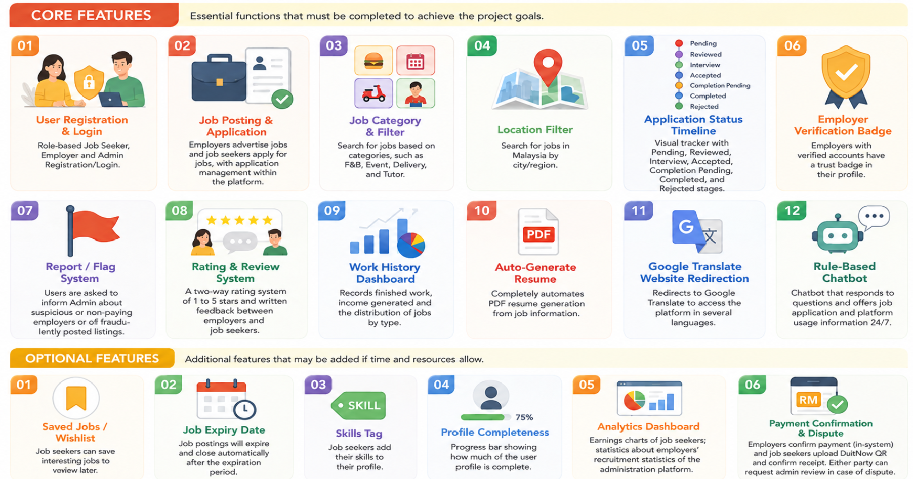

Figure 1.6: Features of EasyEarn

### 1.4.3 Excluded Features

The following features are not part of the current project phase because of time, resources and technical constraints:

Online payment gateway

Financial transactions are carried out offline, using traditional methods like cash and DuitNow transfer. A job seeker can use the DuitNow QR code to receive payment offline from the employer. Payment processors like the DuitNow Application Programming Interface (API), Touch &#39;n Go, or credit card processors will not be connected with the platform at this stage.

Real-Time Chat Messaging

This is not the messaging phase since real-time messaging is not enabled. When it comes to live chat, both the user and the person he/she is chatting with should be online at the same time, which is not feasible with a part-time job platform with an unpredictable schedule. Instead, a rule-based chatbot is used to offer 24/7 automated assistance, without the need for another user to be there.

Native Mobile Application

EasyEarn is a web application. It excludes a native mobile application in the current phase. The platform will, instead, use responsive web design to make it mobile-friendly.

Mandatory Email Verification

There is no current requirement to verify an email address when registering for a new account. But Supabase Auth enables email-based password recovery by sending a password reset link to the user&#39;s registered email address.

Government Database Integration

During this stage, the platform will not be integrating with government databases such as Social Security Organisation (SOCSO), Employees Provident Fund (EPF) and MySejahtera. The information links to Pertubuhan Keselamatan Sosial (PERKESO)’s Self-Employment Social Security Scheme (SESS) will instead be made available to users for reference.

Artificial Intelligence (AI) Job Matching Algorithm

Technical complexity in automated Artificial Intelligence (AI)-based job recommendation will not be possible in this phase, and the project is restricted to this due to scope limitations.

The six features that were not included in the current phase of EasyEarn because of time, resource and technical limitations are shown in Figure 1.7.

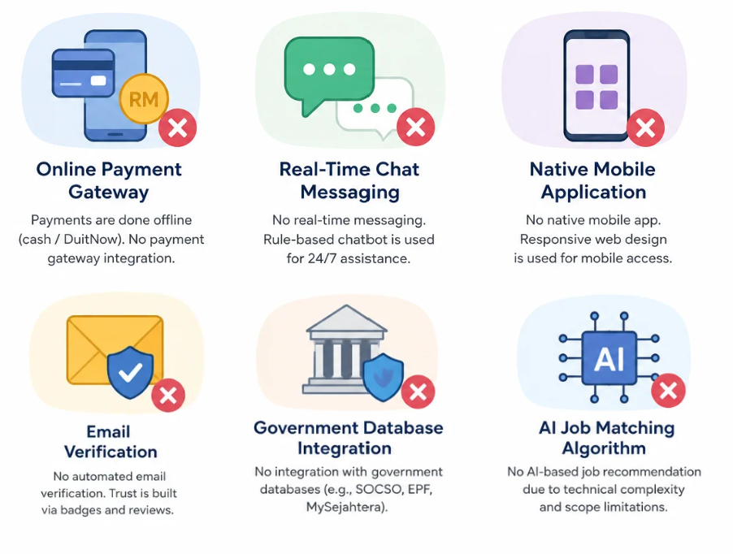

Figure 1.7: Excluded Features of EasyEarn

### 1.4.4 Information Security and Policies

EasyEarn handles personal data from both job seekers and employers, and the platform is secured with a variety of technical security measures, safeguarding user information and ensuring the integrity of the platform [18].

####  1.4.4.1 Regulatory Framework

EasyEarn&#39;s personal data is subject to the following Malaysian regulatory frameworks:

Personal Data Protection Act (PDPA) 2010

EasyEarn’s design takes into account the Personal Data Protection Act (PDPA) 2010 [19]. There are also external services in EasyEarn. When Google Translate website translation is activated, the page address and content submitted for translation may be processed by Google. When Google Fonts and CDN-hosted assets are loaded, the external servers may receive technical information, including users’ IP addresses and browser information. The platform’s privacy notice should clearly disclose these services, their purposes and the relevant providers’ privacy policies. Before wider deployment, these data-processing arrangements should be considered.

Computer Crimes Act 1997

This legislation regulates and addresses the unauthorised use of computer systems and information. To ensure that users cannot access other users&#39; information or system resources without permission, the platform uses role-based access control (RBAC) and Supabase Authentication. All data is sent via Hypertext Transfer Protocol Secure (HTTPS).

Consumer Protection Act 1999

As a form of consumer protection, the Report and Flag System and Employer Verification Badge help reduce the risk of fraudulent job postings and non-paying employers.

Employment Act 1955 (Reference Only)

The platform offers informational guidelines in line with the Employment Act to encourage and help provide fair practices in job posting and clarify responsibilities for the users. This project does not cover direct compliance enforcement because it is an academic prototype called EasyEarn.

Gig Workers Act 2025 (Act 872)

The Gig Workers Act 2025 (Act 872), which came into force on 31 March 2026, offers a legal structure for gig workers and guidelines on service contracts, workers&#39; rights, social protection and dispute resolution. EasyEarn includes the Employer Verification Badge, Rating and Review System, Reporting and Flagging System, and Work History Profile to help promote transparency and accountability on the platform. The features are developed with awareness of the regulatory framework, which is not a formal legal or regulatory certification of compliance [17].

The five regulatory regimes under which EasyEarn operates and handles data are outlined in Figure 1.8.

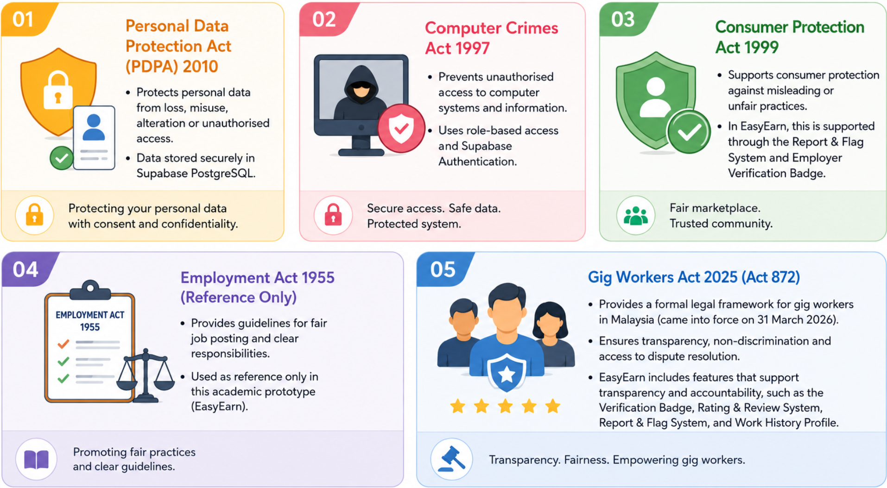

Figure 1.8: Regulatory Framework of EasyEarn

 

#### 1.4.4.2 Technical Security Measures

To ensure users&#39; data security and platform integrity, EasyEarn adopts some technical security measures:

Supabase Authentication

User account authentication is done via Supabase Authentication, which secures passwords and user sessions. Also, to better manage access to sensitive functions in a system and to limit unauthorised access, token-based authentication is employed.

Role-Based Access Control (RBAC)

Access to system functions is limited based on user roles. The different permissions and functions are given to the Job Seekers, Employers and Administrators depending on their role in the platform. Only the Admin role has administrative access, and RBAC minimises cross-role access.

HTTPS Encryption

All data sent between the user&#39;s browser and Supabase&#39;s backend is encrypted using HTTPS. This ensures the data is encrypted while being transmitted and minimises the chance of data interception or eavesdropping.

Supabase Row Level Security (RLS)

Supabase Row Level Security (RLS) policies are employed to enforce policies when accessing the database depending on roles and record ownership. These policies offer an extra degree of security by limiting certain read and write operations at the database level. The effectiveness of those individual RLS policies, however, will depend on how they are configured; any remaining access control limitations will be assessed during Security Testing in Chapter 4.

Four technical security measures are adopted in EasyEarn to provide user data protection, access control and integrity of the platform as illustrated in Figure 1.9.

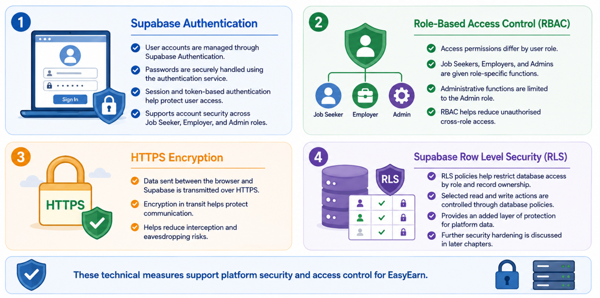

Figure 1.9: Technical Security Measures of EasyEarn

## Significance of the Study

EasyEarn is expected to have a tangible and quantifiable impact on various stakeholders such as job seekers, employers, and Malaysian society as a whole. EasyEarn is not just a tool for connecting with jobs; it has academic, technological, and socioeconomic implications. These dimensions are discussed in detail in the following sections.

### Benefits

EasyEarn provides benefits to its main stakeholders, including Job Seekers, Employers, Administrators and the wider community. These benefits align to the project goals of increasing access to short-term jobs, enhancing trust and safety, supporting digital work history documentation, and making it easier to access through multilingual support.

Benefits to Job Seekers

EasyEarn provides job seekers in underserved areas of Malaysia with a structured platform to search and apply for short-term, part-time and freelance jobs. By combining job search, application management, work history and trust-related features in one system, the platform gives users a more organised way to manage their job-search activities. The Work History Dashboard and Auto-Generate Resume allow job seekers to keep and present records of their completed work, which is related to the portable professional identity issue discussed by Graham et al. [12]. EasyEarn also uses Google Translate Integration to provide multilingual access for users with different language preferences, which is relevant to the language-accessibility issue highlighted by UNCDF [15].

Benefits to Employers

EasyEarn is a one-stop solution for employers, especially SMEs and individual employers in smaller towns, to post job ads, access applicant profiles, skills and work history, and handle the entire recruitment process in one place. Gusenbauer et al. [14] found that digital work platforms can help small enterprises access external labour and reduce the coordination involved in sourcing workers. The structured recruitment functions of EasyEarn may also help employers manage short-term hiring more efficiently by centralising job posting, applicant information and recruitment activities within one platform.

Benefits to Society and the Economy

EasyEarn at the societal level seeks to create more structured opportunities to access short-term jobs, including for users residing in less-serviced towns, like Ipoh, Kangar and Kota Bharu, to foster geographical economic inclusion. The platform also addresses issues relating to employment fraud. The Royal Malaysia Police [8] reported 8,911 cases of part-time job scams in 2025, which is an increase of 144% compared to 2024, and losses amounting to around RM222 million. EasyEarn therefore offers the following trust-related features: Employer Verification Badge, Report and Flag System, and Bidirectional Rating and Review System, which provide a more structured job-search environment.

EasyEarn benefits three groups of stakeholders: Job Seekers, Employers, and Society and the Economy; the key benefits of EasyEarn are summarised in Figure 1.10.

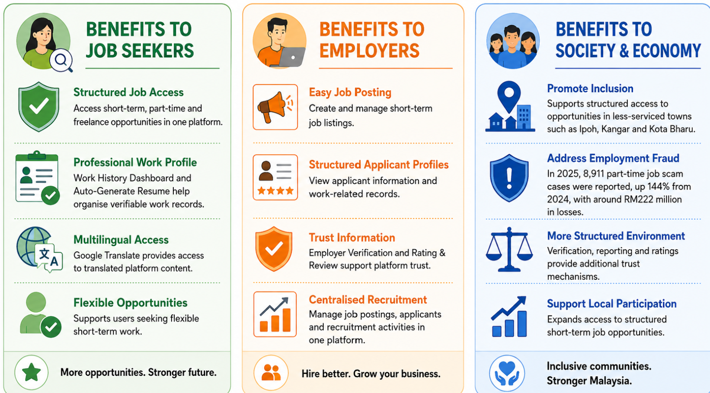

Figure 1.10: Benefits of EasyEarn

### 1.5.2 Significance

The output of this project will be the development of the EasyEarn Job Matching Portal which will be a functional web-based platform for short-term, part-time and freelance job opportunities. This system should enable Job Seekers, Employers and Administrators to access and use the system with the necessary level of access, post jobs and manage applications, increase user confidence with security measures, facilitate digital work history and resume generation, and be accessible in multiple languages.

 

Academic Significance

EasyEarn is an addition to the extant literature on digital labour platforms in developing economies, specifically the context of the Malaysian gig economy. Previous research has explored gig work through the lens of labour rights [12] platform governance and economic inequality [3], but there has been a lack of proposals and implementation of a localised and technology-based solution addressing the particular demographic and geographic circumstances of gig workers in Malaysia. To fill this void, EasyEarn has developed a working system that combines identity verification, portable work history, and multilingual usability in a single platform that can be used as a grounding point for further research into the design and implementation of gig platforms in emerging markets that are underserved.

In addition, the development process used in the development of EasyEarn, which uses a Hybrid Agile-Waterfall methodology, is part of the academic discussion on adaptive software development frameworks for students&#39; information systems projects. Structured but iterative, the methodology followed in this study is a model of how academic projects can meet rigorous documentation expectations and be flexible enough to accommodate changing user needs, and, as such, is a model that can be replicated for applied computing research.

Technological Significance

EasyEarn, from a technological perspective, is a practical proof that a client-side web application can be created on a Backend-as-a-Service (BaaS) architecture and provide a feature-rich, multi-user platform with much less complexity and infrastructure than traditional server-based applications. The use of Supabase for database management and authentication, Chart.js for data visualisation, and jsPDF for dynamic document generation demonstrates the effectiveness of open-source and cloud-native tools to create a scalable, maintainable, and cost-efficient solution [18].

 

This is an architectural style that is of particular interest in the academic and early-stage commercial development space, where budget and access to dedicated server infrastructure often become constraints. EasyEarn shows that a BaaS-based architecture is technically feasible, can provide for complex multi-role workflows, support database-driven multi-role workflows and support user management securely, and is a useful reference for developers and researchers creating similar platforms in resource-constrained environments.

Socioeconomic and Policy Significance

EasyEarn&#39;s key appeals are not only to its targeted groups but also as a technology-driven solution that benefits Malaysia&#39;s socio-economic inclusion. This is aligned with Malaysia’s national digital development priorities, which emphasise digital participation, economic inclusion and technology-driven development. The Gig Workers Act 2025 (Act 872) provides a formal framework for protecting gig workers in Malaysia, which also gives gig worker policy platforms like EasyEarn policy relevance.

EasyEarn is an example of how a local design can overcome local challenges and barriers to short-term job access, trust, work history documentation, and multilingual accessibility to serve underserved communities. The project could also offer valuable insights for future expansion of community-based digital labour platforms and initiatives encouraging participation in the gig economy in non-urbanised areas of Malaysia. The EasyEarn platform is academically, technologically, and socio-economically important, as indicated in Figure 1.11.

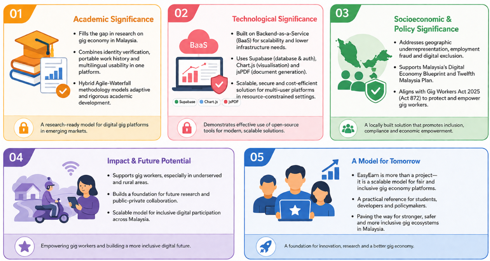

Figure 1.11: Significance of EasyEarn

## Milestones and Deliverables

This section outlines the main milestones and deliverables of the EasyEarn project during the 26 weeks of the Final Year Project (FYP). A Work Breakdown Structure (WBS), a project schedule, a Gantt Chart, project milestones and sprint-based deliverables are used to organise the project activities. These planning components are used to help structure the monitoring of project progress and the completion of required development and documentation activities within the planned timeline.

 

### 1.6.1 Work Breakdown Structure (WBS)

A hierarchical breakdown of the total scope of work needed to complete a project, each of which is more detailed in the definition of project deliverables [20] is called a WBS. For EasyEarn, the WBS decomposes the project into eleven major phases: Project Initiation, Research and Requirements Analysis, System Design, Prototype and Final Year Project 1 (FYP1) Submission, and six Agile development sprints in Final Year Project 2 (FYP2) covering Authentication and User Management, Job Posting and Application, Safety and Trust System, Work History and Auto Resume, System Enhancements, and Integration and Final Testing, followed by Deployment and Final Documentation and Submission.

There are sub-tasks defined in each phase which help the development team to deliver all the components of the project in a structured way. The WBS eliminates the possibility of any critical activity being missed, and it can be used to estimate project time, assign resources, and measure project progress throughout the project&#39;s life cycle [20]. The complete WBS of EasyEarn can be broken down into eleven major project phases, as shown in Figure 1.12.

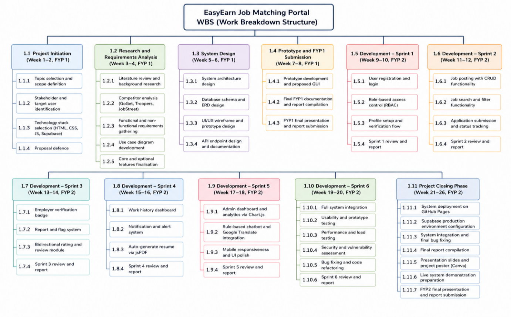

Figure 1.12: Work Breakdown Structure (WBS)

### 1.6.2 Project Schedule

The project schedule breaks down the WBS into a plan that takes into account time, with each work package allocated to a particular week in the 26-week project schedule [20]. Table 1.3 outlines the overall project timeline with the corresponding key milestones and sprints.

Table 1.3: Project Schedule Summary

<table>
<tr>
<td>

Phase

</td>
<td>

Timeline

</td>
<td>

Key Activities

</td>
<td>

Deliverable

</td>
</tr>
<tr>
<td>

Project Initiation

</td>
<td>

Week 1-2 (FYP1)

</td>
<td>

Topic selection, scope definition, stakeholder identification, and selection of the technology stack.

</td>
<td>

Project proposal draft

</td>
</tr>
<tr>
<td>

Research &amp; Requirements

</td>
<td>

Week 2-4 (FYP1)

</td>
<td>

Literature review, competitor analysis, functional requirements (FRs) and non-functional requirements (NFRs), and use case development.

</td>
<td>

Requirements specification document

</td>
</tr>
<tr>
<td>

System Design

</td>
<td>

Week 5-6 (FYP1)

</td>
<td>

System architecture design, Entity-Relationship Diagram (ERD), wireframes, API endpoint documentation.

</td>
<td>

System design artefacts

</td>
</tr>
<tr>
<td>

FYP1 Submission

</td>
<td>

Week 7-8 (FYP1)

</td>
<td>

Development of prototypes, preparation of documents, preparation of final presentation and submission of M3.

</td>
<td>

FYP1 report and prototype

</td>
</tr>
<tr>
<td>

Sprint 1

</td>
<td>

Week 9-10 (FYP2)

</td>
<td>

User Registration, User login, RBAC, User profile setup and Supervisor review.

</td>
<td>

Functional user management module

</td>
</tr>
<tr>
<td>

Sprint 2

</td>
<td>

Week 11-12 (FYP2)

</td>
<td>

Job posting (CRUD), job searching, filtering and submission and tracking of job applications.

</td>
<td>

Functional job module

</td>
</tr>
<tr>
<td>

Sprint 3

</td>
<td>

Week 13-14 (FYP2)

</td>
<td>

Verification badge by employer, report/flag system, bi-directional rating/review system.

</td>
<td>

Functional safety module

</td>
</tr>
<tr>
<td>

Sprint 4 &amp; M4

</td>
<td>

Week 15-16 (FYP2)

</td>
<td>

Work history dashboard, notification system, auto-generate resume (jsPDF), M4 Midsem Checkpoint.

</td>
<td>

Functional work history module

</td>
</tr>
<tr>
<td>

Sprint 5

</td>
<td>

Week 17-18 (FYP2)

</td>
<td>

Admin dashboard and analytics with Chart.js, rule-based chatbot, mobile responsiveness polish and Supervisor review.

</td>
<td>

Functional admin module and rule-based chatbot

</td>
</tr>
<tr>
<td>

Sprint 6

</td>
<td>

Week 19-20 (FYP2)

</td>
<td>

Full system integration, Usability testing, Performance testing, Security assessment, Bug fixing.

</td>
<td>

Fully tested integrated system

</td>
</tr>
<tr>
<td>

Deployment

</td>
<td>

Week 21-22 (FYP2)

</td>
<td>

Live deployment to GitHub Pages, production configuration and overall system integration testing.

</td>
<td>

Live-deployed system and test reports

</td>
</tr>
<tr>
<td>

Final Submission

</td>
<td>

Week 23-26 (FYP2)

</td>
<td>

Create Final Report, Present Slides, Set up for live demo and do M5 defence.

</td>
<td>

FYP2 final report and presentation

</td>
</tr>
</table>

### 1.6.3 Gantt Chart

The Gantt Chart offers a visual timeline display of all project activities, which helps the project team plan, coordinate and monitor progress against scheduled deadlines [20]. It is evident from the chart that the waterfall-driven planning phase in FYP1 was followed by the six agile development sprints in FYP2, and the highlighted critical path runs from Sprint 1 through the end of the development process to submission for deployment. The Gantt Chart is constantly updated and it is a living document at the end of each sprint to show actual progress towards the planned schedule.

The following are important events which are tracked on the Gantt Chart: FYP1 Proposal Defence (Week 3), FYP1 Midsem Checkpoint (Week 6), FYP1 Final Presentation (Week 8), FYP2 Midsem Checkpoint (Week 16) and FYP2 Final Presentation and Submission (Week 26).

The EasyEarn project has a total of 26 weeks for development, and the Gantt Chart of the project is shown in the following figures (Figures 1.13-1.17) as a visual representation of all activities along the project development timeline.

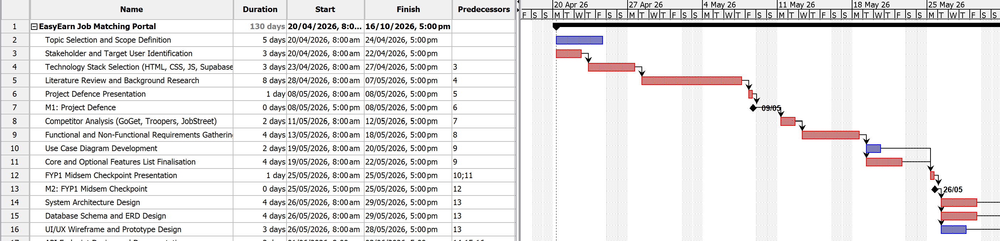

Figure 1.13: Gantt Chart (1)

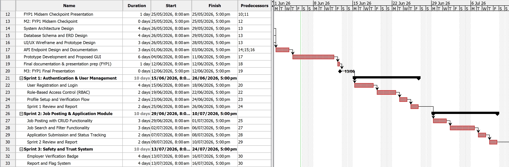

Figure 1.14: Gantt Chart (2)

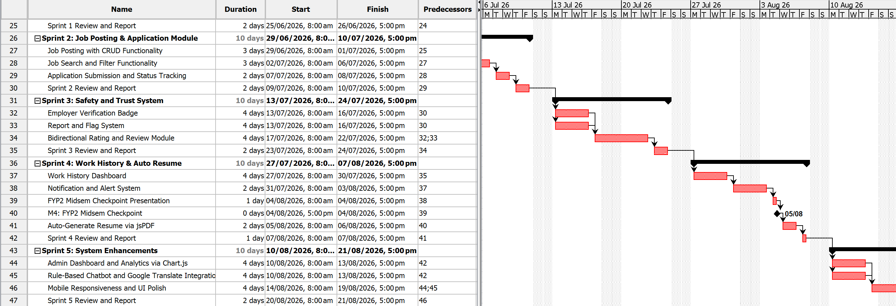

Figure 1.15: Gantt Chart (3)

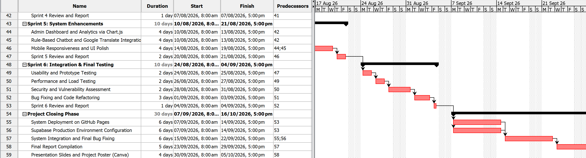

Figure 1.16: Gantt Chart (4)

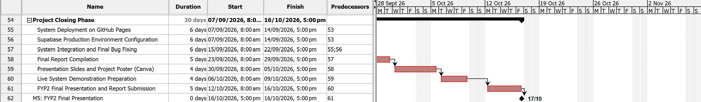

Figure 1.17: Gantt Chart (5)

### 1.6.4 Project Milestones

There are five academic milestones, each being a formal assessment/review point for the EasyEarn project in the two FYPs. Sprint completion reviews are also performed at the end of every FYP2 development sprint to help track progress and incorporate supervisor feedback. The five academic milestones tracked throughout the EasyEarn project are listed below in Table 1.4.

Table 1.4: Project Milestones

<table>
<tr>
<td>

No

</td>
<td>

Milestones

</td>
<td>

Timeline

</td>
<td>

Description

</td>
</tr>
<tr>
<td>

M1

</td>
<td>

Proposal Defence

</td>
<td>

Week 3

</td>
<td>

Project proposal presented to the assessment panel for approval before proceeding to the design phase.

</td>
</tr>
<tr>
<td>

M2

</td>
<td>

FYP1 Midsem Checkpoint

</td>
<td>

Week 6

</td>
<td>

Progress on system design documentation, use case diagrams, wireframes, and ERD was presented to the panel.

</td>
</tr>
<tr>
<td>

M3

</td>
<td>

FYP1 Final Presentation &amp; Report Submission

</td>
<td>

Week 8

</td>
<td>

Submission of the FYP1 interim report and prototype demonstration, marking the end of the first semester.

</td>
</tr>
<tr>
<td>

M4

</td>
<td>

FYP2 Midsem Checkpoint

</td>
<td>

Week 16

</td>
<td>

Completed Sprints 1 to 4 demonstrated to the assessment panel, along with a development progress report.

</td>
</tr>
<tr>
<td>

M5

</td>
<td>

FYP2 Final Presentation &amp; Report Submission

</td>
<td>

Week 26

</td>
<td>

Final system presented to the assessment panel; all project deliverables formally submitted.

</td>
</tr>
</table>

 

Sprint completion reviews are held at the end of each sprint in FYP2 to ensure development is on track and that supervisor feedback is captured for use in future sprints. Sprint 1 will be reviewed at the end of Week 10, Sprint 2 will be reviewed at the end of Week 12, Sprint 3 will be reviewed at the end of Week 14, Sprint 4 will be reviewed at the end of Week 16, Sprint 5 will be reviewed at the end of Week 18, and Sprint 6 will be reviewed at the end of Week 20. The system deployment, preparation and compilation of the system final report, and preparation for the final presentation are completed in the Project Closing Phase from Week 21 to Week 26, culminating in the final M5 presentation and submission at the end of Week 26.

### 1.6.5 Sprint Breakdown and Deliverables

FYP2 development is broken up into six two-week agile sprints (Weeks 9-20), resulting in a functional system module. The sprint structure allows for incremental development and testing of core platform features that can help identify and fix problems before developing additional features. Table 1.5 shows the sprint breakdown and deliverables delivered in each of the six agile development sprints in FYP2.

Table 1.5: Sprint Breakdown and Deliverables

<table>
<tr>
<td>

Sprint

</td>
<td>

Timeline

</td>
<td>

Objective

</td>
<td>

Deliverable

</td>
</tr>
<tr>
<td>

Sprint 1: Authentication &amp; User Management

</td>
<td>

Week 9-10

</td>
<td>

Registration, authentication, login and user role setup.

</td>
<td>

Functional user management module and sprint report.

</td>
</tr>
<tr>
<td>

Sprint 2: Job Posting &amp; Application Module

</td>
<td>

Week 11-12

</td>
<td>

CRUD job posts, search for jobs, filter, and submit and track applications.

</td>
<td>

Functional job module and sprint report.

</td>
</tr>
<tr>
<td>

Sprint 3: Safety &amp; Trust System

</td>
<td>

Week 13-14

</td>
<td>

Bidirectional rating &amp; review module, employer verification badge, report and flag system.

</td>
<td>

Functional safety module and sprint report.

</td>
</tr>
<tr>
<td>

Sprint 4: Work History &amp; Auto Resume

</td>
<td>

Week 15-16

</td>
<td>

Work history dashboard, notification and alert system, auto-generate resume using jsPDF, and M4 checkpoint.

</td>
<td>

Functional work history module and sprint report.

</td>
</tr>
<tr>
<td>

Sprint 5: System Enhancements

</td>
<td>

Week 17-18

</td>
<td>

Admin dashboard and analytics through Chart.js, a rule-based chatbot and mobile responsiveness polish.

</td>
<td>

Functional admin module and sprint report.

</td>
</tr>
<tr>
<td>

Sprint 6: Integration &amp; Final Testing

</td>
<td>

Week 19-20

</td>
<td>

Full system integration, usability testing, performance testing and concurrency checks, security assessment and bug fixing.

</td>
<td>

Fully tested and integrated system; final sprint report.

</td>
</tr>
</table>

### 1.6.6 Final Deliverables

Final deliverables, as part of the EasyEarn academic evaluation, are submitted when the project is completed. Deliverables represent the various stages of the project life cycle and show the breadth of the project. Table 1.6 is the full list of final deliverables that are submitted at the project&#39;s end.

Table 1.6: Final Deliverables

<table>
<tr>
<td>

No

</td>
<td>

Deliverable

</td>
<td>

Description

</td>
</tr>
<tr>
<td>

1

</td>
<td>

Web-Based Job Matching Portal

</td>
<td>

A fully operational EasyEarn portal deployed on GitHub Pages, incorporating all core features, including user management, job matching, safety verification, work history, auto-generated resume, and Google Translate Integration.

</td>
</tr>
<tr>
<td>

2

</td>
<td>

Auto-Generated PDF Resume

</td>
<td>

A system-generated, downloadable resume produced from the job seeker&#39;s work history, ratings, and skills data using jsPDF.

</td>
</tr>
<tr>
<td>

3

</td>
<td>

Comprehensive Documentation

</td>
<td>

All project documentation, such as the project proposal, system design diagrams, database schema, test reports and user manuals.

</td>
</tr>
<tr>
<td>

4

</td>
<td>

Annotated Source Code

</td>
<td>

Formatted and commented HTML, CSS, and JavaScript codebase along with Supabase configuration files, organised for clarity and maintainability.

</td>
</tr>
<tr>
<td>

5

</td>
<td>

Testing and Evaluation Report

</td>
<td>

Functional tests, security assessment, usability evaluation and system performance analysis are documented in detail.

</td>
</tr>
<tr>
<td>

6

</td>
<td>

Presentation Materials

</td>
<td>

Presentation slides, project poster created using Canva, and live system demonstration for academic assessment.

</td>
</tr>
</table>

The milestones, sprint deliverables and final submissions provided in Section 1.6 are the measurable deliverables of the EasyEarn project. The milestones are formal landmarks to review progress towards project objectives, and the deliverables from each sprint ensure that the development of the system keeps moving forward in a step-by-step and systematic fashion throughout the 26 weeks of the project. All of the deliverables in Table 1.6 must be completed for the project to be considered a success.

## Thesis Overview

This thesis consists of five chapters to provide a coherent narrative of the development, design and assessment of EasyEarn, an online job-matching platform created to fill some of the gaps in the gig economy in Malaysia.

The basis of the study is laid in Chapter 1. It provides an overview of the Malaysian gig economy, six major issues that led to EasyEarn, the aims of the research, the scope of the project, the information security framework and the work regarding information policy compliance, and the importance of EasyEarn for job seekers, employers, and the overall economy in Malaysia.

 

The literature review is included in Chapter 2. It starts with a theoretical discussion based on the Technology Acceptance Model (TAM) and then examines the literature on the gig economy, employment fraud, work history documentation, language barriers and underserved demographics in an empirical way. The chapter also examines the existing technologies, tools and platforms selected, as well as similar existing systems, and suggests a framework that builds upon the literature.

The methodology used in this project is explained in Chapter 3. It explains the Hybrid Agile-Waterfall Development Approach, System Architecture, Database Design, and Project Management Framework, along with their WBS and Sprint Planning.

Chapter 4 reports the findings and results of the system development and user testing, explaining the features implemented, the results of testing and the performance of the system in relation to the defined objectives.

The findings of this thesis are presented in the context of the research aims and previous research in Chapter 5, the success of EasyEarn as a platform, and the main contribution of this project to the field of gig platforms in Malaysia. It also highlights the current implementation weaknesses and suggests further developments beyond this FYP.

Figure 1.18 illustrates the overall structure of the thesis. It briefly summarises the five main chapters (Introduction, Literature Review, Methodology, Findings and Results, Discussion and Conclusion). The figure clearly shows the development of the thesis from the background of the research and related studies to system development, evaluation, findings and future improvements.

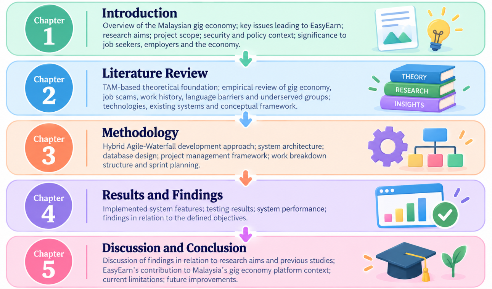

Figure 1.18: Thesis Overview of EasyEarn

## Constraints and Limitations

EasyEarn is developed under bounded conditions due to the nature of the academic environment, the project timeline, and the technology stack, as well as known limitations of the system, which could be solved in future stages.

### 1.8.1 Project Constraints

Project constraints are the fixed factors that may affect the development of EasyEarn. These constraints include time, development resources, technical dependency, scope control, data security and regulatory compliance. By identifying these constraints, the project scope and planning can be managed more realistically throughout the development process.

Time Constraint

The project will be of a fixed duration, comprising 26 weeks in total, to be completed in two phases: FYP1 (20 April to 12 June 2026) and FYP2 (15 June to 16 October 2026). This constraint is controlled by the Hybrid Agile-Waterfall methodology: a blend of structured planning with iterative development. Features that cannot be developed during the sprints are either saved for the next sprints or they are not included in the scope of the project [21].

Resource Constraint

EasyEarn is not developed by a dedicated development team, separate Quality Assurance (QA) team, or enterprise-level infrastructure, but by a single student. This means that only a certain degree of parallel development, testing coverage and optimisation can be achieved during the project period. Thus, it is important to prioritise core functions of the system carefully to make sure that a functional and testable system can be built within the limited resources at hand [22].

Technology Constraint

It is built with HTML, CSS and JavaScript, with Supabase offering BaaS functions and GitHub Pages for the deployment of the static frontend. The technology stack was chosen for its accessibility, its suitability for an academic project, and not needing dedicated application-server infrastructure. However, as GitHub Pages is a static front-end, EasyEarn is built on client-side JavaScript, Supabase backend services and some selected back-end business logic, such as RLS policies and PostgreSQL triggers. Additionally, Supabase&#39;s free tier usage limits may affect resources like databases, storage, and other services depending on platform usage [18].

 

Regulatory Constraint

EasyEarn processes personal information and will be developed in accordance with the current personal data protection laws and regulations in Malaysia, in particular, the PDPA 2010, Computer Crimes Act 1997 and Consumer Protection Act 1999. Supabase offers RLS policies and HTTPS data transmission, while RBAC can be used to limit access based on a user&#39;s role. These controls provide support in protecting user data, but are not a formal certification of legal or regulatory compliance. A formal compliance and legal review would be needed before general production.

To summarise, EasyEarn has four main project constraints: A fixed academic timeline of 26 weeks, A single developer resource constraint, A web-based architecture with a static front end, GitHub Pages and Supabase BaaS services, and regulatory concerns on personal data and gig work. These restrictions are used to limit the development scope and testing depth, as well as the manufacturability of the product. The constraints have been taken into account by making design decisions like phased feature development, prioritisation of essential functions, and using a Hybrid Agile-Waterfall methodology.

Table 1.7 below provides a summary of the four key project constraints, their effect on the current project stage and the recommended future actions.

Table 1.7: Summary of Constraints

<table>
<tr>
<td>

Type

</td>
<td>

Issues

</td>
<td>

Impact

</td>
<td>

Future Recommendation

</td>
</tr>
<tr>
<td>

Time

Constraint

</td>
<td>

Established a fixed 26-week academic project deadline

</td>
<td>

Restricts the development, testing and refinement that can be achieved during the life of the project.

</td>
<td>

Continues development in phases for features or improvements not within the scope of the project.

</td>
</tr>
<tr>
<td>

Resource

Constraint

</td>
<td>

A single-developer project with no designated development or QA team.

</td>
<td>

Limits parallel development, independent review, testing coverage and optimisation.

</td>
<td>

Create a small development and testing team for future enhancements and larger deployment.

</td>
</tr>
<tr>
<td>

Technology

Constraint

</td>
<td>

A static frontend with Supabase&#39;s architecture as a backend, built on GitHub Pages.

</td>
<td>

Restricts dedicated application-server processing and relies on the services&#39; capabilities and limits of the chosen BaaS platform.

</td>
<td>

Expand database-level controls, and if needed, the future requirements call for more server-side processing, consider using Supabase Edge Functions or a dedicated backend.

</td>
</tr>
<tr>
<td>

Regulatory Constraint

</td>
<td>

Compliance with legal and regulatory aspects of personal data, computer misuse, consumer protection and gig work.

</td>
<td>

Production would need to be assessed by a formal legal and compliance review before being used for wider production.

</td>
<td>

Conduct a formal PDPA and legal review, including relevant requirements under the Gig Workers Act 2025, before wider production use.

</td>
</tr>
</table>

The remaining four constraints of the project are summarised in EasyEarn, and the effect the project has on the current development phase is summarised in Figure 1.19.

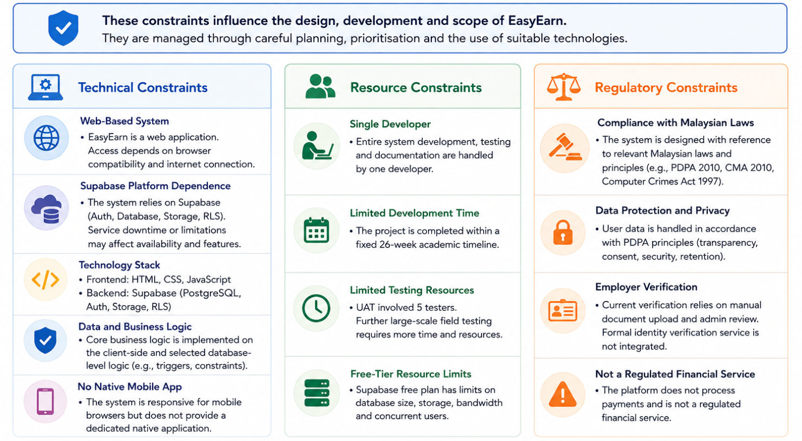

Figure 1.19: Project Constraints of EasyEarn

### 1.8.2 System Limitations

This section provides details on the current restrictions on the EasyEarn Job Matching Portal. The constraints are primarily about payment processing, real-time communication, mobile platform availability, and the size of the acceptance testing. While these restrictions do not hinder the system&#39;s core capabilities, they serve as a guide for future development to make the system more functional, accessible, and user-friendly.

No Integrated Payment Gateway

Financial transactions are currently outside EasyEarn, with cash or DuitNow transfers used. The platform does not have an integrated payment gateway; rather, it facilitates payment confirmation and dispute resolution. Integration with a regulated payment service can be explored in a future phase, subject to technical, regulatory and cost considerations [23].

No Real-Time Direct Messaging

EasyEarn supports asynchronous messaging between Job Seekers and Employers, while real-time messaging or live chat is not implemented. The messages are stored and retrieved via the current messaging function, not using a real-time communication service. The existing messaging functionality can be enhanced with Supabase Realtime or another appropriate messaging service in the future.

No Native Mobile Application

EasyEarn is at the moment a responsive web application, and there isn&#39;t any dedicated native mobile app. The platform can be accessed via mobile browsers, but there may be mobile-specific functions that can be offered with a native iOS or Android app, such as push notifications, offline access, and better mobile interaction. In future enhancements, therefore, it may be appropriate to consider the development of a native app for mobile devices [24], [25].

 

Limited User Acceptance Testing

Five users participated in User Acceptance Testing (UAT), completing 75 functional task executions across the Job Seeker, Employer and Admin roles using designated user accounts and test data stored in Supabase. While the main workflows were successfully tested, the number of testers was limited compared with the intended user population across the targeted underserved towns in Malaysia. Further testing should take place on a larger scale in the field with more representative end users.

No Automated Identity Verification

EasyEarn currently uses employer-submitted verification documents, the Employer Verification Badge and Admin review to support employer credibility. But the system doesn&#39;t support a formal automated identity verification system or government identity database. An appropriate identity verification service could be integrated in the future to enhance the employer verification process.

Multilingual Support via Redirection

Multilingual access is currently available on the EasyEarn site via Google Translate website translation service (and not via the Google in-app translation API). This provides access to several languages, but offers less control over translation accuracy, consistency and interface integration. EasyEarn may be able to benefit from a native translation API like Google Cloud Translation in an upcoming version to offer an integrated multilingual UX [26].

In conclusion, there are six major drawbacks of the current EasyEarn system: there is no embedded payment gateway, real-time direct messaging, mobile app integration, automated identity verification, and the limited scale of UAT, in addition to website redirection instead of a native translation API from Google. These restrictions are primarily due to the scope, time, resource and technical constraints of the academic project. Each limitation also gives a clear direction for future improvement and helps guide the next development stage of EasyEarn.

Table 1.8 shows a summary of the six system limitations, their effect on the current version of EasyEarn and the suggested enhancements for future releases.

Table 1.8: Summary of Limitations

<table>
<tr>
<td>

Type

</td>
<td>

Issues

</td>
<td>

Impact

</td>
<td>

Future Recommendation

</td>
</tr>
<tr>
<td>

Limitation

</td>
<td>
<table>
<tr>
<td>

</td>
</tr>
</table>

<table>
<tr>
<td>

No integrated payment gateway

</td>
</tr>
</table>

</td>
<td>

Payments are made outside the platform, but payments can still be recorded and managed in EasyEarn, and confirmations and disputes can be recorded.

</td>
<td>

Consider integrating a regulated payment service, such as DuitNow, in a future phase.

</td>
</tr>
<tr>
<td>

Limitation

</td>
<td>

No real-time direct messaging

</td>
<td>

Job Seekers and Employers interact asynchronously.

</td>
<td>

Make the current messaging feature more powerful by leveraging Supabase Realtime or another appropriate real-time messaging service.

</td>
</tr>
<tr>
<td>

Limitation

</td>
<td>

No native mobile application

</td>
<td>

Mobile users use the responsive Web interface and don&#39;t have access to mobile-specific features.

</td>
<td>

Create and build native iOS or Android app including push notifications and offline support.

</td>
</tr>
<tr>
<td>

Limitation

</td>
<td>

Limited UAT sample

</td>
<td>

The UAT was performed with five testers and may not have captured the broader view of the target group.

</td>
<td>

Perform extended UAT and field testing to a larger number of users from various target towns and backgrounds.

</td>
</tr>
<tr>
<td>

Limitation

</td>
<td>

No automated identity verification

</td>
<td>

Employer verification is based on documents submitted and Admin review, not automated identity verification.

</td>
<td>

In future development, consider a formal identity verification service.

</td>
</tr>
<tr>
<td>

Limitation

</td>
<td>

Multilingual support via redirection

</td>
<td>

Google Translate website service is required for translation, and is not as integrated as a native translation API.

</td>
<td>

Consider upgrading to a native translation API such as Google Cloud Translation.

</td>
</tr>
</table>

To design a better system in the future, the EasyEarn system has six limitations, which are presented in Figure 1.20, and solutions are recommended.

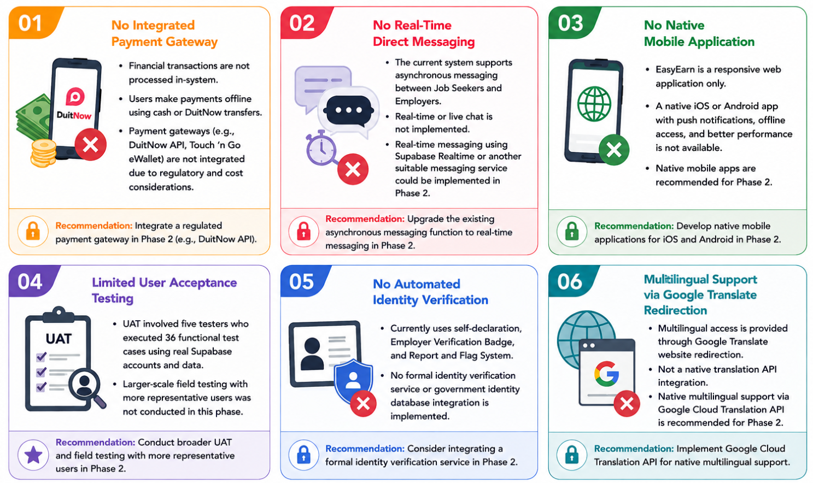

Figure 1.20: System Limitations of EasyEarn

 

## 1.9 Chapter Summary

This chapter presented the background, motivation and direction of EasyEarn, a web-based job-matching platform designed to facilitate short-term and flexible work arrangements, especially in underserved Malaysian towns. The identified problems were interconnected and included: limited access to a structured job platform, employment fraud and trust issues, absence of structured work history, inefficient SME recruitment, lack of support for flexible working, and language accessibility barriers.

To solve these issues, four research goals were set to enable a multi-user portal, trust and safety features, automatic PDF resume generation from digital work history, and multilingual access with Google Translate integration. The chapter also outlined the project scope, security and privacy considerations, and the proposed technologies, including HTML, CSS, JavaScript, Supabase and GitHub Pages. Development was planned over 26 weeks using a Hybrid Agile-Waterfall methodology.

The chapter discussed the envisioned purpose of EasyEarn for Job Seekers, Employers and the broader community, including the prospects it presents for more organised and easier short-term employment processes. Together, the objectives, scope and development plan established the direction and boundaries of the project. The next chapter reviews the relevant literature, theoretical framework, technologies and existing platforms to inform the design of EasyEarn. 

# Chapter 2: Literature Review

## 2.1 Introduction

The gig economy is growing rapidly in Malaysia, yet a structured, reliable and participatory digital labour platform is needed that can benefit not only the dominant big cities, but also the underserved secondary towns and rural parts of Malaysia. This chapter is a complete and critical review of the academic and technical literature that guides the design, development, and evaluation of EasyEarn: a web-based job-matching portal for short-term, part-time and freelance work within Malaysia.

The review is organised into seven main sections. The theoretical underpinning of the design of EasyEarn&#39;s features and the expected adoption by users is based on the TAM [27], as discussed in Section 2.2. The empirical review of the research in Section 2.3 examined research on the gig economy in Malaysia, employment fraud, verifiable work history, language barriers, flexible demographics and SME recruitment challenges. The technologies that will be used to realise EasyEarn are discussed in Section 2.4, and the platform and tools that have been selected are discussed in Section 2.5. It is analysed, and similar systems and their limitations are discussed in Section 2.6, and the research gap is identified in Section 2.6.5. Based on the theoretical and empirical results, and the identified research gap, a conceptual framework is presented in Section 2.7. The chapter ends in Section 2.8.

The literature reviewed in this chapter covers six problem dimensions related to EasyEarn: geographic exclusion, employment fraud and trust, the absence of structured work history, inefficient SME recruitment, limited flexible work channels and language barriers. In addition, Section 2.6 reviews similar systems and how these systems address these areas. In the platforms and features reviewed in this study, no platform was found that integrated all of the above in one platform suitable for the context in Malaysia. EasyEarn is thus suggested as an integrated web-based solution to fill the gap.

Figure 2.1 shows the structure of Chapter 2, which covers the theoretical foundation, empirical review, technologies, selected platforms and tools, similar systems, research gap, conceptual framework, and chapter summary. It also emphasises the six dimensions of the problem highlighted in the literature: geographic exclusion, employment fraud and trust, absence of structured work history, inefficient SME recruitment, lack of flexible work channels, and language barriers.

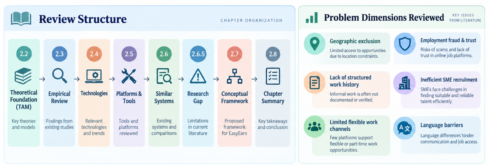

Figure 2.1: Literature Review Overview of EasyEarn

## 2.2 Theoretical Framework

A theoretical framework is the conceptual underpinning for the design decisions that are made for a research project, and the outcomes of the research project are evaluated [28]. For a technology development project like EasyEarn, the theoretical part should explain why users accept or reject a digital platform and how design decisions can be taken to maximise the adoption and usability of a digital platform. This section introduces the TAM as the main theoretical model, discusses its applicability and limitations in the gig economy context and elucidates its use across the design of EasyEarn.

### 2.2.1 The Technology Acceptance Model (TAM)

The TAM was first presented by Davis [27] as a model to explain and predict the use of the Information System by users. The model used in this study is the most recent revision of the original TAM [27], which adds and removes other factors from the original model but keeps the same two constructs of Perceived Usefulness (PU) and Perceived Ease of Use (PEOU) throughout the study. TAM has been developed from the Theory of Reasoned Action (TRA) developed by Ajzen and Fishbein [29], which states that people&#39;s behaviour is first influenced by their behavioural intention, and this behavioural intention is influenced by their attitude and subjective norm. In the context of information technology adoption, Davis [27] modified the TRA, which has two major factors for user acceptance:

PU: the extent to which an individual thinks that the use of a specific system would be useful in accomplishing a task or attaining a goal.

PEOU: the ease of use a person thinks a system will be to use.

The original TAM model proposed by Davis [27] is shown in Figure 2.2, where the two major determinants are shown to lead to attitude and behavioural intention, which in turn lead to the use of the system. All platform features are designed to enhance perceptions of usefulness and/or ease of use for the intended user group, and this pathway lies at the heart of all feature design decisions for EasyEarn.

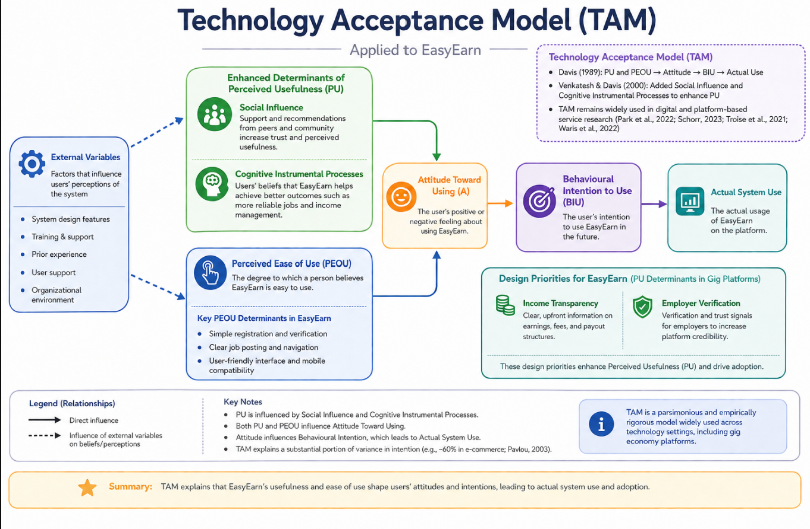

Figure 2.2: The Original Technology Acceptance Model (TAM)

As shown in Figure 2.2, PEOU also has a direct influence on PU, with ease of use being a determinant of a user&#39;s sense of usefulness of a system [27]. Other external factors, such as system design characteristics, training and experience, also play a role in both constructs.

Davis [27] found that both PU and PEOU had an impact on a user&#39;s attitude toward using a system, which in turn had an impact on a user&#39;s Behavioural Intention to Use (BIU), which ultimately had an impact on a user&#39;s system use. Venkatesh and Davis [30] expanded the original model to include additional factors that can impact PU, namely social influence and cognitive instrumental processes, to further enhance the model&#39;s predictive power of enterprise system adoption. Another framework is the Unified Theory of Acceptance and Use of Technology (UTAUT) [31], which integrates eight earlier models, including TAM, but TAM continues to be the most frequently used because of its parsimony and empirical rigour [32].

 

The current studies on the digital platform continue to employ the TAM approach, demonstrating its applicability in the context of digital transformation (DT) [33], [34]. In digitalisation studies, PU and PEOU are the two most important predictors for technology adoption. Platform-based services have also been studied to determine their suitability for the study of online service adoption, as done by [35], who additionally tested platform-based services and confirmed their applicability for the study of online service adoption, thus making them suitable as a theoretical framework for EasyEarn.

TAM is well tested in various technology settings, such as online employment sites, online e-commerce applications and mobile applications. Pavlou [36] used TAM in the context of e-commerce and found that nearly 60 per cent of the variance in users&#39; intentions to make transactions on the Internet could be accounted for by trust, PU and PEOU. However, in the context of the gig platforms, ease of registration and the interpretability of job posting interfaces were the most important PEOU determinants of gig worker platform adoption, whereas income transparency and employer verification were the most significant PU determinants [37]. These findings guide the application of TAM to EasyEarn in the next section.

### 2.2.2 Application of TAM to EasyEarn

EasyEarn has three user roles: Job Seeker, Employer and Admin. However, the application of TAM in this section focuses mainly on the two primary end-user groups, Job Seekers and Employers, because they directly use the platform for job searching and recruitment activities.

 

For job seekers, PU is delivered through functionality that directly affects their job search: location-based job searches save them time deciding where they can find jobs that are relevant to them; the Work History Dashboard and Auto-Generate Resume provide a way for job seekers to create and display a professional, verifiable record; and the bi-directional Rating and Review System helps job seekers show their reliability to potential employers. The inability to establish a portable professional identity and the lack of trust mechanisms through informal means are two of the major structural barriers identified by Graham et al. [12] and Corten et al. [10], respectively, which are directly targeted in these features. PEOU for job seekers is realised through the mobile-responsive web design of the platform, which ensures that it is accessible to non-English-speaking users through Google Translate Integration, and the rule-based chatbot, which allows for guidance on navigating the platform 24/7 [15].

For employers, PU is supported by the centralised job posting and applicant management functions, which allow recruitment activities to be managed within one platform. The Employer Verification Badge helps Job Seekers identify employers whose verification has been approved, while the Report and Flag System provides users with a structured channel to report suspicious accounts, job listings or other concerns. PEOU for employers is supported through the CRUD-enabled job posting interface, Application Status Timeline and consistent platform navigation.

Table 2.1: TAM Application to EasyEarn Features by User Group

<table>
<tr>
<td>

Feature

</td>
<td>

User Group

</td>
<td>

PU

</td>
<td>

PEOU

</td>
</tr>
<tr>
<td>

Location-Based Job Search

</td>
<td>

Job Seeker

</td>
<td>

Helps users narrow job opportunities by location

</td>
<td>

Easy-to-use filter interface; mobile-friendly design

</td>
</tr>
<tr>
<td>

Work History Dashboard

</td>
<td>

Job Seeker

</td>
<td>

Constructs a credible professional identity [12]

</td>
<td>

Records jobs that have been completed and auto-populates the chart (visualisation)

</td>
</tr>
<tr>
<td>

Auto-Generate Resume

</td>
<td>

Job Seeker

</td>
<td>

Produces a downloadable PDF for job applications

</td>
<td>

Generates the PDF from stored profile and work history data using jsPDF.

</td>
</tr>
<tr>
<td>

Bidirectional Rating System

</td>
<td>

Both

</td>
<td>

Provides reputation information that can support trust between users [10]

</td>
<td>

A simple 1-5 star interface and an optional written review

</td>
</tr>
<tr>
<td>

Employer Verification Badge

</td>
<td>

Employer

</td>
<td>

Raising the level of confidence of the applicant and the quality of the application

</td>
<td>

The badge is displayed on the profile, and it is automatically added by the admin

</td>
</tr>
<tr>
<td>

CRUD Job Posting Dashboard

</td>
<td>

Employer

</td>
<td>

Centralises all aspects of the recruitment process

</td>
<td>

Structured form that has an expiry date with category selection

</td>
</tr>
<tr>
<td>

Google Translate Integration

</td>
<td>

Both

</td>
<td>

Overcomes language barriers for non-English speakers [15]

</td>
<td>

Redirects users to Google Translate to access translated versions of the EasyEarn page.

</td>
</tr>
<tr>
<td>

Rule-Based Chatbot

</td>
<td>

Both

</td>
<td>

Automated support and Frequently Asked Questions (FAQ) help 24/7

</td>
<td>

Conversational interface; no registration required to use

</td>
</tr>
</table>

EasyEarn&#39;s features are shown in Figure 2.3 to either address PU or PEOU for both Job Seekers and Employers.

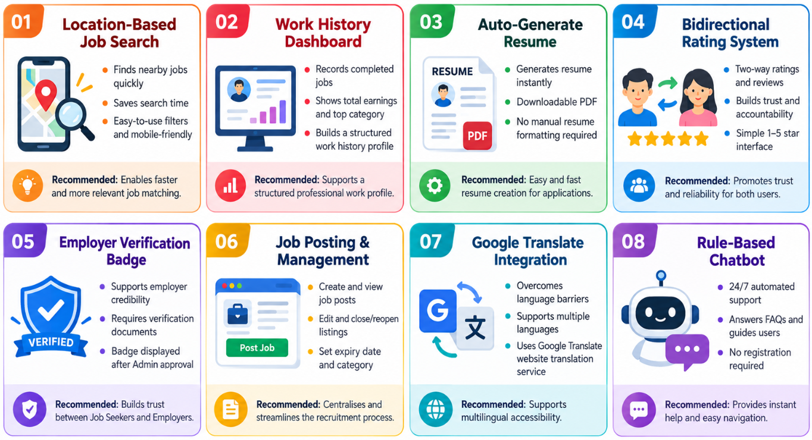

Figure 2.3: Application of TAM

### 2.2.3 Limitations of TAM and Supplementary Considerations

TAM is a comprehensive and empirically proven model for predicting technology adoption, but some scholars have pointed to its limitations in gig platforms. However, Bagozzi [38] noted that the TAM model is a simplified approach to understanding human adoption of technology because it fails to account for social and emotional factors, which play important roles in technology adoption, especially when there is a high level of trust, a high level of perceived risk, and the presence of strong norms. Gefen et al. [39], in the context of online shopping, demonstrated that trust can be integrated with TAM to help explain users&#39; acceptance of online systems alongside PU and PEOU.

 

To address this limitation, EasyEarn supplements the TAM framework with trust-related considerations adapted from Gefen et al. [39]. In EasyEarn, trust is considered alongside PU and PEOU through features such as the Employer Verification Badge, Report and Flag System, and Bidirectional Rating and Review System. These features are intended to provide users with clearer trust and reputation information when interacting on the platform. In this way, trust-related factors are incorporated into the theoretical framework used to guide the design of EasyEarn [36], [39].

Figure 2.4 illustrates how trust-related considerations are incorporated alongside PU and PEOU in the theoretical framework used for EasyEarn.

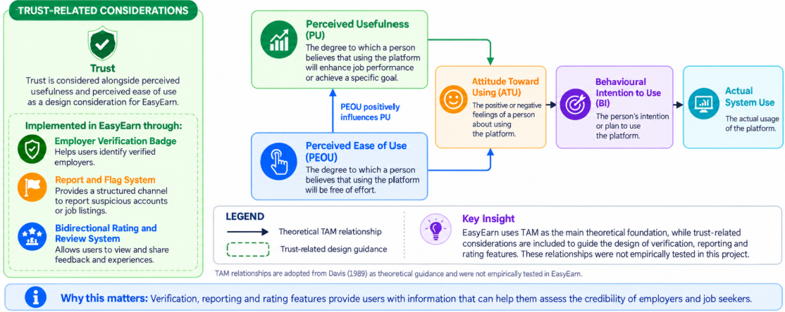

Figure 2.4: Limitations of TAM and Supplementary Considerations

## 2.3 Empirical Review

This section summarises empirical studies which are pertinent to the six problems outlined in Chapter 1 of this study. The empirical review brings together work from academic studies, government reports and research from international organisations to build up an evidence base which underpinned EasyEarn&#39;s design.

### 2.3.1 The Gig Economy in Malaysia

The gig economy has been growing in significance over the past few years, offering non-traditional and flexible employment opportunities to workers. According to Datta et al. [1], there are over 545 online labour platforms, with an estimated 154 million to 435 million workers engaged in online gig work globally. Recent literature also highlights a range of socioeconomic issues, such as access to employment, gig-worker protection and differences among categories of gig workers. A systematic literature review and bibliometric analysis of 510 gig-economy studies conducted by Hu [40] identified these areas as important themes in current gig-economy research.

Gig work has grown in Malaysia as digital platforms have gained traction and individuals increasingly seek alternative sources of income. Abd Samad et al. [3] identified flexibility and supplementary income as important motivations for gig-economy participation, alongside relatively low barriers to participation. More recent research by Mohd Hed and Rosli [4] also found that flexibility, autonomy, financial factors, inclusivity and skill diversification influence Malaysian youths&#39; participation in the gig economy.

According to Malay Mail [5], citing MDEC&#39;s internal analysis, Malaysia&#39;s gig economy market size reached approximately RM1.33 billion in Q3 2023, equivalent to about 80% of the RM1.63 billion recorded for the whole of 2022. More than 100,000 new individuals were participating in and earning income through gig-economy platforms as of Q3 2023, while more than 140 gig-economy platforms had been validated by MDEC and the Ministry of Communications and Digital.

Despite this growth, access to structured short-term work opportunities remains concentrated in certain areas. GoGet states that its workers are mainly available in Klang Valley, Penang, Negeri Sembilan and Johor Bahru [6]. This suggests that the availability of structured gig-work opportunities may vary geographically, particularly for users outside the platform&#39;s main service areas.

Before the Gig Workers Act 2025 came into force, the legal status and protection of gig workers in Malaysia had been identified as an area requiring clearer legal recognition and protection [41]. The regulatory environment surrounding gig employment in Malaysia has also changed significantly. The Gig Workers Act 2025 (Act 872) establishes a formal legislative framework covering matters such as service agreements, gig workers&#39; rights, social protection and dispute resolution [17]. The Act came into force on 31 March 2026 and was reported to provide legal safeguards for approximately 1.64 million individuals involved in Malaysia&#39;s gig economy [42]. The Ministry of Human Resources also identifies the legislation as the Gig Workers Act 2025 (Act 872), while its implementing regulations specify 31 March 2026 as the commencement date.

These developments highlight the increasing significance of gig work in Malaysia and the need for more structured and accessible short-term employment opportunities. EasyEarn responds to this context by providing a web-based platform for short-term, part-time and freelance jobs, with particular attention to users who may have fewer structured gig opportunities in less-serviced areas.

Figure 2.5 gives an overview of the gig economy in Malaysia, its development, the motivations for gig work and the ongoing need for greater access to structured employment opportunities.

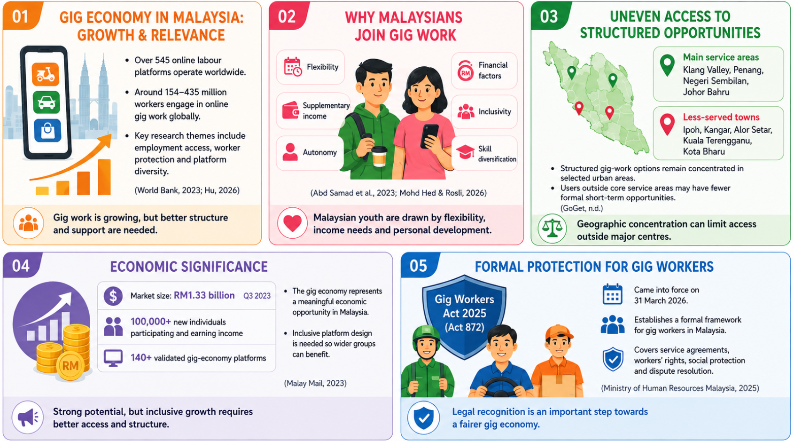

Figure 2.5: Malaysia’s Gig Economy Landscape

### 2.3.2 Employment Fraud and the Risks of Informal Job-Seeking Channels

Fraud relating to employment has become a growing problem for people looking for a quick job on social media and messaging apps online. In 2025, the total number of job scam incidents reported to the Royal Malaysia Police [8] was 8,911 part-time job scam cases, an increase of 144% from 2024, resulting in RM222 million in losses. Some of the common tricks were high-paying jobs for simple tasks, asking for advance payments or fund transfers via WhatsApp, Telegram, and other apps.

Social media is a popular way to search for jobs, especially for individuals looking for work online. Randstad Malaysia [7] reported that 47% of respondents who intended to switch jobs planned to use social media channels such as Facebook and WhatsApp. Randstad also advised employers to promote job openings through trusted channels, such as official company websites and reliable job search platforms, due to the risk of fraudulent digital job advertisements  [7].

Trust and reputation mechanisms can help diminish uncertainty between workers and employers, and also work in favour of digital labour platforms. Corten et al. [10] carried out an experiment using 180 actual clients across five gig-economy platforms that revealed that reputation information had an impact on trust in workers. When ratings were connected to the same task, they were especially helpful, indicating that reputation information could provide a signal of credibility when users have a limited amount of pre-existing information about each other.

Also, formal procedures for addressing and reviewing worker concerns are crucial in digital labour systems. The FareShare project was created by Rao et al. [43] to support the rideshare workers who have been impacted by the platform deactivation or loss of income. The 178 worker account sign-ups in a 3-month field deployment revealed the need for structured recourse processes and a need for trust, consent and accountability in high-stakes digital labour platforms.

EasyEarn mitigates these trust and safety issues with the Employer Verification Badge, Report and Flag System, and Bidirectional Rating and Review System. The Employer Verification Badge adds another layer of credibility for Job Seekers before engaging with an Employer, and the Report and Flag System enables suspicious job postings or Employers&#39; activity to be reported to Admin for review. The Bidirectional Rating and Review System also allows Job Seekers and Employers to give feedback upon completion of the work, for further reputation data that can be used in future job decisions.

The risks and necessary trust and safety mechanisms that are in place to mitigate these risks in EasyEarn are summarised in Figure 2.6.

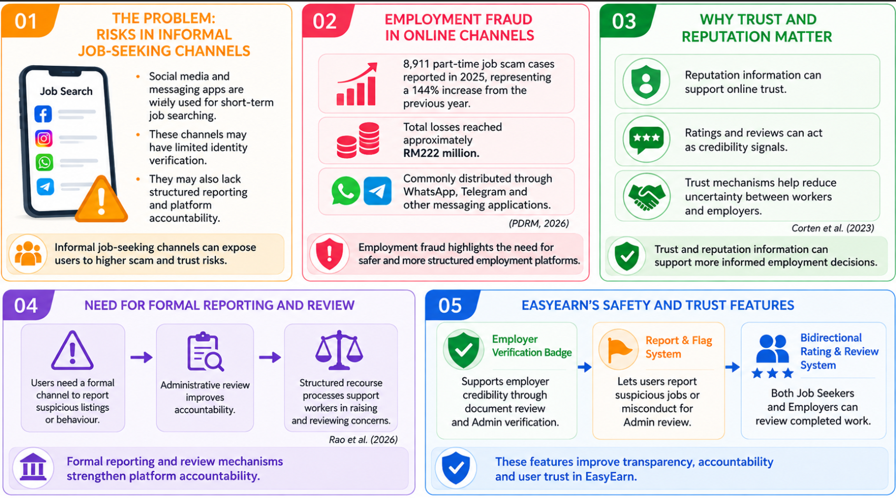

Figure 2.6: Risks of Informal Gig Channels and Solutions

2

### 2.3.3 The Absence of Verifiable Work Histories for Gig Workers

One of the consistent problems with gig work is that it is difficult to have a structured, portable, and suitable means of showing workers their employment experience. In traditional work, employers often keep employment contracts, payslips, employer references, etc., whereas gig workers may have several short-term work engagements with different employers without building up a track record of their skills, performance and employment history. One of the challenges for platform workers in emerging economies that Graham et al. [12] noted was the lack of ability to construct a portable professional identity.

Newer research also supports the benefits of workplace-based information in helping workers on non-traditional career trajectories. Hsieh et al. [44] conducted a seven-day field study with 16 active gig workers from three different platforms and work domains. The study revealed that the exchange of work-related information facilitated financial reflection, work planning and working together among employees. This suggests the potential for structured work data to improve gig workers&#39; understanding and management of their working lives.

Hui et al. [45] also reported that traditional credentials and work histories are more often preferred by employment platforms, which can make it challenging for people with informal and non-traditional work histories to showcase their assets to a potential employer. They emphasise the need for a person to be able to articulate &quot;non-traditional&quot; experiences in an employment setting and to recognise the transferable strengths of such experiences. This is especially true for gig workers who could be working for various short-term companies without combining their experience into one.

This is also confirmed by recent empirical studies. Based on the data from the China General Social Survey (2015-2021), Wang et al. [46] found that in the gig economy, labour-market outcomes become more dependent on the work experience of individuals, whereas their traditional education becomes less important. The research also highlights the continuing importance of work experience in gig-economy employment outcomes.

Reputation data also plays a role in the job and platform transitions of workers. In an experiment with 180 real clients of five gig-economy platforms, Corten et al. [10] looked into the effects of worker ratings on online trust. The study also highlighted limitations in transferring reputation information across different platforms.

To solve this problem, EasyEarn addresses it through the Work History Dashboard, Auto-Generate Resume, and Rating and Review System. The Work History Dashboard keeps track of completed jobs, earnings and ratings, while the Auto-Generate Resume feature converts the recorded work history into a downloadable PDF resume. The Rating and Review System also includes reputation data linked to completed work, enabling Job Seekers to gradually build a more structured digital employment profile.

The structural problem of lack of verifiable work histories with gig workers and the economic consequences of this lack are summarised in Figure 2.7.

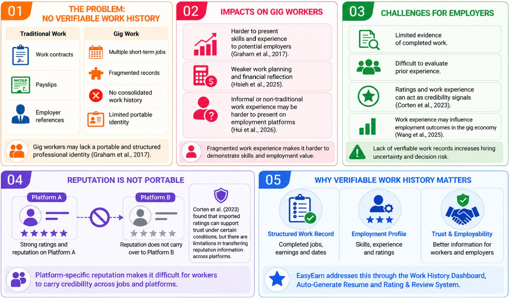

Figure 2.7: The Absence of Verifiable Work Histories of Gig Workers

### 2.3.4 Language Barriers and Digital Exclusion in Malaysian Gig Platforms

The accessibility of language is one of the critical factors to take note of in digital employment platforms, especially in a multilingual nation like Malaysia. Users in Malaysia may have different levels of proficiency in Bahasa Melayu, English, Mandarin and Tamil, which can affect their understanding of job information and use of digital services.

UNCDF [15] highlighted the importance of local-language accessibility for low- and middle-income users of digital platforms.  This is especially true of employment platforms, as language barriers can limit the understanding of the job requirements, instructions for the platform and job-related information.

 

Further research in Malaysia shows the significance of inclusive access to gig work, as published in more recent studies. Mohd Hed and Rosli [4] conducted a study on 385 gig economy youth participants in Malaysia and found that inclusion and technological access are factors affecting gig economy participation. According to their results, use of digital platforms is an important factor in the ability of Malaysian youth to access flexible jobs.

The multilingual digital resources are also reinforced by the recent international evidence. Based on survey results from 4,217 respondents in six European countries, Saulītis [16] concluded that there was a high level of acceptance of web content in the local language, as well as some differences between the various demographic and linguistic groups regarding their satisfaction with machine translation technologies. The study shows the usefulness of multilingual resources in creating digital accessibility and usability, especially for users who might not feel at ease using English-dominant online services.

The results are applicable to EasyEarn as it caters to individuals with various linguistic backgrounds in Malaysia. EasyEarn addresses this issue through Google Translate Integration, allowing users to access translated versions of the current page in languages such as Bahasa Melayu, Mandarin and Tamil. Machine translation is not an alternative to fully localised content but another tool to make the platform available to users who are interested in using it in another language.

This is shown in Figure 2.8, which presents the language access issues that have been discussed in the literature, and EasyEarn&#39;s multilingual approach to language support.

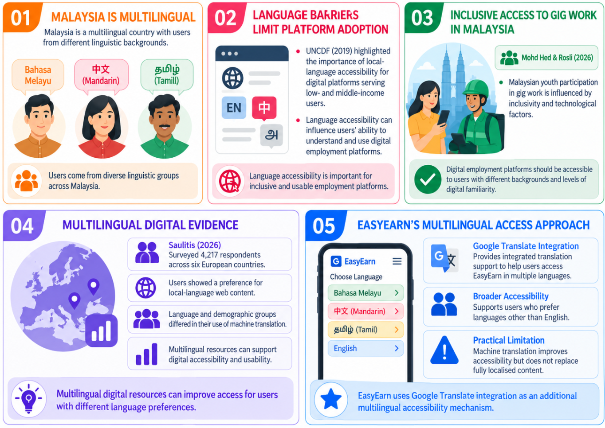

Figure 2.8: Language Accessibility

### 2.3.5 Flexible Work and Underserved Demographics

Short-term and flexible work can be a way to offer employment for people who may not be able to commit to a full-time job, such as university students, housewives or unemployed people. These groups may need special employment conditions that can be flexible to academic and family needs or changing personal situations. Abd Samad et al. [3] found flexibility and additional income to be significant motivations for gig work among the respondents in Malaysia.

 

A more recent piece of Malaysian evidence confirms the significance of flexible employment for young people. Mohd Hed and Rosli [4] conducted a quantitative study on 385 youth gig workers in Kuala Lumpur and identified some factors that encouraged youth to engage in gig work, such as flexibility, autonomy, inclusivity, technological advancement and skill diversification. Their study reveals that the decision to take on gig work is not simply about economic constraints but also about flexibility and avenues for personal and professional growth.

Uchiyama and Furuoka [47] examined 85 young app-based gig workers across 11 Malaysian states through semi-structured interviews. The study found that young gig workers flexibly combined employment and self-employment while facing regulatory ambiguity and unclear labour status. This further shows the changing role of gig work in youth employment in Malaysia.

The experiences of other developing countries also show that flexible gig work can be particularly important for individuals with multiple responsibilities. Sarker et al. [48], in a quantitative survey of 443 gig workers in Bangladesh, found that work flexibility was an important motivation for participating in digital work, particularly among women. The study also found that work-life balance and income were positively associated with job satisfaction, while difficulties such as unstable networks and complicated payment systems reduced job satisfaction.

International Labour Organisation (ILO) [2] has previously linked digital labour platforms in Southeast Asia to key areas like rideshare and food delivery. These forms of platform work may not suit all users seeking flexible employment, particularly those who prefer non-transport-based short-term jobs. There are also temporary job openings for individuals looking for work in roles like event staffing, retail work, tutoring or administrative support. A more diverse short-term employment platform can thus offer other employment opportunities for individuals who have schedules and/or situations that are better suited to other forms of employment.

EasyEarn tackles this need by offering part-time, freelance and short-term job postings in various job categories. Availability and preference filters help Job Seekers focus on jobs that align with their availability and preferences, and application management equips them with a structured application system to keep track of temporary job opportunities.

The flexible employment needs of underserved groups and the ways in which short-term job platforms can contribute to broader gig work participation are shown in Figure 2.9.

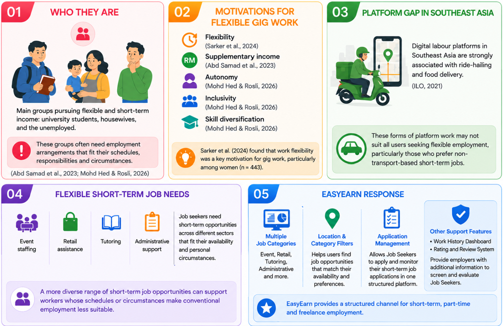

Figure 2.9: Flexible Work and Underserved Demographics

### 2.3.6 Inefficient SME Recruitment and Short-Term Hiring Challenges

Short and temporary staffing requirements for SMEs may be challenging when businesses need to recruit workers for events, retail support and administrative tasks. Digital work platforms can provide small businesses with access to external labour and more flexible workforce arrangements [14].

New studies illustrate the benefits of digital work platforms for small companies that lack resources and capabilities. Gusenbauer et al. [14] interviewed 19 chief executive officers (CEOs), founders, and managers of small and micro businesses in Austria and Germany qualitatively. The research revealed that the primary purpose businesses have for using digital work platforms like Upwork and Fiverr is to secure external resources and to rationalise spending. These platforms also reduced the cost and hassle of outsourcing by offering features that enabled trust and minimised extra coordination that would be needed to discover and handle outside workers.

Additionally, Gusenbauer et al. [14] discovered that digital workers offer small businesses higher versatility in coping with momentary labour shortages and fluctuating workloads. Reputation information was also a key part of the selection process, as enterprises took into account price as well as previous ratings when assessing potential freelancers. The results show how a structured digital platform can help small businesses to have more efficient access to external labour, as well as information that helps workers evaluate themselves.

The findings of the study by Gusenbauer et al. [14] apply to the issue of short-term employment in Malaysia, as digital outsourcing in Austria and Germany, when conducted by smaller companies, is a way to gain access to workers on a flexible basis. EasyEarn follows this principle in the local employment situation in Malaysia, where SMEs and individual employers can post job opportunities for a limited period of time and run the application process through a defined process on a platform.

EasyEarn alleviates these recruitment problems with the following features: Employer Dashboard, Job Posting and Management functions, applicant management and the Application Status Timeline. Employers can post and track short-term job opportunities and profile the applicants in one system. The Work History Dashboard and Rating and Review System also give employers extra details on Job Seekers&#39; past work and reputation in helping to screen applicants.

The challenges to recruitment in the short term for SMEs and the structured recruitment process provided by EasyEarn are summarised in Figure 2.10.

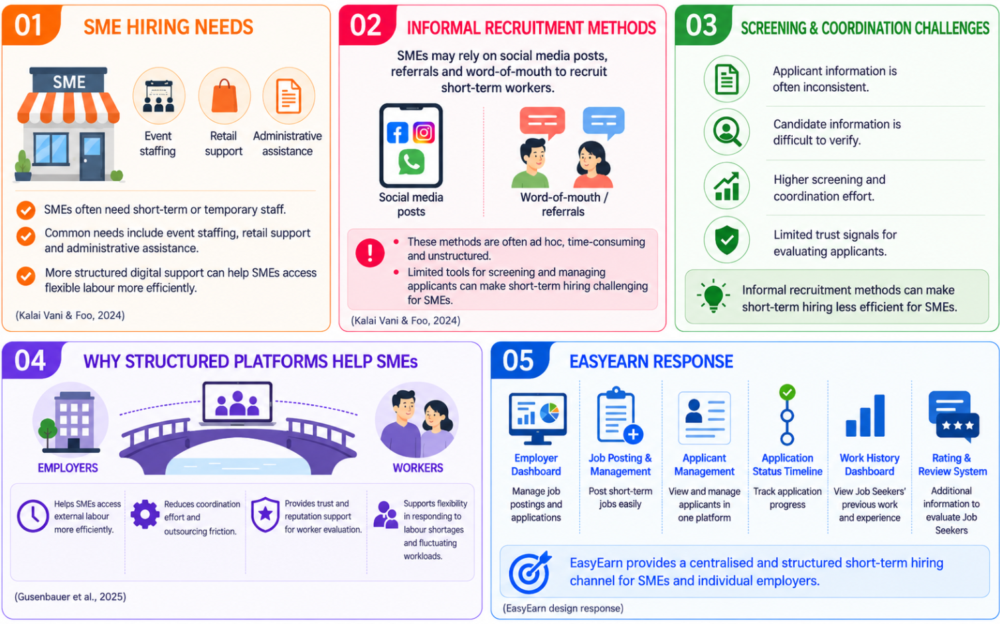

Figure 2.10: Inefficient SME Recruitment and Short-Term Hiring Challenges

### 2.3.7 Synthesis of Empirical Evidence

The empirical literature that has been covered in Sections 2.3.1-2.3.6 covers various aspects of gig work and digital employment. Table 2.2 brings together six recent studies in order to identify common findings and limitations in the literature in relation to the research context, main contribution, relevance to EasyEarn and remaining limitations. The comparison helps to detect recurrent deficiencies and serves as a basis for the system design for EasyEarn.

 

Table 2.2: Synthesis of Empirical Evidence

<table>
<tr>
<td>

Paper

</td>
<td>

Focus / Context

</td>
<td>

Key Contribution

</td>
<td>

Relevance to EasyEarn

</td>
<td>

Limitation / Weak Point

</td>
</tr>
<tr>
<td>

Mohd Hed &amp; Rosli [4]

</td>
<td>

385 Youth were employed as gig workers in Kuala Lumpur, Malaysia.

</td>
<td>

Determined flexibility, autonomy, inclusivity, technology and skill diversification as reasons for gig participation.

</td>
<td>

Enables flexible short-term employment for Malaysian users.

</td>
<td>

Focuses on Kuala Lumpur youth rather than users in secondary towns and does not examine an integrated job platform.

</td>
</tr>
<tr>
<td>

Hsieh et al. [44]

</td>
<td>

16 gig workers across three platforms/work domains.

</td>
<td>

Work-data sharing was structured, which facilitated financial reflection, planning and mutual support.

</td>
<td>

Implements a Work History Dashboard and/or structured work history records.

</td>
<td>

Lacks ability to match local jobs, verify with employers and provide multilingual access.

</td>
</tr>
<tr>
<td>

Corten et al. [10]

</td>
<td>

180 clients of five gig platforms.

</td>
<td>

Showed how ratings can contribute to online trust and explored some of the barriers to the transfer of reputation.

</td>
<td>

Implements a rating and Review System and reputation records.

</td>
<td>

Focuses mainly on reputation and trust rather than employer verification, reporting or local job access.

</td>
</tr>
<tr>
<td>

Gusenbauer et al. [14]

</td>
<td>

19 executives from small/micro enterprises in Austria and Germany.

</td>
<td>

Digital work platforms enhanced access to resources, cost optimisation, trust and flexibility for small enterprises.

</td>
<td>

Supports structured access to external labour for small enterprises.

</td>
<td>

Not local, short-term recruitment-focused, and not Malaysia-specific.

</td>
</tr>
<tr>
<td>

Saulītis [16]

</td>
<td>

Multilingual users of digital resources from six European countries

</td>
<td>

Analysed multilingual resources, the usage and satisfaction of machine translation.

</td>
<td>

Facilitates multilingual accessibility and EasyEarn&#39;s Google Translate method.

</td>
<td>

Not specific to employment platforms or the Malaysian population.

</td>
</tr>
<tr>
<td>

Hernandez et al. [49]

</td>
<td>

25 U.S.-based gig drivers in rideshare and delivery work.

</td>
<td>

Highlighted how gig workers adapt their work practices to local geographic, market and infrastructural conditions.

</td>
<td>

Supports the importance of considering local context in platform design.

</td>
<td>

Concentrates on U.S. rideshare and delivery workers, instead of job matching in secondary towns in Malaysia.

</td>
</tr>
</table>

The synthesis reveals that the current research focuses on key issues surrounding gig work, such as flexibility, data related to gig work, reputation, opportunities for small businesses, multilingualism and local context. Most of these issues, however, are studied individually and not via a single integrated digital employment platform. Within the literature and systems reviewed in this study, no single platform was identified that combines local short-term job access, employer trust mechanisms, structured work history, multilingual accessibility and SME recruitment support for secondary-town users in Malaysia. This shows a gap in the existing research and systems, which EasyEarn aims to address by combining these functions in one web-based job-matching platform.

## 2.4 Review of Relevant Technologies

In this section, the basic front-end and client-side technologies that comprise the technical backbone of EasyEarn are discussed. Each technology is compared to academic literature and to believable alternatives to select them in the context of a solo-developer academic project.

### 2.4.1 Web-Based Application Development

HTML5, CSS3 and JavaScript are the backbone of today&#39;s Web application development. Mozilla Developer Network (MDN) Web Docs [50] explain that HTML5 offers the semantic structure, CSS3 offers the presentation, and JavaScript offers the interactivity of the content, without requiring anything on the server side. This is because the choice of the technology stack for software development needs to be based on several criteria: ease of maintenance, developer familiarity, ease of deployment, and technology suitability in the context of EasyEarn&#39;s academic domain, which this combination achieves.

In comparison to modern front-end frameworks like React, Angular, and Vue.js, plain JavaScript has fewer layers of dependency, is less complex with build tools and offers a clearer code structure, which is more suitable for a student-driven academic project that will be evaluated and moderated [50]. For a single-developer project deployed through GitHub Pages, frameworks such as React may introduce additional dependencies and build-process complexity that are not necessary for the current project scope. EasyEarn&#39;s feature set and ease of maintenance will thus be a compromise between HTML, CSS, and JavaScript, with the latter being prioritised due to the academic nature of the project and the limited resources of the sole developer.

With responsive web design, using CSS3 media queries and a flexible grid, EasyEarn will be accessible through both desktop and mobile browsers without requiring a native application. This is important because EasyEarn is intended to remain usable across different screen sizes and device types.

Figure 2.11 shows the rationale behind the web-based technology stack that EasyEarn has: a contrast between using JavaScript and using modern web frameworks, as well as deployment benefits.

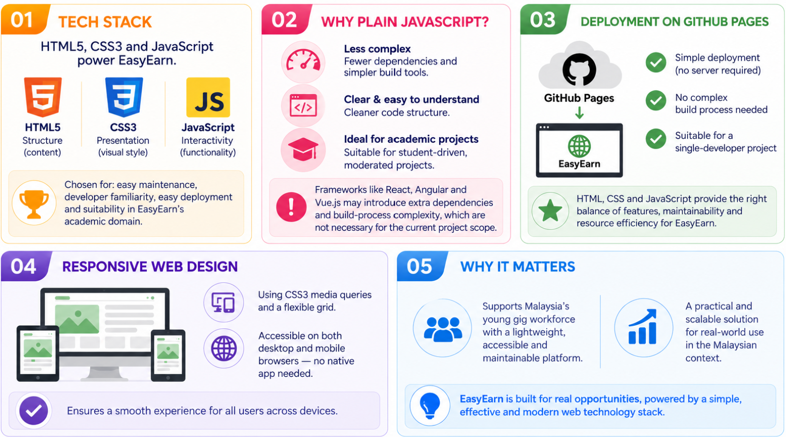

Figure 2.11: Web-Based Application Development

### 2.4.2 Client-Side PDF Generation via jsPDF

The jsPDF library is a free JavaScript library that creates PDF files directly in the browser, instead of having to process the files on the server or make extra API calls [51]. EasyEarn&#39;s Auto-Generate Resume feature uses jsPDF to create a downloadable PDF resume directly from the Job Seeker&#39;s stored profile and work history data.

 

While server-side solutions such as wkhtmltopdf, Puppeteer and Python&#39;s ReportLab provide better typographic control and support for complex layouts, they require a dedicated backend process, which is not available in EasyEarn&#39;s GitHub Pages deployment [52]. The advantages of using jsPDF are that it runs entirely within the browser, can be used alongside the Supabase JavaScript Client Library, and does not require additional server infrastructure, making it suitable for the current project scope [51].

In Figure 2.12, the client-side approach for creating a PDF is illustrated with the help of the jsPDF library and is contrasted with server-side approaches.

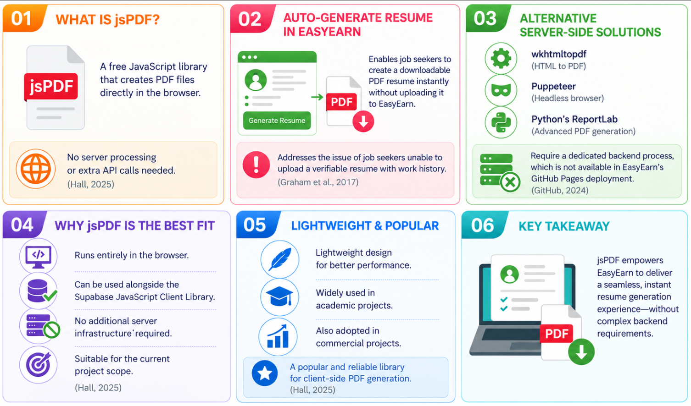

Figure 2.12: Client-Side PDF Generation

 

### 2.4.3 Data Visualisation via Chart.js

Chart.js is an open-source JavaScript charting library that creates interactive and responsive data visualisations using the HTML5 canvas element [53]. EasyEarn uses Chart.js to present the completed jobs count, along with their total earnings and distribution by job type in the Work History Dashboard, and to provide platform-wide totals of registered users, completed jobs, active job postings, applications submitted and successful job matches in the Admin Analytics Dashboard.

Google Charts is typically loaded from Google&#39;s servers, while Chart.js can also be hosted locally within the project. Chart.js integrates directly with JavaScript data arrays and supports responsive charts, making it suitable for EasyEarn&#39;s deployment and current project requirements. The data visualisation approach is illustrated in Figure 2.13, together with other alternatives considered for the project.

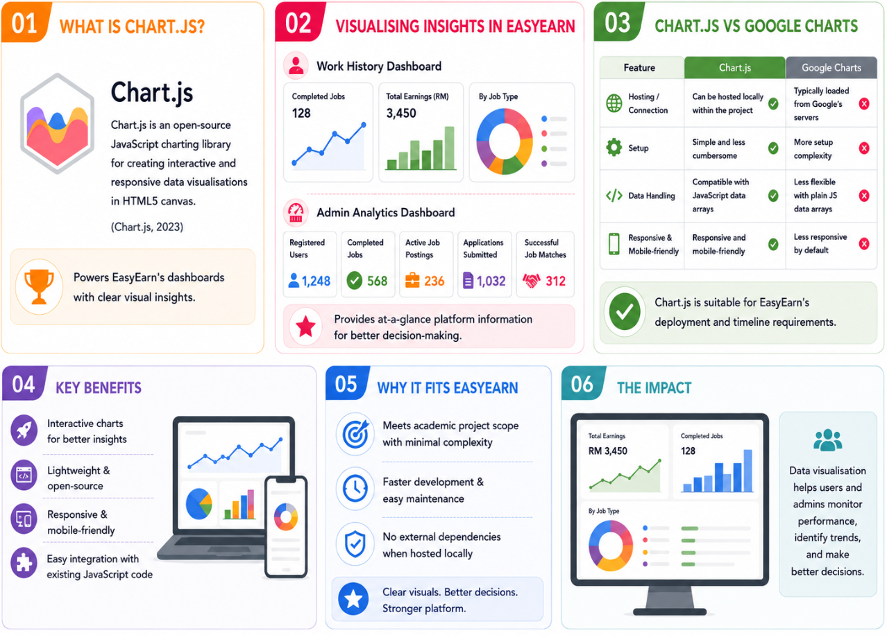

Figure 2.13: Data Visualisation

### 2.4.4 Multilingual Accessibility: Google Translate Integration

UNCDF [15] emphasises that multilingual accessibility is one of the key factors in enhancing the digital inclusion of users with different language backgrounds in Malaysia. There are several options for enabling multilingual support in a web application: Using a native translation API like Google Cloud Translation, using pre-translated static content, or redirection to the Google Translate webpage. Google Cloud Translation provides automatic translation through an API and can be integrated into web applications [26]. However, this approach was not selected for EasyEarn because it involves usage-based costs and additional API integration requirements, which were outside the scope of the current academic prototype.

DeepL [54] was also considered; however, the language coverage described in the reviewed source did not fully align with EasyEarn&#39;s intended multilingual requirements. For this reason, EasyEarn employs the website redirection mechanism of Google Translate [55], in which the current EasyEarn page is redirected to the Google website for translation. This approach avoids the need to integrate a native translation API while still providing users with access to translated versions of the current EasyEarn page.

As shown in Figure 2.14, there are multiple ways of making web pages accessible to people with multiple languages that were considered for EasyEarn, and Google Translate Integration was chosen for the current system.

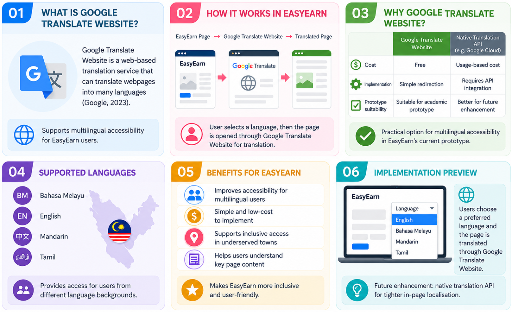

Figure 2.14: Multilingual Accessibility

## 2.5 Review of Selected Tools and Platforms

This section summarises the services, hosting platform and development tools used for EasyEarn and assesses them both academically and technically. Figure 2.15 presents an overview of the tools and platforms that were selected for EasyEarn, including the Supabase relational database features and their comparison with Firebase, the GitHub Pages workflow for static hosting, and the Canva wireframing method based on Nielsen&#39;s heuristics for usability.

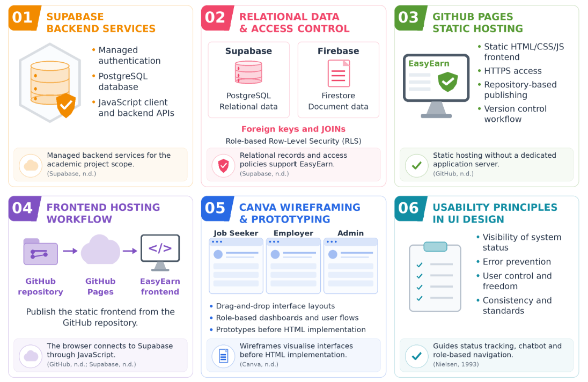

Figure 2.15: Review of Selected Tools and Platforms

### 2.5.1 Supabase: Open-Source BaaS

BaaS is a cloud service model in which backend infrastructure, such as database management, authentication and API provision, is provided through a managed third-party service [18]. Developers do not need to configure and maintain a dedicated server, but instead work with the backend utilising a pre-built API client, which removes a lot of the overhead of infrastructure administration. For EasyEarn, this model reduces the need to configure and maintain a dedicated application server, making it suitable for the scope and resources of a single-developer academic project.

 

Supabase is an open-source BaaS platform that includes a relational database, token-based authentication through JSON Web Tokens (JWTs), real-time capabilities, a JavaScript client library and RLS policies [18]. It is touted to be an open-source alternative to Firebase, Google&#39;s proprietary BaaS. The most notable difference between Supabase and Firebase is the models of their databases. Firebase stores data in Firestore, a NoSQL document-oriented database that is optimised for hierarchical and schema-flexible data. Supabase is based on PostgreSQL, a full-featured relational database that supports foreign key (FK) constraints, JOINs, and declarative schema design [18]. EasyEarn&#39;s data model contains relational relationships among users, job postings, applications, ratings, and work history records, and it is a more natural data model to be expressed in a relational schema.

EasyEarn&#39;s requirement for role-based access is also important to note and is well-suited to Supabase&#39;s RLS policies. One of the great features of RLS is that it supports access control policies at the database level, meaning that job seekers can only view their own application data and employers can only update their own jobs, without having to implement extra middleware logic [18]. These RLS policies provide database-level access control and help restrict access to records based on user roles and ownership. This supports EasyEarn&#39;s approach to protecting user data, although it does not constitute formal compliance certification under Malaysian legislation.

### 2.5.2 GitHub Pages: Static Site Hosting

GitHub Pages is a static website-hosting service that can publish a website directly from a GitHub repository using HTTPS [52]. Other hosting alternatives include Netlify, Vercel and Firebase Hosting. Since EasyEarn uses a static HTML, CSS and JavaScript frontend that communicates with Supabase as its backend service, GitHub Pages provides the hosting functions required for the current project scope.

 

GitHub Pages was selected because it integrates with the project&#39;s GitHub repository, supports HTTPS and allows the static EasyEarn frontend to be deployed without maintaining a dedicated application server [52]. It also fits the project&#39;s existing version-control and iterative development workflow.

### 2.5.3 Canva: User Interface (UI)/ User Experience (UX) Wireframing and Prototyping

Canva is used to create wireframes and prototypes for EasyEarn. Canva allows for easy visualisation of dashboards and user flow diagrams before HTML implementation; it is capable of drag-and-drop interface design and template-based layout creation, making it well-suited for visualisation of role-based dashboards and user flow diagrams before HTML implementation [56]. The EasyEarn wireframes were designed with reference to Nielsen&#39;s [57] usability heuristics, including visibility of system status, error prevention, user control and freedom, and consistency and standards. These principles influenced features such as the Application Status Timeline, Chatbot interface and role-based navigation.

## 2.6 Review of Similar Systems

Existing job-matching platforms are analysed across three categories: full-time job portals, domestic task-based gig platforms and international gig platforms to be considered as comparators to EasyEarn. The analysis is aggregated and presented in a comparative feature gap table.

 

### 2.6.1 Full-Time Employment Portals: JobStreet and RiceBowl

JobStreet and RiceBowl are online recruitment and job search websites established in Malaysia and offer structured job search and recruitment services. Both platforms allow for job postings, employer/company profiles, job applications, and resume/profile information. Although they are commonly used for full-time employment, part-time job opportunities are also available on these platforms [58], [59].

Select trust and safety features on both platforms as well. JobStreet includes a system which enables users to report suspicious job advertisements, employer account verification, company reviews, and job advertisement reviews [60], [61]. RiceBowl also claims to be an interface between job seekers and employers who have been verified, with information about safety that is relevant to job posts, such as reporting suspicious job ads [59], [62].

JobStreet and RiceBowl also provide part-time job opportunities as part of their recruitment services [58], [59]. EasyEarn is designed to support structured short-term job search and recruitment by combining location and category filtering, application-status tracking, trust and safety features, completed work history and automatic PDF resume generation. The features of the platform considered in this subsection are summarised in Figure 2.16.

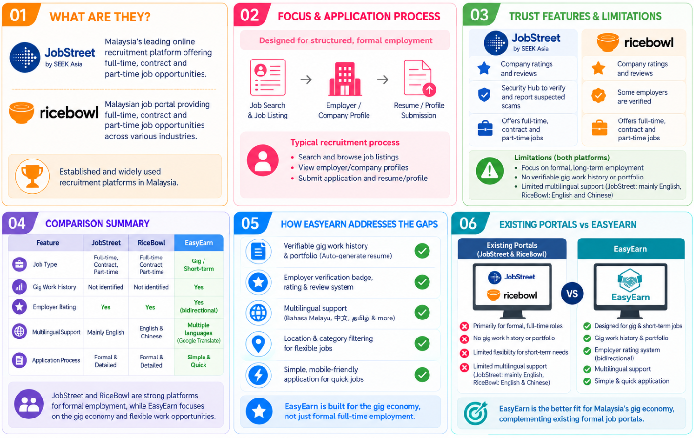

Figure 2.16: Full-Time Employment Portals

### 2.6.2 Task-Based Gig Platforms: GoGet and Troopers

GoGet and TROOPERS are two gig-work platforms in Malaysia offering flexible and short-term employment opportunities. GoGet supports part-time, contract and on-demand work and employs a verification system to ensure that GoGetters work. It also includes function-related evaluations and in-app messaging among users [6]. TROOPERS offers flexible and part-time employment opportunities via its mobile platform with verified employment opportunities, identity verification of gig workers, and location-based job searching [63].

 

Several functions are therefore already available on both platforms that help to create trust and flexible work options. Their ways, however, are distinct from EasyEarn. The part-timer availability is largely centred on the Klang Valley, Penang, Negeri Sembilan and Johor, while the number of jobs available on TROOPERS fluctuates depending on the clients, locations and job demand. Hence, it is untrue to say that either platform lacks in off-centre urban areas. Rather, EasyEarn is created to enable job seekers and employers to search and post short-term jobs categorised by city and region in Malaysia, including the secondary towns covered in this study.

Based on the publicly available features reviewed, GoGet and TROOPERS provide their own verification, job-management and worker-support mechanisms. EasyEarn is unique because it integrates an Employer Verification Badge with a Report and Flag workflow, post-completion Bidirectional Rating and Review system, a structured Work History Dashboard and multilingual access into the academic job-matching process. These differences are summarised below in Figure 2.17.

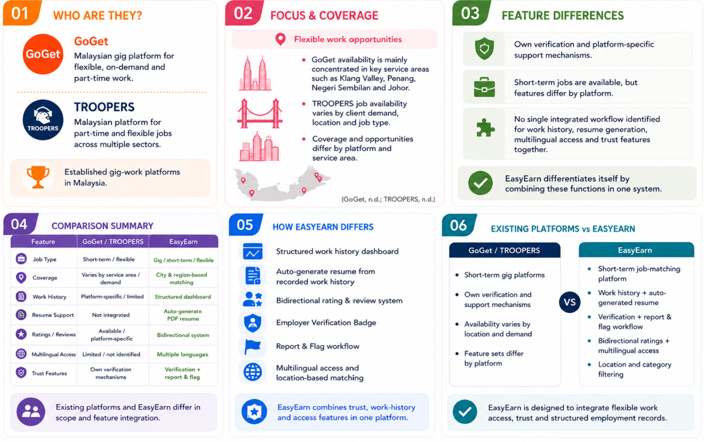

Figure 2.17: Task-Based Gig Platform

### 2.6.3 International Gig Platforms: Fiverr, TaskRabbit, and Upwork

Examples of international gig and freelance work are provided by Fiverr, TaskRabbit and Upwork. Essentially, Fiverr is a digital service platform where freelancers can post their services and service packages on their profiles, while clients can check ratings before booking a service [64]. Upwork provides global access to clients and freelancers via profiles, job postings, proposals, contracts, reviews and platform-managed payments [65], [66]. Unlike these online freelance sites, TaskRabbit makes it possible to get in-person services like cleaning, moving, furniture assembly, and errands [67], [68].

These platforms offer structured ways to connect workers with clients, track work and establish a reputation on the platform. But in terms of their model, they&#39;re different from the model that EasyEarn is looking for. Fiverr and Upwork are primarily freelance services marketplaces, whereas TaskRabbit relies on the availability of Taskers in the supported areas of service [64], [65], [66]. As an example, geographic availability is a critical component in local platform work, as TaskRabbit users choose Taskers based on location, availability, price and task category [69].

EasyEarn is made for fast time-period job matches in Malaysia and is enhanced with employment based mostly in cities and regions, Employer Verification, Report and Flag capabilities, Bidirectional Rating and Review, a structured Work History Dashboard, and Auto-Generate Resume, with multilingual reports and access to be had. Rather, the aim is not to copy the international platforms, but to transfer appropriate ideas from the digital labour platforms to the local situation that is being tackled in this study. This is summarised in Figure 2.18.

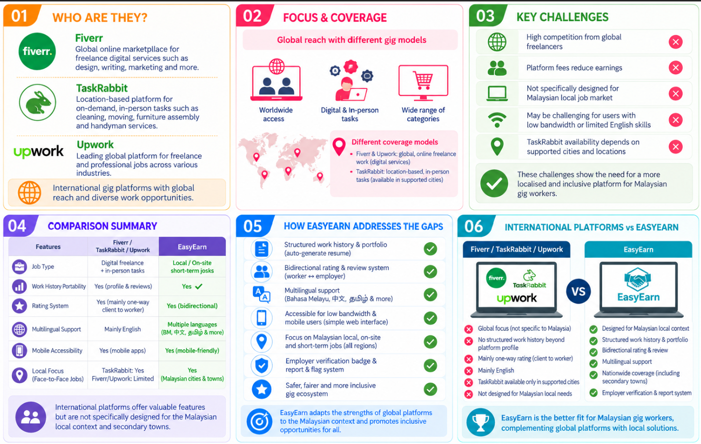

Figure 2.18: International Gig Platform

### 2.6.4 Comparison Feature Gap Analysis

Table 2.3 shows a comparison of EasyEarn to four selected employment and gig-work platforms in Malaysia, namely JobStreet, RiceBowl, GoGet and TROOPERS across 11 feature dimensions relevant to the identified needs in this study. Yes, No and Partial are used to indicate whether a feature was found in a public release of the platform under the same name, a similar name, or if the feature was not found at all.

 

Table 2.3: Feature Comparison of Job Platforms and EasyEarn

<table>
<tr>
<td>

Feature

</td>
<td>

JobStreet

</td>
<td>

RiceBowl

</td>
<td>

GoGet

</td>
<td>

Troopers

</td>
<td>

EasyEarn

</td>
</tr>
<tr>
<td>

Short-term / Gig Work Support

</td>
<td>

Partial

</td>
<td>

Partial

</td>
<td>

Yes

</td>
<td>

Yes

</td>
<td>

Yes

</td>
</tr>
<tr>
<td>

Geographic coverage is beyond major cities.

</td>
<td>

Yes

</td>
<td>

Yes

</td>
<td>

Partial

</td>
<td>

Partial

</td>
<td>

Yes

</td>
</tr>
<tr>
<td>

Verifiable Work History Profile

</td>
<td>

No

</td>
<td>

No

</td>
<td>

Partial

</td>
<td>

Partial

</td>
<td>

Yes

</td>
</tr>
<tr>
<td>

Auto-Generated PDF Resume

</td>
<td>

No

</td>
<td>

No

</td>
<td>

No

</td>
<td>

No

</td>
<td>

Yes

</td>
</tr>
<tr>
<td>

Bidirectional Rating and Review

</td>
<td>

Partial

</td>
<td>

Partial

</td>
<td>

Partial

</td>
<td>

Partial

</td>
<td>

Yes

</td>
</tr>
<tr>
<td>

Multilingual Support

</td>
<td>

Partial

</td>
<td>

Yes

</td>
<td>

No

</td>
<td>

No

</td>
<td>

Yes

</td>
</tr>
<tr>
<td>

Employer Trust Verification Badge

</td>
<td>

Yes

</td>
<td>

Yes

</td>
<td>

Partial

</td>
<td>

Partial

</td>
<td>

Yes

</td>
</tr>
<tr>
<td>

Report and Flag System

</td>
<td>

Yes

</td>
<td>

Yes

</td>
<td>

Yes

</td>
<td>

Partial

</td>
<td>

Yes

</td>
</tr>
<tr>
<td>

Rule-Based Chatbot Support

</td>
<td>

No

</td>
<td>

No

</td>
<td>

No

</td>
<td>

No

</td>
<td>

Yes

</td>
</tr>
<tr>
<td>

Offline Payment Guidance

</td>
<td>

No

</td>
<td>

No

</td>
<td>

Partial

</td>
<td>

No

</td>
<td>

Yes

</td>
</tr>
<tr>
<td>

Gig Workers Act 2025 Awareness / Design Consideration

</td>
<td>

No

</td>
<td>

No

</td>
<td>

Yes

</td>
<td>

Yes

</td>
<td>

Yes

</td>
</tr>
</table>

Note: The following comparison is based on the platform features that are publicly available and were identified during the period of the project review in April 2026. Not included: Features added from April 2026 onwards. Yes, Partial and No represent a complete, partial or no match to the assessed feature dimension.

 

Table 2.3 illustrates that the chosen platforms already offered various mixes of employment and trust/gig-work roles during the period of the review. Structured recruitment and part-time work were supported by JobStreet and RiceBowl, and flexible and gig work was supported more directly by GoGet and TROOPERS. The platforms reviewed, however, have done so in various ways and none of the selected platforms brought together all 11 feature dimensions measured in this study into one system.

EasyEarn aims to combine the 11 feature dimensions considered in this study within one academic job-matching platform: short-term job support, geographic access, structured work history, auto-generated PDF resumes, bidirectional ratings and reviews, multilingual support, employer verification, reporting and flagging, rule-based chatbot support, offline payment guidance, and awareness of the Gig Workers Act 2025.

### 2.6.5 Research Gap

There are three categories of platforms that review existing job-matching and gig-work platforms, namely Malaysian employment portals, Malaysian task-based gig platforms, and international gig platforms. JobStreet and RiceBowl are considered structured employment websites, GoGet and TROOPERS as gig-work sites in Malaysia, and Fiverr, TaskRabbit and Upwork as international digital labour platforms. The emphasis of the review is on the functionality, models, and applicability to the requirements outlined for the EasyEarn project. Section 2.6.4 presents a comparative feature gap analysis of the selected Malaysian platforms with the EasyEarn platform.

 

This same disparity can be seen in the comparison of currently available systems as shown in Table 2.3. JobStreet and RiceBowl make for traditional jobs; GoGet and Troopers offer more for gig and short-term jobs. Structured digital labour markets are also possible on international platforms like Fiverr, TaskRabbit and Upwork. In this study, however, we have compared features and have only found those that were relevant to the requirements we identified with EasyEarn. Within the platforms and features reviewed in this study, no single platform was identified that combined wider local job access, employer verification, formal reporting, bidirectional ratings and reviews, structured work history, multilingual accessibility and short-term recruitment support for SMEs in one system designed for the Malaysian context.

Hence, an integrated short-term job-matching platform to meet the needs of both the Job Seekers and the Employers is still under research and development, especially for those who are in the secondary towns in Malaysia. With this in mind, EasyEarn is designed to fill this gap by providing a single web-based platform that offers location-based job search, employer verification, reporting and rating, a structured digital work history, resume generation, multilingual accessibility, short-term jobs and applicant management. This identified gap forms the basis for the design of the system, which is also represented in the Conceptual Framework in Section 2.7.

## 2.7 Conceptual Framework

A conceptual framework is developed based on the theoretical framework in Section 2.2, the empirical evidence reviewed in Section 2.3 and the research gap identified in Section 2.6.5. The framework combines TAM [27], [70] with trust-related factors from the Trust-Based Technology Acceptance Model (TBTAM) [39] to show how the EasyEarn features respond to the identified problems.

 

There are three layers in the conceptual framework. The first layer shows the six problem dimensions identified from the literature. The second layer shows the EasyEarn design responses linked to each problem. The third layer shows the expected outcomes and design considerations based on TAM and trust-related factors, including PU, PEOU and trust-related considerations. Table 2.4 presents the relationship between the problem dimensions, literature basis, EasyEarn design responses and expected outcomes.

Table 2.4: EasyEarn Conceptual Framework

<table>
<tr>
<td>

Problem Dimension

</td>
<td>

Literature Basis

</td>
<td>

EasyEarn Design Response

</td>
<td>

Expected Outcome (TAM / Trust)

</td>
</tr>
<tr>
<td>

Geographic Exclusion

</td>
<td>

GoGet [6]; Hernandez et al. [49]

</td>
<td>

Job search and location filtering by geographical area.

</td>
<td>

Increased PU for users seeking local opportunities.

</td>
</tr>
<tr>
<td>

Employment Fraud / Trust

</td>
<td>

Royal Malaysia Police [8]; Corten et al. [10]; Rao et al. [43]

</td>
<td>

Employer Verification Badge; Report and Flag System; Bidirectional Rating and Review System.

</td>
<td>

Supports users in assessing credibility and perceived usefulness.

</td>
</tr>
<tr>
<td>

Absent Work Identity

</td>
<td>

Hsieh et al. [44]; Hui et al. [45]; Wang et al. [46]

</td>
<td>

Work History Dashboard; Auto-Generate PDF Resume; Rating and Review System.

</td>
<td>

Increased PU through more structured work-related information.

</td>
</tr>
<tr>
<td>

Language Barrier

</td>
<td>

UNCDF [15]; Saulītis [16]

</td>
<td>

Google Translate site redirection for multilingual access.

</td>
<td>

Enhanced PEOU for users with different language preferences.

</td>
</tr>
<tr>
<td>

Inefficient SME Recruitment

</td>
<td>

Gusenbauer et al. [14]

</td>
<td>

Employer Dashboard; Job Posting and Management; Applicant Management; Application Status Timeline.

</td>
<td>

Improved recruitment efficiency and increased PU.

</td>
</tr>
<tr>
<td>

Limited Structured Access to Flexible Work Opportunities

</td>
<td>

Abd Samad et al. [3]; Mohd Hed and Rosli [4]; Sarker et al. [48]

</td>
<td>

Short-term job categories; location and category filters; application management.

</td>
<td>

Increased PEOU and PU for flexible workers.

</td>
</tr>
</table>

Figure 2.19 illustrates the EasyEarn Conceptual Framework, which links the six problem dimensions identified from the literature to the corresponding EasyEarn design responses and the expected TAM- and trust-related outcomes.

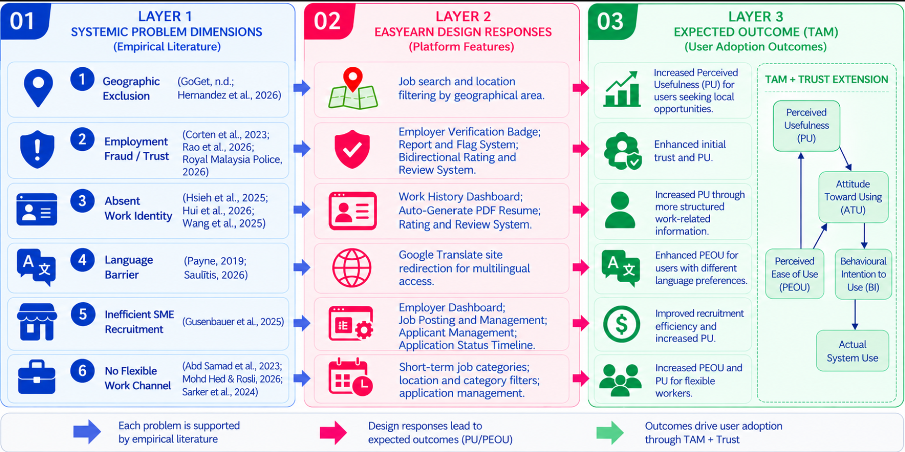

Figure 2.19: EasyEarn Conceptual Framework

The conceptual framework shows that EasyEarn&#39;s features are developed based on the academic and empirical evidence reviewed in this chapter. The features relate to a particular gap in the literature, and the expected outcomes relate to TAM and trust-related factors. This framework also provides a basis for evaluating the system and discussing the findings in the later stages of the project.

## 2.8 Chapter Summary

This chapter reviewed the theoretical, empirical and technical foundations of EasyEarn. The theoretical framework adopted is design-oriented TAM [27] and the other design factor taken into account is the trust-related factor from TBTAM [39] which has been integrated with PU and PEOU to inform the platform design.

The six problem dimensions identified for EasyEarn were: geographic exclusion, employment fraud and trust, lack of structured work history, language barriers, limited flexible work opportunities and inefficient SME recruitment. Recent research has highlighted the significance of local context [49], online reputation and trust [10], [43], structured work-related data and work identity [44], [45], [46], multilingual accessibility [16], flexible gig participation [4], [48], and digital work platforms for small enterprises [14]. These studies generally examine these issues individually rather than as part of an integrated employment platform.

The technologies and development tools relevant to EasyEarn were also reviewed to provide a technical basis for the system. The comparison in Section 2.6 shows that the selected platforms reviewed during the project analysis period provided different combinations of the eleven feature dimensions considered in this study. However, within the platforms reviewed, no single platform was identified that combined all the dimensions in one system designed for EasyEarn&#39;s Malaysian context.

The identified research gap in Section 2.6.5 therefore reinforces the need for an integrated web-based platform with a combination of: local job access, employer verification, reporting and bidirectional ratings, structured work history, multilingual accessibility and short-term support for recruitment. The problem dimensions in Section 2.7 are linked to the corresponding EasyEarn design responses and the expected TAM and trust-related outcomes. Overall, the literature reviewed in this chapter provides the basis for the research methodology, system design, implementation, testing and evaluation presented in the following chapters. 

# Chapter 3: Research Methodology

## 3.1 Introduction

The research and system development methods used in the development of the EasyEarn Job Matching Portal are described in this chapter. The research methodology encompasses the method of data collection and analysis of user requirements, such as research approach, research design, population and sampling, questionnaire design, data analysis, validity, reliability and research ethics. The results of the user requirements survey are also presented and used to identify system requirements and support their selection.

The chapter then describes the Hybrid Agile-Waterfall methodology adopted in the 26 weeks of the FYP to develop the project EasyEarn. Later sections will discuss the phases of the project as well as the sprints, tools and technologies used, planning and risk management, hardware and software needed, system design, and wireframes and the resulting UI.

Figure 3.1 illustrates the overall research and system development methodology used for EasyEarn. It illustrates the process of gathering user requirements by studying user requirements collection, approach to research, research design, population &amp; sampling, designing a questionnaire, analysis of data, validity, reliability and research ethics. It also provides a reflection on the development of the system using the Hybrid Agile-Waterfall methodology, including planning, sprints, tools, risk management, system design, wireframes and UI development.

Figure 3.1: Research and System Development Methodology for EasyEarn

## 3.2 Research Methodology

This section outlines the research methodology used to identify and support the user requirements for the EasyEarn Job Matching Portal. It includes the research approach, research design, population and sampling, data collection method, research instrument, data analysis procedure, validity, reliability and research ethics. The results of the user requirements survey are also summarised to show how the responses contributed to identifying system requirements and supporting their selection. The system development methodology used to develop EasyEarn is presented separately in Section 3.3.

 

### 3.2.1 Alignment of Research Questions with Methodology

The RQs introduced in Section 1.3 were derived from the research problems identified in Section 1.2 and aligned with the research objectives. This section explains how the RQs guide the selection of research methods, data collection and analysis procedures. RQs help provide direction for the selection of research methods, data collection and analysis procedures [28], [71]. For consistency throughout the research process, each RQ is linked to the relevant research problems and research objectives.

RQ1: What are the essential requirements for a web-based job-matching platform that supports short-term, part-time and freelance employment between Job Seekers and Employers in Malaysia?

This RQ covers aspects of the lack of a specialist short-term labour platform, inefficient recruitment processes for employers and limited structured access to flexible work opportunities, which are associated with Problem 1, Problem 4 and Problem 5.

RQ2: What safety and trust features should be incorporated into the platform to support safer and more trustworthy interactions between Job Seekers and Employers?

The Employer Verification Badge, Report and Flag System, and Bidirectional Rating and Review System were implemented to support Objective 2. These features help users identify verified Employers, report suspicious activities, and provide ratings and reviews after completed jobs.

RQ3: How can a digital work history and auto-generated resume support gig workers in documenting and presenting their completed work experience?

This RQ raises the issue of the lack of verifiable work history among gig workers, which is related to Problem 3.

 

RQ4: What are the possible ways of making EasyEarn more accessible to those with varying language preferences using multilingual access?

This RQ is related to Problem 6, which is about language barriers in existing platforms.

The RQs determine the research approach, research participants, questionnaire items and data analysis procedures utilised in this study. The results from the user requirement survey are interpreted in relation to these RQs to help identify user requirements and support their selection for the development of the EasyEarn Job Matching Portal. The four RQs are summarised and are presented with their respective research problems in Figure 3.2.

Figure 3.2: Alignment of Research Questions, Problems and Objectives

 

### 3.2.2 Research Approach

The research approach was selected to identify the needs and preferences of potential users before the main development of the EasyEarn Job Matching Portal. The study mainly adopts a quantitative approach, where UX, needs and feature preferences are collected through structured questions and summarised using numerical data [28].

This study also follows a positivist paradigm. A positivist paradigm assumes that research should be based on observable facts and measurable data rather than personal opinions [28]. Hence, data from the structured questionnaire were used, and the results were analysed using descriptive analysis to identify the user requirements of EasyEarn more objectively and systematically [28].

A deductive approach was used in which existing empirical findings, research problems and problem dimensions revealed in the second chapter were used to structure the questionnaire, rather than it being used as a primarily open-ended and exploratory questionnaire to discover new themes [28]. This approach was appropriate because the study began with the identified research problems and literature findings, then gathered user responses to support the identification and selection of EasyEarn requirements.

For this study, the overall research approach is mainly quantitative to identify the needs of potential users of the EasyEarn Job Matching Portal. The questions used a structured online questionnaire and produced measurable responses regarding job search/hiring experiences and problems faced, language preferences and the importance of proposed EasyEarn features. The majority of the items on the questionnaire were closed-ended, such as multiple-choice questions, checkboxes, a five-point scale and a multiple-choice grid. Frequencies, percentages, mean scores and rating distributions were used to summarise the responses. In addition, an open-ended question was added to give the respondents the chance to submit any other recommendations for the system.

The quantitative approach was chosen because it helps the study uncover common needs of the users and the importance that they place on the proposed EasyEarn features [28]. The findings were used to identify system requirements and support their selection, including requirements for location-based job search, safety and trust, work history, multilingual access and short-term job management.

The study adopted a positivist paradigm, a deductive approach and mainly quantitative data collection, followed by descriptive analysis and system requirement identification, as summarised in Figure 3.3.

Figure 3.3: Research Approach Flow of the Study

### 3.2.3 Research Design

A cross-sectional descriptive survey was used in this study to gather user requirements for the EasyEarn Job Matching Portal [71]. The survey collected feedback from potential users over a defined period to obtain information about their experiences, concerns and preferences regarding short-term, part-time and freelance job searching and hiring.

The cross-sectional study design was used because the study did not involve measuring changes over an extended timeframe, but rather it sought to obtain the current needs and preferences of potential users. A descriptive survey design was also appropriate in that the study aimed to summarise the experiences of users, the problems that they faced and the significance that they attached to the features that were proposed in the EasyEarn system [71].

This design was suitable for the study as it was not to examine causal relationships between variables, but rather to identify the user requirements and assist in the selection. Rather, the survey was used to describe the current needs and preferences of prospective Job Seekers and Employers. This design was thus felt to be appropriate for EasyEarn as it involved identifying requirements and supporting their selection in the study, instead of testing causal relationships between the variables.

Figure 3.4 summarises the cross-sectional, descriptive and non-experimental survey design used to identify user requirements and support their selection.

Figure 3.4: Research Design of the Study

### 3.2.4 Population and Sampling

This study targeted people in Malaysia who may search for or offer part-time, short-term or freelance jobs. This encompassed potential Job Seekers who might be looking for jobs on a job-matching platform, as well as potential Employers / Hirers who may be recruiting workers through a job-matching platform.

 

This population was selected as they are the potential users of the proposed system, as this is the design of EasyEarn to match short-term, part-time, and freelance workers in Malaysia. This study did not specifically request respondents with professional knowledge in a specialised field. The questionnaire was designed to gather general comments from prospective job seekers and hirers of varying levels of experience or interest in job seeking and hiring, so that information regarding the needs of these users and proposed feature preferences could be determined.

Convenience sampling was used in this study. Convenience sampling was used instead of purposive sampling because the study did not aim to actively seek out respondents with specific expertise, e.g. human resources (HR) personnel, SME employers, or gig workers. In contrast, the questionnaire was sent via personal contacts, social media and messaging services, and responses were collected from those who were easily accessible and willing to participate [72]. This was appropriate due to the time and resources available in a FYP. Participation was voluntary.

30 valid responses were received. The responses were mainly used to identify common user needs, assess the relevance of the proposed EasyEarn features and support requirement selection [71]. The sample was found to be useful for identifying user requirements for the EasyEarn Job Matching Portal.

The population and sampling process used in this study is shown in Figure 3.5, from the identification of potential Job Seekers and Employers / Hirers to the collection of 30 valid responses through convenience sampling.

Figure 3.5: Population and Sampling Process of the Study

### 3.2.5 Data Collection Method

Data were collected using a Google Forms online questionnaire, which was appropriate for obtaining standardised responses from several participants [71]. The questionnaire link was sent via social media and messaging communications, as well as personal networks, to a target population of individuals relevant to the study.

Participants had the opportunity and time to access and complete a questionnaire as needed. The answers were all automatically entered into Google Forms, and the time of submission was also recorded. This helped in the organisation of collected data and in preparing responses for analysis.

The decision to use online data collection was made because it was lower cost, convenient and would enable those undertaking the research to obtain responses from participants from across geographical areas without having to meet them in person. It was also suitable for this study since the group of people involved were Job Seekers as well as Employers / Hirers from various parts of Malaysia.

The questionnaire and response options were kept consistent for all participants to achieve consistency in data collection. The gathered answers were then analysed descriptively to determine the common experiences, problems, preferences and key EasyEarn attributes. The EasyEarn User Requirement Survey questionnaire is provided in Appendix 1.

### 3.2.6 Research Instrument: Questionnaire Design

In this research, a structured questionnaire was used as a research instrument to collect user requirements for the EasyEarn Job Matching Portal. The questionnaire was designed based on the research objectives and the identified six research problem dimensions in Chapter 2, as well as the proposed EasyEarn features. The questions were kept simple and focused on information that was readily available and easily provided by the respondents [71].

  A structured questionnaire was deemed appropriate for this research as the majority of the desired data could be obtained by utilising pre-established question sets and answer options. This enabled comparisons between the different participants&#39; responses and summarisation with descriptive statistics. The questionnaire also helped address the four RQs by gathering information on four areas: short-term job searching and hiring, safety and trust, digital work history, and multilingual accessibility.

The questionnaire had 13 questions that were grouped into four sections. The first asked for background information, consent, role and location of the respondents. The second part examined the experiences of the respondents in short-term job hunting or recruitment, such as the sources of information they utilised, challenges they faced and their level of difficulty. The third section sought insights into users&#39; requirements, such as language preferences, the significance of proposed EasyEarn features and the factors deemed most crucial by users when utilising a brief time work-match platform. There was an optional open-ended question at the end of the section where participants could add further suggestions or feedback. Table 3.1 shows a summary of the structure of the questionnaire.

Table 3.1: Structure of the User Requirement Questionnaire

<table>
<tr>
<td>

Section

</td>
<td>

Questions

</td>
<td>

Purpose

</td>
</tr>
<tr>
<td>

Respondent Background

</td>
<td>

Q1-Q5

</td>
<td>

Collect consent, demographic information, intended user role and location.

</td>
</tr>
<tr>
<td>

Current Job Search / Hiring Experience

</td>
<td>

Q6-Q9

</td>
<td>

Identify current experience, channels, problems and level of difficulty.

</td>
</tr>
<tr>
<td>

User Requirements

</td>
<td>

Q10-Q12

</td>
<td>

Determine language preferences, feature importance and overall priorities.

</td>
</tr>
<tr>
<td>

Additional Feedback

</td>
<td>

Q13

</td>
<td>

Gather further feature ideas from participants.

</td>
</tr>
</table>

 

The questionnaire contained various types of questions, and the type of question was dependent on the type of information that was being sought. Multiple choice was used for the questions regarding background characteristics of the respondents and general preferences, while checkbox questions were used to highlight more than one alternative for the following questions: job search/hiring channel, problem, and preferred language. The level of difficulty in finding suitable short-term jobs or workers was measured using a five-point scale. A multiple-choice grid was also used to measure the importance of ten proposed EasyEarn features using a five-point scale ranging from 1 - Not Important to 5 - Very Important. The last question was open-ended and optional, so that respondents could add other suggestions not listed in the options.

### 3.2.7 Data Analysis

This study had research objectives and RQs that were focused on summarising the experiences of the respondents, identifying problems that were common and determining the perceived importance of the proposed EasyEarn features, not on testing hypotheses or testing variables and relationships [28], [71].

The data analysis process was carried out in several steps. The answers to the questions which were obtained from Google Forms were first checked to ensure that only valid answers were analysed. A total of 30 valid responses were used.

Second, the closed-ended answers were arranged by the type of question. Google Forms automatically organised the responses and created summary charts to support the analysis of background information of the respondents, job searching experiences, hiring experiences, problems encountered, language preferences, and the importance of the features EasyEarn is proposing.

Third, data analysis of multiple-choice questions was done by frequencies and percentages. For questions that allowed multiple responses, the number and percentage of people who answered each were noted.

Fourth, the data from the five-point rating questions were analysed by the distribution of responses and mean scores. These findings were employed to determine the general difficulty faced by respondents and their perceived importance of each of the proposed EasyEarn features.

Fifth, the results obtained were analysed and compared to determine the common issues, preferences and highly rated features of the users. These findings were used to identify user requirements and support their selection for the EasyEarn Job Matching Portal.

The optional open-ended responses were examined separately to see if there were any other suggestions and comments that were not included in the predefined options to the questionnaire. These suggestions were used as additional feedback to supplement the system requirements. The results of the analyses are summarised in a number of tables, charts and descriptive summaries, which were selected for presentation in Section 3.2.9.

Figure 3.6 illustrates the data analysis process, from reviewing questionnaire responses and identifying common patterns to supporting the selection of user requirements for the EasyEarn Job Matching Portal.

Figure 3.6: Data Analysis Process of the Study

### 3.2.8 Validity, Reliability and Research Ethics

The present study was mostly quantitative in nature, so a measure of validity and reliability was applied to ensure that the questionnaire was measuring the intended user requirements in the same way. Research ethics was also given importance during the process of data collection, analysis and reporting.

Validity:

Content validity is when the items used in a research instrument are representative of the area that the researcher wants to study [28]. The items of the questionnaire were prepared by taking into consideration the research problem and the research problem findings discussed in Chapter 2 and the features of the EasyEarn Job Matching Portal. The following questions were asked for background information of the respondents, Job Searching and Hiring experiences, job search-related problems, Preferred languages and the perceived importance of proposed system features.

The items on the questionnaire were also connected with the identified key issues presented in Chapter 2, such as geographic restriction, employment scams, lack of documented work history, language barriers, and limited access to flexible work and inefficient short-term recruitment. This helped to ensure that the responses collected were relevant to the purpose and to identify and support the selection of EasyEarn user requirements. But, no formal pre-test or pilot test was done prior to distributing the questionnaire.

Reliability:

Reliability is the consistency of the data collection instrument and/or the process used to collect data [28]. The online questionnaire used in this study was created with Google Forms, and all respondents were asked the same questions, with the same answers to choose from and rating scales. Responses were also gathered online and analysed in the same way as above, to ensure consistency.

A formal statistical reliability test did not take place as the questionnaire was not specifically constructed to measure a single psychological construct with a multi-item scale. Rather, it was primarily employed to gather various kinds of user requirements, experiences and preferences for features. Thus, consistency was supported primarily through the use of a standardised questionnaire and a consistent data collection and analysis process.

Research Ethics:

Research ethics is about giving the right information to participants, getting their consent and responsibly dealing with the information that is gathered [71]. The EasyEarn User Requirement Survey was conducted on a voluntary basis and participants had to give their consent prior to completing the survey.

 

The responses collected were treated confidentially and made use of solely for academic reasons, encompassing the development and evaluation of the EasyEarn Job Matching Portal. The findings of the surveys were presented as frequencies and percentages, mean scores and summary charts, but not as individual respondents. There was also an open-ended question at the end for participants to add their comments and suggestions.

The questionnaire was not overly sensitive and did not include questions that might have been confrontational to the respondents. The data gathered were not changed or fabricated in the analysis and reporting process. Academic sources were also cited throughout the study in relation to it to ensure academic honesty and integrity.

The survey responses were also taken into account for data protection. Only the researcher could access the collected responses and the data would only be used in the FYP. The answers were not made available in a public document along with personal information. Figure 3.7 provides a summary of the measures taken to ensure the validity, reliability, and ethical considerations in designing the questionnaire, collecting data and analysing it in this study.

Figure 3.7: Validity, Reliability and Research Ethics of the Study

### 3.2.9 Summary of User Requirement Survey Findings

The user requirement survey gathered feedback on respondents&#39; experiences with searching for or offering short-term jobs, as well as their expectations for EasyEarn. A total of 30 valid responses were collected from 22 to 23 April 2026.

The 30 respondents were identified as Job Seekers (63.3%), Employers / Hirers (10.0%) and both Job Seekers and Employers / Hirers (26.7%). The respondents were from 14 different states in Malaysia. Figure 3.8 presents respondents&#39; intended platform role.

Figure 3.8: Distribution of Respondents by Intended Platform Role

All respondents had looked for or provided short-term, part-time or freelance employment (100.0%). Of these, 24 respondents (80.0%) reported doing so frequently, four respondents (13.3%) occasionally, and two respondents (6.7%) once or twice.

27 respondents (90.0%) rated the difficulty of finding suitable short-term jobs or workers in their area as Very Difficult, while three respondents (10.0%) selected Difficult. The average difficulty score was 4.90 out of 5, meaning that the respondents generally felt that suitable short-term jobs or workers were very difficult to find in their area. The answers are shown in Figure 3.9.

Figure 3.9: Difficulty in Finding Suitable Short-Term Jobs or Workers

All 30 respondents (100.0%) indicated that managing job applications was a difficulty. The other concerns, such as finding jobs or workers locally, fake or suspicious postings, employers that are not verified, unclear job information, reliability of applicants, lack of work history, language barriers and short-term and flexible jobs, were each endorsed by 29 respondents (96.7%). These findings are summarised in Figure 3.10.

Figure 3.10: Problems in Short-Term Job Search and Hiring

A preference for multilingual accessibility was also revealed in the survey. The majority of the respondents, 24 (80.0%), chose English, 22 (73.3%) chose Bahasa Melayu, 20 (66.7%) chose Mandarin and six (20.0%) chose Tamil. Percentages exceed 100% due to multiple selections of preferred languages by respondents. These findings suggest that having access to multiple languages for EasyEarn users would be helpful.

All of the proposed EasyEarn features were rated highly. Job Search by Location, Job Search by Category, Application Status Tracking, Employer Verification Badge, Report and Flag System, Work History Profile, Auto-Generated PDF Resume, and Multilingual Access all scored a 5.00 out of 5.00. Two-way Rating and Review System and Rule-Based Chatbot Support both had a mean rating of 4.97/5.00. The results are shown in Figure 3.11.

Figure 3.11: Importance Ratings of Proposed EasyEarn Features

The top factor listed when using a short-term job platform was Easy Application / Applicant Management, with nine respondents (30.0%) marking this as their top choice, followed by Easy-to-Use Interface with seven respondents (23.3%). Five respondents (16.7%) opted for Safety and Employer Verification, and four respondents (13.3%) selected Work History and Resume Features. Two respondents (6.7%) selected Flexible Job Opportunities, two respondents (6.7%) selected Jobs Available in my Location, and one respondent (3.3%) selected Multilingual Support. The results are shown in Figure 3.12.

Figure 3.12: Most Important Factor When Using a Short-Term Job Platform

The open-ended answers also provided additional ideas for EasyEarn, including job and application alerts, filters and salary options, scheduling and reminders, increased security features, better profile and resume tools, saved search options, and accessibility options. These suggestions may be considered as future enhancements depending on the project scope, development time and available resources.

In general, the results of the survey reflected the primary needs of EasyEarn, such as searching for jobs from a particular location, safety and trust, application management, work history, multilingual accessibility and ease of use. These findings were taken into account when identifying and supporting the selection of system requirements for EasyEarn.

The results of the survey revealed a high level of agreement on most problem and feature items, but this may be a ceiling effect which would affect the ability of the mean scores for the items alone to provide a true indication of the priority of any individual requirement. Thus, the survey results were only used to substantiate the relevance of the requirements identified and not to establish the definitive priority of them. The interpretation was also considered together with the literature review, identified research problems, project scope and respondents&#39; stated preferences. In addition, the use of convenience sampling, the relatively small sample of 30 respondents and the absence of a formal pilot test limit the generalisability of the findings, particularly to the five towns specifically targeted by EasyEarn.

## 3.3 System Development Methodology

EasyEarn was built with a Hybrid Agile-Waterfall methodology, a combination of the iterative, flexible development of Agile with the structured planning of the Waterfall. This method was chosen to align with the fixed 26-week FYP period, and EasyEarn is a multi-modular system [21], [22].

### 3.3.1 Hybrid Development Approach

EasyEarn was developed and implemented using a Hybrid Agile-Waterfall methodology, a structured approach that incorporates iterative development over a 26-week school term. Weeks 1-8 focused on planning, requirements analysis and system design using a Waterfall approach. Weeks 9-20 comprised six two-week Agile development sprints, during which system modules were implemented, tested and refined. Weeks 21-22 were dedicated to deployment and then Weeks 23-26 to the final review, documentation refinement and submission tasks. This gave a chance to attend to organised academic achievements without having to work out technical concerns during the development process.

Figure 3.13 illustrates the Hybrid Agile-Waterfall methodology, covering planning and design, six Agile development sprints, deployment, and final review and submission.

Figure 3.13: Hybrid Agile-Waterfall Methodology Diagram

### 3.3.2 Rationale for Adopting a Hybrid Development Approach

The development of EasyEarn was conducted using a Hybrid Agile-Waterfall approach for the following reasons:

Academic and Assessment Requirements

FYP assessment framework demands that there are well-spelt-out goals, formal documents, and deliverables at certain intervals. The waterfall method has the potential for systematic documentation, through which supervisor assessment and compliance with academic norms can be performed.

Project Timeline

The project was conducted over two semesters, which have a total period of 26 weeks. One advantage of waterfall planning is that it provides a firm schedule at the outset and achievable milestones during both FYP1 and FYP2. Agile iterations can be used in each sprint to adjust and control the course of the sprint in case of unwanted technical issues, without affecting the deadlines.

Technical Complexity

The system also comprises several interdependent modules such as Supabase integration, Chart.js analytics, jsPDF resume generation and a multi-role access system. The advantages of these components are the possibilities of development in iterative cycles and continuous testing, which are the main ideas of Agile methodologies.

Documentation and Compliance Standards

Waterfall provides good documentation of academic deliverables such as a proposal, system design documentation and final report. Also, Agile encourages incremental additions or enhancements to the functionality, and this would allow for earlier verification of functional additions.

### 3.3.3 Waterfall Phase (FYP1, Weeks 1-8)

The waterfall model is a step-by-step process model that consists of distinct phases in the model development process that must be completed in order [73]. This structured characteristic makes it suitable for the requirements elicitation and documentation part of EasyEarn, as the requirements have to be formally elicited and approved before any development activity can begin [21]. The Waterfall component ensured that the system architecture, database schema, use case diagrams and wireframes were fully reviewed and approved before the Agile sprints started. The key activities in the Waterfall phase included:

Identifying the topic, how it will be covered and who will be involved (Weeks 1-2)

A literature review and competitor analysis, as well as requirements gathering (Weeks 3 - 4)

System architecture design, database schema (ERD), UI/ UX wireframe prototyping and API endpoint documentation (Weeks 5-6)

Prototype development, FYP1 documentation compilation and final FYP1 presentation (Week 8)

### 3.3.4 Agile Phase (FYP2, Weeks 9-20)

The Agile methodology, according to the Manifesto for Agile Software Development [74], favours the iterative delivery of software, the co-creation with the customer, and the ability to adapt to change over upfront planning. These are followed by six structured 2-week development sprints in FYP2. A new sprint provides a fully operational system module, allowing issues to be discovered and addressed before other system modules are developed [75]. In Sprint reviews, the supervisor reviews the sprint and gets input for the next sprint. The six Agile sprints are organised like this:

Sprint 1 (Weeks 9-10): Authentication and User Management

Sprint 2 (Weeks 11-12): Job Posting and Application Module

Sprint 3 (Weeks 13-14): Safety and Trust System

Sprint 4 (Weeks 15-16): Work History and Auto Resume

Sprint 5 (Weeks 17-18): System Enhancements (Admin Dashboard, Chatbot, Mobile Responsiveness)

Sprint 6 (Weeks 19-20): Integration and Final Testing

System deployment on GitHub Pages is completed in Weeks 21-22, and final system documentation and submission of FYP2 are completed in Weeks 23- 26. This blended model allowed EasyEarn to meet the strict documentation requirements of the academic process and will also be responsive to any changes in the technical requirements that may occur during the development process [76]. The overall Hybrid Agile-Waterfall Methodology used for EasyEarn is shown in Figure 3.13.

### 3.3.5 Hybrid Model Workflow

The project was conducted over two semesters, namely FYP1 (Weeks 1-8, 20 April - 12 June 2026) and FYP2 (Weeks 9-26, 15 June - 16 October 2026), in six major phases. FYP1 focused on planning, design and prototype development, while FYP2 outlines all six Agile development sprints, system deployment and final submission.

The following Table 3.2 summarises the key activities and associated deliverables from each of the six phases of the Hybrid Model Workflow for EasyEarn as well as the timeline for each phase.

Table 3.2: Hybrid Model Workflow of EasyEarn

<table>
<tr>
<td>

Phase

</td>
<td>

Timeline

</td>
<td>

Key Activities

</td>
<td>

Deliverable

</td>
</tr>
<tr>
<td>

Phase 1: Planning (FYP1)

</td>
<td>

Week 1-2

</td>
<td>

Project preparation, topic selection and proposal writing.

</td>
<td>

Draft proposal

</td>
</tr>
<tr>
<td>

Design (FYP1)

</td>
<td>

Week 3-8

</td>
<td>

Proposal Defence (Week 3), literature search, competitor analysis, requirements analysis, system design, database design, wireframe design, API documentation and prototype development.

</td>
<td>

Approved proposal, ERD, wireframes and prototype

</td>
</tr>
<tr>
<td>

FYP1 Assessment

</td>
<td>

Week 6 &amp; Week 8

</td>
<td>

FYP1 Midsem Checkpoint (Week 6), FYP1 Final Presentation &amp; Report Submission (Week 8).

</td>
<td>

FYP1 report, presentation

</td>
</tr>
<tr>
<td>

Phase 3: Development (FYP2)

</td>
<td>

Week 9 - Week 20

</td>
<td>

Each FYP2 Agile sprint develops and delivers a functional system module incrementally.

</td>
<td>

Functional modules, sprint reports

</td>
</tr>
<tr>
<td>

FYP2 Assessment

</td>
<td>

Week 16

</td>
<td>

FYP2 Midsem Checkpoint System demonstration with finished sprints 1-4.

</td>
<td>

Working system demo

</td>
</tr>
<tr>
<td>

Phase 4: Testing (FYP2)

</td>
<td>

Week 19 - Week 20

</td>
<td>

The usability testing, performance testing, security testing, bug fixing and code refactoring.

</td>
<td>

Test reports, defect logs

</td>
</tr>
<tr>
<td>

Phase 5: Deployment (FYP2)

</td>
<td>

Week 21-22

</td>
<td>

Deployment of GitHub Pages Hosting, validation and integration of the final system.

</td>
<td>

Live-deployed system

</td>
</tr>
<tr>
<td>

Phase 6: Review &amp; Submission (FYP2)

</td>
<td>

Week 23 - Week 26

</td>
<td>

Compiling final documentation, writing reports, preparing presentations and FYP2 final submission.

</td>
<td>

Final report, FYP2 presentation, and system demonstrations.

</td>
</tr>
</table>

### 3.3.6 Sprint Structure

Every two weeks, the sprint is followed by a regular six-step cycle in order to QA and achieve measurable results at the conclusion of every sprint. Table 3.3 presents a description of the six-step structure of the sprints which EasyEarn followed during the two-week Agile development sprints.

Table 3.3: Sprint Structure of EasyEarn

<table>
<tr>
<td>

Step

</td>
<td>

Description

</td>
</tr>
<tr>
<td>

Planning

</td>
<td>

The beginning of every sprint involves developing sprint goals, user stories, and acceptance criteria to have a clear scope and expected outcomes.

</td>
</tr>
<tr>
<td>

Design

</td>
<td>

UI wireframes, Supabase collection schema refinements, and workflow plans for the system are ready to assist with the targeted features of the sprint.

</td>
</tr>
<tr>
<td>

Development

</td>
<td>

The implementation of features is done in HTML, CSS, JavaScript, and the Supabase JavaScript Client Library with modular, maintainable and testable code.

</td>
</tr>
<tr>
<td>

Testing

</td>
<td>

Sprint testing includes feature-level checks, integration checks and defect fixing to identify issues before the next sprint.

</td>
</tr>
<tr>
<td>

Deployment

</td>
<td>

The features are done, and they are added to GitHub Pages, where a stable and working increment is available to be reviewed.

</td>
</tr>
<tr>
<td>

Review

</td>
<td>

Sprint review and retrospective meetings are conducted with the project supervisor to show which features are done and receive comments on the following sprint.

</td>
</tr>
</table>

### 3.3.7 Sprint Management Practices

To make sure that the hybrid methodology is put into practice, the following sprint management practices are embraced:

Weekly Progress Tracking

A formal log is used to record progress in development every week. Tasks which have been done and problems which have been faced are recorded as a reference for the supervisors.

Sprint Planning Sessions

Each sprint commences with the definition of goals and distribution of the tasks to underline responsibilities and facilitate the process.

Sprint Review Sessions

The sprint review will be held at the end of every sprint, which shows the supervisor what has been accomplished. Feedback is documented to make better improvements in subsequent sprints.

Issue Tracking

Bugs and technical problems are handled in a local tracking log. There are also feature requests that are recorded to ensure clarity and organisation.

Version Management

Project files are organised in the GitHub repository to support version tracking, traceability and the integration of new features across the development sprints.

### 3.3.8 Risk Mitigation Through the Hybrid Approach

The hybrid model assists in mitigating the main project risks following the development and validation of the organisation:

Early Development of Core Features (Sprints 1-3)

Core features like user authentication, job posting, and the safety and trust system will be developed early on to have a working baseline system in FYP2.

Enhancements and Testing Deferred to Later Sprints (Sprints 4-6)

Enhancements like work history, system integration testing, and system administration analytics are not done until the development of core modules has been finished; otherwise, the functionality later developed depends on the higher-quality functionality.

Regular Academic Validation

Frequent reviews with supervisors ensure that the project is in line with the academic expectations. The feedback is implemented in a cyclical fashion in order to stay in line with the project objectives.

Modular System Architecture

The system is constructed to have self-contained Supabase tables and independent JavaScript modules to enable the development of the system in parallel and easier detection of defects.

Documented Decision-Making

All key project decisions are recorded in sprint reports so that they have an apparent audit trail and prove compliance with academic standards.

### 3.3.9 System Evaluation Methodology

System evaluation is performed at a few validation points within the cycles of the sprints to confirm that the system is operational, reliable and oriented toward the project goals:

System Testing

System testing is used to test the complete integrated system to see if it meets both functional and non-functional specifications [77]. Every functionality of the platform is tested end-to-end (E2E), such as the core modules of user sign-up, posting jobs, handling applications, rating and resume generation. This also helps to maintain consistency and integrity of the data across all modules and ensures they can be stored and retrieved properly in the Supabase database.

User Acceptance Testing (UAT)

UAT is a test that validates the system by following real users to make sure that the system is appropriate for real-world users [77]. Realistic scenarios are tested with representative users of the three roles (Admin, Employer and Job Seeker) to validate that the system matches real user needs.

Usability Testing

Usability testing assesses the interface of EasyEarn for usability, clarity and consistency. After completing the UAT tasks, five testers completed a 10-item usability questionnaire using a five-point Likert scale ranging from Strongly Disagree (1) to Strongly Agree (5). A total of 50 ratings were analysed using the mean score to assess overall user-perceived usability. A supplementary heuristic evaluation was also performed by the project author based on Nielsen&#39;s 10 usability heuristics [57] and his severity scale [57] to detect usability problems and give a severity score.

Security Testing

Security testing identifies the weaknesses of the system, vulnerabilities and unauthorised access to the data [77]. Testing of Supabase Authentication, RBAC, and RLS policies ensures the security of sensitive data that unauthorised users are unable to access.

Compatibility Testing

EasyEarn is tested for compatibility across various browsers, devices and screen sizes [77]. Browser Compatibility Testing included Google Chrome, Mozilla Firefox and Microsoft Edge in the included desktop testing environments. To ensure Safari compatibility, the UAT was done on an iPhone browser, Safari. They also measured the responsive design and chosen platform features on various screen sizes and interaction situations.

## 3.4 Project Phases and Sprint Breakdown

The FYP2 development was organised into six two-week Agile sprints (Week 9 - Week 20), with each sprint delivering a functional system module. The sprint-based development started on 15 June 2026 after the submission of the FYP1 final. Table 3.4 presents all 26 weeks of project development along with the project phases, objectives, key activities and deliverables for EasyEarn.

Note: Sprint 6 (Week 19 - 20) happens at the same time as Phase 4 Testing. The Sprint 6 row above contains information about testing activities and deliverables.

 

Table 3.4: Project Phases and Sprint Breakdown of EasyEarn

<table>
<tr>
<td>

Sprint

</td>
<td>

Timeline

</td>
<td>

Objective

</td>
<td>

Key Activities

</td>
<td>

Deliverable

</td>
</tr>
<tr>
<td>

Phase 1: Planning (FYP1)

</td>
<td>

Week 1-2

</td>
<td>

Establish project scope, choose a project topic and get approval from the supervisor.

</td>
<td>

Topic selection, project preparation, proposal writing.

</td>
<td>

Draft project proposal. Project timeline and risk overview.

</td>
</tr>
<tr>
<td>

Design (FYP1)

</td>
<td>

Week 3-8

</td>
<td>

Design a complete system and database before development.

</td>
<td>

Proposal Defence (Week 3), Literature Review, Competitor Analysis, Requirement Gathering, Use Case Diagram, System Architecture Design, Database Schema Design, UI/UX Wireframe Design (on Canva), API Endpoint Documentation, and Making a Prototype.

</td>
<td>

Approved project proposal, ERD, wireframes, system architecture diagram, API documentation, prototype.

</td>
</tr>
<tr>
<td>

FYP1 Assessment

</td>
<td>

Week 6&amp;8

</td>
<td>

Present progress and submit FYP1 interim report.

</td>
<td>

FYP1 Midsem Checkpoint (Week 6), FYP1 Final Presentation and Report Submission (Week 8).

</td>
<td>

FYP1 report, presentation.

</td>
</tr>
<tr>
<td>

Sprint 1: Authentication &amp; User Management

</td>
<td>

Week 9-10

</td>
<td>

Develop secure user registration, login, and RBAC.

</td>
<td>

Registration, login, RBAC, profile setup and verification and Google Translate Integration.

</td>
<td>

Functional user management module. Sprint report.

</td>
</tr>
<tr>
<td>

Sprint 2: Job Posting &amp; Application Module

</td>
<td>

Week 11-12

</td>
<td>

Implement job posting, search, and application management features.

</td>
<td>

Job posting with CRUD functionality, job search and filter by category and location, job application submission, application status timeline, and saved jobs.

</td>
<td>

Functional job module. Sprint report.

</td>
</tr>
<tr>
<td>

Sprint 3: Safety &amp; Trust System

</td>
<td>

Week 13-14

</td>
<td>

Build trust and safety mechanisms to protect users from fraud.

</td>
<td>

Employer verification badge, report and flag system, bidirectional rating and review module.

</td>
<td>

Functional safety module. Sprint report.

</td>
</tr>
<tr>
<td>

Sprint 4: Work History &amp; Auto Resume

</td>
<td>

Week 15-16

</td>
<td>

Develop work history tracking and automated resume generation.

</td>
<td>

Work history dashboard, notification and alert system, auto-generate resume feature using jsPDF.

</td>
<td>

Functional work history module. Sprint report.

</td>
</tr>
<tr>
<td>

FYP2 Assessment

</td>
<td>

Week 16

</td>
<td>

Demonstrate the completed modules and report development progress at the FYP2 Midsem Checkpoint.

</td>
<td>

FYP2 Midsem Checkpoint for system demonstration with finished Sprints 1-4 and progress report.

</td>
<td>

Working system demo.

</td>
</tr>
<tr>
<td>

Sprint 5: System Enhancements

</td>
<td>

Week 17-18

</td>
<td>

Implement admin dashboard, analytics, chatbot, and UI refinements.

</td>
<td>

Admin dashboard and analytics using Chart.js, rule-based chatbot, mobile responsiveness and UI polish.

</td>
<td>

Functional admin module. Sprint report.

</td>
</tr>
<tr>
<td>

Sprint 6: Integration &amp; Final Testing

</td>
<td>

Week 19-20

</td>
<td>

Test the system as a whole, integrate all modules.

</td>
<td>

System integration, usability testing, performance testing and concurrency checks, security and vulnerability assessment, bug fixing and code refactoring.

</td>
<td>

Fully tested and integrated system. Final sprint report.

</td>
</tr>
<tr>
<td>

Phase 4: Deployment (FYP2)

</td>
<td>

Week 21-22

</td>
<td>

Deploy on GitHub Pages.

</td>
<td>

Supabase deployment, final system integration verification, and last round of system testing.

</td>
<td>

Live-deployed system. Deployment validation report.

</td>
</tr>
<tr>
<td>

Phase 5: Review &amp; Submission (FYP2)

</td>
<td>

Week 23-26

</td>
<td>

Finalise documentation and hand in all project deliverables.

</td>
<td>

Final documentation and report compilation, presentation slides and poster preparation, FYP2 Final Presentation and Report Submission.

</td>
<td>

Final report, FYP2 presentation, system demonstration.

</td>
</tr>
</table>

## 3.5 Tools and Technologies

EasyEarn is developed with a light Technology Stack that focuses on the client, with Supabase as the BaaS. Below are the tools and technologies chosen for their suitability for a solo academic project, ease of integration, and support for all core features within the time constraints. The technology stack of EasyEarn is visualised in Figure 3.14 and includes all frontend, backend, hosting and supporting libraries.

Figure 3.14: Visual Overview of Technology Stack

Table 3.5 shows the tools and technologies chosen for EasyEarn and their category and use in building the platform.

Table 3.5: Tools and Technologies of EasyEarn

<table>
<tr>
<td>

Category

</td>
<td>

Technology

</td>
<td>

Purpose

</td>
</tr>
<tr>
<td>

Frontend

</td>
<td>

HTML, CSS, JavaScript

</td>
<td>

All user role dashboards - UI design and development.

</td>
</tr>
<tr>
<td>

Database

</td>
<td>

Supabase PostgreSQL

</td>
<td>

User, job, application, rating and work history Cloud relational database.

</td>
</tr>
<tr>
<td>

Authentication

</td>
<td>

Supabase Authentication

</td>
<td>

Safe user registration, user login, and user session management.

</td>
</tr>
<tr>
<td>

Hosting

</td>
<td>

GitHub Pages

</td>
<td>

HTTPS support for all web applications and Content Delivery Network (CDN) delivery.

</td>
</tr>
<tr>
<td>

Data Visualisation

</td>
<td>

Chart.js

</td>
<td>

Providing interactive charts in the analytics and work history dashboard.

</td>
</tr>
<tr>
<td>

PDF Generation

</td>
<td>

jsPDF &amp; html2canvas

</td>
<td>

Capture the resume layout and generate a downloadable PDF resume based on the Job Seeker&#39;s profile and work history data.

</td>
</tr>
<tr>
<td>

Translation

</td>
<td>

Google Translate Integration

</td>
<td>

Support multilingual accessibility through Google Translate Integration.

</td>
</tr>
<tr>
<td>

Code Editor

</td>
<td>

Visual Studio Code

</td>
<td>

Main development platform for HTML, CSS and JavaScript.

</td>
</tr>
<tr>
<td>

Design

</td>
<td>

Canva

</td>
<td>

UI wireframe design, poster design and visual asset design.

</td>
</tr>
<tr>
<td>

Documentation

</td>
<td>

Microsoft Word

</td>
<td>

Report preparation, technical documentation and proposal writing.

</td>
</tr>
</table>

## 3.6 Planning

Planning is a key part of projects to ensure they are completed within scope, on schedule and to a required quality [20]. For EasyEarn, the planning phase involves mapping the project goals from Section 1.3 to a structured set of management artefacts that control all activities throughout the project development process, which will last for 26 weeks. The main planning artefacts for EasyEarn, including the WBS, Project Schedule and Gantt Chart, are presented in Section 1.6. These planning artefacts support the Hybrid Agile-Waterfall approach described in Section 3.3. This section focuses on the risk management measures used during the project.

 

### 3.6.1 Risk Management

Risk Management consists of a structured approach to identifying, analysing, and controlling risks that can hinder the successful completion of a project [20]. The third-party BaaS, combined with a tight 26-week development schedule and an academic project being worked on by a single developer, makes proactive identification of risks very important to the project&#39;s success in delivering the core system on time and to specification at EasyEarn. Table 3.6 shows the six project risks identified for EasyEarn, their likelihood and impact ratings, and the mitigation strategies undertaken for these risks.

Table 3.6: Risk Management

<table>
<tr>
<td>

No

</td>
<td>

Risk

</td>
<td>

Likelihood

</td>
<td>

Impact

</td>
<td>

Mitigation Strategy

</td>
</tr>
<tr>
<td>

1

</td>
<td>

Timeline overrun. There is no flexibility for a delay in feature development or testing with the fixed 26-week academic schedule.

</td>
<td>

High

</td>
<td>

High

</td>
<td>

Use a Hybrid Agile-Waterfall approach with 2-week sprints. Overall timeline integrity; features deferred/excluded because not completed in allocated sprint [21].

</td>
</tr>
<tr>
<td>

2

</td>
<td>

Limited development capability of a solo developer. Without a development team, parallel development, QA coverage and feature volume are limited.

</td>
<td>

High

</td>
<td>

Medium

</td>
<td>

Core features are prioritised and developed first (Sprints 1-3). Optional features are deferred to later sprints (Sprints 4-6) and may be excluded if time does not permit [22].

</td>
</tr>
<tr>
<td>

3

</td>
<td>

Free-tier restrictions or service uptime issues with Supabase. The platform depends entirely on Supabase for authentication, database, and storage. If there is a service outage or if the free tier resources are exceeded, the system would become unusable.

</td>
<td>

Low

</td>
<td>

High

</td>
<td>

All Supabase table schemas, RLS policies, and configurations are documented. Development and testing are carried out within free tier limits. The modular design enables migrating to another BaaS provider if needed [18].

</td>
</tr>
<tr>
<td>

4

</td>
<td>

Scope creep. As the project evolves or new feature ideas are introduced, the project scope may grow to a point where it exceeds the time available.

</td>
<td>

Medium

</td>
<td>

High

</td>
<td>

Core Features are not necessarily the same as Optional Features; there is a formal feature list that separates them. New feature requests are evaluated with regard to sprint capacity, prior to inclusion. Sprint reports keep an audit trail of all key project decisions [76].

</td>
</tr>
<tr>
<td>

5

</td>
<td>

Data integrity and security failure. Personal information such as user profiles, contact details, and work history is all managed by EasyEarn, which could pose a risk of unauthorised access or data breach.

</td>
<td>

Low

</td>
<td>

High

</td>
<td>

Supabase RLS policies are enforced at the database level. RBAC restricts data access by user role. All data is sent via HTTPS. These measures align with the requirements of the PDPA 2010 [19].

</td>
</tr>
<tr>
<td>

6

</td>
<td>

Regulatory non-compliance. A lack of understanding of relevant Malaysian laws could subject the system to a risk of legal issues before or after it is deployed into the public sphere.

</td>
<td>

Low

</td>
<td>

Medium

</td>
<td>

EasyEarn is developed using specific easy-to-use controls aligned with the PDPA 2010, Computer Crimes Act 1997 and Consumer Protection Act 1999, which are shown in section 3.8.3. The system is an academic prototype that is not formally presented legally. Compliance audit and legal review would be needed prior to general production deployment.

</td>
</tr>
</table>

The six risks listed above are addressed mainly with the help of the structural discipline of the Hybrid Agile-Waterfall methodology, enforcing scope control at the sprint level and frequent academic validation. Its modular system architecture with self-contained Supabase tables and independent JavaScript modules also helps minimise risk by promoting incremental development and fault isolation. These risk measures, when combined, allow for EasyEarn&#39;s development to be consistent and work towards the project goals and academic requirements throughout the 26-week delivery period and applicable regulatory requirements.

Figure 3.15 presents a visual overview of the identified risks, their likelihood and impact ratings, and the risk mitigation measures that were taken for the EasyEarn project.

Figure 3.15: Project Risk Matrix and Mitigation Strategies

## 3.7 Hardware Requirements

EasyEarn is an application that works on the web and can be used with common desktop and laptop computer hardware using a modern web browser. The front end of the system is delivered via the user&#39;s web browser, and the backend services, including authentication, database management and data storage, are delivered remotely by Supabase [18]. Hence, no dedicated server hardware needs to be installed or maintained by the user. The following hardware environment allows for a proper user and development experience. The EasyEarn platform hardware requirements for development and operation are shown in Table 3.7.

Table 3.7: Hardware Requirements

<table>
<tr>
<td>

Component

</td>
<td>

Minimum Specification

</td>
<td>

Recommended Specification

</td>
</tr>
<tr>
<td>

Processor

</td>
<td>

Dual-core 1.8 GHz

</td>
<td>

Quad-core 2.4 GHz or above

</td>
</tr>
<tr>
<td>

Random Access Memory (RAM)

</td>
<td>

4 GB

</td>
<td>

8 GB or above

</td>
</tr>
<tr>
<td>

Storage

</td>
<td>

256 GB Solid State Drive (SSD)

</td>
<td>

512 GB SSD or above

</td>
</tr>
<tr>
<td>

Display

</td>
<td>

1280 x 720 resolution

</td>
<td>

1920 x 1080 (Full HD) or above

</td>
</tr>
<tr>
<td>

Internet Connection

</td>
<td>

Broadband (5 Mbps)

</td>
<td>

Broadband (25 Mbps or above)

</td>
</tr>
<tr>
<td>

Operating System

</td>
<td>

Windows 10, macOS 11, Ubuntu 20.04

</td>
<td>

Windows 11, macOS 13, Ubuntu 22.04

</td>
</tr>
</table>

Because EasyEarn is hosted on GitHub Pages and its provider is Supabase, there is no need for the user to set up specific server hardware for deployment [18], [78]. During the academic project phase, all server-side infrastructure is handled by Supabase in their cloud environment, without requiring any physical hardware.

## 3.8 Software Requirements

Software requirements are organised into FRs, which specify what the system should do, and NFRs, which specify the constraints that the system should meet [21]. EasyEarn Software Requirements are organised in this manner.

### 3.8.1 Functional Requirements

FRs are the services, behaviours and functions the system must offer to its users  [22]. Table 3.8 provides a breakdown of EasyEarn&#39;s FRs, grouped by user role and feature, and provides a description of what each function needs to provide.

Table 3.8: Functional Requirements

<table>
<tr>
<td>

No.

</td>
<td>

User Role

</td>
<td>

Feature

</td>
<td>

Description

</td>
</tr>
<tr>
<td>

FR01

</td>
<td>

All Users

</td>
<td>

User Registration &amp; Login

</td>
<td>

Role-based registration and login for Job Seeker, Employer, and Admin via Supabase Authentication.

</td>
</tr>
<tr>
<td>

FR02

</td>
<td>

All Users

</td>
<td>

RBAC

</td>
<td>

Access to system functions is limited by role; RLS prevents cross-role data access.

</td>
</tr>
<tr>
<td>

FR03

</td>
<td>

Job Seeker

</td>
<td>

Profile Setup

</td>
<td>

Individuals can add or remove skill tags, adjust their availability, preferred categories, and profile photo in their profile.

</td>
</tr>
<tr>
<td>

FR04

</td>
<td>

Job Seeker

</td>
<td>

Browse &amp; Filter Job Listings

</td>
<td>

Job seekers can browse active job listings and filter by category (e.g. F&amp;B, Event, Delivery) and location state.

</td>
</tr>
<tr>
<td>

FR05

</td>
<td>

Job Seeker

</td>
<td>

Apply for Jobs

</td>
<td>

Job seekers can submit one-click applications to active job listings with status automatically set to Pending.

</td>
</tr>
<tr>
<td>

FR06

</td>
<td>

Job Seeker

</td>
<td>

Application Status Tracking

</td>
<td>

There is a visual timeline that tracks the application through all status stages: Pending, Reviewed, Interview, Accepted, Completion Pending (awaiting job seeker payment confirmation), Completed, and Rejected.

</td>
</tr>
<tr>
<td>

FR07

</td>
<td>

Job Seeker

</td>
<td>

Save Jobs / Wishlist

</td>
<td>

Job seekers can save job listings for later review and manage their saved job listings.

</td>
</tr>
<tr>
<td>

FR08

</td>
<td>

Job Seeker

</td>
<td>

Work History Dashboard

</td>
<td>

Completed jobs are automatically logged, and the dashboard shows the total number of jobs, cumulative earnings and job type distribution using Chart.js.

</td>
</tr>
<tr>
<td>

FR09

</td>
<td>

Job Seeker

</td>
<td>

Auto-Generate Resume

</td>
<td>

The Job Seeker&#39;s stored profile, work history, skills and employer ratings are used to generate a downloadable PDF resume via jsPDF without requiring the user to re-enter or manually format the resume content.

</td>
</tr>
<tr>
<td>

FR10

</td>
<td>

Employer

</td>
<td>

Post &amp; Manage Job Listings

</td>
<td>

Employers are able to create, edit and delete jobs with job title, pay rate, job category, job location, job description, and job expiration date.

</td>
</tr>
<tr>
<td>

FR11

</td>
<td>

Employer

</td>
<td>

Review &amp; Manage Applicants

</td>
<td>

Employers can view all applicants for each job listing and update each applicant&#39;s status.

</td>
</tr>
<tr>
<td>

FR12

</td>
<td>

Employer

</td>
<td>

Employer Verification Badge

</td>
<td>

Employers can submit Know Your Business (KYB) documents for Admin review; approved employers receive a verified badge.

</td>
</tr>
<tr>
<td>

FR13

</td>
<td>

Job Seeker &amp; Employer

</td>
<td>

Bidirectional Rating and Review System

</td>
<td>

Upon job completion, Job Seekers and Employers can rate and review each other using a 1-5 star rating and written feedback.

</td>
</tr>
<tr>
<td>

FR14

</td>
<td>

All Users

</td>
<td>

Report / Flag System

</td>
<td>

Report / Flag System: Any users reporting suspicious job postings, non-paying employers, or fraudulent accounts may submit reports to the Administrator.

</td>
</tr>
<tr>
<td>

FR15

</td>
<td>

Admin

</td>
<td>

User Management

</td>
<td>

The Administrator can view, suspend, and restore all user accounts on the platform.

</td>
</tr>
<tr>
<td>

FR16

</td>
<td>

Admin

</td>
<td>

Job Listing Moderation

</td>
<td>

The Administrator may view, approve, flag and delete the job postings made by employers.

</td>
</tr>
<tr>
<td>

FR17

</td>
<td>

All Users

</td>
<td>

Google Translate Integration

</td>
<td>

Users can access translated versions of EasyEarn pages through Google Translate Integration from the navigation bar.

</td>
</tr>
<tr>
<td>

FR18

</td>
<td>

All Users

</td>
<td>

Rule-Based Chatbot

</td>
<td>

Users can chat with a rule-based chatbot to ask questions about the FAQs, provide information about completing the job application and how to use the platform.

</td>
</tr>
</table>

### 3.8.2 Non-Functional Requirements

NFRs are the quality characteristics and restrictions that influence the way the system works and how well it performs [21]. The NFRs for EasyEarn are presented in Table 3.9, which includes performance, security, usability, scalability and regulatory compliance.

Table 3.9: Non-Functional Requirements

<table>
<tr>
<td>

No.

</td>
<td>

Category

</td>
<td>

Requirement

</td>
<td>

Description

</td>
</tr>
<tr>
<td>

NFR01

</td>
<td>

Performance

</td>
<td>

Page Load Time

</td>
<td>

The project targets a page load time of within three seconds for primary pages under a normal broadband connection.

</td>
</tr>
<tr>
<td>

NFR02

</td>
<td>

Security

</td>
<td>

HTTPS Encryption

</td>
<td>

All communication between the client and Supabase backend should use HTTPS to avoid data interception [79].

</td>
</tr>
<tr>
<td>

NFR03

</td>
<td>

Security

</td>
<td>

RLS

</td>
<td>

Supabase RLS policies are used to restrict data access based on user roles and record ownership [18].

</td>
</tr>
<tr>
<td>

NFR04

</td>
<td>

Security

</td>
<td>

Session Management

</td>
<td>

All user sessions should be secured by Supabase Authentication with token-based access [79].

</td>
</tr>
<tr>
<td>

NFR05

</td>
<td>

Usability

</td>
<td>

Responsive Design

</td>
<td>

The platform should be completely usable on desktop and mobile browsers, without the need to install a native app [80].

</td>
</tr>
<tr>
<td>

NFR06

</td>
<td>

Usability

</td>
<td>

Accessibility

</td>
<td>

The UI should be simple and easy to use, with important tasks designed to be completed within approximately three main interaction steps where practical.

</td>
</tr>
<tr>
<td>

NFR07

</td>
<td>

Reliability

</td>
<td>

System Availability

</td>
<td>

The system aims to be highly available through Supabase backend services and static web hosting. Availability is considered a &quot;reasonable expectation&quot; of deployment, rather than an actual uptime guarantee, for the FYP scope [18].

</td>
</tr>
<tr>
<td>

NFR08

</td>
<td>

Scalability

</td>
<td>

Concurrent Users

</td>
<td>

The system is built with Supabase and static client-side web architecture for small-scale concurrent usage. 100 concurrent users is considered a target capacity for the FYP scope and isn&#39;t formally stress-tested, but rather is based on the selected Supabase-backed static web architecture.

</td>
</tr>
<tr>
<td>

NFR09

</td>
<td>

Maintainability

</td>
<td>

Code Modularity

</td>
<td>

To help with testing and future maintenance [22], JavaScript modules should be logically broken up by feature (auth.js, jobs.js, resume.js).

</td>
</tr>
<tr>
<td>

NFR10

</td>
<td>

Compliance

</td>
<td>

PDPA 2010

</td>
<td>

Personal data handling follows principles in the PDPA 2010 (Act 709) of purpose limitation and secure storage [19].

</td>
</tr>
<tr>
<td>

NFR11

</td>
<td>

Compatibility

</td>
<td>

Browser Compatibility

</td>
<td>

The platform should work properly in the latest release of Google Chrome, Mozilla Firefox, Microsoft Edge, and Safari [50].

</td>
</tr>
<tr>
<td>

NFR12

</td>
<td>

Portability

</td>
<td>

Deployment Independence

</td>
<td>

The frontend should be able to be deployed as a static site on GitHub Pages and not require a dedicated application server [78].

</td>
</tr>
</table>

### 3.8.3 Ethical and Legal Considerations

EasyEarn&#39;s design was guided by pertinent Malaysian legislation and regulations related to personal data, computer misuse, consumer protection and employment practices and gig work. EasyEarn also has tools which enable fraud awareness, transparency and safer hiring practices. EasyEarn is an academic prototype; these legal and ethical issues are used to inform the design of the system, but are not a formal certification of legal or regulatory compliance.

Personal Data Protection Act (PDPA) 2010

In Malaysia, the main laws that regulate the collection, processing, storage and disclosure of personal data are the PDPA 2010. EasyEarn takes reasonable technical steps to prevent the loss, misuse, alteration or access to personal data without authorisation, in line with the Security Principle in the Act [19]. All personal data is kept in the Supabase PostgreSQL database with RLS policies that ensure that each user can only access data that they have been authorised to see. At registration, users are informed of the purpose of data collection and can access the platform&#39;s privacy information.  The Auto-Generate Resume feature creates resume documents based on the information that the user enters into the system, and allows the user to control what is in the output.

Computer Crimes Act 1997

Unauthorised access to computer systems and data is regulated by the Computer Crimes Act 1997 [81]. EasyEarn&#39;s risk of unauthorised access is reduced by using Supabase Authentication, which offers secure password hashing and session management through token-based authentication. RBAC also limits what actions a user can take with the system: Job seekers can only view their profile and job applications; employers can only manage their own job listings; administrators have full access to platform management. Communication between the client and Supabase servers is also sent over HTTPS, which further minimises the risk of unauthorised access and data interception.

 

Consumer Protection Act 1999

The Consumer Protection Act 1999 provides for consumers&#39; rights to be protected from fraudulent and deceptive practices. EasyEarn has two platform features designed to enhance transparency and user protection: the Employer Verification Badge, which shows that an employer has uploaded verification documents for Admin to review; and the Report and Flag System, which enables users to flag suspicious listings, employers who do not pay, or fraudulent accounts, for further investigation. The features have been designed to assist with the purpose of the Consumer Protection Act 1999 [82].

Employment Act 1955 (Reference Only)

The Employment Act 1955 is included as a reference point for conventional employment-related practices in Malaysia. EasyEarn encourages clear job information and fair treatment in job postings; however, the academic prototype does not determine whether a particular gig engagement creates an employer-employee relationship or gives rise to statutory employment entitlements. The Act is therefore considered for general awareness rather than as a formal compliance requirement for EasyEarn [83].

Gig Workers Act 2025 (Act 872)

The Gig Workers Act 2025 (Act 872) is the law in Malaysia that safeguards gig workers and took effect on 31 March 2026. The Act requires that gig workers be covered by the rule of law, be protected against discrimination, and have access to dispute resolution mechanisms in service contracts. EasyEarn&#39;s Employer Verification Badge, Bidirectional Rating and Review System, and Work History Profile are created with a spirit of transparency and trust in mind. The features in EasyEarn are tailored based on the principles of transparency, trust and dispute resolution in the Act [17], as it is an academic prototype.

Figure 3.16 shows the various Malaysian legislation governing the design and operation of EasyEarn, which includes the PDPA 2010, Computer Crimes Act 1997, Consumer Protection Act 1999, Employment Act 1955 and Gig Workers Act 2025.

Figure 3.16: Ethical and Legal Considerations

## 3.9 System Design

System design converts the requirements specification into a blueprint for building the software, including the design of the software&#39;s architecture, data structures, interfaces, and procedural details [22]. This section includes detailed design of the entire system pertaining to the development framework, system architecture, module division, Database design, Use case diagram and System workflow diagrams.

### 3.9.1 Framework

The framework for EasyEarn is built using vanilla HTML5, CSS3, and JavaScript on the front-end, and Supabase as the provider. This tech stack was chosen because it was widely available, free of licensing fees and appropriate for this academic-based student project.

All platform interfaces are built using HTML5 and CSS3, which provide the structure and presentation of all web pages for the platform, allowing them to be responsive and accessible without needing a ‘front-end framework’ [50]. All client-side interactivity, form validation, and CRUD operations are done in vanilla JavaScript, using the Supabase JavaScript Client Library, along with module-level business logic [18]. Avoiding heavy frameworks like React or Angular avoids the complexity of dependencies and keeps code transparent, especially for an academic system built in a short time frame [84].

Within its framework, supplementary libraries are added, such as Chart.js, used to generate interactive analytics charts on the Admin Dashboard and Work History Dashboard, or jsPDF, used to automatically produce PDFs of the resume feature, which is created by the program, so that there is no need for manual formatting on the client side [51], [53]. Google Translate is available throughout the website through site redirection from the navigation bar, allowing multilingual access. The system is deployed and hosted on GitHub Pages, a free, simple and static site hosting service that deploys directly from the project&#39;s GitHub repository via HTTPS [78].

### 3.9.2 System Architecture

A three-layer client-server architecture using Supabase BaaS lies at the core of EasyEarn. Instead of installing an application server, this approach reduces the need to do so by using managed backend services offered by Supabase [18]. Figure 3.17 shows that the system is divided into three layers: the Presentation Layer, the Business Logic Layer, and the Data Layer.

The front-end interfaces, built with HTML/CSS/JavaScript, are part of the Presentation Layer. This layer is in charge of rendering role-specific dashboards, interactive UI elements, Chart.js visualisations and the auto-generated resume preview and PDF export on the client side via html2canvas and jsPDF. Supabase JavaScript client library allows the frontend to communicate with Supabase backend services for authentication and database operations without having to use a separate application server [18].

JavaScript modules are the major components of the Business Logic Layer that are implemented on the client side, organised by feature domain, such as authentication management, job listing and application logic, safety and trust operations, work history processing, and handling chatbot responses. This modular structure aids in separating concerns throughout the application and in maintainability and testability throughout the sprint-based development process [85]. Furthermore, certain access control and data handling policies are implemented at the Supabase RLS policy and database level.

Supabase provides the Data Layer, which consists of a Postgres relational database, authentication services including session management via tokens, RLS policies, and some of the database-level business logic [18]. These services enable secure data storage, user authentication, and access control to data based on their roles. That means the current EasyEarn architecture doesn&#39;t need an application server, as the needed backend services are managed by Supabase.

EasyEarn&#39;s three-layer system architecture is shown in Figure 3.17, which depicts the relationship among the three layers in EasyEarn&#39;s system architecture: Presentation Layer, Business Logic Layer, and Data Layer.

Figure 3.17: System Architecture Diagram

 

### 3.9.3 System Modules and Functionality

EasyEarn is designed with seven key system modules to help solve different parts of the job-matching process. The relationship of modules and between modules are shown in Figure 3.18.

Figure 3.18: System Module Diagram

User Management Module

All three users are managed through the User Management Module, which is the entry point of EasyEarn and is responsible for the registration, login and RBAC for all users. RBAC guarantees that each user can utilise only functions and data that are suitable for their role [86]. Supabase Authentication automatically redirects users to their appropriate dashboards after successful authentication. Client-side role checks are used to help navigate the application based on the user&#39;s role; Supabase RLS policies enforce access control at the database level.

 

Job Posting and Application Module

The Job Posting and Application Module is the hub of EasyEarn&#39;s operations. Employers can add, edit and remove job postings with full CRUD capabilities. Job seekers can view active job postings, apply filters by type and location, and apply directly on the platform. Each application progresses through a multi-stage Application Status Timeline: Pending, Reviewed, Interview (shortlisted for interview), Accepted, Completion Pending (awaiting job seeker payment confirmation), Completed, and Rejected, allowing job seekers to track updates throughout the hiring process.

Safety and Trust Module

The employment fraud issue on informal gig platforms is a topic that is widely discussed [87] and is covered in this module. It involves three features: the Employer Verification Badge, which is given to a verified employer who provides valid business documents approved by the Administrator; and the Report and Flag System, where users can report suspicious listings and accounts. The Bidirectional Rating and Review System allows Job Seekers and Employers to rate and review each other after job completion using a 1-5 star rating and optional written feedback.

Work History and Resume Module

This module allows individuals in search of employment to create a digital working identity. The Work History Dashboard is automatically populated with completed jobs and displays some of the necessary metrics through Chart.js [53]. The Auto-Generate Resume feature uses jsPDF to generate a downloadable PDF resume from the Job Seeker&#39;s stored profile, work history, skills and platform ratings without requiring the user to re-enter or manually format the resume content [51]. EasyEarn&#39;s value proposition for low-income, experience-building workers is at the heart of this automated credential-building process.

 

Chatbot and Support Module

The rule-based chatbot offers round-the-clock automated support for all users, answers FAQs, guides users through job applications and leads to the appropriate parts of the platform. Rule-based chatbots are based on a set of rules and keywords, and their responses are consistent and predictable, making them suitable for a structured FAQ-based support system [88]. All interactions with the chatbot are stored in Supabase and are available for use by the Administrator as a tool to improve accuracy over time.

Admin and Analytics Module

This module allows administrators to manage the platform through a dedicated Admin Dashboard, including User Account Management, Job Listing Moderation, Employer Verification Review and Report Resolution. Platform analytics, using Chart.js, provide users with valuable insights such as the number of registered users, active job postings, total job applications and successful job matches [53].

Google Translate Integration

The navigation bar includes a Google Translate site redirection for multilingual access that lets users translate the website into the languages they can understand, including Bahasa Melayu, Mandarin, Tamil, and more [55]. This feature allows for multilingual accessibility for users in Malaysia&#39;s various regions with different languages, such as smaller towns and rural areas where English might not be as widely used.

 

### 3.9.4 Database Design

The EasyEarn database is realised as a relational schema in the Supabase PostgreSQL system, with twelve tables, each of which holds all the platform data. Relational databases are designed to store data in a structured format with tables and relationships defined and validated by primary key (PK) and FK constraints, ensuring data integrity and consistency [89]. The ERD shown in Figure 3.19 shows the relationships between the different tables, their PKs and FKs.

The core table is users, which holds all user records, irrespective of role, such as personal information, role designation, verification status, skill tags, availability, account status, etc. The job_listings table contains every job posting by an employer and references back to the users table through the FK employer_id and the field approved_by (Administrator reference). Job seekers are linked to job applications in the applications table, and the status of applications is monitored throughout their life cycle.

The ratings table supports the bidirectional rating system by referencing the completed application and the users involved as reviewer and reviewee. The work_history table is populated for completed work and references the Job Seeker through seeker_id and the completed application through application_id. Payment confirmations and disputes are stored in the payments table, while user-submitted reports are stored in the reports table for Admin review.

There are supporting tables such as saved_jobs for the job wishlist feature, notifications for generated system alerts, analytics for aggregating platform-wide metrics, chatbot_knowledge for the rule-based chatbot knowledge base and chatbot_logs for the interaction history. All tables are primary keyed with Universally Unique Identifiers (UUIDs), which are globally unique and are resistant to enumeration attacks [90].

Figure 3.19: Entity-Relationship Diagram (ERD)

### 3.9.5 Data Dictionary

The Data Dictionary offers a detailed description of each of the EasyEarn Supabase PostgreSQL database&#39;s columns. The column name, data type, constraints that can be applied to the column, and a description in plain English of what the column represents are all provided in each table entry. All primary keys are based on UUIDs created by gen_random_uuid(), and RLS is applied on all twelve tables to ensure that users can only access data for which they have permissions.

#### 3.9.5.1 users

The users table is the central table of the EasyEarn database. It contains all registered user accounts, including job seekers, employers and administrators. The personal profile information, such as skills, availability, education, and similar data, is stored in a single record along with the employer-specific data, such as Suruhanjaya Syarikat Malaysia (SSM) number, verification documents, etc., and irrelevant fields are kept as NULL based on the role of the user. Table 3.10 shows the data dictionary for the users table, which defines the names, data types, constraints, and descriptions of the table columns.

Table 3.10: Data Dictionary - users

<table>
<tr>
<td>

Column Name

</td>
<td>

Data Type

</td>
<td>

Constraint

</td>
<td>

Description

</td>
</tr>
<tr>
<td>

id

</td>
<td>

UUID

</td>
<td>

PK, NOT NULL

</td>
<td>

Unique identifier for every user record

</td>
</tr>
<tr>
<td>

email

</td>
<td>

TEXT

</td>
<td>

NOT NULL

</td>
<td>

User&#39;s login email address

</td>
</tr>
<tr>
<td>

full_name

</td>
<td>

TEXT

</td>
<td>

NOT NULL

</td>
<td>

User&#39;s full display name

</td>
</tr>
<tr>
<td>

role

</td>
<td>

TEXT

</td>
<td>

NOT NULL

</td>
<td>

Account role: job_seeker / employer / admin

</td>
</tr>
<tr>
<td>

phone

</td>
<td>

TEXT

</td>
<td>

NULL

</td>
<td>

Contact phone number

</td>
</tr>
<tr>
<td>

location

</td>
<td>

TEXT

</td>
<td>

NULL

</td>
<td>

User&#39;s state or city

</td>
</tr>
<tr>
<td>

bio

</td>
<td>

TEXT

</td>
<td>

NULL

</td>
<td>

Short personal or company description

</td>
</tr>
<tr>
<td>

profile_pic

</td>
<td>

TEXT

</td>
<td>

NULL

</td>
<td>

Uniform Resource Locator (URL) to the uploaded profile photo

</td>
</tr>
<tr>
<td>

is_verified

</td>
<td>

BOOLEAN

</td>
<td>

DEFAULT false

</td>
<td>

Employer verification flag

</td>
</tr>
<tr>
<td>

skill_tags

</td>
<td>

TEXT[]

</td>
<td>

NULL

</td>
<td>

An array of skills for job matching

</td>
</tr>
<tr>
<td>

headline

</td>
<td>

TEXT

</td>
<td>

NULL

</td>
<td>

Short professional headline

</td>
</tr>
<tr>
<td>

preferred_categories

</td>
<td>

TEXT[]

</td>
<td>

NULL

</td>
<td>

Job categories the seeker is interested in

</td>
</tr>
<tr>
<td>

experience_years

</td>
<td>

INTEGER

</td>
<td>

NULL

</td>
<td>

Years of work experience

</td>
</tr>
<tr>
<td>

expected_rate

</td>
<td>

TEXT

</td>
<td>

NULL

</td>
<td>

Preferred pay rate

</td>
</tr>
<tr>
<td>

availability_days

</td>
<td>

TEXT[]

</td>
<td>

NULL

</td>
<td>

Available working days

</td>
</tr>
<tr>
<td>

availability_time

</td>
<td>

TEXT

</td>
<td>

NULL

</td>
<td>

Available working time range

</td>
</tr>
<tr>
<td>

work_mode

</td>
<td>

TEXT

</td>
<td>

NULL

</td>
<td>

Preferred work mode: remote/onsite

</td>
</tr>
<tr>
<td>

education

</td>
<td>

JSONB

</td>
<td>

NULL

</td>
<td>

Education data in JavaScript Object Notation (JSON) format.

</td>
</tr>
<tr>
<td>

business_type

</td>
<td>

TEXT

</td>
<td>

NULL

</td>
<td>

Employer business type (employer only)

</td>
</tr>
<tr>
<td>

website

</td>
<td>

TEXT

</td>
<td>

NULL

</td>
<td>

Company website URL (employer only)

</td>
</tr>
<tr>
<td>

company_overview

</td>
<td>

TEXT

</td>
<td>

NULL

</td>
<td>

Company description (employer only)

</td>
</tr>
<tr>
<td>

ssm_number

</td>
<td>

TEXT

</td>
<td>

NULL

</td>
<td>

SSM company registration number

</td>
</tr>
<tr>
<td>

verification_status

</td>
<td>

TEXT

</td>
<td>

NULL

</td>
<td>

Verification state: pending/approved/rejected

</td>
</tr>
<tr>
<td>

verification_address

</td>
<td>

TEXT

</td>
<td>

NULL

</td>
<td>

Registered business address

</td>
</tr>
<tr>
<td>

registration_doc_name

</td>
<td>

TEXT

</td>
<td>

NULL

</td>
<td>

SSM document file name

</td>
</tr>
<tr>
<td>

registration_doc_data

</td>
<td>

TEXT

</td>
<td>

NULL

</td>
<td>

SSM document stored as base64

</td>
</tr>
<tr>
<td>

contact_doc_name

</td>
<td>

TEXT

</td>
<td>

NULL

</td>
<td>

Contact person document file name

</td>
</tr>
<tr>
<td>

contact_doc_data

</td>
<td>

TEXT

</td>
<td>

NULL

</td>
<td>

The contact person document is stored as base64

</td>
</tr>
<tr>
<td>

verification_notes

</td>
<td>

TEXT

</td>
<td>

NULL

</td>
<td>

Instructions for administering a note about the verification result

</td>
</tr>
<tr>
<td>

account_status

</td>
<td>

TEXT

</td>
<td>

DEFAULT &#39;active&#39;

</td>
<td>

Account state: active / suspended

</td>
</tr>
<tr>
<td>

deleted_at

</td>
<td>

TIMESTAMP

</td>
<td>

NULL

</td>
<td>

Soft delete timestamp; NULL means active

</td>
</tr>
<tr>
<td>

created_at

</td>
<td>

TIMESTAMP

</td>
<td>

DEFAULT now()

</td>
<td>

Account creation timestamp

</td>
</tr>
</table>

#### 3.9.5.2 job_listings

The easyearn job_listings table contains all the job postings made by employers on the EasyEarn platform. Each record is foreign-keyed to the user’s table to identify the employer and documents the entire process of a listing from creation to admin approval to its expiration. Job Seekers can view active job listings that have been approved for publication. The data dictionary for the job_listings table is shown in Table 3.11, which lists the columns that store all the jobs posted by the employers on the platform.

 

Table 3.11: Data Dictionary - job_listings

<table>
<tr>
<td>

Column Name

</td>
<td>

Data Type

</td>
<td>

Constraint

</td>
<td>

Description

</td>
</tr>
<tr>
<td>

id

</td>
<td>

UUID

</td>
<td>

PK, NOT NULL

</td>
<td>

Unique identifier for each job listing

</td>
</tr>
<tr>
<td>

employer_id

</td>
<td>

UUID

</td>
<td>

FK → users.id

</td>
<td>

The employer who created the listing

</td>
</tr>
<tr>
<td>

title

</td>
<td>

TEXT

</td>
<td>

NOT NULL

</td>
<td>

Job title displayed to job seekers

</td>
</tr>
<tr>
<td>

description

</td>
<td>

TEXT

</td>
<td>

NULL

</td>
<td>

Full job description and requirements

</td>
</tr>
<tr>
<td>

category

</td>
<td>

TEXT

</td>
<td>

NULL

</td>
<td>

Job category (e.g. F&amp;B, Events, Delivery)

</td>
</tr>
<tr>
<td>

location

</td>
<td>

TEXT

</td>
<td>

NOT NULL

</td>
<td>

Job location by state or city

</td>
</tr>
<tr>
<td>

job_type

</td>
<td>

TEXT

</td>
<td>

NULL

</td>
<td>

Employment type: part-time / gig / flexible

</td>
</tr>
<tr>
<td>

pay_rate

</td>
<td>

NUMERIC

</td>
<td>

NULL

</td>
<td>

Pay amount offered

</td>
</tr>
<tr>
<td>

pay_type

</td>
<td>

TEXT

</td>
<td>

NULL

</td>
<td>

Pay basis: hourly / daily

</td>
</tr>
<tr>
<td>

skill_tags

</td>
<td>

TEXT[]

</td>
<td>

NULL

</td>
<td>

Required skills for the role

</td>
</tr>
<tr>
<td>

expiry_date

</td>
<td>

DATE

</td>
<td>

NULL

</td>
<td>

Application closing date

</td>
</tr>
<tr>
<td>

openings_count

</td>
<td>

INTEGER

</td>
<td>

DEFAULT 1, ≥ 0

</td>
<td>

Number of available vacancies

</td>
</tr>
<tr>
<td>

status

</td>
<td>

TEXT

</td>
<td>

DEFAULT &#39;open&#39;

</td>
<td>

Listing status: open / closed

</td>
</tr>
<tr>
<td>

approved_by

</td>
<td>

UUID

</td>
<td>

FK → users.id

</td>
<td>

Admin who approved the listing

</td>
</tr>
<tr>
<td>

approved_at

</td>
<td>

TIMESTAMP

</td>
<td>

NULL

</td>
<td>

Timestamp when the listing was approved

</td>
</tr>
<tr>
<td>

deleted_at

</td>
<td>

TIMESTAMP

</td>
<td>

NULL

</td>
<td>

Soft delete timestamp; NULL means active

</td>
</tr>
<tr>
<td>

created_at

</td>
<td>

TIMESTAMP

</td>
<td>

DEFAULT now()

</td>
<td>

Listing creation timestamp

</td>
</tr>
</table>

#### 3.9.5.3 applications

The applications table stores all of a job seeker&#39;s applications. It monitors the entire application process from submission to employer evaluation to acceptance or rejection and also records the interview scheduling information after an employer has provided a short list of candidates. Table 3.12 provides a complete listing of the data dictionary for the applications table, which includes information on the columns used to capture the lifecycle of each job seeker&#39;s application.

Table 3.12: Data Dictionary - applications

<table>
<tr>
<td>

Column Name

</td>
<td>

Data Type

</td>
<td>

Constraint

</td>
<td>

Description

</td>
</tr>
<tr>
<td>

id

</td>
<td>

UUID

</td>
<td>

PK, NOT NULL

</td>
<td>

Unique identifier for each application

</td>
</tr>
<tr>
<td>

job_id

</td>
<td>

UUID

</td>
<td>

FK → job_listings.id

</td>
<td>

The job listing that was applied to

</td>
</tr>
<tr>
<td>

seeker_id

</td>
<td>

UUID

</td>
<td>

FK → users.id

</td>
<td>

Job seeker who submitted the application

</td>
</tr>
<tr>
<td>

status

</td>
<td>

TEXT

</td>
<td>

DEFAULT &#39;pending&#39;

</td>
<td>

Application status: pending/reviewed/interview/accepted/completion_pending/completed/rejected

</td>
</tr>
<tr>
<td>

resume_url

</td>
<td>

TEXT

</td>
<td>

NULL

</td>
<td>

URL to the submitted resume file

</td>
</tr>
<tr>
<td>

applied_at

</td>
<td>

TIMESTAMP

</td>
<td>

DEFAULT now()

</td>
<td>

Timestamp when the application was submitted

</td>
</tr>
<tr>
<td>

interview_date

</td>
<td>

TIMESTAMP

</td>
<td>

NULL

</td>
<td>

Scheduled interview date and time

</td>
</tr>
<tr>
<td>

interview_notes

</td>
<td>

TEXT

</td>
<td>

NULL

</td>
<td>

Employer notes on the interview

</td>
</tr>
<tr>
<td>

interview_location

</td>
<td>

TEXT

</td>
<td>

NULL

</td>
<td>

Interview venue or Google Meet

</td>
</tr>
<tr>
<td>

attendance_confirmed_at

</td>
<td>

TIMESTAMP

</td>
<td>

NULL

</td>
<td>

Timestamp when attendance was confirmed

</td>
</tr>
<tr>
<td>

deleted_at

</td>
<td>

TIMESTAMP

</td>
<td>

NULL

</td>
<td>

Soft delete timestamp; NULL means active

</td>
</tr>
</table>

#### 3.9.5.4 payments

The payments table documents all payments made by employers to job-seekers after a job is finished. It handles all payments from start to finish, including confirmation by both parties, filing of disputes and administrative resolution. Payment evidence is saved as a URL link to a screenshot uploaded with evidence. The payments table contains a set of data columns to record and track every payment transaction between the employer and the job seeker, as shown in Table 3.13.

Table 3.13: Data Dictionary - payments

<table>
<tr>
<td>

Column Name

</td>
<td>

Data Type

</td>
<td>

Constraint

</td>
<td>

Description

</td>
</tr>
<tr>
<td>

id

</td>
<td>

UUID

</td>
<td>

PK, NOT NULL

</td>
<td>

Unique identifier for each payment record

</td>
</tr>
<tr>
<td>

application_id

</td>
<td>

UUID

</td>
<td>

FK → applications.id

</td>
<td>

Application this payment is linked to

</td>
</tr>
<tr>
<td>

payer_id

</td>
<td>

UUID

</td>
<td>

FK → users.id

</td>
<td>

The user who made the payment

</td>
</tr>
<tr>
<td>

payee_id

</td>
<td>

UUID

</td>
<td>

FK → users.id

</td>
<td>

The user who received the payment

</td>
</tr>
<tr>
<td>

amount

</td>
<td>

NUMERIC

</td>
<td>

NOT NULL

</td>
<td>

Payment amount in Malaysian Ringgit (MYR)

</td>
</tr>
<tr>
<td>

method

</td>
<td>

TEXT

</td>
<td>

DEFAULT &#39;DuitNow&#39;

</td>
<td>

Payment method used

</td>
</tr>
<tr>
<td>

evidence_url

</td>
<td>

TEXT

</td>
<td>

NULL

</td>
<td>

URL to the uploaded payment proof screenshot

</td>
</tr>
<tr>
<td>

status

</td>
<td>

TEXT

</td>
<td>

DEFAULT &#39;pending&#39;

</td>
<td>

The payment status is pending/confirmed/disputed/resolved

</td>
</tr>
<tr>
<td>

dispute_desc

</td>
<td>

TEXT

</td>
<td>

NULL

</td>
<td>

Description of the payment dispute

</td>
</tr>
<tr>
<td>

admin_resolution

</td>
<td>

TEXT

</td>
<td>

NULL

</td>
<td>

Admin resolution note for the dispute

</td>
</tr>
<tr>
<td>

payer_confirmed

</td>
<td>

BOOLEAN

</td>
<td>

DEFAULT false

</td>
<td>

Whether the payer confirmed the payment

</td>
</tr>
<tr>
<td>

payee_confirmed

</td>
<td>

BOOLEAN

</td>
<td>

DEFAULT false

</td>
<td>

Whether the payee confirmed receipt

</td>
</tr>
<tr>
<td>

confirmed_at

</td>
<td>

TIMESTAMP

</td>
<td>

NULL

</td>
<td>

Timestamp when payment was confirmed

</td>
</tr>
<tr>
<td>

disputed_at

</td>
<td>

TIMESTAMP

</td>
<td>

NULL

</td>
<td>

Timestamp when the dispute was raised

</td>
</tr>
<tr>
<td>

resolved_at

</td>
<td>

TIMESTAMP

</td>
<td>

NULL

</td>
<td>

Timestamp when the dispute was resolved

</td>
</tr>
<tr>
<td>

employer_paid_at

</td>
<td>

TIMESTAMP

</td>
<td>

NULL

</td>
<td>

Timestamp employer marked as paid

</td>
</tr>
<tr>
<td>

seeker_confirmed_at

</td>
<td>

TIMESTAMP

</td>
<td>

NULL

</td>
<td>

Timestamp seeker acknowledged receipt

</td>
</tr>
<tr>
<td>

deleted_at

</td>
<td>

TIMESTAMP

</td>
<td>

NULL

</td>
<td>

Soft delete timestamp; NULL means active

</td>
</tr>
<tr>
<td>

created_at

</td>
<td>

TIMESTAMP

</td>
<td>

DEFAULT now()

</td>
<td>

Record creation timestamp

</td>
</tr>
</table>

 

#### 3.9.5.5 ratings

The ratings table enables Employers and Job Seekers to rate and review each other after job completion, thereby supporting the Bidirectional Rating and Review System. Each rating is attached to a specific use, and it includes the role that the user placed it in, the star score and an optional written rating in order to create a platform of trust and accountability. The data dictionary for the ratings table is shown in Table 3.14, which lists the columns that are used to implement the bidirectional ratings and reviews between employers and job seekers.

Table 3.14: Data Dictionary - ratings

<table>
<tr>
<td>

Column Name

</td>
<td>

Data Type

</td>
<td>

Constraint

</td>
<td>

Description

</td>
</tr>
<tr>
<td>

id

</td>
<td>

UUID

</td>
<td>

PK, NOT NULL

</td>
<td>

Unique identifier for each rating record

</td>
</tr>
<tr>
<td>

application_id

</td>
<td>

UUID

</td>
<td>

FK → applications.id

</td>
<td>

Completed application this rating is for

</td>
</tr>
<tr>
<td>

reviewer_id

</td>
<td>

UUID

</td>
<td>

FK → users.id

</td>
<td>

The user who submitted the rating

</td>
</tr>
<tr>
<td>

reviewee_id

</td>
<td>

UUID

</td>
<td>

FK → users.id

</td>
<td>

The user who received the rating

</td>
</tr>
<tr>
<td>

reviewer_role

</td>
<td>

TEXT

</td>
<td>

NULL

</td>
<td>

Role of the reviewer: employer / job_seeker

</td>
</tr>
<tr>
<td>

stars

</td>
<td>

INTEGER

</td>
<td>

NULL

</td>
<td>

Star rating from 1 (lowest) to 5 (highest)

</td>
</tr>
<tr>
<td>

review

</td>
<td>

TEXT

</td>
<td>

NULL

</td>
<td>

Written review comment

</td>
</tr>
<tr>
<td>

created_at

</td>
<td>

TIMESTAMP

</td>
<td>

DEFAULT now()

</td>
<td>

Timestamp when the rating was submitted

</td>
</tr>
</table>

 

#### 3.9.5.6 reports

The reports table contains all user-generated reports of suspicious activity on the site, whether that pertains to job scams, fake listings, or non-paying employers. Admin review and resolution is the backbone of EasyEarn&#39;s safety and trust system, with each report being reviewed and resolved by an admin. All user-submitted reports of suspicious activity for administrator review are stored in the columns defined in the data dictionary of the reports table, which can be seen below in Table 3.15.

Table 3.15: Data Dictionary - reports

<table>
<tr>
<td>

Column Name

</td>
<td>

Data Type

</td>
<td>

Constraint

</td>
<td>

Description

</td>
</tr>
<tr>
<td>

id

</td>
<td>

UUID

</td>
<td>

PK, NOT NULL

</td>
<td>

Unique identifier for each report record

</td>
</tr>
<tr>
<td>

reporter_id

</td>
<td>

UUID

</td>
<td>

FK → users.id

</td>
<td>

The user who filed the report

</td>
</tr>
<tr>
<td>

reported_user

</td>
<td>

UUID

</td>
<td>

FK → users.id

</td>
<td>

The user who is being reported

</td>
</tr>
<tr>
<td>

report_type

</td>
<td>

TEXT

</td>
<td>

NULL

</td>
<td>

Type of report: scam / fake_listing / non_payment

</td>
</tr>
<tr>
<td>

description

</td>
<td>

TEXT

</td>
<td>

NULL

</td>
<td>

Detailed description of the reported issue

</td>
</tr>
<tr>
<td>

status

</td>
<td>

TEXT

</td>
<td>

DEFAULT &#39;pending&#39;

</td>
<td>

Report status: pending/reviewed/resolved

</td>
</tr>
<tr>
<td>

admin_notes

</td>
<td>

TEXT

</td>
<td>

NULL

</td>
<td>

Admin&#39;s investigation and action notes

</td>
</tr>
<tr>
<td>

created_at

</td>
<td>

TIMESTAMP

</td>
<td>

DEFAULT now()

</td>
<td>

Timestamp when the report was submitted

</td>
</tr>
</table>

 

#### 3.9.5.7 saved_jobs

The saved_jobs table provides the job wishlist capability, which lets job-seekers save jobs they are interested in viewing later. Each record is an association between a job seeker and one particular job listing, with the time of entry into the record. Table 3.16 shows the data dictionary for saved_jobs, which contains a list of the columns included in the table to store details of jobs that are bookmarked by job seekers for future consideration.

Table 3.16: Data Dictionary - saved_jobs

<table>
<tr>
<td>

Column Name

</td>
<td>

Data Type

</td>
<td>

Constraint

</td>
<td>

Description

</td>
</tr>
<tr>
<td>

id

</td>
<td>

UUID

</td>
<td>

PK, NOT NULL

</td>
<td>

Unique identifier for each saved job record

</td>
</tr>
<tr>
<td>

seeker_id

</td>
<td>

UUID

</td>
<td>

FK → users.id

</td>
<td>

Job Seeker who marked this listing as a favourite

</td>
</tr>
<tr>
<td>

job_id

</td>
<td>

UUID

</td>
<td>

FK → job_listings.id

</td>
<td>

Job listing that was saved

</td>
</tr>
<tr>
<td>

saved_at

</td>
<td>

TIMESTAMP

</td>
<td>

DEFAULT now()

</td>
<td>

Timestamp when the job was saved

</td>
</tr>
</table>

#### 3.9.5.8 work_history

The work_history table is used to keep a history of all Gig Jobs that a job seeker has finished on EasyEarn that can be verified. Job seeker records are automatically generated when jobs are completed, and information is automatically synced into the job seeker&#39;s work history dashboard and an auto-generated PDF resume using jsPDF. Table 3.17 is the data dictionary of the work_history table, where the columns are used to automatically log and store each job seeker&#39;s gig completion data.

 

Table 3.17: Data Dictionary - work_history

<table>
<tr>
<td>

Column Name

</td>
<td>

Data Type

</td>
<td>

Constraint

</td>
<td>

Description

</td>
</tr>
<tr>
<td>

id

</td>
<td>

UUID

</td>
<td>

PK, NOT NULL

</td>
<td>

Unique identifier for each work history entry

</td>
</tr>
<tr>
<td>

seeker_id

</td>
<td>

UUID

</td>
<td>

FK → users.id

</td>
<td>

Job Seeker who owns this work history record

</td>
</tr>
<tr>
<td>

application_id

</td>
<td>

UUID

</td>
<td>

FK → applications.id

</td>
<td>

Completed application associated with this work history record

</td>
</tr>
<tr>
<td>

job_title

</td>
<td>

TEXT

</td>
<td>

NOT NULL

</td>
<td>

Title of the completed job

</td>
</tr>
<tr>
<td>

employer_name

</td>
<td>

TEXT

</td>
<td>

NULL

</td>
<td>

Name of the employer for this job

</td>
</tr>
<tr>
<td>

category

</td>
<td>

TEXT

</td>
<td>

NULL

</td>
<td>

This entry&#39;s category of jobs

</td>
</tr>
<tr>
<td>

start_date

</td>
<td>

DATE

</td>
<td>

NULL

</td>
<td>

Date the job started

</td>
</tr>
<tr>
<td>

end_date

</td>
<td>

DATE

</td>
<td>

NULL

</td>
<td>

Date the job ended

</td>
</tr>
<tr>
<td>

earnings

</td>
<td>

NUMERIC

</td>
<td>

NULL

</td>
<td>

Total earnings from this completed job

</td>
</tr>
<tr>
<td>

created_at

</td>
<td>

TIMESTAMP

</td>
<td>

DEFAULT now()

</td>
<td>

Timestamp when the record was created

</td>
</tr>
</table>

#### 3.9.5.9 notifications

Notifications is the table that contains all the notifications sent out by the system to users on the platform. An event, like a new application being received, an application status change, or a verification result, triggers notifications. Every record indicates if the recipient has read the notification. Table 3.18 is the data dictionary for the notifications table, which describes the columns that can be used to store and manage all the system-generated notifications that are sent to the users of the platform.

 

Table 3.18: Data Dictionary - notifications

<table>
<tr>
<td>

Column Name

</td>
<td>

Data Type

</td>
<td>

Constraint

</td>
<td>

Description

</td>
</tr>
<tr>
<td>

id

</td>
<td>

UUID

</td>
<td>

PK, NOT NULL

</td>
<td>

Unique identifier for each notification

</td>
</tr>
<tr>
<td>

user_id

</td>
<td>

UUID

</td>
<td>

FK → users.id

</td>
<td>

The user who receives this notification

</td>
</tr>
<tr>
<td>

actor_id

</td>
<td>

UUID

</td>
<td>

FK → users.id

</td>
<td>

The user who triggered the notification event

</td>
</tr>
<tr>
<td>

type

</td>
<td>

TEXT

</td>
<td>

NULL

</td>
<td>

Notification type (e.g. application_update)

</td>
</tr>
<tr>
<td>

message

</td>
<td>

TEXT

</td>
<td>

NULL

</td>
<td>

The notification message content is displayed to the user

</td>
</tr>
<tr>
<td>

is_read

</td>
<td>

BOOLEAN

</td>
<td>

DEFAULT false

</td>
<td>

Whether the user has read this notification

</td>
</tr>
<tr>
<td>

is_admin

</td>
<td>

BOOLEAN

</td>
<td>

DEFAULT false

</td>
<td>

Whether this is an admin-targeted notification

</td>
</tr>
<tr>
<td>

target_table

</td>
<td>

TEXT

</td>
<td>

NULL

</td>
<td>

Name of the related database table

</td>
</tr>
<tr>
<td>

target_id

</td>
<td>

UUID

</td>
<td>

NULL

</td>
<td>

UUID of the related record in target_table

</td>
</tr>
<tr>
<td>

created_at

</td>
<td>

TIMESTAMP

</td>
<td>

DEFAULT now()

</td>
<td>

Timestamp when the notification was created

</td>
</tr>
</table>

#### 3.9.5.10 chatbot_knowledge

EasyEarn&#39;s rule-based chatbot utilises the chatbot_knowledge table as its knowledge base. Every entry contains a sample question, a group of matching keywords and a prepared response. The chatbot looks for these words at runtime and returns relevant guidance without having to rely on an external AI service. The data dictionary for the chatbot_knowledge table, which contains the columns of the rule-based chatbot&#39;s question-answer knowledge base, is presented in Table 3.19 below.

Table 3.19: Data Dictionary - chatbot_knowledge

<table>
<tr>
<td>

Column Name

</td>
<td>

Data Type

</td>
<td>

Constraint

</td>
<td>

Description

</td>
</tr>
<tr>
<td>

id

</td>
<td>

UUID

</td>
<td>

PK, NOT NULL

</td>
<td>

Unique identifier for each knowledge entry

</td>
</tr>
<tr>
<td>

question

</td>
<td>

TEXT

</td>
<td>

NOT NULL

</td>
<td>

Sample question used for chatbot matching

</td>
</tr>
<tr>
<td>

answer

</td>
<td>

TEXT

</td>
<td>

NOT NULL

</td>
<td>

Chatbot response returned when matched

</td>
</tr>
<tr>
<td>

keywords

</td>
<td>

TEXT[]

</td>
<td>

NULL

</td>
<td>

An array of keywords to match logic based on rules

</td>
</tr>
<tr>
<td>

category

</td>
<td>

TEXT

</td>
<td>

NULL

</td>
<td>

Knowledge category: general / jobs

</td>
</tr>
<tr>
<td>

usage_count

</td>
<td>

INTEGER

</td>
<td>

DEFAULT 0

</td>
<td>

Number of times this entry has been matched

</td>
</tr>
<tr>
<td>

created_at

</td>
<td>

TIMESTAMP

</td>
<td>

DEFAULT now()

</td>
<td>

Timestamp when the entry was created

</td>
</tr>
</table>

#### 3.9.5.11 chatbot_logs

The chatbot_logs table has all the logs of the users interacting with the EasyEarn chatbot. Each log entry includes the user&#39;s question, the response of the chatbot, a boolean indicating whether a knowledge base match was found and the confidence score for that match. This information can be used by the administrator to track the performance of the chatbot and determine any knowledge gaps. The data dictionary for table chatbot_logs is shown in Table 3.20 and includes the definition of every column that is used to store every interaction of the user with the EasyEarn chatbot.

 

Table 3.20: Data Dictionary - chatbot_logs

<table>
<tr>
<td>

Column Name

</td>
<td>

Data Type

</td>
<td>

Constraint

</td>
<td>

Description

</td>
</tr>
<tr>
<td>

id

</td>
<td>

UUID

</td>
<td>

PK, NOT NULL

</td>
<td>

Unique identifier for each chatbot interaction log

</td>
</tr>
<tr>
<td>

user_id

</td>
<td>

UUID

</td>
<td>

FK → users.id

</td>
<td>

User who interacted with the chatbot; NULL if anonymous

</td>
</tr>
<tr>
<td>

question

</td>
<td>

TEXT

</td>
<td>

NULL

</td>
<td>

Question or message sent by the user

</td>
</tr>
<tr>
<td>

answer

</td>
<td>

TEXT

</td>
<td>

NULL

</td>
<td>

Response returned by the chatbot

</td>
</tr>
<tr>
<td>

matched

</td>
<td>

BOOLEAN

</td>
<td>

DEFAULT false

</td>
<td>

Whether the question is a match for a knowledge base

</td>
</tr>
<tr>
<td>

confidence_score

</td>
<td>

NUMERIC

</td>
<td>

NULL

</td>
<td>

Matching confidence score from the rule-based engine

</td>
</tr>
<tr>
<td>

created_at

</td>
<td>

TIMESTAMP

</td>
<td>

DEFAULT now()

</td>
<td>

Timestamp when the interaction was logged

</td>
</tr>
</table>

#### 3.9.5.12 analytics

Admin Dashboard is dynamically calculated from user, jobs, reports and other tables within the core platform. These metrics can be stored periodically in the analytics table as snapshots for historical reference, which is an option. Every snapshot record stores the number of total users, jobs and applications that are active on the platform at the time of the snapshot and can be monitored as overall growth and activity of the platform through the Chart.js visualisation. Table 3.21 is the data dictionary for the analytics table that holds this periodic snapshot data.

 

Table 3.21: Data Dictionary - analytics

<table>
<tr>
<td>

Column Name

</td>
<td>

Data Type

</td>
<td>

Constraint

</td>
<td>

Description

</td>
</tr>
<tr>
<td>

id

</td>
<td>

UUID

</td>
<td>

PK, NOT NULL

</td>
<td>

Unique identifier for each analytics snapshot

</td>
</tr>
<tr>
<td>

recorded_at

</td>
<td>

DATE

</td>
<td>

DEFAULT CURRENT_DATE

</td>
<td>

Date this snapshot was recorded

</td>
</tr>
<tr>
<td>

total_users

</td>
<td>

INTEGER

</td>
<td>

DEFAULT 0

</td>
<td>

Total number of registered user accounts

</td>
</tr>
<tr>
<td>

total_seekers

</td>
<td>

INTEGER

</td>
<td>

DEFAULT 0

</td>
<td>

Total number of job seeker accounts

</td>
</tr>
<tr>
<td>

total_employers

</td>
<td>

INTEGER

</td>
<td>

DEFAULT 0

</td>
<td>

Total number of employer accounts

</td>
</tr>
<tr>
<td>

active_listings

</td>
<td>

INTEGER

</td>
<td>

DEFAULT 0

</td>
<td>

Number of currently active job listings

</td>
</tr>
<tr>
<td>

total_apps

</td>
<td>

INTEGER

</td>
<td>

DEFAULT 0

</td>
<td>

Total number of applications submitted

</td>
</tr>
<tr>
<td>

successful_matches

</td>
<td>

INTEGER

</td>
<td>

DEFAULT 0

</td>
<td>

Total number of completed jobs

</td>
</tr>
</table>

### 3.9.6 Use Case Diagram

A use case diagram is a behavioural diagram in the Unified Modelling Language (UML) that shows the interactions between the external actors and the functional use cases of the system [91]. Figure 3.20 shows three main actors in EasyEarn: Job Seeker, Employer and Admin. The use cases are grouped according to the functions available to each actor.

 

The Job Seeker Module consists of 11 use cases: Browse and Search Jobs, Save Jobs, Apply for Jobs, Track Applications, View Interviews, Chatbot Assistance, Build Resume/Profile, View Work History, Messaging/Chat, Receive Notifications, and Rate Employer. The Employer Module contains nine use cases: Post Job Listing, Manage Job Listings, View Applicants, Manage Hiring Pipeline, Company Profile, Messaging/Chat, Submit Verification Request, Rate Job Seekers, and Chatbot Assistance. The Admin Module has six use cases: User Management, Job Moderation, Approve Employer Verification, Platform Analytics, Handle Reports, and Chatbot Assistance. The &lt;&lt;notify&gt;&gt;, &lt;&lt;moderate&gt;&gt; and &lt;&lt;verify&gt;&gt; stereotype connectors show relationships between modules because of the cross-role dependencies in the platform&#39;s trust and safety architecture.

The dedicated Interviews page is the implementation of the View Interviews use case, and is where Job Seekers can view scheduled interview appointments for upcoming, confirmed and completed interviews created by Employers. The Application Status Timeline also includes the status of applications for interviews.

Figure 3.20: Use Case Diagram

### 3.9.7 System Flow

System flow diagrams show a logical sequence of operations, decision points, and interactions between various components of a process in a system, as a structured visual recipe for the logic of the operations performed by the system [22]. There are four system workflow diagrams for EasyEarn: Full System Workflow, Job Seeker Workflow, Employer Workflow, and Admin Workflow.

Full System Workflow

Figure 3.21 shows the overall workflow between all three user roles, called a Full System Workflow. Users visit EasyEarn, register and choose their role. The Job Seeker Portal is used to direct job seekers to look at and apply for jobs. Employers are referred to the Employer Portal, where they can post jobs and look at applicants. The Admin Portal enables administrators to check employers and to manage the reports. All three flows stream into the Job Matching and Application Module, an application lifecycle management module from submission to completion of the job. Once the job is finished, both parties agree on the payment and provide ratings, which completes the transactional cycle.

Figure 3.21: Full System Workflow

Job Seeker Workflow

The Job Seeker Workflow starts with registration, followed by profile setup, including skills, availability and profile photo. The Job Seeker then browses job listings by category and location and applies for a suitable job. If shortlisted, the Job Seeker attends the scheduled interview. If subsequently accepted, the Job Seeker proceeds with the job. After the work is completed, the Employer confirms payment and the Job Seeker confirms receipt before the application is marked as completed. The completed job is then added to the Job Seeker&#39;s work history, and the Job Seeker can rate and review the Employer. If the application is rejected, the Job Seeker can continue applying for other available jobs.

Figure 3.22 shows the Job Seeker workflow in EasyEarn, starting from registration and profile setup, and proceeding with the job application and job completion, up to the Employer rating.

Figure 3.22: Job Seeker System Workflow

Employer Workflow

Employer registration is done through an Employer Code and submission of Employer KYB documents (SSM number and Business documents) to the Administrator for review. The employer will be issued a Verification Badge upon approval. The employer then publishes jobs, checks applicants&#39; profiles, accepts and rejects applicants, arranges interviews, records the attendance of the job seeker, uploads evidence of payment and rates the job seeker.

Figure 3.23 shows the Employer workflow in EasyEarn, including the registration process, the submission of KYB documents, job posting, applicant management and payment confirmation.

Figure 3.23: Employer System Workflow

Admin Workflow

This is the Admin Workflow, which starts with login using a valid Admin account.  Once the Administrator logs into the Admin Dashboard, he/she is presented with three paths from which to select a task to perform: Verify (to review the employer KYB documents and approve/reject); Reports (to triage received user reports and take action based on the same such as warning, suspend, or resolve); Users (to view, suspend, or restore user accounts). Once complete, the Administrator is able to review the platform analytics, which includes platform metrics, user and job information, and then decides whether to complete more tasks.

The EasyEarn Admin workflow is detailed in Figure 3.24, with secure login, employer verification review, report management, user account management and platform analytics review.

Figure 3.24: Admin System Workflow

## 3.10 Wireframe

Wireframes are low-fidelity sketches of a UI that outline the elements, hierarchy and functionality of each screen without being concerned with the visual design elements like typography and colour [92]. The wireframes were created using the Canva app and act as the UI/UX prototype for the EasyEarn project throughout the Agile sprint phases. Below, each wireframe is shown with a description of its main features and the reasoning behind its design.

### 3.10.1 Landing Page (Index)

The Landing Page (Index) is the front page of EasyEarn that is visible to everyone before logging in or registering. The page has a hero section that includes a prominent tagline, “Find Jobs. Hire Talent. EasyEarn,” and two main call-to-action buttons: “Find a Job” and “Post a Job”. The platform&#39;s value proposition, including the Why EasyEarn section that provides six key features (Verified Employers, Auto Resume, Location Filter, Instant Apply, Messaging, and Analytics), the Browse Opportunities section, a Project Scope and Modules summary, and a Functionalities and Security overview, is listed below the hero section. The page ends with a &quot;Create Free Account&quot; link and a footer with navigation links.

Figure 3.25 shows the wireframe for the EasyEarn Landing Page, featuring the hero section, call-to-action buttons, and platform feature highlights.

Figure 3.25: Wireframe for Landing Page (Index)

### 3.10.2 Registration Page

The Register page allows new users to create an EasyEarn account by entering their full name, email, and a password that meets the minimum-security requirement of at least six characters with one special character. Users need to choose their role, either Job Seeker, Employer or Admin, because this determines what will be available on their dashboard once they log in. If the Employer or Admin role is selected, then the conditional secure code field will appear, providing further access controls. The account is generated as soon as it is submitted, and the user is directed to their account dashboard.

Figure 3.26 shows the wireframe of the Registration Page with fields for the Job Seeker and Employer registration forms.

Figure 3.26: Wireframe for Registration Page

### 3.10.3 Login Page

The login page enables existing users to log in with their registered email and password. For convenience, there is a toggle button that shows/hides the password. Users without an account are directed to the Register page via the &quot;Register here&quot; link at the bottom.

Figure 3.27 shows the wireframe of the Login Page that includes a role selection box, email and password text boxes.

Figure 3.27: Wireframe for Login Page

 

### 3.10.4 Job Listing Page

The Unified Job Listing Page gives authenticated job seekers access to all available job listings on the platform, or search for jobs by filtering them. The page features a search box to search by title, a filter dropdown to search by location, and an advanced filter button. Job postings are presented as a card listing the job title, the employer, the location, the salary, and the schedule. For wishlisting, there is a Save button on each card, and for immediate application submission, there is an Apply Now button (FR05). There is a Saved Jobs section below the active listings that lists and saves bookmarked jobs, and allows users to delete or directly apply to them (FR07).

Figure 3.28 shows the wireframe for a Job Listing Page, featuring job cards that include search and filter functions, as well as save and apply functions.

Figure 3.28: Wireframe for Job Listing Page

### 3.10.5 Job Seeker Dashboard

The Job Seeker Dashboard is an authenticated job seeker&#39;s personal hub. A welcome banner welcomes the user and shows their name, profile photo and what percentage of the profile is complete. The Overview Snapshot section provides summary data, such as profile completion, which includes a progress bar. Four action cards quickly take you to the key functions of the platform: Update Profile (includes the ability to add a headline, preferences, and skills), Review Applications (shows the status of your applications), Build Resume (auto-generates a PDF resume), and Check Work History (displays completed gigs and payments earned). The primary action buttons, “Open Jobs” and “Edit Profile”, are clearly displayed to provide quick access to commonly used functions.

The Job Seeker Dashboard&#39;s wireframe includes the welcome banner, a progress indicator for completing the profile, and four quick-action cards, as shown in Figure 3.29.

Figure 3.29: Wireframe for Job Seeker Dashboard

### 3.10.6 Job Seeker Resume Builder

The Resume Builder page implements the Auto-Generate Resume feature (FR09) using jsPDF and html2canvas to create a downloadable PDF resume from the Job Seeker&#39;s stored profile and work history data [51]. The “Refresh from Profile” button retrieves the latest available data from Supabase and updates the resume preview, while the “Download PDF” button uses jsPDF and html2canvas to generate the PDF on the client side.

 

The auto-generated resume displays an A4 printable preview containing the contact details, location, work mode preferences, profile photo, job seeker name and headline. The resume is divided into four sections: Summary and Preferences, Skills (shown as tag chips filled with the skill_tags field from the users table), System Metrics Summary (automatically generated from the work_history and ratings tables, showing the number of gigs completed, amount of income tracked, and average job rating), and References (filled with verified employer feedback entries from the ratings table upon gig completion). The resume preview is dynamically generated from the profile, work history and rating data available in Supabase at the time it is refreshed.

Figure 3.30 shows the Job Seeker Resume Builder wireframe, which displays the template, including the automatic generation of an A4 PDF template preview and sections for skills, work experience, and employer ratings.

Figure 3.30: Wireframe for Job Seeker Resume Builder (Auto-Generated)

### 3.10.7 Employer Dashboard

The Employer Dashboard gives employers a single view into their hiring activity. The page is split into two panels: the left panel (&quot;Employer Dashboard&quot;) displays quick action buttons for Manage Jobs and Edit Profile, while the right panel (&quot;Current Build&quot;) summarises the employer&#39;s connected workflow status. The Active Jobs, Pending Review, Total Applicants and Trust Verified status are shown in four statistics cards at a glance. The bottom section includes a Verification Status Check panel showing the Employer&#39;s current verification status and prompting the Employer to complete the verification process where required.

Figure 3.31 provides the wireframe for the Employer Dashboard containing statistics cards, verification status and the application breakdown chart.

Figure 3.31: Wireframe for Employer Dashboard

 

### 3.10.8 Employer Manage Jobs

The Manage Jobs page allows the employer to add, edit and track all their job postings in one workspace. The left side shows a Post/Edit Job Listing form with a Publish Job/Save Changes button, and fields for Job Title, Hourly Rate (RM/Hr), State Category, Location State, Area Details, and Job Description. On the right, you will see a dynamically loaded list of Job Post Records that are active, with the title, category icon, posting date, location, and pay rate. Every listing card includes Edit and Applicants buttons for easy management. The Published, Pending Review, Total Applicants, and Completed Gigs counts are displayed at the top of the page as four different summary statistics.

Figure 3.32 is a wireframe of the Employer Manage Jobs page where the job posting form is displayed, and the active job listing records are displayed.

Figure 3.32: Wireframe for Employer Manage Jobs

### 3.10.9 Employer Applicants

The Hiring Pipeline Queue is displayed on the Employer Applicants page and displays all of the applicants from the employer&#39;s open job postings. At the top of the page, there are four summary counters: Applied, Reviewed, Accepted, and Completed that show the counts for the current period. A view of each applied job entry in the queue will display the name of the applicant, the job title they applied for, a link to open their auto-generated Resume Summary, and a badge indicating their job&#39;s status (Applied, In Review, or Reviewed). There are four action buttons for each applicant: Accept Applicant, Message Seeker, Reject, and Mark as Completed. If the employer clicks on Mark as Completed, a Finalise Completion Details window appears and asks the employer to provide the Final Earnings Paid (RM) and Completed Date before it is finalised. This confirmation will cause the work history to be automatically updated, and the credential to be transferred to the job seeker&#39;s profile and update the auto-filled resume information.

Figure 3.33 shows the Employer Applicants wireframe with the hiring pipeline queue and applicant action buttons.

Figure 3.33: Wireframe for Employer Applicants

 

### 3.10.10 Admin Dashboard

The Admin Dashboard gives the Administrator an overview of the platform. The four statistics cards at the top of the screen show the total number of Users, Reports, Verifications, and Jobs, and include a weekly change indicator. The two main buttons, &quot;Open Reports&quot; and &quot;Review Verifications&quot;, are prominently displayed. The lower part of the dashboard breaks down into a Moderation Queue panel, which displays any reports, verifications or job listings that need attention from the admin, and a Database Distribution Metrics panel, which displays a doughnut chart generated using Chart.js that shows the relative distribution of platform data by Users, Reports, Verifications and Jobs.

Figure 3.34 is the wireframe for the Admin Dashboard, which displays platform statistics cards, activity stream and the distribution chart of the database.

Figure 3.34: Wireframe for Admin Dashboard

### 3.10.11 Admin Job Listing Moderation

The Admin Job Listing Moderation page allows the Admin to view, approve, flag and remove all the job postings from the platform by employers. There are three summary cards which show Live Jobs, Flagged Jobs and Removed listings. The Hiring Directory Records section offers a Status Filter drop-down and a Search Listings bar to easily moderate listings. A listing record will show the following information: Position Title, Employer Entity, Remuneration Pay-rate, Category Class, Employer Identifier (ID), flagging reason, and current status badge. A listing has four moderation action buttons: Approve Posting, Flag Listing, Remove Post and View Live Application. This page is the main instrument to ensure high-quality content on the EasyEarn platform and to prevent fraudulent job offers.

Figure 3.35 shows the wireframe for the Admin Job Listing Moderation page, which contains listing records and moderation action buttons.

Figure 3.35: Wireframe for Admin Job Listing Moderation

## 3.11 User Interface (UI)

This section presents the key implemented UI screens of the EasyEarn Job Matching Portal, developed based on the wireframe prototypes in Section 3.10.

### 3.11.1 Landing Page (Index)

The Landing Page is the external profile of EasyEarn, which is accessible to everyone without a login. It includes a hero section with two call-to-action buttons (&quot;Find a Job&quot; and &quot;Post a Job&quot;), a platform highlights section, and a Google Translate site redirection for multilingual access on the navigation bar to make it multilingual. Figure 3.36 illustrates the Landing Page design implemented in EasyEarn, which includes the hero section, call-to-action buttons and a Google Translate site redirection for multilingual access.

Figure 3.36: Landing Page (Index)

### 3.11.2 About Us Page

The About Us page communicates the purpose of EasyEarn to visitors and describes its mission, target users and development roadmap. It features a Hero banner, a Mission &amp; Vision section that explains the problem being solved and the users of the platform, a development roadmap for FYP1 and FYP2, a series of flip/stacking highlight cards that feature three major platform benefits and an overview of the technology stack that was used to create EasyEarn.About Us Page design used in EasyEarn (Mission and Vision, Development Roadmap, Technology stack overview) is shown in Figure 3.37.

Figure 3.37: About Us Page

 

### 3.11.3 Help Center Page

The Help Center page is a self-service resource for EasyEarn users, helping to minimise the need for direct contact with the service. It has an FAQ section with expandable accordion answers for common questions about account creation, employer verification, application tracking, reporting suspicious listings, data protection and resume generation. A Support section also provides access to the rule-based chatbot, the EasyEarn support email and a link to the Report an Issue page. The Help Center Page design implemented in EasyEarn is shown in Figure 3.38, which consists of an FAQ accordion and Support / Contact options.

Figure 3.38: Help Center Page

### 3.11.4 Browse Job Page

The Browse Jobs page is the place where job seekers can explore and search to find gig opportunities that are available on EasyEarn. It comprises a search box to find jobs by keyword, category filter pills (Events, F&amp;B, Education, Delivery) and a geolocation option (Near Me) to enable users to select a radius (5-50 km) to find jobs within their current location. Job postings are dynamically displayed in a grid, and loading and empty state indicators are displayed while fetching data and when no corresponding records are found. Figure 3.39 presents the Browse Jobs Page design in EasyEarn, which includes the search and filter toolbar, location-based radius filter and a dynamic listing of jobs in the grid.

Figure 3.39: Browse Job Page

### 3.11.5 Report Page

Users can report suspicious employers, job listings, payment issues or other safety concerns through the Report Page. The form includes Full Name, Email, user role, Report Type, an optional Listing or Profile Link, a Description field and an optional Evidence Upload. The available report reasons include fake or misleading jobs, unpaid or insufficient payment, scams, harassment, discrimination, unsafe working conditions, changes to agreed work terms and other concerns. A side panel is included, detailing the reporting process and contact details, and a Reporting FAQ offers guidance related to review time, confidentiality and supporting evidence. Figure 3.40 shows the Report Page implemented in EasyEarn.

Figure 3.40: Report Page

### 3.11.6 Security Page

The Security page explains the technical measures taken to protect the security of users and platform information in EasyEarn. It also includes Data &amp; Platform Integrity, where it discusses the use of HTTPS encryption, RLS policies that scope reads and writes by user role, and security measures such as security testing and Admin review of reports. A Security FAQ section caps the page with short answers regarding data protection, report handling, data visibility between employers and job seekers, and how to mark suspicious listings. The design of the Security Page in EasyEarn is shown in Figure 3.41, which includes the authentication and access controls, data integrity measures and the security FAQ.

Figure 3.41: Security Page

### 3.11.7 Chatbot Page

The Chatbot page gives a dedicated interface for the user to interact with the EasyEarn Assistant (a rule-based Chatbot) that guides the user on how to use the platform. It features a chat window with a welcome message, a text field and a send button for sending general questions, and quick reply buttons for common topics like sign-up, upload resume, post a job, and report a scam. EasyEarn uses the Chatbot Page design as shown in Figure 3.42, featuring the chat window, input for chatrooms and quick reply shortcuts.

Figure 3.42: Chatbot Page

### 3.11.8 Google Translate Integration

Google Translate Integration has a language selector where users can see EasyEarn in various languages such as Bahasa Melayu, Mandarin, Tamil and English. If a language is chosen, the current EasyEarn page is redirected via Google Translate site translation service; the content on the page is translated without the need for having localised copies of each page. To extend access for users from different communities in Malaysia, Google Translate Integration is implemented in EasyEarn, as shown in Figure 3.43.

Figure 3.43: Google Translate Integration

### 3.11.9 Registration Page

The Registration Page allows new users to create an EasyEarn account. The registration form asks the user for a full name, email, a password and confirmation, and then asks the user to select a role: Job Seeker, Employer or Admin. The secure code is used as an extra access control for Employer and Admin registration. Before creating an account, users must agree to the collection and use of their account and profile data and accept the Privacy Policy and Terms of Service. Once registered, an account is created via Supabase Authentication and the user is redirected based on the role they registered. Figure 3.44 shows the Registration Page implemented in EasyEarn.

Figure 3.44: Registration Page

### 3.11.10 Login Page

All registered EasyEarn users access the Login Page using their email address and password. Users log in with Supabase Authentication, and then the system checks what role the user is registered for and sends them to the Job Seeker, Employer or Admin dashboard. The page also includes a Forgot Password link for recovering the account and a Register link for signing up. Figure 3.45 shows the Login Page implemented in EasyEarn.

Figure 3.45: Login Page

### 3.11.11 Forgot Password Page

The Forgot Password and Reset Password pages enable users who are not able to log in to their EasyEarn account to recover access to their account via a secure email-based reset flow. On the Forgot Password page, the user types in their registered email address, and Supabase Auth sends a password reset link to their email address. The link will take the user to the Reset Password page, on which he or she will enter and confirm the new password and then return to the Login page to log in with the new password. The password validation for strength and the visual style are the same on both pages as on the Login/Register page. The Forgot Password and Reset Password pages that have been added to EasyEarn and are shown in Figure 3.46 demonstrate how this can be done.

Figure 3.46: Forgot Password Page

### 3.11.12 Password Reset Email

On the Forgot Password page, when a user submits their email, Supabase Auth automatically sends a password reset email to the user&#39;s registered email address as shown in Figure 3.47. The email includes a &quot;Reset Password&quot; link which is valid for a short period of time; when it is clicked, the user will be directed to the Reset Password page where they can change their password and regain access to their account.

Figure 3.47: Password Reset Email

### 3.11.13 Logout Page

The Logout page verifies that the user is logged out of EasyEarn and his session. It includes a personalised goodbye screen with the user&#39;s profile picture or initials, a confirmation message to let the user know that his/her progress has been saved, and options to return to the homepage or log in again. The page also makes a Supabase sign-out call as a precaution, just in case someone navigated to this page directly rather than through the standard logout process. The design of the Logout Page in EasyEarn is shown in Figure 3.48, including a customised goodbye message and navigation.

Figure 3.48: Logout Page

### 3.11.14 Job Seeker

The Job Seeker module is intended for people looking for short-term or flexible jobs on EasyEarn, such as students, housewives or people who are not working but seek flexible earning opportunities. Once logged in, Job Seekers will be able to browse and apply for jobs, check the status of applications, build a digital work history, build an auto-resume from completed jobs, and rate employers upon completion of a job. The module has a green colour theme, which helps to differentiate it from the Employer and Admin modules.

#### 3.11.14.1 Job Seeker Dashboard

The Job Seeker Dashboard is the personal hub for authenticated job seekers upon login. It shows a welcome banner that shows the percentage of completion of the profile and highlights four buttons for quick access to the following actions: Update Profile, Review Applications, Build Resume and Check Work History. Figure 3.49 depicts the Job Seeker Dashboard with the following elements: Welcome Banner, Profile Completion Indicator, and Quick Access Action Cards.

Figure 3.49: Job Seeker Dashboard

#### 3.11.14.2 Jobs Page

The Job Seeker Jobs page provides a way for Job Seekers to view and manage their saved jobs in one place, and to browse through job postings in two tabs, Browse Jobs and Saved Jobs.

Browser Job:

The Browse Jobs tab includes an activity overview that includes counts of saved, applied, skill-matched and available jobs, a search and filter panel, a filter by &quot;Near Me&quot; geolocation with a radius filter (5-50 km), a grid of live approved job posts, and a job already applied filter section. EasyEarn Browse Jobs tab is shown in Figure 3.50, where the activity overview, search/filter panel and live job listings are seen.

Figure 3.50: Jobs Page (Browse Jobs Tab)

Saved Jobs:

The Saved Jobs tab shows a summary of how many jobs are saved, how many of them are still live, and how many have already been applied to, and a list of bookmarked listings available for Job Seekers to apply to or remove. The Saved Jobs tab in EasyEarn is shown in Figure 3.51 and consists of the Saved Jobs summary and Bookmarked listings.

Figure 3.51: Jobs Page (Saved Jobs Tab)

#### 3.11.14.3 My Application Page

Job Seekers can use the My Applications page to keep track of all jobs they have applied for. It features an overview section with application metrics (In Review, Active, Completed, Rejected), a trend section with a line graph and doughnut chart of application activity by status, and filter tabs that display applications by All, Active, or Rejected. All applications are listed on the page with their current status, while a separate Completed Jobs section shows jobs that have completed the confirmation process. Once a job is completed and the completion process is confirmed, the completed work record is added to the Job Seeker&#39;s Work History, and the Job Seeker can rate the Employer. When Job Seekers request the Employer to confirm completion of a job, they can enter the job title, employer/company, category, and start/end dates in a Submit Completion Request modal. Figure 3.52 shows the My Applications Page design used in EasyEarn, which features the application overview statistics, activity trend charts, status filters, and the completed jobs/work history submission flow.

Figure 3.52: My Applications Page

 

##### 3.11.14.3.1 Report Employer

Job Seekers can report a particular Employer by using the Report button included on each application card, without navigating away from the application page. When the Job Seeker clicks Report, they will access a modal to choose from a list of options like a fake or misleading job posting, harassment, unsafe working conditions, non-payment or scam, and more, and may optionally enter additional details before submitting the report to be reviewed by an admin. The reason selector and details field are presented as the Report Employer modal in EasyEarn, as shown in Figure 3.53.

Figure 3.53: Report Employer

 

#### 3.11.14.4 Job Seeker Messages Page

The Messages page is used to post and receive asynchronous messages to and from the Employers about submitting them for a job and how to get the job. It features a sidebar inbox with an overview of conversation threads with the name of the employer, relevant job posting, and an employer rating if applicable, and a thread panel with the complete conversation history. Job Seekers are able to send text messages, upload images and see the messages sent by the employer, including the special DuitNow payment-related messages. On a panel, if no conversation is selected, it shows a &quot;Select a conversation&quot; prompt in the inbox. The design of the Messages Page used in EasyEarn is shown in Figure 3.54 and consists of the conversation inbox, message thread view, and the image attachment support message composer.

Figure 3.54: Job Seeker Messages Page

 

#### 3.11.14.5 Interviews Page

The Interviews page lets Job Seekers keep track of interview appointments arranged by employers who have received their job applications. It features an interview summary section with numbers of Confirmed, Upcoming, and Completed interviews; a list of upcoming interviews is sorted by soonest date, and a Completed Interviews section shows past or attended interviews. If there are no confirmed interviews, the page will offer a little bit of advice to the Job Seeker to fill out their profile with skills and a bio to increase the odds of being accepted to the application process, as well as links to edit their profile and keep track of applications. The design of the Interviews Page, as shown in Figure 3.55, is the one that was used in EasyEarn and it contains the next interviews, the completed interview history, and the summary stats for the interviews.

Figure 3.55: Interviews Page

#### 3.11.14.6 Work History Page

Job Seekers can use the Work History page to view their completed gigs, monitor their earnings and maintain work records that can later be included in their resumes. Completed work records are stored in the Supabase work_history table.

The page provides a Work Record form that allows Job Seekers to save information such as job title, company, category, location, completion date, total earnings, rating, work period and work highlights. It also shows summary information such as the total jobs completed, total earnings and top job category.

A Resume Status panel displays the count of saved work records and if the resume is prepared, and will include a button that will take you directly to the Resume page. The Recent Work Record section displays completed job records stored in the work_history table, including the job title, company, completion date, earnings, category and rating information. Completed jobs that have employer ratings and reviews are also shown.

Figure 3.56 shows the design of the Work History Page in EasyEarn, including the completed-job summary, Work Record form, Resume Status panel and Recent Work Record section.

Figure 3.56: Work History Page

#### 3.11.14.7 Resume Page

The Resume page automatically creates a Resume based on the information provided in the Job Seeker&#39;s Saved profile and Work History section that&#39;s ready for use by an employer. The page provides a printable single-page resume that includes the user&#39;s profile picture, name, professional headline, contact information, profile bio, skills, education and availability. The main content area displays work experience entries, highlighted results such as completed jobs, total earnings and average employer rating, as well as references generated from completed jobs. Using the Refresh button, Job Seekers can refresh the preview view with fresh data as they update their profile, and download the resume in a PDF format using the jsPDF and html2canvas packages. EasyEarn&#39;s Resume Page design is a combination of the Resume preview design and the refresh/download toolbar, as illustrated in Figure 3.57.

Figure 3.57: Resume Page

#### 3.11.14.8 Job Seeker Profile Page

Job Seekers can use the Profile page to fill in and keep up to date with information that they use throughout applications, recommendations, and resumes. It features a preview card with the user&#39;s avatar, headline, location, phone and availability, as well as an activity overview with rating, completed gigs, applications and saved jobs and a guide showing a progress bar and checklist of missing essentials to complete the user profile. The profile form consists of four sections: Basic Information, which includes the name, email, phone number, location, headline and biographical details, and the upload of a profile photo; Skills &amp; Experience, which has a searchable skill tag picker, preferred job category, years of experience, and expected rate; Education, which dynamically adds qualification entries; and Availability, which includes selectable available days, preferred time, and work mode. The final action section enables Job Seekers to save all changes to their Supabase profile. The Profile Page design is shown in Figure 3.58 and includes the profile preview, the profile completeness tracker, and the editing form with multiple sections.

Figure 3.58: Job Seeker Profile Page

### 3.11.15 Employer

The Employer module is for people and SMEs wanting to recruit for short or flexible-term contracts in EasyEarn. Employers can post their job listings, review &amp; manage applications from job seekers, verify their business to display a verified badge, access a dashboard to see their hiring analytics, and rate job seekers after they finish the job. The module has an amber colour theme to differentiate it from Job Seeker and Admin modules.

#### 3.11.15.1 Employer Dashboard

The Employer Dashboard gives employers a single view of their hiring activity and shows them four statistics cards: Active Jobs, Pending Review, Total Applicants, and Trust Verified status. An Application Share Breakdown doughnut chart visualises the distribution of application statuses across all job postings. Figure 3.59 shows the Employer Dashboard implemented with hiring statistics cards and a breakdown of the application status doughnut chart.

Figure 3.59: Employer Dashboard

#### 3.11.15.2 Manage Jobs Page

The Manage Jobs page is the Employer&#39;s main page to post and update jobs. It features a metrics dashboard with Published, Pending Review, Expired, and Closed metrics and a job form to add or edit a job with fields for job title, job category, location (with state and area drop-downs, and a geolocate/geocode button), pay range, openings, schedule, expiry date, job required skills (where tags can be set to up to five skills), and a job description, including options for publish immediately and save as a draft. A Publishing Notes panel shows a listing quality score, a pre-publish checklist and quick tips for writing effective listings. At the bottom of the page, there is a Job List section, which lists all of the employer&#39;s jobs and displays their status, number of applicants and expiry date so that the employer can view and manage their jobs from one location. The Manage Jobs Page design in EasyEarn is shown in Figure 3.60, which consists of the job metrics overview, the job creation/editing form, the publishing guidance panel, and the listings management table.

Figure 3.60: Manage Jobs Page

#### 3.11.15.3 Applicants Page

Employers can review candidates and manage the hiring pipeline on their Applicants page for their job listings. It provides an overview where the numbers of applicants applied, reviewed, accepted and rejected are displayed, a trend view with a line chart and a doughnut chart that breaks down the activity of applicants by status, and an Applicant Queue that shows the list of all applications received, from which Employers can accept applicants, schedule them for an interview, send messages and confirm job completion. Employers can use a Schedule Interview modal to schedule the interview date and time, location or platform, and notes for the applicant. Once a Job is completed, Employers are able to record the Date of Confirmation and the Final Earnings using a Confirm Completed Job modal. The Applicants Page design used in EasyEarn is shown in Figure 3.61, featuring the applicant overview stats, activity trend charts, applicant queue, the interview scheduling and job completion modals.

Figure 3.61: Applicants Page

#### 3.11.15.4 Employer Messages Page

Employers can follow up with a job seeker about application and hiring details on the Messages page. It has an inbox sidebar that shows conversation threads, and a thread panel that shows a conversation history and allows Employers to view and add messages about a given applicant. If no conversation is selected, the panel will ask the Employer to select a conversation in the Inbox or create a conversation on the Applicants page. EasyEarn implements the Messages Page (Employer) design shown in Figure 3.62 that contains the conversation inbox and the message thread view.

Figure 3.62: Employer Messages Page

#### 3.11.15.5 Verification Page

Employers can submit verification information and supporting documents for Admin review through the Verification Page. Information that is required depends on the type of employer. Individual Hirers are required to provide a contact address, proof of address and identity proof, while Company / Business and Online Seller / E-commerce accounts are required to provide a registration number, registered business address, business registration document and contact-person proof. The page also shows the current verification status and progress before the completed package is submitted to Admin for verification. Figure 3.63 shows the Verification Page implemented in EasyEarn.

Figure 3.63: Verification Page

#### 3.11.15.6 Rating Page

The Rating Page shows the ratings and reviews of the Employer that have been received from Job Seekers for completed jobs. It includes an overview of the average rating, the number of reviews and the number of five-star ratings, a rating distribution graph and a list of all the reviews received. The Rating Page design is demonstrated in Figure 3.64, which includes the rating overview, distribution breakdown and list of all ratings.

Figure 3.64: Rating Page

#### 3.11.15.7 Employer Profile Page

Employer Profile Page allows the Employer to keep certain company information that can foster trust with prospective Job Seekers before they apply for a job. It includes a profile form with the name of the company, contact email, contact phone number, business type, location, website, business logo and company overview. It also features a readiness snapshot panel, a preview of the company logo, and progress tracking throughout the Basic Info, Trust Setup and Hiring Ready stages, as well as a trust checklist that offers the steps to make the company profile more complete and trustworthy. EasyEarn Employer Profile Page design layout, as shown in Figure 3.65, contains the Employer Profile details form and Employer Profile ready snap.

Figure 3.65: Employer Profile Page

### 3.11.16 Admin

The Admin module is designed to control and oversee the platform&#39;s operations and guarantee the integrity and safety of EasyEarn. Admins have access to reporting and can respond to user reports, review employer verification requests, access the platform&#39;s analytics using Chart.js dashboards, manage users and job listings, and use the rule-based chatbot for help. The module has been designed in a purple colour scheme to help stand out from the Job Seeker and Employer modules.

#### 3.11.16.1 Admin Dashboard

The Admin Dashboard gives the Administrator a full overview of platform activity, with statistics cards for total Users, Reports, Verifications, and Jobs. The Moderation Queue shows reports, verification requests and job postings that need to be reviewed by an admin, while the Database Distribution Metrics doughnut chart shows platform data proportions by category. Figure 3.66 shows the Admin Dashboard implemented with Platform statistics cards, activity stream and Database distribution metrics.

Figure 3.66: Admin Dashboard

#### 3.11.16.2 Admin Users Page

The Admin Users Page provides Administrators with a list of all users registered in the platform. It has a summary that displays the number of Job Seekers, Employers and Admins, and a user directory which filters by role. Alternatively, administrators can search for users by their name, email, phone number or location using the search field. All users appear in the directory with their respective roles, account status and user registration date, which can be used for additional moderation actions. The Admin Users Page design of EasyEarn is displayed in Figure 3.67, which includes an overview of the user count and a filterable user directory.

Figure 3.67: Admin User Page

#### 3.11.16.3 Admin Jobs Page

The Admin Jobs Page allows Admins to moderate job listings posted on the platform. It contains a summary of the number of Live Jobs, Flagged Jobs and Removed listings, and includes one Live Job review queue. The queue may be sorted by moderation status, which includes Pending Review, Approved, Flagged, Removed, Closed, Expired or All Jobs. A search bar is also provided to search by title, employer, category, pay or description. The employer name is displayed with the flag reason and moderation status for each of the job posts, and this lets Admins view and make changes to flagged or pending job posts. Figure 3.68 shows the EasyEarn system&#39;s Admin Jobs Page, which contains an overview of the jobs&#39; status and provides a list of jobs in the review queue that can be filtered.

Figure 3.68: Admin Jobs Page

 

#### 3.11.16.4 Admin Reports Page

Admins can manage and resolve safety-related reports, such as suspicious employers, fraudulent listings and payment disputes, through the Admin Reports Page. It includes an overview of the number of Open, Escalated and Resolved reports, as well as a report feed that filters reports by Status (Open, Escalated or Resolved) and by Source (Supabase Reports or Payment Disputes). A search field is also included to search by type, description, reporter and/or status. Every report displays the type of report, priority and status, enabling Admins to view and act upon reports of fake employers, non-payment, suspicious listings or platform abuse. The design for the Admin Reports Page in EasyEarn is shown in Figure 3.69; it combines the report status overview and filterable report feed.

Figure 3.69: Admin Reports Page

#### 3.11.16.5 Admin Messages Page

If a payment dispute or moderation issue is to be followed up with the user in question, Admins may send them a message asynchronously from the Admin Messages Page. It features an inbox sidebar that notifies active conversations between the Admin and others, and includes a message panel that lists the selected conversation history so that the admin can view past messages and type in new ones. If follow-up is needed, the corresponding conversation will be available for the Admin on the Admin Reports Page. Admin Messages Page design in EasyEarn, with a conversation inbox and message thread panel, is shown in Figure 3.70.

Figure 3.70: Admin Messages Page

#### 3.11.16.6 Admin Verifications Review Page

EasyEarn has several Safety and Trust features, including the Admin Verifications Review Page, which directly supports Research Objective 2. The page provides the Administrator the ability to view the verification submissions, review uploaded KYB documents, check on the status of the verification, and approve or deny the verification request. If an Employer requests verification, his/her information, uploaded documents and verification status are displayed for review. This allows the Administrator to evaluate the information provided before verifying the submission and helps to ensure the platform&#39;s safety and trust. Figure 3.71 illustrates the Admin Verifications Review Page, which supports Research Objective 2 by allowing the Administrator to review Employer KYB documents, check the verification status, and approve or reject Employer verification submissions.

Figure 3.71: Admin Verifications Review Page

#### 3.11.16.7 Admin Chatbot Knowledge Management Page

The Admin Chatbot Knowledge Management Page is where Administrators can manage the knowledge that the EasyEarn rule-based chatbot uses. There is the ability to create new questions and answers, categorise and keyword questions, search for pre-existing chatbot knowledge and update or delete answers that are outdated. The chatbot knowledge is stored in the Supabase chatbot_knowledge table and is used to give a response to common platform-related questions. This way, the information in the chatbot can be updated via the Admin page, without having to adjust chatbot code. Only authorised Administrators have access to the management functions. The Admin Chatbot Knowledge Management Page, as shown in Figure 3.72, contains the knowledge entry form, as well as the stored chatbot knowledge records.

Figure 3.72: Admin Chatbot Knowledge Management Page

#### 3.11.16.8 Admin Analytics Page

The Admin Analytics Page offers Admins a snapshot of platform growth and workload with summary metrics for user growth, job volume and report load, a trend chart, and a distribution graph of users, jobs, reports and verifications. It also includes a Gig Workers Act 2025 awareness panel to remind Admins that there should be clear information in job postings, any claims related to payment must be followed up and that verification records should be looked at when considering employer accountabilities. Under the charts, there is a data explorer table showing analytics records which can be filtered by analytics type and status and searched by name, title, role, category or details. For the Admin Analytics Page, the design includes the filterable records table, the trend and distribution graphs, as well as summary metrics, as shown in Figure 3.73.

Figure 3.73: Admin Analytics Page

#### 3.11.16.9 Admin Profile Page

The Admin Profile page enables Admins to keep their contact information and avatar complete and trustworthy, and use it across moderation actions. It has a profile page with the Admin&#39;s name, email, telephone, address, picture and brief bio about their moderating position. A snapshot panel on the right provides a real-time preview of the profile and readiness flags for basic info, identity, and moderation readiness, as well as a trust checklist to remind Admins to ensure that all information is up to date before taking moderation action. The design of the Admin Profile Page as used in EasyEarn is shown in Figure 3.74 and further comprises the profile form as well as the readiness snapshot panel.

Figure 3.74: Admin Profile Page

## 3.12 Chapter Summary

This chapter documented the research methodology, project planning, user requirements, system design and user interface design of the EasyEarn Job Matching Portal. The Hybrid Agile-Waterfall methodology combined structured planning with incremental development through iterative sprints [21], [76]. The user requirement survey informed the identification and selection of requirements, with its findings interpreted alongside the literature review, research problems and project scope.

 

The planning artefacts, such as the WBS, project schedule and Gantt chart, created a 26-week development plan that outlined milestones and deliverables. The resources required for developing and deploying EasyEarn within the scope of the academic project were identified by the hardware and software requirements analysis. The system design covered the three-layer BaaS architecture, modular JavaScript structure, and relational PostgreSQL database schema [89], use case diagram [91] and role-based workflow diagrams. All of these elements served as the technical underpinning for implementation.

The wireframe designs in Section 3.10 emphasised simplicity and ease of use, consistent with usability principles [80]. The implemented interfaces in Section 3.11 followed a user-centred design approach [92]. Automatic PDF resume generation was one of the features developed to facilitate the presentation of user profile and work history without the need for format editing of a document [51]. It focused on simplicity, clarity and ease of access to the functions of the roles, catering to the different levels of digital literacy of the users. Chapter 4 presents the implementation, testing and evaluation of EasyEarn in relation to the project objectives.

 

# Chapter 4: Implementation

## 4.1 Introduction

This chapter presents the implementation and testing of EasyEarn, a web-based job-matching platform developed to support short-term, part-time and freelance employment. It explains the main technologies and implementation decisions used for the frontend, backend services, database and supporting third-party packages. The chapter also evaluates the implemented system through five testing approaches such as System Testing, UAT, Usability Testing, Security Testing and Compatibility Testing.

EasyEarn is implemented using HTML, CSS and JavaScript for the frontend interface and client-side interactions. Supabase is used as the BaaS platform to support authentication, application logic and backend services, while PostgreSQL is used for structured data storage and queries [18]. RLS is applied to restrict data access according to user roles and ownership [18]. There are also a number of supporting technologies that are built in to enhance the system functionality, such as Chart.js for analytics visualisation, jsPDF for PDF resume generation and the Google Translate integration for multilingual accessibility.

Five complementary testing approaches are used to evaluate the implemented system. System Testing is used to verify the core functionality and overall system behaviour, while UAT evaluates whether the implemented functions meet the intended user requirements. Usability Testing assesses the ease of use and user experience of the system. Security Testing looks at access control, data protection, security-related functions, and Compatibility Testing looks at whether the system works equally on all supported browsers, devices and interface conditions. Figure 4.1 summarises the main implementation technologies used in EasyEarn and the five testing approaches applied to evaluate the system.

Figure 4.1: Implementation and Testing Overview of EasyEarn

4.2 Implementation

This section explains how EasyEarn is technically implemented in four aspects: Frontend, Backend, Database and Third-party Packages. EasyEarn uses a static frontend with a BaaS architecture. The frontend comprises HTML, CSS and JavaScript files served through GitHub Pages, while Supabase provides authentication, data persistence, access control and selected database-level business logic. This architecture minimises the need to have a dedicated application server and enables access-control rules to be implemented using Supabase RLS policies and database rules [18]. Section 4.2.1 explains the structure of the frontend and the page inventory; Section 4.2.2 describes the backend services and the security model; Section 4.2.3 describes the database schema and access-control policies; and Section 4.2.4 summarises the third-party packages used in the system.

### 4.2.1 Frontend

EasyEarn is a multi-page application organised into a set of public pages in the root directory (index.html, login.html, jobs.html) and three role-scoped directories (pages/jobseeker/, pages/employer/, pages/admin/). The page distribution is summarised in Table 4.1 below.

Table 4.1: Page Distribution by role/section

<table>
<tr>
<td>

Section

</td>
<td>

Page Count

</td>
<td>

Representative Page

</td>
<td>

Paired CSS

</td>
</tr>
<tr>
<td>

Public / Auth

</td>
<td>

16

</td>
<td>

index, login, register, forgot-password, reset-password, jobs, about, help, report, security

</td>
<td>

css/landing.css, css/style.css

</td>
</tr>
<tr>
<td>

Job Seeker

</td>
<td>

11

</td>
<td>

dashboard, jobs, applications, saved-jobs, interviews, resume, work-history, messages, profile, logout

</td>
<td>

jobseeker-pages.css / jobseeker-dashboard.css

</td>
</tr>
<tr>
<td>

Employer

</td>
<td>

8

</td>
<td>

dashboard, post-job, manage-jobs, applicants, ratings, verification, messages, profile

</td>
<td>

employer-pages.css

</td>
</tr>
<tr>
<td>

Admin

</td>
<td>

9

</td>
<td>

dashboard, jobs, users, verifications, reports, chatbot-knowledge, analytics, messages, profile

</td>
<td>

admin-pages.css

</td>
</tr>
</table>

The page count includes redirect and compatibility routes retained in the project structure, such as post-job.html and saved-jobs.html, although their main functionality has been consolidated into manage-jobs.html and the Saved Jobs tab of jobs.html, respectively.

The three colour themes (green for Job Seekers, amber for Employers and purple for Admins) are stored centrally in a single CSS file per role folder.  All pages are written using semantic HTML5 and assembled dynamically using a lightweight client-side includes system (js/includes.js), where a common header and footer are dynamically included in each page, without any server-side template engine; a pattern that is appropriate to a static host like GitHub Pages [52].

 

To implement interactivity, EasyEarn uses multiple vanilla JavaScript with the code organised into ECMAScript (ES) modules [50], including page-specific modules such as jobseeker-resume.js, employer-manage-jobs.js and admin-analytics.js, together with shared modules for authentication, data access, notifications, themes, translation and chatbot functionality.

The Job Seeker Resume Builder uses four supporting libraries to extend page functionality over native browser APIs: Lucide [93] is used to provide lightweight Scalable Vector Graphics (SVG) icons on all the role dashboards; Chart.js [53] is used to render charts in selected dashboard and analytics views, including the Job Seeker Applications page, Employer Dashboard and Admin Analytics Dashboard and html2canvas [94] and jsPDF [51] to take a snapshot of the on-screen Document Object Model (DOM) of the on-screen resume and export it as an A4 PDF without a server round trip.

### 4.2.2 Backend

EasyEarn&#39;s backend is powered by Supabase, with no need to build a custom application server. Three back-end issues are addressed this way: authentication, data access, and server-enforced business logic.

Authentication:

Supabase Auth provides email/password sign-up and login, and issues JWTs [95]which are stored in the browser and automatically refreshed as needed without user intervention. Each protected page subscribes to the Supabase onAuthStateChange event using observeAuth() (js/supabase-data.js), and redirects unauthenticated visitors to the login page before any protected UI is rendered.

 

Data access:

Instead of sending raw Structured Query Language (SQL) from the client, database operations are performed through the Supabase JavaScript client. The client sends Hypertext Transfer Protocol (HTTP) requests through PostgREST to the underlying PostgreSQL database, where applicable RLS policies are evaluated before data is returned or modified [96]. This reduces the need to construct raw SQL queries directly in client-side code and helps reduce SQL injection risks associated with manually constructed queries [79].

Table 4.2: Layered Access Control in EasyEarn

<table>
<tr>
<td>

Layer

</td>
<td>

Mechanism

</td>
<td>

Purpose

</td>
</tr>
<tr>
<td>

Client-side

</td>
<td>

Use role guards in page JavaScript (e.g. requireUser(), role checks in admin-*.js)

</td>
<td>

Protects UI from unauthorised users.

</td>
</tr>
<tr>
<td>

Network

</td>
<td>

PostgREST over HTTPS, Supabase anon key

</td>
<td>

Client requests are sent to Supabase/PostgREST over HTTPS, while database operations remain subject to the configured RLS policies.

</td>
</tr>
<tr>
<td>

Database

</td>
<td>

RLS policies per table

</td>
<td>

Applies access rules when there are duplicate or modified client requests.

</td>
</tr>
</table>

Server-enforced business logic:

Important business rules that should not rely only on client-side JavaScript are implemented using PostgreSQL trigger functions at the database level. This reduces reliance on client-side checks because the rules are applied at the database level when the relevant operations are performed. The two key examples are sync_job_openings_from_application(), which is activated on INSERT/UPDATE/DELETE to the applications table to ensure that the job_listings.openings_count field is up to date, no overbooking occurs, and notify_new_application(), which adds a row to the notifications table for the appropriate employer when an application is added to the applications table.

### 4.2.3 Database

The EasyEarn schema consists of 12 tables, summarised in Table 4.3: Key tables support soft-delete via a deleted_at timestamp column, preserving referential integrity while allowing logical removal of records (e.g. a withdrawn job listing).

Table 4.3: EasyEarn Database Tables and Purpose

<table>
<tr>
<td>

Table

</td>
<td>

Purpose

</td>
</tr>
<tr>
<td>

users

</td>
<td>

Stores information about the user&#39;s profile and role (seeker/employer/admin) for each account.

</td>
</tr>
<tr>
<td>

job_listings

</td>
<td>

Job offers made by employers.

</td>
</tr>
<tr>
<td>

applications

</td>
<td>

Connects a person looking for a job to a job posting and tracks the status of the job.

</td>
</tr>
<tr>
<td>

notifications

</td>
<td>

Built-in notifications based on system events.

</td>
</tr>
<tr>
<td>

payments

</td>
<td>

Completed application payment history.

</td>
</tr>
<tr>
<td>

ratings

</td>
<td>

Bidirectional post-completion ratings and reviews between Employers and Job Seekers.

</td>
</tr>
<tr>
<td>

reports

</td>
<td>

Safety reports (fraud, dispute, abuse) are checked by Admins.

</td>
</tr>
<tr>
<td>

saved_jobs

</td>
<td>

Job seeker bookmarks.

</td>
</tr>
<tr>
<td>

work_history

</td>
<td>

Completed job records created when the application is completed.

</td>
</tr>
<tr>
<td>

chatbot_knowledge

</td>
<td>

Keyword-response pairs used by the rule-based chatbot.

</td>
</tr>
<tr>
<td>

chatbot_logs

</td>
<td>

Logged chatbot interactions.

</td>
</tr>
<tr>
<td>

analytics

</td>
<td>

All platform statistics for the Admin dashboard.

</td>
</tr>
</table>

Each table has RLS configured, and policies are set based on the type and sensitivity of the data. Access rules are based on the authenticated user&#39;s UUID (auth.uid()), on record ownership fields like employer_id or seeker_id, on Administrator role checks and where not sensitive to public read access. This way, UI access control is complemented with access control at the PostgreSQL database level.

The chatbot_knowledge table is accessible for reading by public and authenticated users, enabling chatbot support before logging in, but INSERT, UPDATE and DELETE are only allowed for authorised Administrators. These interactions with the chatbot can be saved in the chatbot_logs table, and only Administrators have access to see the chatbot&#39;s logs for monitoring.

Unique constraints are used to prevent duplicate records. The applications (job_id, seeker_id) constraint makes sure that any Job Seeker does not apply for the same job more than once, and the ratings (application_id, reviewer_id) ensures that no reviewer rates the same application more than once.

### 4.2.4 Imported Packages

EasyEarn is an integration of the following library packages with the goal of facilitating development. The following are the libraries integrated in EasyEarn for easy development and summarised in Table 4.4. All client-side libraries are loaded from CDN links, without the need for a local build pipeline, as it is used during publishing to GitHub Pages.

Table 4.4:  Imported Packages and Third-party Libraries Used in EasyEarn

<table>
<tr>
<td>

Package / Library

</td>
<td>

Version / Source

</td>
<td>

Purpose

</td>
</tr>
<tr>
<td>

Supabase JavaScript Client

</td>
<td>

@supabase/supabase-js(CDN)

</td>
<td>

BaaS client for authentication and database access through Supabase and PostgREST; database access remains subject to configured RLS policies.

</td>
</tr>
<tr>
<td>

Chart.js

</td>
<td>

V4.x(CDN)

</td>
<td>

Renders line and doughnut charts in selected Job Seeker, Employer and Admin dashboard and analytics views.

</td>
</tr>
<tr>
<td>

jsPDF

</td>
<td>

v2.x(CDN)

</td>
<td>

Job Seeker: Export (programmatic) to PDF.

</td>
</tr>
<tr>
<td>

html2canvas

</td>
<td>

v1.x(CDN)

</td>
<td>

The frame source used for the exported resume (jsPDF) is a DOM-to-canvas snapshot.

</td>
</tr>
<tr>
<td>

Lucide Icons

</td>
<td>

CDN

</td>
<td>

Helpful, user-friendly, lightweight SVG icon library that is implemented in all role dashboards and in public pages.

</td>
</tr>
<tr>
<td>

Google Translate Integration

</td>
<td>

Google Translate Web Service

</td>
<td>

Redirects the existing EasyEarn page to the Google Translate website translation service, making it accessible in multiple languages.

</td>
</tr>
<tr>
<td>

Google Fonts (Manrope, DM Sans)

</td>
<td>

CDN

</td>
<td>

When using secondary UI typefaces: Manrope on public &amp; landing pages; DM Sans on all role dashboards.

</td>
</tr>
</table>

Other services listed in Table 4.4 include the Supabase JavaScript Client. [18]which is used to access Supabase from the client-side JavaScript, the Google Translate website translation service for multilingual access and Google Fonts for providing the Manrope and DM Sans typefaces employed across the site.

### 4.2.5 System Deployment

EasyEarn is published using the automatic build-and-deploy pipeline offered by GitHub Pages, which automatically rebuilds and republishes EasyEarn when changes are made to the main branch without needing a custom build/publish pipeline or manual release step. EasyEarn is built with a static-frontend, BaaS architecture, meaning that the HTML, CSS and JavaScript frontend is served from GitHub Pages, while Supabase serves managed backend services like authentication, database access, RLS and business logic at the database level. This design makes it possible to deploy the system without a specific application server.

There were some problems that were encountered in the deployment process that were not apparent when developing locally and only became apparent during deployment; these were related to paths. Shared partials are used in the site, including a common header and footer that are included from a shared file, js/includes.js (Section 4.2.1). The paths to these partials, logos and backgrounds are different for the depth of each page within the folder hierarchy, however. For instance, pages/jobseeker/dashboard.html has to have a different relative path from the top-level pages.

Each page sets the EASYEARN_BASE_PATH global variable before the include file includes.js is loaded (such as &#39;../../&#39; for role-specific pages), so that they don&#39;t have to duplicate the logic for including the script. Then the script uses this base path to determine at runtime where the header, footer, logo and footer-link will be found. This partial-loading approach allows the same common components to load properly across all system pages, even with varying folder depths.

The EasyEarn deployment history on GitHub shows successful and unsuccessful deployments across the development of EasyEarn. Potential deployment problems were resolved by future commits and successful deployments. This history shows that there were issues with deployment, which were monitored and acted upon throughout the iterative development process. The deployment history can be found in Appendix 7, Figure A7.1.

## 4.3 Testing

Five complementary testing methods were used: System Testing, UAT, Usability Testing, Security Testing, and Compatibility Testing. The methods are used to assess various quality characteristics of EasyEarn, such as functional correctness, user acceptance, usability, security and cross-environment behaviour. System Testing is the testing that checks the E2E functionality of EasyEarn.

### 4.3.1 System Testing

System Testing was conducted to evaluate the completed EasyEarn system across seven categories: E2E Workflow, Integration, Performance, Recovery, Business Logic, Reporting and Compliance. 34 System Testing test cases (ST-001-ST-034) were run, and all of the test cases passed. The tests focused on the core workflows, front-end-to-Supabase integration, performance, failure handling and business rules, reporting accuracy, and selected compliance system controls. Security Testing and Compatibility Testing were evaluated separately in Sections 4.3.4 and 4.3.5. Figure 4.2 summarises the seven System Testing categories. The following is a representative test case for each category; the other test cases and supporting evidence are given in Appendix 3 [97].

Figure 4.2: EasyEarn System Testing Summary

#### 4.3.1.1 End-to-End Workflow

E2E Workflow Testing tests the ability of a complete user workflow to complete successfully across interconnected sets of system functions [97]. In EasyEarn, the testing covered registration, job applications, applicant management, job completion, payment confirmation and moderation, with additional test cases and evidence provided in Appendix 3.1.

Test ID: ST-003 Hire-to-Completion Flow

The hire-to-completion workflow was tested using an existing job application. During the test, the application successfully progressed from Reviewed to Interview, Accepted, Completion Pending and finally Completed. The Job Seeker confirmed interview attendance and payment receipt, submitted a five-star rating and review for the Employer, and the completed job was recorded in the Job Seeker&#39;s Work History. Figure 4.3 shows the successful completion of the tested workflow.

Figure 4.3: Hire-to-completion flow

#### 4.3.1.2 Integration

Integration Testing determines if the system components that are connected communicate and work properly together [97]. EasyEarn testing covered interactions among the JavaScript frontend, Supabase database, triggers, notifications, Employer Verification, asynchronous messaging, chatbot knowledge and saved jobs, with additional evidence provided in Appendix 3.2.

Test ID: ST-007 Application CRUD and openings_count trigger

This test examined the integration between job applications and the job listing&#39;s available openings count. The tested job had one available position at first. After a Job Seeker submitted an application, the available openings decreased from 1 to 0. The opening count bounced back from 0 to 1 when the application was cancelled. The openings count remained consistent throughout the test and did not become negative. Figure 4.4 shows the application and openings_count behaviour during the test.

Figure 4.4: Application CRUD and openings_count trigger

#### 4.3.1.3 Performance

Performance Testing evaluates system response and behaviour during selected time-sensitive or data-processing operations [97]. EasyEarn testing covered job-page loading and filtering, concurrent applications, PDF resume generation and Admin Analytics rendering, with additional evidence provided in Appendix 3.3.

Test ID: ST-014 Concurrent Application Race Condition

This test evaluated how EasyEarn handled near-simultaneous applications for a job with only one remaining opening. During the test, one Job Seeker successfully submitted the application. After the final opening was taken, the second Job Seeker&#39;s Apply button changed to “Full”, preventing another application from being submitted. There was no overbooking, and the test passed. Figure 4.5 shows the concurrent application scenario.

Figure 4.5: Concurrent Application Race Condition

#### 4.3.1.4 Recovery

Recovery Testing checks the response of the system to failure and disruption without compromising stability and consistency of the data state [97]. The connectivity loss, session-related interruptions and failed transactions were covered in EasyEarn testing, and further test cases and evidence were supplied in Appendix 3.4.

 

Test ID: ST-019 Failed Application Submission Rollback

This test was used to determine if the application submission fails to leave the database with incomplete or inconsistent data. A direct application insert was attempted for a job that was not available. The operation failed because there was no partial application record. The job data remained unchanged after the failed transaction. As illustrated in Figure 4.6, the submitted data was successfully backed out without any data corruption.

Figure 4.6: Failed Application Submission Rollback

#### 4.3.1.5 Business Logic

Business Logic Testing was conducted to check whether EasyEarn’s implemented business rules operated as expected. This subsection is an Evaluation of Application-status Transition Constraints in the Employer interface, namely ST-023. Additional business logic testing evidence is provided in Appendix 3.5.

 

Test ID: ST-023 Application Status Transition Constraints

This test checked if the forward application-status workflow is applied as intended in the Employer interface. A Reviewed application could not be moved backwards to an earlier status. Once an application was completed, there were no controls on the Employer interface to toggle the application back to the previous status, so it could not be done through the normal interface. Figure 4.7 shows the status-transition controls used in the test.

Figure 4.7: Application Status Transition Constraints

#### 4.3.1.6 Reporting

Reporting Testing determines if system-generated values and summaries match the data stored in the system [97]. EasyEarn testing covered Admin Analytics, job-listing reports, Job Seeker work history and earnings, and Employer job-performance information, with additional evidence provided in Appendix 3.6.

Test ID: ST-027 Admin Analytics Dashboard Accuracy

This test compared the values displayed on the Admin Analytics Dashboard with the corresponding records stored in Supabase. The dashboard showed User Growth = 8, Job Volume = 5, Report Load = 2 and database verification showed: eight active users, five active job listings, two report records, and one approved Employer verification. The chart displayed 50% User Growth, 31% Job Volume, 13% Report Load and 6% Verification Load, which matched the rounded proportions of the underlying values. Figure 4.8 shows the verified Admin Analytics Dashboard results.

Figure 4.8: Admin Analytics Dashboard Accuracy

#### 4.3.1.7 Compliance

Compliance-related System Testing consisted of the evaluation of selected EasyEarn controls related to privacy, transparency and user-protection aspects, such as privacy information access, handling of Employer verification documents, audit records, and compliance reminders [17], [19], [97]. These tests were for selected controls already implemented and were not legal or regulatory certification. Additional test cases and evidence are provided in Appendix 3.7.

 

Test ID: ST-032 PDPA-Aligned Document Handling

This test evaluated the access controls applied to Employer verification documents. Each Employer&#39;s registration and contact details were recorded in the Employer record in the Supabase database during testing. An Admin account was able to log in to the Verifications area and view the documents submitted by the Employer, whereas a Job Seeker attempting to log in to the Employer verification area was directed to the Job Seeker section and was not able to see protected verification documents. The test confirmed that the verification-document access is in accordance with the tested user roles and record ownership. Figure 4.9 shows the document-access control evidence.

Figure 4.9: PDPA-aligned Document Handling

Overall, all 34 System Testing test cases across the seven categories of E2E Workflow, Integration, Performance, Recovery, Business Logic, Reporting and Compliance achieved a Pass result. The tested EasyEarn workflows, system integrations, operations related to performance, recovery behaviour, business rules, reporting functions and selected compliance-related controls functioned as designed in the scenarios evaluated. The remaining System Testing test cases and supporting evidence are provided in Appendix 3.

### 4.3.2 User Acceptance Testing (UAT)

UAT was conducted to determine whether EasyEarn could support the main functional needs of its three primary user groups: Job Seeker, Employer and Admin. The testing was performed with the designated user accounts and test data stored in Supabase to simulate real-life system usage. Five testers participated in the UAT, and each tester completed 15 core functional tasks, consisting of five Job Seeker tasks, five Employer tasks and five Admin tasks. In the scenarios tested, all functional tasks were executed to Pass. Figure 4.10 summarises the UAT results, showing 75 successful functional task executions across the five testers with an overall pass rate of 100%. The detailed UAT forms and supporting evidence are provided in Appendix 4.

Figure 4.10: Summary of User Acceptance Testing Results

#### 4.3.2.1 Job Seeker UAT

The Job Seeker UAT consisted of five core functional tasks covering registration and login, job search and browsing, job application, work history and Employer rating, and resume management. All five testers completed the five Job Seeker tasks, resulting in 25 successful Job Seeker task executions. One completed Job Seeker UAT form is presented as a representative example in this section, as shown in Figure 4.11. The complete UAT forms for all testers are provided in Appendix 4.

Figure 4.11: Representative Job Seeker UAT Results

#### 4.3.2.2 Employer UAT

The Employer UAT consisted of five core functional tasks covering job posting, applicant viewing, applicant acceptance or rejection, Employer verification, and job completion and Job Seeker rating. All five testers completed the five Employer tasks, resulting in 25 successful Employer task executions. One completed Employer UAT form is presented as a representative example in this section, as shown in Figure 4.12. The complete UAT forms for all testers are provided in Appendix 4.

Figure 4.12: Representative Employer UAT Results 

#### 4.3.2.3 Admin UAT

The Admin UAT processes were organised into five core functional tasks: Employer account lock and unlock, Job Approval, Job Flagging or Removal, Employer verification review, and handling of reports. All five testers completed the five Admin tasks, resulting in 25 successful Admin task executions. One completed Admin UAT form is presented as a representative example in this section, as shown in Figure 4.13. The complete UAT forms for all testers are provided in Appendix 4.

Figure 4.13: Representative Admin UAT Results

All 75 functional UAT task executions were completed successfully across the three user roles: Job Seeker, Employer and Admin. Each of the five testers completed 15 core functional tasks, consisting of five tasks for each user role. The results showed that the main EasyEarn workflows could be completed successfully using the tested user accounts and Supabase data. The complete UAT forms and supporting evidence are provided in Appendix 4.

### 4.3.3 Usability Testing

Usability Testing was conducted using two complementary approaches: an end-user usability questionnaire and a heuristic evaluation based on Nielsen&#39;s 10 Usability Heuristics [57]. The end-user usability questionnaire was included in Section D of the UAT form, which was composed of 10 statements rated on a five-point Likert scale ranging from Strongly Disagree (1) to Strongly Agree (5). Five testers completed the questionnaire after performing the Job Seeker, Employer and Admin UAT tasks.

Across the five testers, a total of 50 usability ratings were collected. Of these, 42 ratings were Strongly Agree (5) and eight ratings were Agree (4), giving a mean usability rating of 4.84 out of 5.00. No Neutral, Disagree, or Strongly Disagree responses were recorded. All five testers also selected “Accept” for Overall Acceptance. These results indicate that the tested users generally perceived EasyEarn as clear, usable and easy to navigate within the evaluated scenarios.

The end-user usability results were complemented by a heuristic evaluation conducted by the author using Nielsen&#39;s 10 Usability Heuristics [57]. The heuristic evaluation was applied to identify interface-level usability problems that may not have been reported directly by the end users. Each heuristic was assessed across the Job Seeker, Employer and Admin interfaces, and identified issues were rated using Nielsen&#39;s 0-4 severity scale, where 0 represents no usability problem, and four represents a usability catastrophe [57]. The end-user usability questionnaire results are presented in Table 4.5, while the heuristic evaluation results are presented in Tables 4.6 to 4.8.

 

Table 4.5: End-user Usability Questionnaire Results

<table>
<tr>
<td>

No.

</td>
<td>

Evaluation Item

</td>
<td>

Agree (4)

</td>
<td>

Strongly Agree (5)

</td>
<td>

Mean Score

</td>
</tr>
<tr>
<td>

1

</td>
<td>

Navigation menu makes functions easy to find.

</td>
<td>

0

</td>
<td>

5

</td>
<td>

5.00

</td>
</tr>
<tr>
<td>

2

</td>
<td>

Job information, buttons and instructions are clear.

</td>
<td>

0

</td>
<td>

5

</td>
<td>

5.00

</td>
</tr>
<tr>
<td>

3

</td>
<td>

Job search, filters and Near Me are easy to use.

</td>
<td>

0

</td>
<td>

5

</td>
<td>

5.00

</td>
</tr>
<tr>
<td>

4

</td>
<td>

Application status and next actions are clearly displayed.

</td>
<td>

0

</td>
<td>

5

</td>
<td>

5.00

</td>
</tr>
<tr>
<td>

5

</td>
<td>

Forms and system messages support task completion and error correction.

</td>
<td>

2

</td>
<td>

3

</td>
<td>

4.60

</td>
</tr>
<tr>
<td>

6

</td>
<td>

Layout, buttons and design are consistent throughout EasyEarn.

</td>
<td>

0

</td>
<td>

5

</td>
<td>

5.00

</td>
</tr>
<tr>
<td>

7

</td>
<td>

Employer verification requirements are clear and understandable.

</td>
<td>

3

</td>
<td>

2

</td>
<td>

4.40

</td>
</tr>
<tr>
<td>

8

</td>
<td>

Chatbot and available guidance are helpful.

</td>
<td>

3

</td>
<td>

2

</td>
<td>

4.40

</td>
</tr>
<tr>
<td>

9

</td>
<td>

Translation feature is easy to access and use.

</td>
<td>

0

</td>
<td>

5

</td>
<td>

5.00

</td>
</tr>
<tr>
<td>

10

</td>
<td>

Main EasyEarn tasks can be completed easily and efficiently.

</td>
<td>

0

</td>
<td>

5

</td>
<td>

5.00

</td>
</tr>
<tr>
<td>

Overall

</td>
<td>

50 usability rating

</td>
<td>

8

</td>
<td>

42

</td>
<td>

4.84

</td>
</tr>
</table>

As shown in Table 4.5, the five testers provided a total of 50 usability ratings. Of these, 42 (84%) were considered “Strongly Agree”, and eight (16%) were considered “Agree”, giving an overall mean usability score of 4.84 out of 5.00. No Neutral, Disagree, or Strongly Disagree responses were recorded. The highest mean score of 5.00 was achieved by seven of the ten evaluation items. Employer verification clarity and chatbot guidance had the lowest mean scores of 4.40, but were still considered positive between “Agree” and “Strongly Agree.” All five testers also selected Accept for Overall Acceptance.

In addition to the end-user questionnaire, a heuristic evaluation based on Nielsen&#39;s 10 Usability Heuristics [57] was conducted by the author to identify interface-level usability issues that might not be directly reported by end users. The evaluation identified issues involving Visibility of System Status, Consistency and Standards, and Help and Documentation. The identified issues, severity levels and proposed solutions are presented in Tables 4.6 to 4.8.

Table 4.6: Heuristic Evaluation Issues and Proposed Solutions

<table>
<tr>
<td>

No.

</td>
<td>

Issue

</td>
<td>

Heuristic Violated

</td>
<td>

Location

</td>
<td>

Severity

</td>
<td>

Proposed Solution

</td>
</tr>
<tr>
<td>

1

</td>
<td>

The chatbot can only handle a set of pre-defined FAQ keywords, and free-form natural language questions are not supported.

</td>
<td>

H10 - Help and Documentation

</td>
<td>

Floating chatbot widget (all dashboard pages)

</td>
<td>

2 - Minor

</td>
<td>

Implement a lightweight intent-matching service or Large Language Model (LLM)-as-a-service tool to be used alongside the existing FAQ knowledge base for handling free-form questions.

</td>
</tr>
<tr>
<td>

2

</td>
<td>

The navbar background colour is inconsistent with the page background on some role dashboards.

</td>
<td>

H4 - Consistency and Standards

</td>
<td>

Job Seeker and Admin dashboard navbars

</td>
<td>

1 - Cosmetic

</td>
<td>

Match the colour of the navbar background to the page-level colour token or CSS variable.

</td>
</tr>
<tr>
<td>

3

</td>
<td>

Below 700px, the Applications page stat-card grid does not appear as desired due to a CSS specificity issue.

</td>
<td>

H4 - Consistency and Standards

</td>
<td>

Job Seeker Applications page

</td>
<td>

1 - Cosmetic

</td>
<td>

Make the 700px media query more specific, or order the media queries to make the narrower one the most specific.

</td>
</tr>
<tr>
<td>

4

</td>
<td>

The notification bell is polling for 30 seconds instead of push-based notification updates, which may cause the status change to be delayed.

</td>
<td>

H1 - Visibility of System Status

</td>
<td>

Notification bell across all roles

</td>
<td>

2 - Minor

</td>
<td>

Use Supabase Realtime subscriptions instead of periodic polling to ensure that notifications are sent to the client more quickly.

</td>
</tr>
</table>

The heuristic findings were evaluated in conjunction with the lower end-user ratings of Employer verification clarity and chatbot guidance. The result of the chatbot was similar to that of H10, and there was no distinct heuristic violation found for Employer verification clarity.

Among the four usability issues identified in Table 4.6, two were rated as minor and were considered to have a greater effect on UX than the two cosmetic issues. These were limited help and documentation support (H10) and delayed notification updates (H1). Table 4.7 compares the current implementation of these two issues with their proposed improvements.

Table 4.7: Comparison for the Two Higher-Impact Issues

<table>
<tr>
<td>

Issue

</td>
<td>

Current Implementation

</td>
<td>

Proposed Improvement

</td>
</tr>
<tr>
<td>

Help and Documentation (H10)

</td>
<td>

The chatbot answers primarily based on set FAQ keywords. If a question is not similar to the stored keywords, it may not get the desired answer.

</td>
<td>

Integrate light intent matching/LLM response handling for free-form inputs and preserve the FAQ knowledge base.

</td>
</tr>
<tr>
<td>

Visibility of System Status (H1)

</td>
<td>

The notification bell refreshes every 30 seconds, which can make it take a bit longer for it to display the latest status changes.

</td>
<td>

Use Supabase Realtime subscriptions to push notification updates to the client more promptly.

</td>
</tr>
</table>

Table 4.7 presents the comparison between two higher-impact usability issues found in the heuristic evaluation: limited chatbot support under Help and Documentation (H10) and delayed notification updates under Visibility of System Status (H1). Both issues were rated as minor because they could affect the UX but did not prevent users from completing the main system tasks. All other usability problems were cosmetic and mainly were related to consistency and responsiveness of layout.

To provide an overall summary of the heuristic evaluation, Table 4.8 maps all ten Nielsen usability heuristics to the issues identified in EasyEarn. The table shows which heuristics were associated with usability issues and which were found to have no specific issue during the evaluation. This provides a consolidated view of the usability strengths and areas for improvement across the Job Seeker, Employer and Admin interfaces.

Table 4.8: Heuristics and Issues Found

<table>
<tr>
<td>

Heuristic

</td>
<td>

Issue(s) Found

</td>
<td>

Notes

</td>
</tr>
<tr>
<td>

H1 - Visibility of System Status

</td>
<td>

Issue 4

</td>
<td>

Notification updates can take up to 30 seconds since the notification bell operates on periodic polling instead of push updates.

</td>
</tr>
<tr>
<td>

H2 - Match Between System and the Real World

</td>
<td>

None identified

</td>
<td>

Job categories, RM currency formatting, role names and application status terms match the setting of the gig work in Malaysia.

</td>
</tr>
<tr>
<td>

H3 - User Control and Freedom

</td>
<td>

None identified

</td>
<td>

Actions supported can be edited and deleted or reversed, as applicable to the user&#39;s role and the state of the workflow.

</td>
</tr>
<tr>
<td>

H4 - Consistency and Standards

</td>
<td>

Issues 2 and 3

</td>
<td>

There were two cosmetic consistency problems: navbar background inconsistencies and a responsive stat-card layout problem below the 700px breakpoint.

</td>
</tr>
<tr>
<td>

H5 - Error Prevention

</td>
<td>

None identified

</td>
<td>

Validation and duplicate-submission prevention for required field data was verified to be working for the scenarios tested.

</td>
</tr>
<tr>
<td>

H6 - Recognition Rather Than Recall

</td>
<td>

None identified

</td>
<td>

Persistent navigation, role-specific menus and dashboard summaries minimise navigation path and system state memory.

</td>
</tr>
<tr>
<td>

H7 - Flexibility and Efficiency of Use

</td>
<td>

None identified

</td>
<td>

Filters, dark mode and saved jobs offer shortcuts and repeated-use support, but don&#39;t stop novice users from enjoying the same capabilities.

</td>
</tr>
<tr>
<td>

H8 - Aesthetic and Minimalist Design

</td>
<td>

None identified

</td>
<td>

Common card layouts and specific content for roles keep the interface system coherent and form task-oriented groups.

</td>
</tr>
<tr>
<td>

H9 - Help Users Recognise, Diagnose, and Recover from Errors

</td>
<td>

None identified

</td>
<td>

Clear and actionable error messages were displayed for the tested invalid inputs and failed actions.

</td>
</tr>
<tr>
<td>

H10 - Help and Documentation

</td>
<td>

Issue 1

</td>
<td>

The chatbot offers answers based on FAQs but can only match keywords and cannot handle free-form natural language questions.

</td>
</tr>
</table>

Overall, four usability issues were identified across three heuristics: Visibility of System Status (H1), Consistency and Standards (H4), and Help and Documentation (H10). Two issues were rated as minor and two as cosmetic. In all the identified scenarios, the identified issues did not prevent completion of the main EasyEarn tasks.  

#### 4.3.3.1 Justification for Non-Violations

For the seven heuristics where no specific usability issue was identified, the “Met” assessment was based on direct review of the deployed EasyEarn interfaces and the tested system behaviour. Match Between System and the Real World (H2) was judged as met because job categories, the format of RM currency, user-role terminology and application-status labels were presented consistently in the context of gig work in Malaysia. User Control and Freedom (H3) was found to be met as users were able to edit, delete, logout and remove saved jobs where permitted, based on their role and workflow state.

Required field Validation and Duplicate submission controls were tested and found to be functioning as expected, and Error Prevention H5 was therefore judged met. Recognition Rather Than Recall (H6) was supported by sustained navigation and role-specific menus and dashboard summaries, decreasing the need for users to remember paths or states in the system. Flexibility and Efficiency of Use (H7) was supported by functions such as filters, dark mode and saved jobs, which provided convenient access without preventing new users from completing the same tasks. Aesthetic and Minimalist Design (H8) was classified as met, as the common card designs and the content relevant to the task remained clearly visible and the function was kept in focus. Help Users Recognise, Diagnose, and Recover from Errors (H9) was also rated as met, as clear error messages in the form of actionable instructions were displayed for the tested incorrect inputs or failed actions.

Overall, four usability issues were identified across three heuristics: Visibility of System Status (H1), Consistency and Standards (H4), and Help and Documentation (H10). Two issues were rated as minor and two as cosmetic, with none preventing completion of the main EasyEarn tasks. The results were generally similar to the end-user usability questionnaire that gave a mean score of 4.84 out of 5.00 on 50 usability rating.

 

A limitation of the heuristic evaluation is that it was conducted by a single evaluator who was also the system developer. Therefore, the identified issues may not represent all possible usability problems. The heuristic findings should be considered in conjunction with the UAT results that included 50 usability ratings and 75 functional task executions by five testers in the Job Seeker, Employer and Admin roles.

### 4.3.4 Security Testing

Security Testing was conducted to evaluate the security controls implemented in EasyEarn for protecting user data, restricting unauthorised access and reducing common application-level security risks [79], [97]. The testing was organised into nine categories: RLS Data Isolation, Auth &amp; Access Control, Upload Security, Input Sanitisation, Rating &amp; Business Rules, Report Security, Analytics &amp; Chatbot, PDPA &amp; Compliance, and Employer Verification &amp; Visibility. A total of 30 Security Testing test cases (SEC-001 to SEC-030) were executed, and all 30 test cases achieved a Pass result in the final testing round. The testing centred on Supabase RLS, authentication and RBAC, file-upload restrictions, handling of input, rating and reporting restrictions, access to administrative data, privacy-related restrictions, and Employer verification-based job visibility. Figure 4.14 summarises the nine Security Testing categories. In this section, one representative test case from each category is presented, with the other test cases and supporting evidence given in Appendix 5.

Figure 4.14: EasyEarn Security Testing Summary

#### 4.3.4.1 RLS Data Isolation

RLS Data Isolation Testing evaluated whether Supabase RLS controls restrict users to records they are authorised to access. EasyEarn testing covered applications, notifications, job listings, user profiles, work history and other user-related records, with additional test cases and evidence provided in Appendix 5.1.

Test ID: SEC-001 Seeker Cannot Read Another Seeker&#39;s Applications

This test was designed to determine if an authenticated Job Seeker could gain access to application records of another Job Seeker. The system was logged in by Job Seeker ABCD and returned ABCD&#39;s own application record. When requesting another Job Seeker&#39;s applications, using the same authenticated session returned no results, and neither user&#39;s application data was exposed. The test passed as a result, and the tested RLS policy prevented application data from being shared between Job Seekers. Figure 4.15 shows the application data-isolation test result.

Figure 4.15: RLS Data Isolation (Seeker Application Read Isolation) 

#### 4.3.4.2 Auth &amp; Access Control

Auth &amp; Access Control Testing evaluated whether authentication, session and role-based restrictions prevent users from accessing functions or data outside their authorised role. The testing included registration controls, cross-role access, session handling, Admin-only functions, as well as some additional evidence in Appendix 5.2.

Test ID: SEC-024 Admin Page Access Blocked for Non-Admin Users

This test confirmed whether a non-admin authenticated user can directly access an admin-only page. While logged in as Job Seeker ABCD, direct navigation to the Admin Users page was blocked and the session was redirected back to the Job Seeker Dashboard. No Admin content was displayed. The test passed, thus verifying that direct access to the page was blocked by the Admin access guard. The access-control result is shown in Figure 4.16.

Figure 4.16: Auth &amp; Access Control - Admin Page Access Restriction 

#### 4.3.4.3 Upload Security

Upload Security Testing was used to assess the file-type and file-size limits for profile images and Employer verification documents. This category contains one test case, SEC-016, which is presented below.

Test ID: SEC-016 Profile Photo and Verification Document Upload Restrictions

This test measured the size and type of restrictions on profile images and Employer verification documents. An 11.46 MB PNG profile image was rejected because it exceeded the 2 MB limit. An oversized Employer verification document was also rejected and was not saved, and a plain-text file with a .jpg extension was similarly rejected. The test passed, showing that the tested upload controls blocked oversized files and a non-image file with an image extension. Figure 4.17 shows the upload-security test result.

Figure 4.17: Upload Security - File Type and Size Restrictions

 

#### 4.3.4.4 Input Sanitisation

Input Sanitisation Testing evaluated how EasyEarn handles potentially malicious user input, including Cross-Site Scripting (XSS) and SQL injection-related input. One representative test case is presented below, while the additional test case and evidence are provided in Appendix 5.4.

Test ID: SEC-017 Input Sanitisation Against XSS

This test evaluated whether HTML and JavaScript payloads could execute when user-generated content was displayed by EasyEarn. XSS payloads were tested in job descriptions, rating reviews and chat messages. In the re-test, the job-description payload was presented as escaped text, and the rating-review and chat-message payloads did not trigger any JavaScript alert. Display of the payloads provided access to normal system functions. The retest subsequently passed and verified that the XSS payloads submitted could not be executed because of the display paths tested. Figure 4.18 shows the XSS test result.

Figure 4.18: Input Sanitisation - XSS Prevention

#### 4.3.4.5 Rating &amp; Business Rules

Rating &amp; Business Rules Security Testing evaluated whether rating-related restrictions prevent invalid or unauthorised rating activities. The testing covered rating eligibility and self-rating prevention, with additional evidence provided in Appendix 5.5.

Test ID: SEC-008 Seeker Cannot Submit a Rating for a Pending Application

The first test showed that a Job Seeker was able to prompt a rating for an application that was still Pending, and the rating was now displayed on the Employer Ratings page. With database-level rating validation enabled, the same request was made, and it was denied with a 403 HTTP error code. A new rating record was never added, and an invalid pending-application rating was no longer shown. It was also confirmed that valid ratings attached to Completed applications remained valid through regression testing. The retest passed in turn, and it was confirmed that the creation of ratings is now limited based on the eligibility of the application. Figure 4.19 shows the rating-security test result.

Figure 4.19: Rating &amp; Business Rules - Rating Eligibility Guard

#### 4.3.4.6 Report Security

Report Security Testing determined that report submission and report records are controlled only to authenticated and authorised users. Testing included unauthenticated report submission and cross-user report access; further evidence is included in Appendix 5.6.

Test ID: SEC-011 Seeker Cannot Read Another User&#39;s Submitted Reports

This test was to ensure an authenticated Job Seeker could not access reports submitted by other users. While logged in as Job Seeker ABCD, a direct query to the reports table returned an empty result, and known reports belonging to other Job Seekers were not returned. The test passed because it limited reports&#39; visibility and prevented disclosure of cross-user reports. Figure 4.20 shows the report data-isolation result.

Figure 4.20: Report Security - Report Read Isolation

#### 4.3.4.7 Analytics &amp; Chatbot

Analytics &amp; Chatbot Security Testing examined whether analytics and chatbot data is limited by user role. The tests were focused on restricting non-admin users from accessing administrative analytics and chatbot log information, and further evidence is included in Appendix 5.7.

Test ID: SEC-025 Admin Analytics Data is Not Accessible to Non-Admin Users

This test confirmed whether the data on platform analytics can be retrieved directly by a non-admin user. A direct query to the analytics table was made with the same username as Job Seeker ABCD and returned no analytics records, an empty result, and the HTTP status code 200. The test was successful, and it was concluded that analytics data is restricted to authorised Admin users by the tested RLS policy. Figure 4.21 shows the analytics access-control result.

Figure 4.21: Analytics &amp; Chatbot - Analytics Access Restriction 

#### 4.3.4.8 PDPA &amp; Compliance

PDPA &amp; Compliance Security Testing evaluated selected EasyEarn privacy and access-control measures related to personal data, Employer verification information and job-listing visibility. These tests were for selected technical controls and were not part of a legal compliance audit. Additional test cases and evidence are provided in Appendix 5.8.

Test ID: SEC-026 Personal Data Fields are Not Exposed in Public Job Listing Queries

This test was designed to determine if public job-listing queries revealed Employer personal information or verification information. While unauthenticated, a direct query returned the available public job listings and their job-specific fields, such as title, category, location, pay information and status. The returned job-listing records did not contain employee personal information like email addresses, phone numbers, biographies, registration details or verification-document details. The tested public query was therefore successful, establishing that these personal-data fields of the Employer were not disclosed. The result of the public job-listing query is shown in Figure 4.22.

Figure 4.22: PDPA &amp; Compliance - Job Listing Data Minimisation

#### 4.3.4.9 Employer Verification &amp; Visibility

Employer Verification &amp; Visibility Testing determined if public job visibility is appropriately limited based on the Employer&#39;s verification status. This category contains only one test case, SEC-030, which is presented in full below. Since there are no additional test cases in this category, SEC-030 is not repeated in Appendix 5.9.

 

Test ID: SEC-030 Employer Verification &amp; Job Visibility

The initial test identified that an approved job posted by the unverified CarePlus Employer was visible to Job Seekers even though the Employer had not completed verification. A security update was then added to ensure the public can see jobs only when an employer has an approved job list and a verified, active Employer. During the retest, the CarePlus job remained available in the Employer Dashboard for management but was no longer visible on the Public or Job Seeker Browse Jobs page. The retest passed, and it was shown that approved jobs from unverified Employers are not visible in the public job view. Figure 4.23 shows the Employer verification and job-visibility result.

Figure 4.23: Employer Verification and Job Visibility Restriction

Overall, all 23 Compatibility Testing test cases across the six testing categories achieved a Pass result in the final testing round. In the directly tested environments, the platform features, authentication-session behaviour, the interface components and form controls performed as expected for the selected functions. The findings are limited to the browsers, devices, operating systems and viewport conditions that were directly tested. Other Security Testing test cases and supporting evidence are included in Appendix 5.

### 4.3.5 Compatibility Testing

Compatibility Testing was performed to determine if EasyEarn was consistent with the browsers, screen sizes, devices and interaction environments within the scope of the test. The testing categories were: Browser Compatibility, Responsive Design, Feature Compatibility, Session &amp; Auth, UI &amp; Display, Form &amp; Input. A total of 23 Compatibility Testing test cases (CT-001 to CT-023) were executed, and all 23 achieved a Pass result in the final testing round. The tests included browser-dependent functionality, responsive layout, platform-dependent features, authentication-session functionality, presentation of the interface and form controls. Figure 4.24 summarises the six Compatibility Testing categories. One representative test case from each category is presented in this section, while the remaining test cases and supporting evidence are provided in Appendix 6.

Figure 4.24: EasyEarn Compatibility Testing Summary

#### 4.3.5.1 Browser Compatibility

Browser Compatibility Testing evaluated the consistency of selected browser-dependent EasyEarn functions and interface elements as they were tested in the directly tested desktop browsers. The testing covered CSS layout rendering, JavaScript functionality, PDF resume generation and Chart.js analytics rendering in Google Chrome, Mozilla Firefox and Microsoft Edge. Additional test cases and evidence are provided in Appendix 6.1.

Test ID: CT-001 CSS Layout Rendering

This test evaluated whether the main EasyEarn interface rendered correctly in Google Chrome, Mozilla Firefox and Microsoft Edge. CSS Grid and Flexbox layouts, Lucide icons and role-specific interface elements were displayed without broken layouts in the tested browsers. The test passed: the layout rendered in all the desktop browsers it was tested in. Figure 4.25 shows the browser compatibility result.

Figure 4.25: Browser Compatibility - CSS Layout Rendering 

#### 4.3.5.2 Responsive Design

Responsive Design Testing determined if EasyEarn&#39;s layout, navigation and interactive components were responsive to desktop, tablet and mobile screen sizes. The testing included layout breakpoints, touch interactions, mobile content display, validation presentation and mobile filtering, and video evidence is attached in Appendix 6.2.

Test ID: CT-005 Layout Breakpoints

This test evaluated the Jobs page across desktop, tablet and mobile viewport sizes. At the end of the retest, the job layout adjusted correctly to the tested breakpoints, the mobile navigation collapsed as intended, and the page did not cause unwanted horizontal scrolling. The test was successful in its final test round. The responsive layout at the breakpoints tested is shown in Figure 4.26

Figure 4.26: Responsive Design - Layout Breakpoints 

#### 4.3.5.3 Feature Compatibility

Feature Compatibility Testing checked if the selected EasyEarn features functioned correctly across the browsers and screen resolutions tested. The tests covered Google Translate Integration, dark mode, the floating chatbot, Employer verification uploads, notification updates and Admin analytics, with additional evidence provided in Appendix 6.3.

Test ID: CT-010 Google Translate Integration

This test evaluated whether Google Translate Integration could be activated while keeping the main EasyEarn content, navigation and interface accessible. The translation function was activated during the test, and the page was usable after translation. The test achieved a Pass result. Figure 4.27 shows the test record and result for Google Translate integration.

Figure 4.27: Feature Compatibility - Google Translate Integration

#### 4.3.5.4 Session &amp; Auth

Session &amp; Auth Compatibility Testing checked if authentication-session behaviour was consistent across multiple tabs in the same browser session. Tests included cross-tab session persistence and synchronised logout, and there was additional evidence provided in Appendix 6.4.

Test ID: CT-017 Cross-Tab Logout

This test checked if the authenticated state of one browser tab was invalidated by the logout of another tab of the same browser session. When logout was done on the first tab, the second tab noticed the logout and brought the user back to the Login page. The test passed, confirming the tested cross-tab logout behaviour. Figure 4.28 shows the logout result.

Figure 4.28: Session &amp; Auth - Cross-tab Logout 

#### 4.3.5.5 UI &amp; Display

UI &amp; Display Compatibility Testing was used to determine the readability and proper display of the EasyEarn interface content in the test environments. Testing was conducted on font rendering, long text handling and image-upload preview, and some specifics are included in Appendix 6.5.

 

Test ID: CT-019 Long Text Overflow Handling

This test assessed if long text content would be shown without breaking the EasyEarn page layout. When tested, the content in the long job description did not overrun or break the surrounding UI. The test was successfully passed. Figure 4.29 shows the long-text display result.

Figure 4.29: UI &amp; Display - Long Text Overflow Handling

#### 4.3.5.6 Form &amp; Input

Form &amp; Input Compatibility Testing was used to determine if common EasyEarn form controls and functions responded consistently in the tested browsers. The tests included interview date and time selection, file-size and file-type validation, and password-field masking; additional evidence is included in Appendix 6.6.

Test ID: CT-021 Interview date/time picker

This test evaluated whether the interview date and time picker operated correctly in Google Chrome, Mozilla Firefox and Microsoft Edge. The form accepted the selected date and correct time, and the information was passed to the interview scheduling process and stored in the application record. A pass result was obtained from the test. Figure 4.30 shows the tested date and time picker.

Figure 4.30: Form &amp; Input - Interview Date/Time Picker

Overall, all 23 Compatibility Testing test cases across the six testing categories achieved a Pass result in the final testing round. For the EasyEarn browser, the results indicated that the tested environments operated in a consistent manner for the tested functions and the features of the platform selected, the authentication-session behaviour, the interface components and form controls. The findings are limited to the browsers, devices, operating systems and viewport conditions that were directly tested. The remaining Compatibility Testing test cases and supporting evidence are provided in Appendix 6.

### 4.3.6 Requirements Traceability and Verification Summary

To show the connection between the system requirements established in Chapter 3 and the evidence of evaluating the system in this chapter, the FRs and NFRs of EasyEarn were mapped to the evidence of the implementation and the verification of the system. Requirements traceability provides a systematic relationship between software requirements, implementation and evaluation activities [22], [97]. Tables 4.9 and 4.10 accordingly show the evidence used to assess each requirement and whether it is verified, partially verified, evaluated or supported in terms of implementation evidence in the scope of this FYP.

 

The 18 FRs defined in Table 3.8 are mapped to the corresponding System Testing, UAT, Security Testing and Compatibility Testing evidence in Table 4.9. As the final UAT was structured as 15 core functional tasks for the Job Seeker, Employer and Admin roles, rather than as numbered test cases, the relevant UAT task descriptions are provided directly as evidence for verification in the table.

Table 4.9: Functional Requirements Verification Summary

<table>
<tr>
<td>

Requirement

</td>
<td>

Test Case IDs

</td>
<td>

Status

</td>
</tr>
<tr>
<td>

FR01 - User Registration &amp; Login

</td>
<td>

UAT - Job Seeker Registration &amp; Login; ST-001; SEC-014; SEC-015

</td>
<td>

Verified

</td>
</tr>
<tr>
<td>

FR02 - RBAC

</td>
<td>

SEC-013; SEC-024; ST-018

</td>
<td>

Verified

</td>
</tr>
<tr>
<td>

FR03 - Profile Setup

</td>
<td>

ST-001

</td>
<td>

Verified

</td>
</tr>
<tr>
<td>

FR04 - Browse &amp; Filter Job Listings

</td>
<td>
<table>
<tr>
<td>

</td>
</tr>
</table>

<table>
<tr>
<td>

UAT - Job Seeker Job Search &amp; Browsing; ST-013; CT-009

</td>
</tr>
</table>

</td>
<td>

Verified

</td>
</tr>
<tr>
<td>

FR05 - Apply for Jobs

</td>
<td>

UAT - Job Seeker Job Application; ST-001; ST-007

</td>
<td>

Verified

</td>
</tr>
<tr>
<td>

FR06 - Application Status Tracking

</td>
<td>

ST-003; ST-023

</td>
<td>

Verified

</td>
</tr>
<tr>
<td>

FR07 - Save Jobs / Wishlist

</td>
<td>

ST-012

</td>
<td>

Verified

</td>
</tr>
<tr>
<td>

FR08 - Work History Dashboard

</td>
<td>

UAT - Job Seeker Work History &amp; Employer Rating; ST-029

</td>
<td>

Verified

</td>
</tr>
<tr>
<td>

FR09 - Auto-Generate Resume

</td>
<td>

UAT - Job Seeker Resume Management; ST-015; CT-003

</td>
<td>

Verified

</td>
</tr>
<tr>
<td>

FR10 - Post &amp; Manage Job Listings

</td>
<td>

UAT - Employer Job Posting; ST-002; ST-030

</td>
<td>

Verified

</td>
</tr>
<tr>
<td>

FR11 - Review &amp; Manage Applicants

</td>
<td>

UAT - Employer Applicant Viewing and Acceptance/Rejection; ST-003

</td>
<td>

Verified

</td>
</tr>
<tr>
<td>

FR12 - Employer Verification Badge

</td>
<td>

UAT - Employer Verification; ST-009; ST-026; SEC-030

</td>
<td>

Verified

</td>
</tr>
<tr>
<td>

FR13 - Bidirectional Rating &amp; Review

</td>
<td>

UAT - Job Seeker Work History &amp; Employer Rating; UAT - Employer Job Completion &amp; Job Seeker Rating; ST-024; SEC-008; SEC-009

</td>
<td>

Verified

</td>
</tr>
<tr>
<td>

FR14 - Report / Flag System

</td>
<td>

UAT - Admin Job Flagging/Removal; UAT - Admin Handling of Reports; ST-004; ST-028; SEC-010; SEC-011

</td>
<td>

Verified

</td>
</tr>
<tr>
<td>

FR15 - User Management

</td>
<td>

UAT - Admin Employer Account Lock/Unlock; ST-033

</td>
<td>

Verified

</td>
</tr>
<tr>
<td>

FR16 - Job Listing Moderation

</td>
<td>

UAT - Admin Job Approval; UAT - Admin Job Flagging/Removal; ST-004; ST-025

</td>
<td>

Verified

</td>
</tr>
<tr>
<td>

FR17 - Google Translate Integration

</td>
<td>

CT-010

</td>
<td>

Verified

</td>
</tr>
<tr>
<td>

FR18 - Rule-Based Chatbot

</td>
<td>

ST-011; CT-012

</td>
<td>

Verified

</td>
</tr>
</table>

Direct evidence of evaluation of all 18 FRs was provided within the scope of testing defined. The verification evidence included 34 System Testing test cases, 75 UAT functional task executions completed by five testers, 30 Security Testing test cases and 23 Compatibility Testing test cases. The results demonstrate that the FRs implemented worked as expected in the scenarios and environments tested [97].

Table 4.10 shows how the NFRs stipulated in Table 3.9 are mapped to the corresponding verification evidence. NFRs are the quality attributes and operational constraints that impact the performance of the system, such as performance, security, usability, compatibility and maintainability [21].

 

Table 4.10: Non-Functional Requirements Verification Summary

<table>
<tr>
<td>

Requirement

</td>
<td>

Test Case IDs

</td>
<td>

Status

</td>
</tr>
<tr>
<td>

NFR01 - Page Load Time

</td>
<td>

ST-013; ST-016

</td>
<td>

Verified (Selected Pages)

</td>
</tr>
<tr>
<td>

NFR02 - HTTPS Encryption

</td>
<td>

Section 4.2.5 System Deployment; HTTPS implementation evidence

</td>
<td>

Implementation Verified

</td>
</tr>
<tr>
<td>

NFR03 - RLS

</td>
<td>

SEC-001-SEC-007; SEC-012; SEC-019-SEC-021

</td>
<td>

Verified

</td>
</tr>
<tr>
<td>

NFR04 - Session Management

</td>
<td>
<table>
<tr>
<td>

</td>
</tr>
</table>

ST-018; SEC-023; CT-016; CT-017

</td>
<td>

Verified

</td>
</tr>
<tr>
<td>

NFR05 - Responsive Design

</td>
<td>

CT-005-CT-009; UAT device evidence

</td>
<td>

Verified within Tested Devices

</td>
</tr>
<tr>
<td>

NFR06 - Accessibility

</td>
<td>

UAT Usability Questionnaire; Heuristic Evaluation

</td>
<td>

Evaluated

</td>
</tr>
<tr>
<td>

NFR07 - System Availability

</td>
<td>

Section 4.2.5 System Deployment

</td>
<td>

Not Formally Verified

</td>
</tr>
<tr>
<td>

NFR08 - Concurrent Users

</td>
<td>

ST-014

</td>
<td>

Partially Verified

</td>
</tr>
<tr>
<td>

NFR09 - Code Modularity

</td>
<td>

Section 4.2.1 Frontend

</td>
<td>

Implementation Verified

</td>
</tr>
<tr>
<td>

NFR10 - PDPA 2010

</td>
<td>

SEC-026-SEC-029; ST-031-ST-033

</td>
<td>

Verified (Selected Controls)

</td>
</tr>
<tr>
<td>

NFR11 - Browser Compatibility

</td>
<td>

CT-001-CT-004; UAT - iPhone/Safari

</td>
<td>

Partially Verified

</td>
</tr>
<tr>
<td>

NFR12 - Deployment Independence

</td>
<td>

Section 4.2.5 System Deployment; Appendix 7

</td>
<td>

Implementation Verified

</td>
</tr>
</table>

The detailed evaluation results discussed in Sections 4.3.1-4.3.5 are complemented by the verification evidence presented in Tables 4.9 and 4.10. The 12 NFRs were verified, with three of them within the specified scope limits. Three were implementation verified, one was evaluated, two were partially verified, and one was not formally verified.

The scope limits apply to NFR01 (Page Load Time), NFR05 (Responsive Design) and NFR10 (PDPA 2010), which were verified for selected pages, tested devices and selected controls, respectively. We evaluated NFR06 (Accessibility) through the usability questionnaire and heuristic evaluation. NFR07 (System Availability) was not formally verified because it was not monitored for long. The concurrent application test in ST-014 partially validated NFR08 (Concurrent Users) without stress or load testing with 100 concurrent users. NFR11 (Browser Compatibility) was partially verified as the formal Compatibility Testing suite included Google Chrome, Mozilla Firefox and Microsoft Edge, while Safari evidence was collected via iPhone UAT.

The three remaining NFRs, NFR02 (HTTPS Encryption), NFR09 (Code Modularity), and NFR12 (Deployment Independence), were considered implementation-verified NFRs, which are verified through implementation and deployment evidence without dedicated execution-based test cases. The classifications reflect the evidence type and extent that exists and do not give undue credence to the results of the verification [21], [22], [97].

## 4.4 Output Analysis

This section shows two sample outputs that EasyEarn can produce: the Admin Analytics Dashboard and the Job Seeker Auto-Generated Resume. The outputs provide examples of how the data stored and processed in EasyEarn can be converted to information that can be useful to various system users. The Admin Analytics Dashboard provides a summary of platform information and visualisations for easy administration monitoring, and the Auto-Generated Resume makes a Job Seeker&#39;s profile information and completed work history available as a downloadable PDF. The following subsections describe the purpose, data sources and resulting output of each feature.

 

### 4.4.1 Admin Analytics Dashboard Output

The Admin Analytics Dashboard provides Admins with a consolidated overview of platform activity through summary statistics, visualisations and detailed records. The dashboard presents information related to users, job listings, reports and Employer verification. Selected statistics are presented visually through charts for interpretation and monitoring of activities on the platform [53].

The dashboard fetches actual data from Supabase and makes the necessary calculations on the client side before returning and rendering the summaries and visualisations. The analytics information that was selected may also be saved as a dated snapshot in the analytics table, so that previous platform statistics may be referenced. It is implemented following EasyEarn&#39;s static-frontend and BaaS architecture, where the data is stored in Supabase, while the front-end processes and displays the retrieved information.

Admins also have access to a Data Explorer on the dashboard to view even more detailed information, depending on the filters available. In addition, a Compliance Awareness panel provides reminders related to job information, reports, payment disputes and Employer verification records. These elements combine to make the platform information comprehensible as a structured management overview. Figure 4.31 shows the Supabase analytics table used to store analytics records and historical snapshots.

Figure 4.31: Supabase Analytics Table

### 4.4.2 Auto-Generated Resume Output

The Auto-Generated Resume function produces a PDF resume using information stored in the Job Seeker&#39;s EasyEarn profile and completed work history. The information for the resumes generated includes profile information, skills, education, availability, and completed work experience, so that the Job Seeker can use this information without having to re-enter it into EasyEarn.

The resume content is first rendered within the browser using the Job Seeker&#39;s stored information. The html2canvas library captures the rendered resume content and converts it to PDF document format with a size of A4, using jsPDF [51], [94]. The document will then show the profile and completed work information provided when the Resume was made.

Completed work records can provide supporting employment information such as the job role, completion details and available platform rating information. The Auto-Generated Resume transforms the Job Seeker data stored in EasyEarn into a portable employment document. Figure 4.32 shows an example of the PDF resume generated by EasyEarn.

Figure 4.32: Auto-Generated Resume Output (PDF)

## 4.5 Chapter Summary

This chapter presented the implementation, testing and representative outputs of the EasyEarn Job Matching Portal. Section 4.2 described the frontend, backend, database, imported packages and system deployment. EasyEarn is built as a multi-page web application with HTML, CSS, and JavaScript, with Supabase handling the authentication, database services, RLS, and some of the database logic. It was deployed using a static frontend and a BaaS approach via GitHub Pages.

Five complementary evaluation methods were conducted in Section 4.3: System Testing, UAT, Usability Testing, Security Testing and Compatibility Testing. All 34 System Testing test cases across seven categories achieved a Pass result. Five UAT testers completed 75 functional task executions across the Job Seeker, Employer and Admin roles, with all tested tasks completed successfully. The mean value for the End-user usability questionnaire was 4.84/5.00, which was the result of 50 ratings from five testers. In addition, the heuristic evaluation identified four usability issues across three of Nielsen&#39;s usability heuristics, consisting of two minor issues and two cosmetic issues.

Security Testing had 30 test cases in nine categories, with all 30 passing the final testing round. Several deficiencies that were noted during the first testing were rectified and retested satisfactorily before the final results were obtained. Compatibility Testing included 23 test cases across six categories, all of which passed in the directly tested environments. The Compatibility Testing findings were therefore limited to the browsers, devices, operating systems and viewport conditions that were directly evaluated.

The FRs and NFRs were mapped to the respective testing and implementation evidence in Section 4.3.6 to show requirement traceability. All 18 FRs were found to be supported by direct evaluation evidence, and selected NFRs were identified as verified, partially verified, evaluated, implementation verified or not formally verified based on the available evidence and project scope.

In Section 4.4, two typical outputs of the system were introduced: the Admin Analytics Dashboard and the Auto-Generated Resume. The dashboard provides an overview of platform information for admin monitoring, and the resume feature transforms a Job Seeker&#39;s profile and completed work history into a PDF document for download. In summary, the operation of the main EasyEarn functions and workflows in the scope of evaluation is supported. Chapter 5 discusses these findings in relation to the project objectives, limitations, contributions and future enhancements.

# Chapter 5: Discussion and Conclusion

## 5.1 Introduction

This final chapter discusses the findings of the EasyEarn project in relation to the four RQs presented in Section 3.2.1 and the four research objectives outlined in Section 1.3. The findings are interpreted using the implementation, testing and output evidence presented in Chapter 4. Section 5.2 discusses how each RQ was addressed and how the corresponding research objective was achieved. Limitations related to implementation, security assurance and testing are discussed in Section 5.3. The contributions of EasyEarn are presented in Section 5.4, while Section 5.5 summarises its research contribution and significance. Future enhancements are discussed in Section 5.6. The chapter and overall project are completed in Section 5.7.  Figure 5.1 outlines the discussion of the research findings, objective achievement, project limitations, contributions, future enhancements and overall project conclusion.

Figure 5.1: Overview of Chapter 5 Discussion and Conclusion

## 5.2 Findings

The key findings of the EasyEarn project are discussed in relation to the four RQs and their corresponding research objectives. Each subsection explains how the relevant RQ was addressed through the user requirement findings, system implementation and testing evidence presented in the previous chapters, and evaluates whether the corresponding research objective was achieved.

### 5.2.1 RQ1 and Objective 1: A Multi-User Job-Matching Platform

RQ1 aimed to identify the key requirements for a web-based job-matching platform that supports short-term, part-time and freelance employment between Job Seekers and Employers in Malaysia. Based on the user requirement findings and the identified system requirements, the main requirements included role-based access, job posting and application management, location and category-based job search and filtering, application status tracking, and user-support functions. These requirements formed the basis for the development of the main EasyEarn platform functions.

Objective 1 was achieved through the development of a multi-user web-based job-matching platform with separate role-based interfaces for Job Seekers, Employers and Admins. Job Seekers can browse and filter job listings, apply for jobs, track application status, save jobs and access the rule-based chatbot. Employers can create and manage job listings, review applicants and manage application progress. Admins are provided with platform management, user management, job moderation, reporting and analytics functions.

System Testing and UAT were used to evaluate the implementation. All 34 System Testing test cases were conducted across the E2E Workflow, Integration, Performance, Recovery, Business Logic, Reporting and Compliance categories. In addition, five UAT testers completed 75 functional task executions across the Job Seeker, Employer and Admin roles using designated accounts and test data stored in Supabase. All 75 task executions were completed successfully, indicating that the main role-based workflows could be completed within the tested scenarios

The findings therefore indicate that EasyEarn provides the essential functions required for structured short-term job matching between Job Seekers and Employers. This directly addresses Problem 1, Lack of a Specialised Short-Term Labour Platform in Smaller Towns; Problem 4, Inefficient Recruitment Process for Employers; and Problem 5, Limited Structured Access to Flexible Work Opportunities, as identified in Section 1.2.

Figure 5.2 summarises the key findings for RQ1 and Objective 1, including the main role-based functions of EasyEarn, the supporting System Testing and UAT evidence, and the three related problems addressed by the platform.

Figure 5.2: Summary of Findings for RQ1 and Objective 1

### 5.2.2 RQ2 and Objective 2: A Safety and Trust Verification System

RQ2 focused on the safety and trust aspects that can be included in EasyEarn to minimise the risk of fraudulent job postings and build trust between the Job Seeker and Employer. Employer verification and reporting/flagging, bidirectional ratings and reviews, and RBAC and security controls are important features to support transparency and accountability for the platform.

The Employer Verification Badge, Report and Flag System, and Bidirectional Rating and Review System were used to accomplish Objective 2. These functions give users options to review completed work engagements, report any suspicious activity and find out which Employers have been verified by the platform.

Security Testing was conducted to evaluate the implemented safety- and security-related controls. All 30 Security Testing test cases were performed on nine categories, and all 30 of them passed the final test rounds. Several weaknesses identified during the initial testing were corrected and successfully retested, including rating eligibility, unauthorised application-status modification and the public visibility of jobs posted by unverified Employers. The final results showed that all the tested controls in authentication, access control, reporting, privacy and Employer verification were working as designed in the tested scenarios.

Overall, EasyEarn provides more structured accountability mechanisms than informal job-seeking channels. This answers Problem 2: Prevalence of Social Media Job Scams identified in Section 1.2.

Figure 5.3 summarises the key findings for RQ2 and Objective 2, including EasyEarn&#39;s main safety and trust features, the supporting Security Testing evidence, and how these functions address Problem 2 related to social media job scams.

Figure 5.3: Summary of Findings for RQ2 and Objective 2

### 5.2.3 RQ3 and Objective 3: A Verifiable Digital Work History

RQ3 focused on the use of a digital work history and the Auto-Generated Resume to document and present the completed work experience of gig workers. The results suggest that data gathered from completed jobs, skills and platform ratings can be utilised to build a structured work history and used to produce a downloadable PDF resume. This allows Job Seekers to have a more portable and structured resume of their experience on platforms.

Objective 3 was accomplished by implementing the Work History Dashboard and Auto-Generated Resume identified in Section 4.4.2. The Resume Builder extracts the content from the Job Seeker&#39;s profile, skill tags, work history and platform ratings from Supabase and outputs them into a formatted resume and downloadable PDF. The resume created, therefore, is based on information already recorded in the EasyEarn platform, and does not require that the Job Seeker re-enter the information.

The Work History Dashboard also offers a detailed history of the jobs Job Seekers have finished and some work details. When combined, the Work History Dashboard and Auto-Generated Resume offer a viable means of recording and presenting gig workers&#39; work history more systematically.

This directly responds to Problem 3 in Section 1.2: Lack of Verifiable Work History for Gig Workers. The key findings for RQ3 and Objective 3 are summarised in Figure 5.4, which includes the Work History Dashboard, Auto-Generated Resume, output evidence to show the work, and inputs to address the lack of verifiable work history for gig workers.

Figure 5.4: Summary of findings for RQ3 and Objective 3

### 5.2.4 RQ4 and Objective 4: Multilingual Accessibility

RQ4 explored the possibility of EasyEarn being more accessible to users with different language preferences by using multilingual access. The results show that multilingual accessibility can be achieved by providing a translated version of EasyEarn on the Google Translate website translation service. This way, users who are using different languages can see the content on the pages displayed in their own language, rather than having to download different versions of each EasyEarn page that have been translated into the users&#39; language.

The Google Translate Integration implemented in EasyEarn achieved Objective 4. The translation function enables the website to be read in various languages such as Bahasa Melayu, Mandarin and Tamil, depending on the languages supported by the Google Translate service.

The multilingual feature was evaluated through CT-010: Google Translate Integration as part of Compatibility Testing. The translation function was successfully activated during testing, and the content of the tested page, navigation and main interface elements were accessible. The broader Compatibility Testing suite achieved 23 Pass results across six categories within the directly tested environments.

The implementation thus offers a useful multilingual-access option for different language preferences of users. It directly addresses Problem 6, Language Barrier on Existing Platforms, in Section 1.2.

Figure 5.5 summarises the key findings for RQ4 and Objective 4, including the multilingual feature implemented in EasyEarn, the supporting Compatibility Testing evidence, and how the feature addresses Problem 6 related to language barriers on existing platforms.

Figure 5.5: Summary of findings for RQ4 and Objective 4

### 5.2.5 Overall Objective Achievement Summary

The findings presented in Sections 5.2.1 to 5.2.4 demonstrate the extent to which each research objective was achieved. The evidence of implementation, evaluation outcomes and overall achievement of each project objective are summarised in Table 5.1.

Table 5.1: Overall Project Objective Achievement Summary

<table>
<tr>
<td>

Objective

</td>
<td>

Evidence Collected

</td>
<td>

Result

</td>
<td>

Status

</td>
</tr>
<tr>
<td>

Objective 1: Develop a multi-user web-based job-matching platform with role-based dashboards, CRUD job management and a rule-based chatbot.

</td>
<td>

34 System Testing test cases; 75 UAT functional task executions; role-based implementation

</td>
<td>

Core workflows for Job Seeker, Employer and Admin were successfully completed within the evaluated scenarios.

</td>
<td>

Achieved

</td>
</tr>
<tr>
<td>

Objective 2: Implement trust and safety features to improve platform reliability.

</td>
<td>

30 Security Testing test cases; Employer Verification Badge; Report &amp; Flag System; Bidirectional Rating &amp; Review

</td>
<td>

The tested safety, trust and security-related controls operated as intended in the final testing round after identified weaknesses were corrected and retested.

</td>
<td>

Achieved

</td>
</tr>
<tr>
<td>

Objective 3: Develop a digital work history profile with automatic PDF resume generation.

</td>
<td>

Work History Dashboard, Auto-Generate Resume, System Testing

</td>
<td>

The completed work history was successfully converted into a downloadable PDF resume.

</td>
<td>

Achieved

</td>
</tr>
<tr>
<td>

Objective 4: Improve multilingual accessibility through Google Translate integration.

</td>
<td>

CT-010; Google Translate Integration; Compatibility Testing

</td>
<td>

Multilingual access was enabled via Google Translate integration, with the job information displayed in the correct language in the examples shown. However, personal names may be translated inaccurately. The accuracy of translation for all supported languages was not formally evaluated.

</td>
<td>

Achieved

</td>
</tr>
</table>

In summary, the evaluation outcomes are in support of the project goals of all four objectives being met within the scope of the tested FYP. Implementation evidence and relevant evaluation results for each objective were presented in Chapter 4. The results show that these features performed as expected in the assessed scenarios. Longer-term effects on user trust and fraud reduction, and translation accuracy across all supported languages, were not formally assessed. The remaining limitations are discussed in Section 5.3.

## 5.3 Limitations

The four project objectives were met based on the findings presented in Section 5.2, but there were a number of limitations during the implementation and testing of EasyEarn. The limitations should be taken into account before the system is deployed more widely in a production environment.

### 5.3.1 Security Assurance Limitations

All 30 Security Testing test cases passed in the final testing round after the issues found during the earlier testing were fixed and tested again. However, passing these test cases does not mean that EasyEarn is completely free from security risks. In this FYP, only selected areas have been tested, including authentication, access control, RLS, file upload, input handling, ratings, reporting, privacy and Employer verification.

The security evaluation was mainly carried out using manually prepared test cases and by checking the security controls implemented in the system. It was not an independent penetration test or a comprehensive security audit. Therefore, there may still be security risks that were not covered by the selected test cases, especially if the system code, database policies or third-party services are changed in the future.

Before EasyEarn is deployed more widely, further security testing should be carried out. This can involve independent security testing, periodic audits of Supabase RLS and database security features, scans for vulnerabilities and dependencies, and regression testing after security changes. The main constraint is thus not in the final Security Testing result, but in the scope of the security evaluation.

 

Figure 5.6 highlights the primary security testing and assurance weaknesses of EasyEarn, namely the narrow focus of the Security Testing scenarios, the lack of independent Security Testing and a formal security audit, and the requirement for ongoing testing and regression testing prior to the wider production deployment of EasyEarn.

Figure 5.6: Limitation - Security Assurance Limitations

### 5.3.2 Testing Methodology Limitations

The project author performed Security Testing by manual analysis of the source code, RLS policies and some of the security test scenarios. Some combinations of vulnerabilities or attack patterns may not have been discovered in the 30 Security Testing test cases; the testing was not conducted by any independent penetration-testing team or a full security audit.

 

The heuristic evaluation based on Nielsen&#39;s 10 Usability Heuristics [57] identified four minor or cosmetic issues across three heuristics. This evaluation was done by one evaluator, who was also the author of the project, which is one of the limitations of this evaluation. Multiple evaluators are recommended by Nielsen [57] as it is possible that different evaluators will find different usability problems. Thus, the results are not meant to be definitive.

The UAT (Section 4.3.2) involved five testers who completed 75 functional task executions across the Job Seeker, Employer and Admin roles using designated accounts and test data stored in Supabase. The UAT was able to test the major workflows of a role, but the number of testers was low in relation to the total target user base within the selected underserved towns in Malaysia. In addition, the testers were not chosen through an official sampling process. A larger-scale field test including users of different geographical regions would thus offer more reliable evidence of the usability and acceptance of the platform in real-world contexts.

Figure 5.7 summarises the main limitations of the testing methodology, including the absence of an independent security assessment, the use of a single evaluator for heuristic evaluation, and the limited number of UAT testers compared with the intended user population.

Figure 5.7: Limitation - Testing Methodology Limitations

### 5.3.3 Scope Limitations

The scope limitations of EasyEarn are mainly related to the academic project environment, implementation boundaries and functions that were not fully extended within the current FYP scope. They are not a failure of the system implemented, but are boundaries of the current version and areas for further development, wider evaluation or other technical assistance in further work.

Academic Time Frame

EasyEarn was developed within a 26-week academic period across two FYP courses. The specific time restriction for the project decreased the time available for continued development, evaluation, and large-scale refinement. The project therefore concentrated on implementing and piloting the core functions that have been identified and have been incorporated into the available academic programme.

Single-Developer Environment

EasyEarn was developed by one developer without an independent peer review team or cross-functional development team. Requirements analysis, system design, implementation, testing and QA activities were therefore conducted within a single-developer environment. This could have limited the independent testing and validation available in the development and testing phases.

Architecture Constraints

EasyEarn is built with a static frontend and a BaaS architecture. The frontend is deployed via GitHub Pages, and Supabase offers authentication, database services, RLS policies and some business logic. Some controls are also implemented on the client-side using JavaScript. It is desirable to limit the need for a dedicated application server, but, as described in Section 5.3.1, there are potential security and privacy issues that will need to be resolved before widespread production deployment.

Excluded Features

Some functions were excluded from the implemented system due to the current project scope. This consists of an inbuilt settlement gateway and a native mobile application. Payments are therefore not part of the application, but mobile users access EasyEarn via the responsive web interface and not through a dedicated mobile app.

Communication Scope

The current EasyEarn messaging function is not real-time, but asynchronous. Thus, the testing that was conducted was centered on the rule-based chatbot and the implemented asynchronous messaging functionality. Real-time messaging, live chat and the related communication patterns were not considered in the scope of the ongoing project.

Limited Employer-Side Match Score Filtering

EasyEarn provides a rule-based job match score for Job Seekers based on factors such as skills and location. However, the current Employer applicant management interface does not provide advanced filtering, sorting or ranking of applicants based on the calculated match score. Employers should therefore consider each applicant separately, and not simply give priority to those who have a higher match score. Future developments might extend the existing matching mechanism to the Employer side by enabling filtering/sorting applicants based on match score, skills and location match.

Translation Limitations

The accessibility and usability of EasyEarn pages translated using the Google Translate website translation service were assessed as part of Compatibility Testing, but no formal assessment of translation accuracy or native localisation was conducted. When the interface language is changed, the language names in the selector may also be translated into the selected language, which may make it more difficult for users unfamiliar with that language to identify English or another preferred language. Personal names may also not always be translated accurately by the automatic translation service. Users may therefore need to compare translated names with the original names.

Figure 5.8 summarises six scope limitations of EasyEarn: the academic time frame, single-developer environment, architecture constraints, excluded features, communication scope and translation limitations.

Figure 5.8: Limitation - Scope Limitations

## 5.4 Contribution of the Project

This section looks at the other contributions of EasyEarn, in addition to the four project objectives outlined in Section 5.2. The contributions are evaluated from the viewpoints of practical usefulness for Job Seekers and Employers, academic/methodological usefulness as a FYP, and technological usefulness in terms of architecture and technologies used in the system.

Contribution to Job Seekers and Employers

The following section summarises the practical benefits of the implementation and evaluation results presented in Chapter 4. The evaluation included 34 System Testing test cases, 75 UAT functional task executions, 30 Security Testing test cases and 23 Compatibility Testing test cases, together with the end-user usability questionnaire and heuristic evaluation. The results showed that the main EasyEarn functions worked as expected in the scenarios considered. EasyEarn is thus offering a structured platform that helps to connect Job Seekers and Employers and assists with job searching, application management, hiring, verification, reporting, rating and work-history functions. However, the constraints mentioned in Section 5.3 should be taken into account prior to wider production deployment.

For the Job Seekers, the Work History Dashboard and Auto-Generated Resume also offer a practical benefit, as completed work history, skills and available platform ratings stored in EasyEarn can be used again in a downloadable PDF resume. This will allow Job Seekers to provide a more structured and portable record of their work history.

Academic and Methodological Contribution

EasyEarn documents a case study that applies a Hybrid Agile-Waterfall approach to a FYP developed by a single developer. The project was a blend of formal planning and documentation and iterative development during the FYP. For the evaluation approach, the project used System Testing, UAT, an end-user usability questionnaire, and a heuristic evaluation based on Nielsen&#39;s 10 Usability Heuristics [57], Security Testing and Compatibility Testing. Along with the restrictions listed in Sections 5.3.1 and 5.3.2, this is an example of how several testing methods can be implemented in the context of an academic information systems project, with limitations.

The findings can also be understood in the context of the TAM presented in Section 2.2.2, when interpreting the usability and acceptance of EasyEarn. The UAT and Usability Testing, however, were not formal assessments of constructs of the TAM (such as PEOU or PU). Thus, the outcomes should not be considered a formal TAM assessment.

Technological Contribution

EasyEarn is an example of a multi-role web application implemented using a BaaS architecture with Supabase, GitHub Pages, Chart.js and jsPDF. Supabase provides authentication and database services, with RLS policies controlling data access and database functions and triggers enforcing selected business rules. The frontend is deployed as a static website with no dedicated application server by using GitHub Pages.

The various contributions of EasyEarn are summarised in Figure 5.9, which outlines the practical value of EasyEarn to Job Seekers and Employers, the academic and methodological contribution of the Hybrid Agile-Waterfall approach and multiple testing methods, and the technological contribution of the implementation of a multi-role web application with a BaaS architecture.

Figure 5.9: Contribution of the Project

## 5.5 Research Contribution and Significance

EasyEarn offers practical, methodological and technological contributions to the tested Final Year Project scope.

Practical Contribution

EasyEarn offers a structured platform that combines job search, hiring, trust controls, digital work history and multilingual access. Its Job Seeker, Employer and Admin roles support the management of short-term, part-time and freelance job opportunities. It is aimed at allowing for flexible access to jobs that people can use, including those in the underserved towns of Malaysia like Ipoh, Kangar, Alor Setar, Kota Bharu and Kuala Terengganu. However, its wider adoption and impact in these towns require further field evaluation.

 

Academic and Methodological Contribution

The project demonstrates the application of a Hybrid Agile-Waterfall methodology in a single-developer FYP. Initial planning, requirements analysis and system design were followed by iterative development and testing. Five main evaluation methods were used: System Testing, UAT, Usability Testing, Security Testing and Compatibility Testing. These methods gave some indication of functional correctness, user experience, security behaviour and compatibility in the scope tested.

Technology Contribution

EasyEarn is a multi-role web application built in HTML, CSS and JavaScript, leveraging Supabase for authentication and database and GitHub Pages for deployment. The platform features a built-in data visualisation tool, Chart.js, for visualising data, a PDF resume generation tool, jsPDF, and Google Translate for multilingual access. These technologies were integrated into a web platform for job management, trust features and digital work records.

Significance

EasyEarn&#39;s value is being able to have structured jobs, control access to them, digital work history and multilingual accessibility in one place. The completed implementation and evaluation demonstrate the feasibility of this approach within the FYP scope. Larger-scale evaluation is needed to establish its long-term adoption and employment outcomes in the target communities.

Figure 5.10 summarises the practical, academic, methodological, and technological contributions of EasyEarn, highlighting their significance within the tested FYP scope. It also notes a need for broader evaluation of the long-term effects and need for wider adoption.

Figure 5.10: Research Contribution and Significance

## 5.6 Future Enhancement

Future security enhancements should focus on strengthening security assurance beyond the test scenarios completed in this project. This could involve independent penetration testing, automated vulnerability and dependency checks, regular audits of Supabase RLS and database-level security measures, improved monitoring of security-sensitive activities, and regression testing following system changes that may affect security.

The platform could also be expanded with additional functional features. Manual payment confirmation could be reduced by integrating an online payment service, such as DuitNow. Real-time messaging could be added to the existing asynchronous messaging with Supabase Realtime or another appropriate real-time communications service.

Future versions of EasyEarn could also integrate Google Maps into the Employer job-posting process. Employers may choose or pin the specific job location on a map they use to create a job posting, not just select from a list of cities or locations. The selected location could then be displayed to Job Seekers to improve job-location clarity and support more convenient location-based job searching. Further enhancement could include distance estimation between the Job Seeker and the job location.

In addition to the responsive web design, a native iOS or Android application could also be created to provide the application with special mobile features, like push notifications, more mobile interaction and selected offline features.

More end users from the target underserved towns should be involved in future evaluation. More extensive field testing would provide stronger evidence of the usability and acceptance of EasyEarn in real-world settings, since the current UAT involved only five testers. To obtain broader coverage of potential usability issues, heuristic evaluation could also be conducted by three to five evaluators, as suggested by Nielsen [57].

Furthermore, the existing Google Translate website translation service could be replaced or extended using the Google Cloud Translation API to provide a more integrated multilingual user experience. The language selector might show fixed and recognisable labels, such as English, Bahasa Melayu and Chinese, irrespective of the selected interface language. This would allow the user to choose his/her preferred language, without having to hover over translated labels. There should also be an obvious choice to return to the original language. Personal names may not be translated automatically, to keep the name intact. A formal identity verification service could also be introduced into the Employer verification process to strengthen employer identity checks. The improvements may help provide more uniform multilingual access and to improve employer verification.

 

The proposed EasyEarn Future Enhancement Roadmap is summarised in Figure 5.11. It includes continued security assurance with independent security assessment, automated vulnerability scanning, periodic review of access control, regression testing, and broader evaluation and trust and accessibility improvements with multi-evaluator heuristic testing, formal identity verification, and multilingual improvements.

Figure 5.11: Future Enhancement

## 5.7 Conclusion

The EasyEarn project aimed to develop a web-based job-matching platform for Job Seekers and Employers, with particular consideration for underserved Malaysian towns such as Ipoh, Kangar, Alor Setar, Kuala Terengganu and Kota Bharu. The evaluation results support the achievement of the four project objectives outlined in Section 1.3 within the tested FYP scope. Supporting evidence included 34 System Testing test cases, 75 UAT functional task executions completed by five testers across three roles, 30 Security Testing test cases and 23 Compatibility Testing test cases. 50 ratings were received for the usability questionnaire, which gave a mean rating of 4.84 out of 5.00 points and four minor or cosmetic issues were found during the heuristic evaluation.

The project has limitations concerning security assurance, testing methodology and implementation scope, as discussed in Section 5.3. These include the small tester sample, the absence of an independent security assessment and the lack of a formal translation-accuracy evaluation. The limited scope of academic research and the one-developer environment also limited the scope of development and independent testing. Within these boundaries, EasyEarn provides practical, academic and technological contributions. The future enhancements presented in Section 5.6 outline opportunities for further development and evaluation.

In conclusion, EasyEarn shows that it is possible to build a multi-role job-matching web application with a static frontend and BaaS architecture with just one developer and in an academic project. The implemented features support structured job access, trust and safety mechanisms, digital work history and multilingual access in the evaluated scenarios. These findings are not conclusive evidence of lasting improvements in user trust, or of decreasing employment fraud. Additional security guarantees, wider evaluations and production-oriented enhancements are required to pave the way for wider deployment.

 

# References

[1] N. Datta et al., Working Without Borders: The Promise and Peril of Online Gig Work. Washington, DC: World Bank, 2023. doi: 10.1596/40066.

[2] International Labour Organisation, “World employment and social outlook 2021: The role of digital labour platforms in transforming the world of work,” International Labour Organisation, Geneva, Switzerland, 2021. [Online]. Available: https://www.ilo.org/publications/flagship-reports/role-digital-labour-platforms-transforming-world-work

[3] K. Abd Samad, N. H. Abd Rahman, S. Ismail, and N. H. Marmaya, “Is the well-being of gig workers in Malaysia better? The reality of pain and gain,” Int. Rev. Appl. Econ., vol. 37, no. 4, pp. 518–531, Jul. 2023, doi: 10.1080/02692171.2023.2240243.

[4] N. Mohd Hed and N. A. Rosli, “Navigating the gig economy: What drives Malaysian youth?,” J. Appl. Youth Stud., vol. 9, pp. 141–164, 2026, doi: 10.1007/s43151-025-00192-z.

[5] Malay Mail, “MDEC: Gig economy continues to grow despite normalisation of household, business activities,” Malay Mail, Dec. 17, 2023. [Online]. Available: https://www.malaymail.com/news/money/2023/12/17/mdec-gig-economy-continues-to-grow-despite-normalisation-of-household-business-activities/107968

[6] GoGet, “Hire verified, quality part-timers instantly,” GoGet. [Online]. Available: https://goget.my/business/

[7] Randstad Malaysia, “Talent in Malaysia seeking more financial support from their employers: 2024 employer brand research,” Randstad Malaysia. [Online]. Available: https://www.randstad.com.my/hr-trends/employer-brand/employer-brand-research-job-mobility-2024/

[8] Royal Malaysia Police, “#BeSmartStayAlert #LetsFightScammerTogether [Posting Pilihan] Scam alert: Statistik kes penipuan tawaran pekerjaan sambilan,” Royal Malaysia Police. [Online]. Available: https://www.rmp.gov.my/news-detail/2026/01/27/besmartstayalert-letsfightscammertogether-posting-pilihan-scam-alert-statistik-kes-penipuan-tawaran-pekerjaan-sambilan

[9] P. N. E. Nohuddin, Z. AbdKadir, and N. A. Noordin, “A framework for bridging the digital divide: Improving connectivity and opportunities in rural Malaysia,” in Technology for Societal Transformation, 2025, pp. 215–233. doi: 10.1007/978-981-96-1721-0_14.

[10] R. Corten, J. Kas, T. Teubner, and M. Arets, “The role of contextual and contentual signals for online trust: Evidence from a crowd work experiment,” Electron. Mark., vol. 33, p. Article 41, 2023, doi: 10.1007/s12525-023-00655-2.

[11] United Nations Capital Development Fund, “The gig economy and financial health: A snapshot of Malaysia and China,” United Nations Capital Development Fund. [Online]. Available: https://www.uncdf.org/article/6398/the-gig-economy-and-financial-health-a-snapshot-of-malaysia-and-china

[12] M. Graham, I. Hjorth, and V. Lehdonvirta, “Digital labour and development: Impacts of global digital labour platforms and the gig economy on worker livelihoods,” Transf. Eur. Rev. Labour Res., vol. 23, no. 2, pp. 135–162, 2017, doi: 10.1177/1024258916687250.

[13] Department of Statistics Malaysia, “Micro, small &amp; medium enterprises (MSMEs) performance 2025,” Department of Statistics Malaysia. [Online]. Available: https://www.dosm.gov.my/portal-main/release-content/micro-small--medium-enterprises-msmes-performance-2025

[14] M. Gusenbauer, S. K&#246;nitzer, and M. Kitowski, “A remedy for the liability of smallness? How digital work platforms augment the smallest enterprises,” Rev. Manag. Sci., vol. 19, pp. 2867–2898, 2025, doi: 10.1007/s11846-025-00834-9.

[15] R. Payne, “GoGet, a start-up in Malaysia, shares its B40 Challenge experience,” United Nations Capital Development Fund. [Online]. Available: https://www.uncdf.org/article/4628/goget-a-start-up-in-malaysia-shares-its-b40-challenge-experience

[16] A. Saulītis, “Evaluating multilingual digital resources: Machine translation adoption and user satisfaction across six European countries,” vol. 60, no. 1, p. Article 7, 2026, doi: 10.1007/s10579-025-09884-7.

[17] Ministry of Human Resources Malaysia, “Gig Workers Act 2025 (Act 872),” Ministry of Human Resources Malaysia. [Online]. Available: https://www.mohr.gov.my/aktapekerjagig2025/

[18] Supabase, “Supabase documentation: Database, authentication, and storage,” Supabase. [Online]. Available: https://supabase.com/docs

[19] Personal Data Protection Act 2010 (Act 709). 2010. [Online]. Available: https://www.agc.gov.my/

[20] Project Management Institute, A guide to the project management body of knowledge (PMBOK&#174; guide), 7th ed. Project Management Institute, 2021. [Online]. Available: https://www.pmi.org/pmbok-guide-standards/foundational/pmbok

[21] I. Sommerville, Software engineering, 10th ed. Pearson Education Limited, 2016. [Online]. Available: https://www.pearson.com/en-gb/subject-catalog/p/Sommerville-Software-Engineering-Global-Edition-10th-Edition/P200000005464/9781292096148

[22] R. S. Pressman and B. R. Maxim, Software engineering: A practitioner’s approach, 9th ed. McGraw-Hill Education, 2020.

[23] Bank Negara Malaysia, “Financial technology enabler group: Payment systems policy,” Bank Negara Malaysia. [Online]. Available: https://www.bnm.gov.my

[24] Apple Developer Program, “App Store review guidelines,” Apple Inc. [Online]. Available: https://developer.apple.com/app-store/review/guidelines/

[25] Google Play Console, “Android developer guide: Publish your app.” [Online]. Available: https://developer.android.com/distribute/googleplay

[26] Google Cloud, “Cloud Translation API documentation,” Google Cloud. [Online]. Available: https://cloud.google.com/translate/docs

[27] F. D. Davis, “Perceived Usefulness, Perceived Ease of Use, and User Acceptance of Information Technology,” MIS Q., vol. 13, no. 3, pp. 319–340, Sep. 1989, doi: 10.2307/249008.

[28] J. W. Creswell, Research design: Qualitative, quantitative, and mixed methods approaches, 4th ed. SAGE Publications, 2014. [Online]. Available: https://oscarjaramillo.cl/wp-content/uploads/2015/12/version-nueva-Creswell-2008-Research-Design.pdf#page=6.00

[29] I. Ajzen and M. Fishbein, Understanding attitudes and predicting social behaviour. Prentice-Hall, 1980.

[30] V. Venkatesh and F. D. Davis, “A Theoretical Extension of the Technology Acceptance Model: Four Longitudinal Field Studies,” Manag. Sci., vol. 46, no. 2, pp. 186–204, Feb. 2000, doi: 10.1287/mnsc.46.2.186.11926.

[31] V. Venkatesh, M. G. Morris, G. B. Davis, and F. D. Davis, “User Acceptance of Information Technology: Toward A Unified View,” MIS Q., vol. 27, no. 3, pp. 425–478, Sep. 2003, doi: 10.2307/30036540.

[32] W. R. King and J. He, “A meta-analysis of the technology acceptance model,” Inf. Manage., vol. 43, no. 6, pp. 740–755, Sep. 2006, doi: 10.1016/j.im.2006.05.003.

[33] I. Park, D. Kim, J. Moon, S. Kim, Y. Kang, and S. Bae, “Searching for New Technology Acceptance Model under Social Context: Analyzing the Determinants of Acceptance of Intelligent Information Technology in Digital Transformation and Implications for the Requisites of Digital Sustainability,” Sustainability, vol. 14, no. 1, p. 579, Jan. 2022, doi: 10.3390/su14010579.

[34] A. Schorr, “The Technology Acceptance Model (TAM) and its importance for digitalization research: A review,” Open Educ. Stud., vol. 5, no. 1, 2023, [Online]. Available: https://www.researchgate.net/publication/372301809_The_Technology_Acceptance_Model_TAM_and_its_Importance_for_Digitalization_Research_A_Review

[35] C. Troise, A. O’Driscoll, M. Tani, and A. Prisco, “Online food delivery services and behavioural intention – a test of an integrated TAM and TPB framework,” Br. Food J., vol. 123, no. 2, pp. 664–683, 2021, doi: 10.1108/BFJ-05-2020-0418.

[36] P. A. Pavlou, “Consumer acceptance of electronic commerce: Integrating trust and risk with the technology acceptance model,” Int. J. Electron. Commer., vol. 7, no. 3, pp. 101–134, 2003.

[37] I. Constantiou, A. Marton, and V. K. Tuunainen, “Four models of sharing economy platforms,” MIS Q. Exec., vol. 16, no. 4, pp. 236–251, 2017.

[38] R. P. Bagozzi, “The legacy of the technology acceptance model and a proposal for a paradigm shift,” J. Assoc. Inf. Syst., vol. 8, no. 4, pp. 244–254, 2007.

[39] D. Gefen, E. Karahanna, and D. W. Straub, “Trust and TAM in online shopping: An integrated model,” MIS Q., vol. 27, no. 1, pp. 51–90, Mar. 2003, doi: 10.2307/30036519.

[40] X. Hu, “The Gig Economy Revisited: Synthesizing Knowledge and Pioneering Paths Forward,” J. Knowl. Econ., Jul. 2026, doi: 10.1007/s13132-026-03427-3.

[41] A. Ali et al., “Comparative Analysis on the Legal Status of GIG Workers Between Malaysia and Indonesia,” in Next-Generation Business Models: The Role of Advanced Technologies in Defining the Future, vol. 1572, B. Alareeni and A. Hamdan, Eds., in Lecture Notes in Networks and Systems, vol. 1572. , Cham: Springer Nature Switzerland, 2025, pp. 306–315. doi: 10.1007/978-3-032-00441-3_29.

[42] Q. Sallehuddin, “Gig Workers Act 2025 comes into force today,” The Star, Mar. 31, 2026. [Online]. Available: https://www.thestar.com.my/news/nation/2026/03/31/gig-workers-act-2025-comes-into-force-today

[43] V. N. Rao, S. Dalal, A. Schwartz, A. Liaqat, D. Calacci, and A. Monroy-Hern&#225;ndez, “FareShare: A Tool for Labor Organizers to Estimate Lost Wages and Contest Arbitrary AI and Algorithmic Deactivations,” Proc. ACM Hum.-Comput. Interact., vol. 10, no. 2, pp. 1–32, Apr. 2026, doi: 10.1145/3788052.

[44] J. Hsieh et al., “Gig2Gether: Datasharing to Empower, Unify and Demystify Gig Work,” in Proceedings of the 2025 CHI Conference on Human Factors in Computing Systems, Yokohama Japan: ACM, Apr. 2025, pp. 1–25. doi: 10.1145/3706598.3714398.

[45] J. Hui, M. E. Filipof, S. Lee, S. Corvite, M. Naseem, and T. R. Dillahunt, “‘I Know I Can Do the Job, It’s Just Putting It Down’: Using Personas as a Mirror to Identify Strengths,” in Proceedings of the 2026 CHI Conference on Human Factors in Computing Systems, Barcelona Spain: ACM, Apr. 2026, pp. 1–44. doi: 10.1145/3772318.3790914.

[46] J. Wang, Q. Gao, and R. Zhang, “Gig economy and its impact on individual employment: an empirical analysis,” Humanit. Soc. Sci. Commun., vol. 12, no. 1, p. 1703, Nov. 2025, doi: 10.1057/s41599-025-05970-x.

[47] Y. Uchiyama and F. Furuoka, “On-Demand App Gig Work for Youth: A Case in Malaysia,” in Youth and Employment, Singapore: Springer Nature Singapore, 2025, pp. 133–161. doi: 10.1007/978-981-95-3257-5_6.

[48] M. R. Sarker et al., “Gender differences in job satisfaction among gig workers in Bangladesh,” Sci. Rep., vol. 14, no. 1, p. 17128, Jul. 2024, doi: 10.1038/s41598-024-68327-5.

[49] R. H. L. Hernandez, Q. Song, Y. Kou, and X. Gui, “Making the Gig Economy Infrastructure Work: Gig Drivers’ Adaptive, Algorithmic, and Social Knowledge Practices,” Comput. Support. Coop. Work CSCW, vol. 35, no. 1, p. 1, Mar. 2026, doi: 10.1007/s10606-026-09536-6.

[50] MDN Web Docs, “HTML, CSS, and JavaScript references,” Mozilla Foundation. [Online]. Available: https://developer.mozilla.org

[51] J. Hall, “jsPDF: Client-side JavaScript PDF generation for everyone [Software library],” GitHub. [Online]. Available: https://github.com/parallax/jsPDF

[52] GitHub, “GitHub Pages: Websites for you and your projects,” GitHub. [Online]. Available: https://pages.github.com

[53] Chart.js, “Chart.js documentation.” [Online]. Available: https://www.chartjs.org/docs/latest/

[54] DeepL, “DeepL translator: Supported languages.” [Online]. Available: https://www.deepl.com/en/languages

[55] Google, “Google Translate.” [Online]. Available: https://translate.google.com

[56] Canva, “Canva: Visual communication platform.” [Online]. Available: https://www.canva.com

[57] J. Nielsen, Usability engineering. Academic Press, 1993.

[58] JobStreet Malaysia, “Part Time Jobs in Malaysia,” JobStreet by SEEK. Accessed: Sep. 09, 2026. [Online]. Available: https://my.jobstreet.com/jobs/in-Malaysia/part-time

[59] RiceBowl Malaysia, “Get A Job Faster,” Google Play. Accessed: Sep. 09, 2026. [Online]. Available: https://play.google.com/store/apps/details?id=my.ricebowl.applicant

[60] JobStreet Malaysia, “Job Seeker Security Hub,” JobStreet by SEEK. Accessed: Sep. 09, 2026. [Online]. Available: https://my.jobstreet.com/security-hub

[61] JobStreet Malaysia, “Company Reviews Community Guidelines,” JobStreet Help Centre. Accessed: Sep. 09, 2026. [Online]. Available: https://help.my.jobstreet.com/article/Company-reviews-community-guidelines-asia

[62] RiceBowl Malaysia, “RiceBowl Safety Centre,” RiceBowl Malaysia. Accessed: Sep. 09, 2026. [Online]. Available: https://www.ricebowl.my/zh/career-advice/safety-centre/

[63] TROOPERS, “About Troopers.” [Online]. Available: https://www.troopers.com.my

[64] Fiverr, “How Fiverr works for clients,” Fiverr Help Center. Accessed: Sep. 09, 2026. [Online]. Available: https://help.fiverr.com/hc/en-us/articles/360010558038-How-Fiverr-works-for-clients

[65] Upwork, “Intro to Upwork,” Upwork Help. [Online]. Available: https://support.upwork.com/hc/en-us/articles/34954643219987-Intro-to-Upwork

[66] Upwork, “How to start hiring on Upwork,” Upwork Help. Accessed: Sep. 09, 2026. [Online]. Available: https://support.upwork.com/hc/en-us/articles/211063398-How-to-start-hiring-on-Upwork

[67] Taskrabbit, “Taskrabbit: Same Day Handyman, Moving &amp; Mounting Services,” Taskrabbit. [Online]. Available: https://www.taskrabbit.com/

[68] Taskrabbit, “Services offered,” Taskrabbit. [Online]. Available: https://www.taskrabbit.com/services

[69] Taskrabbit Support, “How Do I Hire a Tasker?,” Taskrabbit Support. [Online]. Available: https://support.taskrabbit.com/hc/en-us/articles/46260422073755-How-Do-I-Hire-a-Tasker

[70] V. Venkatesh and H. Bala, “Technology Acceptance Model 3 and a Research Agenda on Interventions,” Decis. Sci., vol. 39, no. 2, pp. 273–315, May 2008, doi: 10.1111/j.1540-5915.2008.00192.x.

[71] M. Saunders, P. Lewis, and A. Thornhill, Research methods for business students, 8th ed. Pearson, 2019. [Online]. Available: https://www.pearson.com/en-gb/subject-catalog/p/research-methods-for-business-students/P200000005358/9781292208800

[72] I. Etikan, S. A. Musa, and R. S. Alkassim, “Comparison of Convenience Sampling and Purposive Sampling,” Am. J. Theor. Appl. Stat., vol. 5, no. 1, pp. 1–4, 2016, doi: 10.11648/j.ajtas.20160501.11.

[73] W. W. Royce, “Managing the development of large software systems,” in Proceedings of IEEE WESCON, 1970, pp. 1–9. [Online]. Available: https://www.praxisframework.org/files/royce1970.pdf

[74] K. Beck et al., “Manifesto for agile software development.” [Online]. Available: https://agilemanifesto.org/

[75] K. Schwaber and J. Sutherland, “The Scrum guide: The definitive guide to Scrum—The rules of the game.” [Online]. Available: https://www.scrumguides.org/scrum-guide.html

[76] B. Boehm and R. Turner, Balancing agility and discipline: A guide for the perplexed. Addison-Wesley, 2004. [Online]. Available: https://dl.acm.org/doi/10.5555/861419

[77] International Software Testing Qualifications Board, “ISTQB glossary.” [Online]. Available: https://glossary.istqb.org

[78] GitHub, “GitHub Pages documentation.” [Online]. Available: https://docs.github.com/en/pages

[79] Open Web Application Security Project Foundation, “OWASP top ten.” [Online]. Available: https://owasp.org/www-project-top-ten/

[80] J. Nielsen, “Usability 101: Introduction to usability,” Nielsen Norman Group. [Online]. Available: https://www.nngroup.com/articles/usability-101-introduction-to-usability/

[81] Computer Crimes Act 1997 (Act 563). 1997. [Online]. Available: https://www.agc.gov.my/

[82] Consumer Protection Act 1999 (Act 599). 1999. [Online]. Available: https://www.agc.gov.my/

[83] Employment Act 1955 (Act 265). 1955. [Online]. Available: https://www.agc.gov.my/

[84] D. Flanagan, JavaScript: The definitive guide, 7th ed. O’Reilly Media, 2020. [Online]. Available: https://www.oreilly.com/library/view/-/9781491952016

[85] M. Fowler, Refactoring: Improving the design of existing code, 2nd ed. Addison-Wesley, 2018.

[86] D. F. Ferraiolo, R. Sandhu, S. Gavrila, D. R. Kuhn, and R. Chandramouli, “Proposed NIST standard for role-based access control,” ACM Trans. Inf. Syst. Secur., vol. 4, no. 3, pp. 224–274, Aug. 2001, doi: 10.1145/501978.501980.

[87] Eurofound, “Employment and working conditions of selected types of platform work,” Publications Office of the European Union, 2018. [Online]. Available: https://www.eurofound.europa.eu/publications/report/2018/employment-and-working-conditions-of-selected-types-of-platform-work

[88] H. Shum, X. He, and D. Li, “From Eliza to XiaoIce: challenges and opportunities with social chatbots,” Front. Inf. Technol. Electron. Eng., vol. 19, no. 1, pp. 10–26, Jan. 2018, doi: 10.1631/FITEE.1700826.

[89] C. J. Date, Database Design and Relational Theory: Normal Forms and All That Jazz. Berkeley, CA: Apress, 2019. doi: 10.1007/978-1-4842-5540-7.

[90] P. Leach, M. Mealling, and R. Salz, “A universally unique identifier (UUID) URN namespace,” Internet Engineering Task Force, RFC 4122, 2005. [Online]. Available: https://www.rfc-editor.org/rfc/rfc4122

[91] J. Rumbaugh, I. Jacobson, and G. Booch, The Unified Modelling Language reference manual, 2nd ed. Addison-Wesley, 2004. [Online]. Available: https://www.oreilly.com/library/view/unified-modeling-language/0321245628/

[92] J. J. Garrett, The elements of user experience: User-centered design for the web and beyond, 2nd ed. New Riders, 2011.

[93] Lucide Contributors, “Lucide icons documentation,” Lucide. [Online]. Available: https://lucide.dev

[94] N. von Hertzen, “html2canvas: Screenshots with JavaScript [Software library],” GitHub. [Online]. Available: https://github.com/niklasvh/html2canvas

[95] M. Jones, J. Bradley, and N. Sakimura, “JSON Web Token (JWT),” Internet Engineering Task Force, RFC 7519, 2015. [Online]. Available: https://www.rfc-editor.org/rfc/rfc7519

[96] PostgREST, “PostgREST documentation,” PostgREST documentation. [Online]. Available: https://postgrest.org

[97] International Organization for Standardization, ISO/IEC/IEEE 29119-1:2022—Software and systems engineering—Software testing—Part 1: General concepts, ISO/IEC/IEEE 29119-1:2022, 2022. [Online]. Available: https://www.iso.org/standard/81291.html

# Appendix

## Appendix 1: Google Form

This appendix shows the Google Form used for the EasyEarn User Requirement Survey. Information on users&#39; requirements and extra feedback was gathered using the questionnaire, which also asked for respondents&#39; background data, their job searches, and their experiences of being hired or not.

Questionnaire:

https://forms.gle/28utP2sdZZ9MFvBbA

Response:

https://docs.google.com/spreadsheets/d/1whp2KaGWr0da-I7iLeo3lDQ6lxSiMdyb/edit?usp=sharing&amp;ouid=102370839147916344868&amp;rtpof=true&amp;sd=true

## Appendix 2: EasyEarn Job Matching Portal

This appendix provides a link to the deployed EasyEarn Job Matching Portal for direct access to the implemented system.

https://peiying040830.github.io/easyearn/

## Appendix 3: System Testing

This appendix provides the detailed System Testing test cases and supporting evidence that are not presented in Section 4.3.1. System Testing was conducted across seven categories: E2E Workflow, Integration, Performance, Recovery, Business Logic, Reporting and Compliance. A total of 34 System Testing test cases (ST-001 to ST-034) were executed, and all 34 achieved a Pass result in the final testing round. A representative case from each of these categories is included in Section 4.3.1, and the other test cases and evidence are grouped by category in Appendix 3.1 to Appendix 3.7. The complete System Testing evidence is available at:

https://docs.google.com/spreadsheets/d/1t0kEYQJqHQSiiJkLfzPzEq97Lbfq-3IL/edit?usp=drive_link&amp;ouid=102370839147916344868&amp;rtpof=true&amp;sd=true

###  Appendix 3.1 E2E Workflow

This appendix provides the remaining E2E Workflow System Testing test cases that are not presented in Section 4.3.1.1. These test cases provide supporting evidence for complete EasyEarn workflows involving the Job Seeker, Employer and Admin roles. The representative test case, ST-003: Hire-to-Completion Flow, is presented in Section 4.3.1.1, while the additional E2E Workflow test cases are provided below.

Test ID: ST-001 Job Seeker Registration to Application

A new Job Seeker account was successfully registered and logged in during the test. Location, skills and availability were entered and saved successfully. The Profile page was reopened, and the saved information was still present. The Job Seeker then applied for the SugarShine job, and the application appeared under My Applications with a Pending status. The Pending status was correctly displayed even after the page was refreshed. The workflow to register an application is now complete as illustrated in Figure A3.1.

Figure A3.1: Job Seeker Registration to Application

 

Test ID: ST-002 Employer Registration to Applicant Review

A new Employer job listing was successfully created during the test and initially appeared with a Pending Review status. After the Admin approved the listing, it became visible to Job Seekers. A Job Seeker then submitted an application for the approved job, and a new-application notification was generated for the Employer. The Employer reviewed the application, and its status changed to Reviewed. The updated Reviewed status was also correctly reflected on the Job Seeker&#39;s My Applications page. Completed Employer registration-to-applicant-review workflow shown in Figure A3.2.

Figure A3.2: Employer Registration to Applicant Review

Test ID: ST-004 Admin Moderation Lifecycle

A suspicious job report was successfully submitted by a Job Seeker and appeared on the Admin Reports page. The Admin reviewed the report, removed the related job listing and resolved the submitted report. The status of the report was changed to Resolved, and the deleted job no longer appeared in the active list of jobs available to Job Seekers. The Admin moderation lifecycle is shown in Figure A3.3.

Figure A3.3: Admin Moderation Lifecycle

Test ID: ST-005 Payment Lifecycle

The Employer successfully confirmed work completion and payment for the accepted application during the test. The application status then changed to Completion Pending. After the Job Seeker confirmed receipt of the payment, the application status was updated to Completed. The completed job was also recorded in the Job Seeker&#39;s Work History together with the corresponding earnings. The final payment lifecycle is in Figure A3.4.

Figure A3.4: Payment Lifecycle

Test ID: ST-006 Payment Dispute and Resolution

The Job Seeker successfully submitted a payment dispute during the test. The dispute appeared on the Admin Reports page with the correct application and payment information. The Admin reviewed and resolved the dispute, and its status was updated to Resolved. The payment and application details were correctly linked to the dispute process. Figure A3.5 shows the payment-dispute and resolution workflow.

Figure A3.5: Payment Dispute and Resolution

### Appendix 3.2 Integration

This appendix provides the remaining Integration System Testing test cases that are not presented in Section 4.3.1.2. These test cases provide supporting evidence for interactions among the EasyEarn frontend, Supabase database, database triggers, notifications, Employer verification workflow, asynchronous messaging, chatbot knowledge base and saved-job functions. The representative test case, ST-007: Application CRUD and openings_count Trigger, is presented in Section 4.3.1.2, while the additional Integration test cases are provided below.

Test ID: ST-008 New-Application Notification Trigger

After the Job Seeker submitted a new application, a notification was successfully generated for the correct Employer. The notification initially appeared as unread in the Employer&#39;s notification panel. The status of the notification was updated to read after it was viewed or checked, which is the correct status. Figure A3.6 shows the new-application notification generated during the test.

Figure A3.6: New-application Notification Trigger

Test ID: ST-009 Employer Verification Workflow

The employer verified a package that included business details and documents. The verification request appeared on the Admin Verifications page and was successfully approved by the Admin. The Employer&#39;s verification status changed to Approved, and the verification badge appeared on the respective Employer and job views once it was approved. Figure A3.7 shows the completed Employer verification workflow.

Figure A3.7: Employer Verification Workflow

Test ID: ST-010 Messaging Integration

The Employer successfully sent a message to the Job Seeker, and the message appeared in the correct conversation thread. When the Job Seeker opened the conversation, the unread-message indicator appeared. The Job Seeker then replied to the Employer, and the response was correctly displayed in the Employer&#39;s conversation view. The history of the conversation was also accessible following the exchange of messages. The result of the messaging integration is displayed in Figure A3.8.

Figure A3.8: Messaging Integration

Test ID: ST-011 Chatbot Knowledge Base Integration

The rule-based chatbot successfully returned the expected knowledge-base response for the recognised question, “How do I apply for a job?”. An unrelated question, “What is the weather on Mars today?”, was then entered to evaluate the fallback behaviour. The chatbot didn&#39;t produce any error and returned the expected support message instead. Recognised-query and fallback-query were thus utilised as planned. The result of integrating the Knowledge Base in the Chatbot is shown in Figure A3.9.

Figure A3.9: Chatbot Knowledge Base Integration

Test ID: ST-012 Saved Jobs Integration

The Job Seeker successfully saved a job during the test, and the Saved Jobs count increased accordingly. The selected job appeared in the Saved Jobs list. After the Job Seeker removed the saved job, it disappeared from the list and the Saved Jobs count decreased accordingly. Figure A3.10 shows the save and remove behaviour of the Saved Jobs function.

Figure A3.10: Saved Jobs Integration

### Appendix 3.3 Performance

This appendix provides the remaining Performance System Testing test cases that are not presented in Section 4.3.1.3. The tests evaluated selected time-sensitive and data-processing operations, including Jobs page loading and filtering, PDF resume generation and Admin Analytics rendering. The representative test case, ST-014: Concurrent Application Race Condition, is presented in Section 4.3.1.3, while the additional Performance test cases are provided below.

Test ID: ST-013 Jobs Page Load and Filter Performance

The Job Seeker Jobs page had no interface freezing observed. Chrome DevTools recorded 79 requests, 3.0 MB transferred, 3.8 MB of resources and a total finish time of 1.11 seconds. The results were shown without delay or interface freezing after applying a job filter. The test therefore achieved a Pass result. Figure A3.11 shows the Jobs page load and filter performance result.

Figure A3.11: Jobs Page Load and Filter Performance

Test ID: ST-015 PDF Resume Generation Performance

The PDF resume generation function was tested using the Job Seeker Resume page. The PDF was successfully created in about 2.56 seconds, which is within the 3-second target. After the generated PDF was opened, the profile information, skills, education and work history were displayed correctly without clipped text, missing content or layout problems. The test therefore achieved a Pass result. Figure A3.12 shows the PDF resume generation performance result.

Figure A3.12: PDF Resume Generation Performance

Test ID: ST-016 Admin Analytics Dashboard Render Time

The Admin Analytics Dashboard loaded successfully during the performance test. Chrome DevTools recorded a total finish time of 1.86 seconds, with 75 requests, 5.0 MB transferred and 6.1 MB of resources. No observable interface freezing or display problems occurred while the summary cards and Chart.js visualisations were rendered. The test therefore achieved a Pass result. Figure A3.13 shows the Admin Analytics Dashboard performance result.

Figure A3.13: Admin Analytics Dashboard Render Time

### Appendix 3.4 Recovery

This appendix provides the remaining Recovery System Testing test cases that are not presented in Section 4.3.1.4. The tests verified the stability and consistency of data state in case of loss of connectivity, interruption of a session and repeated payment operations. The representative test case, ST-019: Failed Application Submission Rollback, is presented in Section 4.3.1.4, while the additional Recovery test cases are provided below.

ST-017: Supabase Connectivity Loss Handling

Network connectivity was disabled while a Job Seeker attempted to submit a job application. The application was not submitted, and the message “Unable to submit application. Please try again” was displayed. The page stayed up and did not crash or become blank, but the submit control did not go away after the failed attempt and stayed in the “Submitting...” state. Network connection was restored and the Job Seeker tried the application again successfully. Figure A3.14 shows the behaviour observed during the connectivity-loss test.

Figure A3.14: Supabase Connectivity Loss Handling

Test ID: ST-018 Session Expiry and Re-authentication

The authentication session in the store was flushed during testing. After the session was removed, the protected Job Seeker page was no longer accessible, and the user was redirected to the Login page. No protected application data was shown without an authenticated session. Once the user logged in again with valid credentials, access to the Dashboard and Applications page was restored. Figure A3.15 shows the session-expiry and re-authentication behaviour.

Figure A3.15: Session Expiry and Re-authentication

Test ID: ST-020 Duplicate Payment Prevention on Retry

The Employer successfully confirmed payment for the tested application. After the confirmation was completed, the payment control was locked and could not be submitted again. One of the payment records was found in the database with RM200. No duplicate payment record was made. The payment record and duplicate-payment prevention behaviour observed during the test are displayed in Figure A3.16.

Figure A3.16: Duplicate Payment Prevention on Retry

### Appendix 3.5 Business Logic

This appendix provides the remaining Business Logic System Testing test cases that are not presented in Section 4.3.1.5. The tests were designed to assess important EasyEarn business rules such as Job Match calculations, location-distance bonuses, rating eligibility, moderation classification and the action of the Employer Verification Badge. The below Business Logic test cases are presented in Section 4.3.1.5 as an additional test case to ST-023: Application Status Transition Constraints.

Test ID: ST-021 Match Score Calculation Accuracy

Five skills were listed for the Cashier job, and four matched the skills recorded in the tested Job Seeker profile. The system correctly showed an 80% Match score. The skills were divided so that Cash Handling, POS Systems, Customer Service and Friendly Communication were matched skills and Attention to Detail was a skill to build. After all Job Seeker skills were removed and the Jobs page was refreshed, the match badge changed to “New” instead of displaying 0%. Figure A3.17 shows the calculated match score and “New” badge behaviour.

Figure A3.17: Match Score Calculation Accuracy

 

Test ID: ST-022 Location-Distance Bonus and Match Cap

The tested job initially displayed an 85% Match score without a location-distance bonus. The Near Me setting was turned on, and the job was displayed as about 2.9 km away, and the bonus for being close to the location was applied. The Match score rose to 99%, but not beyond the set match-score limit. Figure A3.18 shows the Match score before and after the location-distance bonus was applied.

Figure A3.18: Location-distance Bonus and Match Cap

Test ID: ST-024 Bidirectional Rating Eligibility

The rating action was not available for an application that had not reached Completed status. A completed application had a valid rating already submitted in the completed workflow. The application was then presented as Rated and there was no further rating action possible on the tested interface. The test confirmed that rating was only available after the job was completed, and that a second rating action was not offered after the job was rated. Figure A3.19 shows the tested rating-eligibility behaviour.

Figure A3.19: Bidirectional Rating Eligibility

Test ID: ST-025 Admin Moderation Queue Classification

The Pending Review, Flagged and Removed filters on the Admin Jobs page displayed job listings under their corresponding moderation statuses. The visible moderation queue was updated properly when the filter was changed. Summary counts were the same as the listings shown under the tested status categories. Figure A3.20 shows the status-filter behaviour and Admin moderation queue.

Figure A3.20: Admin Moderation Queue Classification

Test ID: ST-026 Employer Verification Badge Visibility

Verified Employers consistently showed the verification badge on the Employer Dashboard and relevant job postings. When an unverified Employer was viewed, the verification badge was not displayed. Hence, the visibility of the badge is consistent with the status of the Employer in the different views tested. Figure A3.21 shows the verification-badge behaviour for verified and unverified Employers.

Figure A3.21: Employer Verification Badge Visibility

### Appendix 3.6 Reporting

This appendix provides the remaining Reporting System Testing test cases that are not presented in Section 4.3.1.6. The tests evaluated whether information displayed in EasyEarn reports, dashboards and calculated summaries was consistent with the underlying stored data. The additional tests covered job-listing reports, Job Seeker work history and earnings, and Employer job-posting performance. The representative test case is shown in Section 4.3.1.6: Admin Analytics Dashboard Accuracy.

Test ID: ST-028 Job Listing Reporting Feature

The Job Seeker successfully submitted a suspicious-job report during the test. The report appeared on the Admin Reports page with the correct Job Seeker as the reporter, the correct reported job and Employer reference, the submitted description and an initial Pending status. The Admin was then able to review and resolve the report successfully. Figure A3.22 shows the submitted report and corresponding Admin record.

Figure A3.22: Job Listing Report Feature

Test ID: ST-029 Work History and Earnings Report

The Work History page displayed one Completed job with Total Earnings of RM120. The Part-Time Barista &amp; Caf&#233; Crew application has been verified as Completed in the database with a confirmed payment of RM120. The Cashier application was not completed and was not included in the Work History completed. A query to the database with the same completion and payment constraints yielded one completed job with RM120 earned, which corresponds to the values on the page. Figure A3.23 shows the verified Work History and earnings information.

Figure A3.23: Work History and Earnings Report

Test ID: ST-030 Employer Job Posting Performance View

The Employer Manage Jobs page showed applicant and opening numbers consistent with the database records. The listing for “[ST-002 TEST] Part-time Barista” showed two people for the position and no vacancy, which is the same information in the database. The Event Crew (F&amp;B Booth - SugarShine) listing showed one applicant and two vacancies, which was consistent with the database records.  After the ST-002 test listing was closed, its status changed to Closed, the summary reflected one closed listing and the available action changed to Reopen. Figure A3.24 shows the verified Employer job-posting performance information.

Figure A3.24: Employer Job Posting Performance View

### Appendix 3.7 Compliance

This appendix provides the remaining Compliance-related System Testing test cases that are not presented in Section 4.3.1.7. The tests included selected EasyEarn controls pertaining to privacy, transparency and user protection, such as access to the Privacy Policy and Terms of Service, administrative audit records, and reminders of compliance with the policy and awareness of the user. These tests were used to assess selected implemented controls and were not intended to be legal or regulatory certification. The representative test case, ST-032: PDPA-Aligned Document Handling, is presented in Section 4.3.1.7, while the remaining test cases are provided below.

Test ID: ST-031 Privacy Policy and Terms of Service Accessibility

A consent and privacy notice was displayed on the Registration page before account creation. The notice explained the collection and use of account and profile information for EasyEarn services and stated that the data would be stored using Supabase. Working links to the Privacy Policy and Terms of Service were provided in the notice. Policy pages were loaded, and the same links were present in the shared website footer. Figure A3.25 shows the privacy notice and policy-accessibility result.

Figure A3.25: Privacy Policy and Terms of Service Accessibility

Test ID: ST-033 Admin Audit Trail for Account Decisions

The Admin locked the ABCD Job Seeker account during the test, and the account status changed to Locked. After the user logged out, a subsequent login attempt was blocked with the message “Your account has been locked by the administrator. Please contact support.” The Admin then unlocked the account; the status became Active, and the login was restored. The Admin also rejected the CarePlus Employer verification request. The Employer view showed Rejected, and the database had verification_status = rejected, and the verification note was &quot; Admin rejected this verification package.” The account-status and verification-decision records created during the test are illustrated in Figure A3.26.

Figure A3.26: Admin Audit Trail for Account Decisions

Test ID: ST-034 Gig Workers Act 2025 Compliance Reminders

The Admin Analytics page displayed a “Gig Workers Act 2025 Compliance Awareness” panel during the test. The panel reminded the Admin to review job postings for information such as work scope, schedule, location and pay; monitor reports and payment disputes; and refer to verification and moderation records when reviewing Employer accountability. The implemented guidance was displayed correctly during the test. This test was conducted to assess compliance-awareness guidance and was not a legal compliance certification. Figure A3.27 shows the Compliance Awareness panel displayed to the Admin.

Figure A3.27: Gig Workers Act 2025 Compliance Reminders

Overall, all 34 System Testing test cases across the seven categories achieved a Pass result. The detailed evidence in Appendix 3 supports the System Testing results summarised in Section 4.3.1 and documents the additional test cases omitted from the main chapter for conciseness.

## Appendix 4: User Acceptance Testing (UAT)

Section 4.3.2 presents the overall UAT results and representative examples for the Job Seeker, Employer and Admin roles. This appendix provides access to the complete UAT forms collected from all five testers. Testers performed Sections A, B, and C (the 15 functional tasks for each of the three user roles) and then Section D (User Satisfaction and Overall Acceptance). The complete signed UAT forms are provided through the Google Drive links below.

Tester 1: Windows 11 Laptop

Completed the UAT using a Pavilion Plus 14 running Windows 11. All 15 functional tasks across the Job Seeker, Employer and Admin roles were completed, followed by the usability evaluation and Overall Acceptance.

Link:

https://drive.google.com/file/d/1KcJ3EFmnTZ2PZWbknDAacSTIJ2Jz9aEK/view?usp=drive_link

Tester 2: Windows 11 Laptop

Completed the UAT using an MSI Raider GE78 HX 14V running Windows 11. All 15 functional tasks across the three user roles were completed, followed by the usability evaluation and Overall Acceptance.

Link:

https://drive.google.com/file/d/1TdtuODBYe7-XbQyDV5cvmLpGgxY_Pc39/view?usp=drive_link

Tester 3: iPhone / Safari

Completed the UAT using an iPhone 15 Pro Max with Safari. All 15 functional tasks across the three user roles were completed, followed by the usability evaluation and Overall Acceptance.

Link:

https://drive.google.com/file/d/1ypJAt8R_Oy0jOejH3755P6dNUyzXqEpJ/view?usp=drive_link

 

Tester 4: Android Tablet / Chrome

Completed the UAT using HONOR Pad 9 with Android and Chrome. All 15 functional tasks across the three user roles were completed, followed by the usability evaluation and Overall Acceptance.

Link:

https://drive.google.com/file/d/18JCX8OTYEZM_QhbUZ2xk4Fy62O5jFFtl/view?usp=drive_link

Tester 5: Android Smartphone / Chrome

Completed the UAT using HONOR X9b with Android and Chrome. All 15 functional tasks across the three user roles were completed, followed by the usability evaluation and Overall Acceptance.

Link:

https://drive.google.com/file/d/1xeB8hhVvYaZgcg6_-wzyVeNjdXxVm-HA/view?usp=drive_link

Overall, the five UAT forms provide supporting evidence that the core Job Seeker, Employer and Admin tasks were completed across the tested devices and platforms. The corresponding usability evaluations and Overall Acceptance responses are included in the complete forms provided above.

 

## Appendix 5: Security Testing

This appendix provides the detailed Security Testing test cases and supporting evidence that are not presented in Section 4.3.4. Security Testing was conducted across nine categories: RLS Data Isolation, Auth &amp; Access Control, Upload Security, Input Sanitisation, Rating &amp; Business Rules, Report Security, Analytics &amp; Chatbot, PDPA &amp; Compliance, and Employer Verification &amp; Visibility. A total of 30 Security Testing test cases (SEC-001 to SEC-030) were executed, and all 30 achieved a Pass result in the final testing round. Section 4.3.4 provides one representative test case from each category, while the rest of the test cases and supporting evidence are provided in Appendix 5.1 to Appendix 5.9. There were a number of limitations that were identified during the early testing phases, which were resolved and successfully retested prior to the final results being recorded. The complete Security Testing evidence is available at:

https://docs.google.com/spreadsheets/d/1J8tsBmmfZewbUvCZdGcKjbObT-Y0A0vb/edit?usp=drive_link&amp;ouid=102370839147916344868&amp;rtpof=true&amp;sd=true

### Appendix 5.1: RLS Data Isolation

This appendix provides the remaining RLS Data Isolation Security Testing test cases that are not presented in Section 4.3.4.1. These tests provide supporting evidence for the RLS controls applied to user-specific records, including applications, notifications, job listings, verification information, payments, saved jobs, user profiles and work history. The representative test case, SEC-001: Seeker Cannot Read Another Job Seeker&#39;s Applications, is presented in Section 4.3.4.1, while the additional RLS Data Isolation test cases are provided below.

Test ID: SEC-002 Seeker Cannot Update Another Seeker&#39;s Application Status

The RLS policy applied to application updates restricted a Job Seeker to application records permitted by the authenticated user&#39;s scope. When Seeker B attempted to update an application belonging to Seeker A, no application record was modified. The cross-user update attempt therefore resulted in zero rows being affected. Figure A5.1 shows the blocked application-update attempt.

Figure A5.1: RLS Data Isolation (Seeker Application Update Isolation)

Test ID: SEC-003 Seeker Cannot Read Another User&#39;s Notifications

The notifications_select_own RLS policy restricted notification records according to the authenticated user&#39;s ID. A Job Seeker queried the notification table and only got the notifications that belonged to the authenticated user, not the other users. Figure A5.2 shows the notification read-isolation result.

Figure A5.2: RLS Data Isolation (Notification Read Isolation) 

 

Test ID: SEC-004 Employer cannot update another employer&#39;s job listing

The job_listings_update_owner policy restricted job-listing updates to the authenticated Employer who owned the listing. When one Employer attempted to update a job listing owned by another Employer, the update was rejected and no record was modified. A cross-Employer update attempt was rejected as indicated in Figure A5.3.

Figure A5.3: RLS Data Isolation (Job Listing Update Isolation) 

Test ID: SEC-005 Employer Cannot Modify Another Employer&#39;s Verification Documents

The users_update_own policy limited updates to the updated user&#39;s own record. Employer E2 tried to change the verification-related data of Employer E1, but the change was refused, and the protected data was not modified. The blocked Cross-owner update attempt is illustrated in Figure A5.4.

Figure A5.4: RLS Data Isolation (Verification Document Access)

Test ID: SEC-006 Seeker Cannot Insert a Payment Record on the Employer&#39;s Behalf

The tested payment-insertion controls restricted the actions available to a Job Seeker according to the authenticated user&#39;s role and relationship to the application. During testing, the Job Seeker was prevented from creating an Employer payment record through the tested workflow. Figure A5.5 shows the payment-insert restriction.

Figure A5.5: RLS Data Isolation (Payment Insert Restriction)

Test ID: SEC-007 Seeker Cannot Update Another Seeker&#39;s Payment Confirmation

The tested payment-update policy restricted modification of payment information to authorised related users. The request to change Seeker 1&#39;s payment confirmation was rejected, and Seeker 2&#39;s payment record remained unchanged. The isolation result for payment confirmation is displayed as shown in Figure A5.6.

Figure A5.6: RLS Data Isolation (Payment Confirmation Isolation) 

Test ID: SEC-012 Seeker Cannot Delete Another Seeker&#39;s Saved Job

The saved_jobs_delete_own policy only allowed DELETE when the user ID was equal to auth.uid(), so even though Seeker 2 knew the UUID of Seeker 1&#39;s saved job, it was not deleted. In Figure A5.7, Seeker 1&#39;s saved job has not been altered by the blocked delete request of Seeker 2.

Figure A5.7: RLS Data Isolation (Saved Job Delete Isolation)

Test ID: SEC-019 Non-Admin Cannot Update Another User&#39;s Profile Row

The users_update_own and users_admin_update policies restricted profile updates to the record owner or an authorised Admin. A Job Seeker tried to change another user&#39;s profile record, but it was not allowed to be changed, and no protected profile information was changed. The rejected cross-user profile update is displayed in Figure A5.8.

Figure A5.8: RLS Data Isolation (User Profile Update Isolation)

Test ID: SEC-020 Seeker Cannot Change an Application&#39;s Status Field Directly

The initial test identified that a Job Seeker could directly change the status of an owned application from Pending to Completed. Then, a security rule was added at the database level, and the same direct change was made again. The request was rejected due to HTTP status code 403 and database error code 42501, and another database check showed that the application still had Pending status. The retest was therefore successful, and the status of the application could not be changed by the unauthorised direct request that was tested. Figure A5.9 shows the application-status field restriction.

Figure A5.9: RLS Data Isolation (Application Status Field Restriction) 

Test ID: SEC-021 Employer Cannot Read Another Seeker&#39;s Work History

The Work History data were limited by the Work_history_select_own policy that defined the scope of the authorised user. When a user who did not own the tested Work History record attempted to retrieve it, the query returned no rows and the other user&#39;s Work History information was not exposed. Figure A5.10 shows the Work History read-isolation result.

Figure A5.10: RLS Data Isolation - Work History Read Isolation

### Appendix 5.2: Auth &amp; Access Control

This appendix provides the remaining Auth &amp; Access Control Security Testing test cases that are not presented in Section 4.3.4.2. These tests cover authentication, session handling and role-based access restrictions, such as cross-role access, registration role-gating, password handling and session expiry. The representative test case, SEC-024: Admin Page Access Blocked for Non-Admin Authenticated Users, is presented in Section 4.3.4.2, while the additional test cases are provided below.

Test ID: SEC-013 RLS Prevents Cross-Role Data Access

The tested RLS and role-based controls restricted access to records and functions according to the authenticated user&#39;s role and record ownership. Non-admin users were also denied access to Admin-only pages and were redirected from Admin-only functions. The cross-role access-control result is displayed in Figure A5.11.

Figure A5.11: Auth &amp; Access Control - Cross-role Data Access 

Test ID: SEC-014 Registration Role-Gating via Invite Codes

The registration process checked the necessary Admin or Employer invite code before account creation. When an invalid invite code was entered, the registration attempt was blocked, and an error message was displayed before a Supabase account could be created. Figure A5.12 shows the registration role-gating result.

Figure A5.12: Auth &amp; Access Control - Registration Role-gating

Test ID: SEC-015 Password Policy Enforcement and Credential Handling

The account creation process verified the set password-length and character limits before creating an account. For login testing, invalid credential responses were translated to a generic “Invalid email or password” message, instead of revealing the presence or absence of an email account. The tested password and credential-handling behaviour is illustrated in Figure A5.13.

Figure A5.13: Auth &amp; Access Control - Password Policy Enforcement

Test ID: SEC-023 Session Expiry and requireUser() Redirect Behaviour

When the authenticated session was no longer valid, the protected page could not be accessed, and the user was redirected to the Login page. The authentication check failed to return a valid user session, and the UI responded to exiting the session by denying access to protected content. The result for handling the session expiry is displayed in Figure A5.14.

Figure A5.14: Auth &amp; Access Control - Session Expiry Handling

 

### Appendix 5.3: Upload Security

This appendix supports the Upload Security Testing presented in Section 4.3.4.3. SEC-016 evaluated the file-size and file-type restrictions applied to Job Seeker profile images and Employer verification documents. Since this category contains only one test case and the complete representative result is presented in Section 4.3.4.3, the test case is not repeated in this appendix.

### Appendix 5.4: Input Sanitisation

This appendix provides the remaining Input Sanitisation Security Testing test case that is not presented in Section 4.3.4.4. The tests evaluated how potentially malicious input was handled, including XSS and SQL injection-related input. The representative test case, SEC-017: Input Sanitisation Against XSS, is presented in Section 4.3.4.4, while the additional test case is provided below.

Test ID: SEC-018 SQL Injection Resistance

SQL queries were not directly built from user input; instead, they were made using the Supabase JavaScript client and through PostgREST requests. The payload submitted for the test was not executed as an SQL statement but rather was treated as an input value. Figure A5.15 shows the tested SQL injection-related input behaviour.

Figure A5.15: Input Sanitisation - SQL Injection Resistance

### Appendix 5.5: Rating &amp; Business Rules

This appendix provides the remaining Rating &amp; Business Rules Security Testing test case that is not presented in Section 4.3.4.5. The tests focused on limitations on rating eligibility and reviewer-reviewee relationships as they relate to security issues. The representative test case, SEC-008: Seeker Cannot Submit a Rating for a Pending Application, is presented in Section 4.3.4.5, while the additional test case is provided below.

Test ID: SEC-009 Reviewer and Reviewee Cannot Be the Same User

A forced self-rating attempt was performed using a Completed application with the same user specified as both reviewer and reviewee. The request was denied with HTTP status 403, and a further check in the database revealed that no self-rating record was made. The retest thus resulted in a Pass outcome, which showed that the database-level rating validation prevented the attempted self-rating at the database level. Figure A5.16 shows the self-rating prevention result.

Figure A5.16: Rating &amp; Business Rules - Self-rating Prevention

### Appendix 5.6: Report Security

This appendix provides the remaining Report Security test case that is not presented in Section 4.3.4.6. The tests evaluated whether report submission and report records were restricted to authenticated and authorised users. The representative test case, SEC-011: Seeker Cannot Read Another User&#39;s Submitted Reports, is presented in Section 4.3.4.6, while the additional test case is provided below.

Test ID: SEC-010 Unauthenticated User Cannot Submit a Report

The reports_insert_own policy did not permit an unauthenticated user to create a report record. The frontend also checked for an authenticated session before making the report form available. During the test, an unauthenticated user could not access and submit the report form. Figure A5.17 shows the unauthenticated report-submission restriction.

Figure A5.17: Report Security - Unauthenticated Submission Block 

### Appendix 5.7: Analytics &amp; Chatbot

This appendix provides the remaining Analytics &amp; Chatbot Security Testing test case that is not presented in Section 4.3.4.7. The tests determined if administrative analytics and chatbot-related records were limited by user role. The representative test case, SEC-025: Admin Analytics Data Is Not Accessible to Non-Admin Users, is presented in Section 4.3.4.7, while the additional test case is provided below.

Test ID: SEC-022 Admin-Only Access to Chatbot Logs

The chatbot_logs_select_admin policy restricted SELECT access to users with the Admin role. When a non-admin user queried the chatbot logs table, no chatbot-log records were returned. Figure A5.18 shows the chatbot-log access restriction.

Figure A5.18: Analytics &amp; Chatbot - Chatbot Log Access Restriction

### Appendix 5.8: PDPA &amp; Compliance

This appendix provides the remaining PDPA &amp; Compliance Security Testing test cases that are not presented in Section 4.3.4.8. The tests examined certain privacy and access-control aspects of personal data, Employer verification information, modification of verification status and visibility of public job listings. These tests evaluated the technical controls that had been implemented and were not a comprehensive legal compliance audit. The representative test case, SEC-026: Personal Data Fields Are Not Exposed in Public Job Listing Queries, is presented in Section 4.3.4.8, while the additional test cases are provided below.

Test ID: SEC-027 Employer Verification Documents Are Not Exposed to Authenticated Non-Owner Users

The tested users-table SELECT policies restricted direct access to a user&#39;s record according to ownership and authorised Admin access. A valid non-owner user was not allowed to view other employers&#39; record information that was protected by the verification document. Figure A5.19 shows the verification-document access restriction.

Figure A5.19: PDPA &amp; Compliance - Verification Document Access Restriction

Test ID: SEC-028  Seeker Cannot Update an Employer&#39;s Verification Status

The tested update policies restricted modification of the Employer verification status to authorised users. When a Job Seeker attempted to change another Employer&#39;s verification status, the protected verification-status field remained unchanged. Figure A5.20 shows the verification-status update restriction.

Figure A5.20: PDPA &amp; Compliance - Verification Status Update Restriction 

 

Test ID: SEC-029 Closed Job Listings Are Removed from Public Job Search

The public job-listing query excluded listings whose status was no longer Open. After the tested listing was changed to Closed, it was no longer returned in the public job-search results. The result of the closed-listing removal appears in Figure A5.21.

Figure A5.21: PDPA &amp; Compliance - Closed Listing Removal

### Appendix 5.9: Employer Verification &amp; Visibility

This appendix corresponds to the Employer Verification &amp; Visibility Security Testing category. This category contains one test case, SEC-030: Employer Verification &amp; Job Visibility.  The complete test case and supporting evidence are presented in Section 4.3.4.9; therefore, SEC-030 is not repeated in this appendix.

Overall, all 30 Security Testing test cases across the nine testing categories achieved a Pass result in the final testing round. Several vulnerabilities detected in the initial test were patched, and retests were conducted successfully. The detailed evidence in Appendix 5 supports the Security Testing results summarised in Section 4.3.4 and documents the additional test cases omitted from the main chapter for conciseness. The restrictions mentioned in Section 5.3.1 apply to the scope of security assurance and are not directly related to known failures in the final Security Testing results.

## Appendix 6: Compatibility Testing

This appendix provides the detailed Compatibility Testing test cases and supporting evidence that are not presented in Section 4.3.5. Compatibility Testing was conducted across six categories: Browser Compatibility, Responsive Design, Feature Compatibility, Session &amp; Auth, UI &amp; Display, and Form &amp; Input. A total of 23 Compatibility Testing test cases (CT-001 to CT-023) were executed, and all 23 achieved a Pass result in the final testing round within the environments directly tested. One representative test case from each category is contained in Section 4.3.5, and all the other test cases and supporting evidence are grouped in Appendix 6.1 to Appendix 6.6. The complete Compatibility Testing evidence is available at:

https://docs.google.com/spreadsheets/d/1XXPW7gAKUQUbruu0E_LBs4451-zoo1Fi/edit?usp=drive_link&amp;ouid=102370839147916344868&amp;rtpof=true&amp;sd=true

### Appendix 6.1: Browser Compatibility

This appendix provides the remaining Browser Compatibility test cases that are not presented in Section 4.3.5.1. These tests evaluated selected browser-dependent functions and interface elements in Google Chrome, Mozilla Firefox and Microsoft Edge, such as feature support for JavaScript, creating PDF resumes and rendering analytics with Chart.js. The following Browser Compatibility test cases are provided; for the representative test case, a description is given in Section 4.3.5.1.

Test ID: CT-002 JavaScript Feature Support

The JavaScript functions used to retrieve job-listing data from Supabase were tested in Google Chrome, Mozilla Firefox and Microsoft Edge. The tested fetch() operations and ES module imports executed without related console errors in the browsers tested. Figure A6.1 shows the JavaScript feature-support result.

Figure A6.1: Browser Compatibility - JavaScript Feature Support

Test ID: CT-003 PDF Resume Generation

The PDF resume function was tested in Google Chrome, Mozilla Firefox and Microsoft Edge using jsPDF and html2canvas. The resume PDF was generated successfully in the tested browsers, and the profile information, layout and Work History content were displayed correctly in the resulting document. Figure A6.2 shows the PDF resume generation result.

Figure A6.2: Browser Compatibility - PDF Resume Generation 

Test ID: CT-004 Chart.js Analytics Rendering

The Admin Analytics charts were tested in Google Chrome, Mozilla Firefox and Microsoft Edge. The line and doughnut charts were tested; they displayed with Chart.js and the analytics values were consistent. Both the line and doughnut charts were represented correctly. Figure A6.3 shows the analytics-rendering result.

Figure A6.3: Browser Compatibility - Chart.js Analytics Rendering

### Appendix 6.2: Responsive Design

This appendix provides the remaining Responsive Design Compatibility Testing test cases that are not presented in Section 4.3.5.2. These tests assessed how EasyEarn reacts to the following viewport sizes and interactions: mobile touch interaction, mobile content display, form-validation presentation and mobile filtering. The representative test case, CT-005: Layout Breakpoints, is presented in Section 4.3.5.2, while the additional test cases are provided below.

Test ID: CT-006 Mobile Touch Interactions

Hamburger menu, job card navigation and filter controls were tested with touch interaction in the mobile layout. The tested controls were accessible and reacted to tap input in the mobile interface. Figure A6.4 shows the mobile touch-interaction result.

Figure A6.4: Responsive Design - Mobile Touch Interactions 

Test ID: CT-007 Mobile Content Display

The Saved Jobs and Work History pages were tested using a 375 px mobile viewport. Card-based layouts were correctly stacked, and content on the relevant pages was visible and readable without breaking the layout. Figure A6.5 shows the mobile content-display result.

Figure A6.5: Responsive Design - Mobile Content Display 

Test ID: CT-008 Form Validation Consistency

Tests in invalid fields and passwords were conducted in the supported browser environments. The custom JavaScript validation always showed the expected error messages in the tests performed. Figure A6.6 shows the form-validation result.

Figure A6.6: Responsive Design - Form Validation Consistency

 

Test ID: CT-009 Mobile Filter Functionality

The Category and Location filters on the Jobs page were tested within the mobile layout. The filter controls were responsive to touch input, and the job list shown was updated based on the current filter criteria. Figure A6.7 shows the mobile filtering result.

Figure A6.7: Responsive Design - Mobile Filter Functionality

### Appendix 6.3: Feature Compatibility

This appendix provides the remaining Feature Compatibility test cases that are not presented in Section 4.3.5.3. These tests evaluated selected EasyEarn features within the tested browser and screen environments, including dark mode, the floating chatbot, Employer verification file uploads, notification updates and Admin Analytics. The representative test case, CT-010: Google Translate Integration, is presented in Section 4.3.5.3, while the additional test cases are provided below.

Test ID: CT-011 Dark Mode Across Role Dashboards

Dark mode was tested across the Job Seeker, Employer and Admin dashboards. The preferred theme was saved and stayed in place after refreshing the page, and the dashboards for the different roles were still readable in the tested dark mode. Dark Mode is visible throughout the role dashboards in Figure A6.8.

Figure A6.8: Feature Compatibility - Dark Mode Across Role Dashboards 

Test ID: CT-012 Floating Chatbot Widget

The floating chatbot widget was tested on desktop and mobile layouts. The widget was available in both layouts and did not block the primary navigation on views in the tested layouts. The chatbot interaction based on the rules also remained functional via the tested interface. The chatbot widget is displayed on the desktop and mobile layouts as shown in Figure A6.9.

Figure A6.9: Feature Compatibility - Floating Chatbot Widget 

Test ID: CT-013 File Upload for Verification

The Employer verification file-upload function was tested in the supported browsers. The file picker opened, and the set-up client-side file-type and file-size validation was performed before the selected verification document was processed. Figure A6.10 shows the verification file-upload result.

Figure A6.10: Feature Compatibility - File Upload for Verification 

Test ID: CT-014 Notification Bell Updates

The notification bell was tested after a new notification was generated. The number of notifications was updated during the following polling period, and the updated unread-notification indicator was correctly shown. The notification-bell update result is shown in Figure A6.11.

Figure A6.11: Feature Compatibility - Notification Bell Updates 

Test ID: CT-015 Admin Analytics Data Consistency

The Admin Analytics Dashboard was tested across the supported browsers using the same underlying Supabase records. The summary values and Chart.js visualisations remained consistent across the browsers tested. Figure A6.12 shows the Admin Analytics data-consistency result.

Figure A6.12: Feature Compatibility - Admin Analytics Data Consistency

### Appendix 6.4: Session &amp; Auth

This appendix provides the remaining Session &amp; Auth Compatibility Testing test case that is not presented in Section 4.3.5.4. The tests covered the authentication-session behaviour for various tabs in the same browser session, such as cross-tab session persistence and synchronised logout. The representative test case, CT-017: Cross-Tab Logout, is presented in Section 4.3.5.4, while the additional test case is provided below.

Test ID: CT-016 Cross-Tab Session Persistence

The authenticated EasyEarn session was tried with multiple tabs in the same browser session. Once logged in, opening the protected dashboard in a second tab kept the user logged in without requiring the user to log in again. Figure A6.13 shows the cross-tab session-persistence result.

Figure A6.13: Session &amp; Auth - Cross-tab Session Persistence 

### Appendix 6.5: UI &amp; Display

This appendix provides the remaining UI &amp; Display Compatibility Testing test cases that are not presented in Section 4.3.5.5. The following tests were performed for the selected EasyEarn interface elements to assess their readability and presentation in the environments being tested, such as font rendering and previews of images being uploaded. The representative test case, CT-019: Long Text Overflow Handling, is presented in Section 4.3.5.5, while the additional test cases are provided below.

Test ID: CT-018 Cross-Operating-System Font Rendering

The rendering of fonts was tested in the operating-system environments directly available for the tests, and the Compatibility Testing environment was based mainly on Windows. The tested EasyEarn text was still readable; no font layout problems were observed in the directly tested environment. This test was not conducted with macOS or Linux, so it should not be considered as compatibility with those operating systems. The tested font rendering is shown in Figure A6.14.

Figure A6.14: UI &amp; Display - Cross-OS Font Rendering 

Test ID: CT-020 Image Upload Preview

The image-upload preview function was tested in Google Chrome, Mozilla Firefox and Microsoft Edge. After an image was selected, the preview was displayed correctly before upload and remained correctly displayed after the upload process in the tested browsers. Figure A6.15 shows the image-upload preview result.

Figure A6.15: UI &amp; Display - Image Upload Preview 

### Appendix 6.6: Form &amp; Input

This appendix provides the remaining Form &amp; Input Compatibility Testing test cases that are not presented in Section 4.3.5.6. The tests checked typical form and input controls for the browsers that were tested, such as password masking for fields, file-size and file-type checking. The representative test case, CT-021: Interview Date/Time Picker, is presented in Section 4.3.5.6, while the additional test cases are provided below.

Test ID: CT-022 File Size and Type Validation

The configured file-size and file-type validation was tested using invalid upload files in the supported browsers. Files not conforming to the configured file requirements were rejected, and the anticipated validation message was always shown in the browsers tested. The rejected oversized-file scenario and validation message are illustrated in Figure A6.16.

Figure A6.16: Form &amp; Input - File Size and Type Validation

Test ID: CT-023 Password Field Masking

The password input field was tested in the supported browsers. The characters entered into the password field on the login page were hidden instead of showing them in plain text in the password field. Figure A6.17 shows the password-field masking behaviour.

Figure A6.17: Form &amp; Input - Password Field Masking

Overall, all 23 Compatibility Testing test cases across the six testing categories achieved a Pass result in the final testing round within the environments directly tested. The Compatibility Testing results summarised in Section 4.3.5 are detailed in Appendix 6, which also provides information about test cases excluded from the main chapter for brevity. The results are only applicable to browsers, devices, operating systems and viewport configurations evaluated directly, and are not a guarantee of all possible environments.

## Appendix 7: GitHub Repository and Deployment

EasyEarn was developed using Git for version control and GitHub as the project repository. The repository maintains the development history of the system through commits made throughout the implementation, testing, correction and deployment stages. The commit history then supports evidence of the iterative development process undertaken during FYP2.

The EasyEarn web application is deployed by the main deployment workflow of the EasyEarn repository to GitHub Pages. This deployment strategy is similar to the static-frontend and BaaS architecture discussed in Section 4.2, with the frontend served using GitHub Pages and the authentication and database services offered by Supabase.

The deployment history also shows repeated deployments while developing the system, which is also written to the deployment history on GitHub Pages. Successful and unsuccessful deployment attempts provided evidence of the iterative deployment process, where deployment-related issues were identified, corrected and followed by subsequent deployments.

The development record export is available as a supplementary spreadsheet, which can be downloaded from the link below. The record will allow you to see the commit history and development evidence without having to replicate this history in this report.

GitHub Repository:

https://github.com/PeiYing040830/easyearn

Deployed EasyEarn Website:

https://peiying040830.github.io/easyearn/

Supplementary Development Record:

https://docs.google.com/spreadsheets/d/1kI1XszY_p9zjSSiSyxYvcOC7JIXOphPacPTJAdbirEA/edit?usp=drive_link
